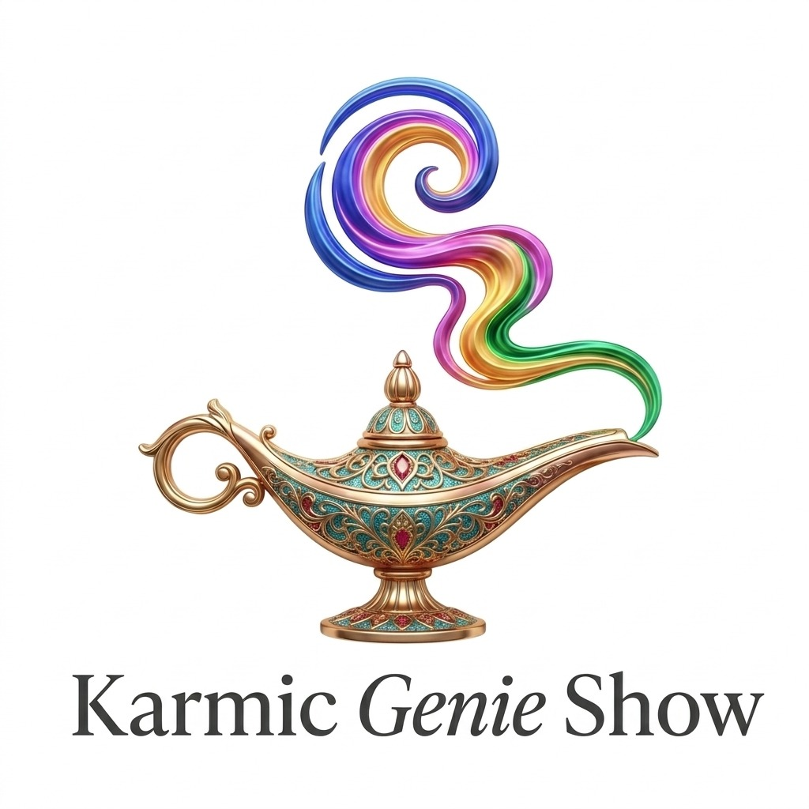
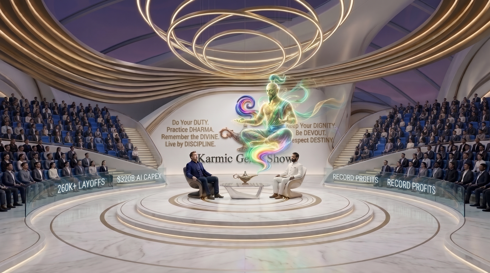

# Karmic Genie Show



> ***"What does Genie say — the 7D way?"***

**Karmic Genie Show** is a global public-forum & philosophical cinema series (`@karmicgenie`) examining the real human crossroads of our decade (`2020–2030`) through lived global voices, verified real-world metrics, and calm, open-ended saintly reflection.

---

## Channels & Live Releases

* **Prime YouTube Channel:** [`@karmicgenie` (*Karmic Genie Show*)](https://www.youtube.com/@karmicgenie)
* **Syndication Channel:** [`@influenzian`](https://www.youtube.com/@influenzian)
* **Season 1, Episode 1 Vertical Short (`70%` Contemplative Pacing):**
  * Watch on `@karmicgenie`: https://youtube.com/shorts/mpQlEJGyz1o
  * Watch on `@influenzian`: https://youtube.com/shorts/ns1kWtoNB5U

---

## Governed by *The 7D Way*

Flanking the jeweled-lamp emblem across the pure-white curved studio walls, seven warm brushed-gold maxims govern every episode:

| Left Stage Side Wall | Right Stage Side Wall |
| :--- | :--- |
| **1.** `Do Your DUTY.` | **5.** `Keep Your DIGNITY.` |
| **2.** `Practice DHARMA.` | **6.** `Be DEVOUT.` |
| **3.** `Remember the DIVINE.` | **7.** `Respect DESTINY.` |
| **4.** `Live by DISCIPLINE.` | |

### Official Show Theme Song (`64.40s`)
```text
The 7D Way
Duty, Dharma, Divine, Discipline, Dignity, Devout, Destiny
Karmic Genie Show!
```
* **Audio Master (`48kHz` Lossless WAV):** [`assets/theme/official_karmic_genie_7d_theme_song.wav`](assets/theme/official_karmic_genie_7d_theme_song.wav)
* **Broadcast `16:9` Opener (`1920x1080`):** [`renders/Karmic_Genie_Show_Official_7D_Theme_Opener_16x9.mp4`](renders/Karmic_Genie_Show_Official_7D_Theme_Opener_16x9.mp4)

---

## Studio Architecture (`v5` Subtle Side-Wall 7D Standard)



* **Pure-White Circular Marble Stage & Floor:** Concentric champagne-gold inlay rings keeping visual focus squarely on the human dialogue.
* **Mild Dark Violet-Magenta Vault Roof:** Tall stadium vault with concentric golden Halo chandeliers overhead.
* **Curved OLED Smart-Glass Metric Barriers:** Waist-high transparent display screens cleanly separating steeply elevated horizon-blue stadium grandstands from the host platform while displaying verified real-world episode metrics.
* **Two Chairs & The Dormant Lamp:** The Guest of Power sits in the dark sculptural chair; the Host sits in the pure-white sculptural chair. Between them on a floating glass table rests the ornate 24k gold, turquoise, and ruby **Genie Lamp**, remaining dormant through Act I until summoned with ***"What does Genie say — the 7D way?"***

---

## Repository Structure

```text
Karmic-Genie-Show/
├── README.md
├── docs/
│   └── SHOW_BIBLE_AND_7D_ARCHITECTURE.md
├── episodes/
│   └── S01E01_Employees_vs_Tech_CEO/
│       ├── S01E01_7Min_Movie_Screenplay.md
│       └── published_manifest.json
├── assets/
│   ├── logo/
│   │   └── official_karmic_genie_show_logo.jpg
│   ├── theme/
│   │   ├── official_karmic_genie_7d_theme_song.wav
│   │   └── official_karmic_genie_7d_theme_lyrics.txt
│   └── studio_v5_masters/
│       ├── v5_subtle_7d_stadium_16x9.jpg
│       ├── v5_subtle_7d_dormant_9x16.jpg
│       └── v5_subtle_7d_awakened_9x16.jpg
├── pipeline/
│   ├── build_official_7d_theme_opener_16x9.py
│   ├── build_s01e01_short_70pct.py
│   └── publish_s01e01_short.py
└── renders/
    ├── Karmic_Genie_Show_Official_7D_Theme_Opener_16x9.mp4
    └── Karmic_Genie_Show_S01E01_Tech_CEO_Short_70pct_9x16.mp4
```

---

## Season 1 Episodes

* **Episode 1 (`~07:10` Movie Screenplay):** [**Seven Chairs Around One Fire: Non-AI Teams, Hyperscaler Billions & The 2030 Clock**](episodes/S01E01_Employees_vs_Tech_CEO/S01E01_7Min_Movie_Screenplay.md)
  * Seven lived perspectives across **San Francisco**, **Seattle ↔ Mysuru**, **London**, **São Paulo**, **Tokyo**, **Munich**, and **Coimbatore**—grounded in verified `2025–2026` SEC `10-Q` CapEx filings, *Challenger*, *Layoffs.fyi*, *Stanford Digital Economy Lab*, and *SignalFire* data on non-cloud/non-AI restructurings.
