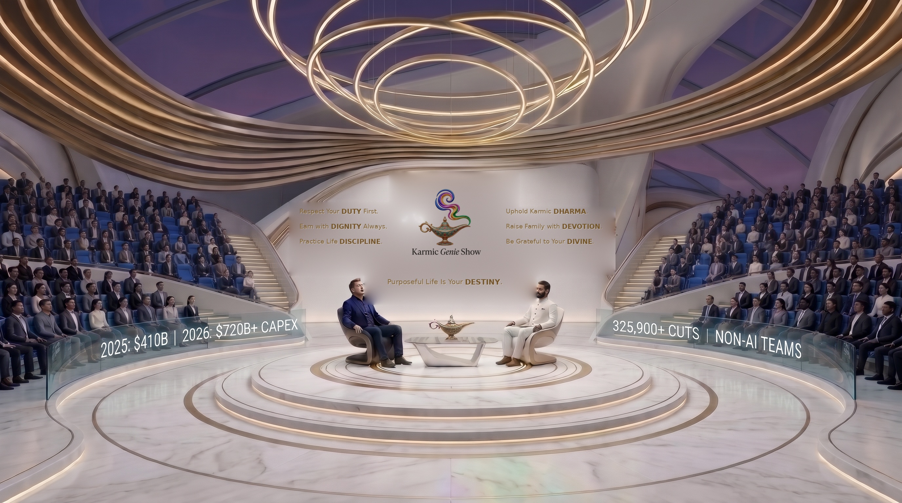
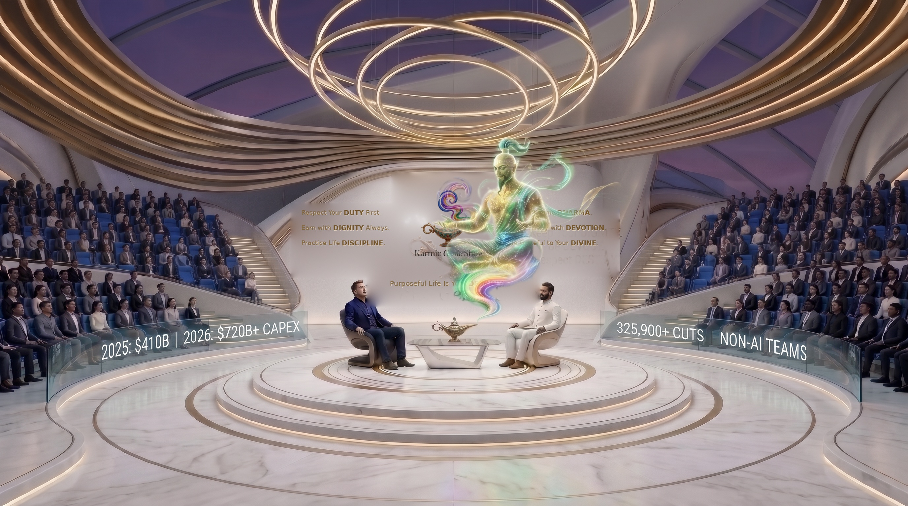

# Karmic Genie Show

## Storage Policy — Google Drive Is the Central Repository

> Updated 2026-11-08 by owner decision: Drive-first, GitHub = code only, **no Git LFS**.

- **All media lives on Google Drive** (`nagaraj957@gmail.com`): renders, clips, audio, thumbnails, bundles, masters, build artifacts. Project folder `Karmic_Genie_Show_S01E01` (Drive ID `1Mf-4vffVo6RRBhNFqTjzW3RAcC2bpbCy`) is what Colab/remote agents read.
- **GitHub is for code sync only**: scripts, `SKILL.md`, docs and small web assets. Never add `filter=lfs` rules, never commit media, OAuth tokens or `.env`.
- **Every build ends on Drive**: upload outputs with `gdrive mutate upload <file> --parent <folder-id>`, confirm the Drive size equals the local size, and record the Drive file ID.
- Dated handoff drops go in `remote_agent_sync_YYYYMMDD/` inside that folder (source bundle + README handoff + published cuts). Colab inputs: `karmic_genie_7d_colab_bundle.tar.gz`.
- **Never delete or overwrite a local binary until its Drive copy is verified** (size match). When a file name is reused by a newer build, upload the older cut under a distinct name first.
- Repo `Karmic-Genie-Show` ignores media via `.gitignore`; see its `STORAGE.md`. Published YouTube IDs are recorded in each episode's `published_manifest.json`.


> ***"What does Genie say — the 7D way?"***

**Karmic Genie Show** is a global public-forum & philosophical cinema series (`@karmicgenie`) examining the real human crossroads of our decade (`2020–2030`) through lived global voices, verified real-world metrics, and calm, open-ended saintly reflection.

---

## Channels & Live Releases

* **Prime YouTube Channel:** [`@karmicgenie` (*Karmic Genie Show*)](https://www.youtube.com/@karmicgenie)
* **Syndication Channel:** [`@influenzian`](https://www.youtube.com/@influenzian)
* **Season 1, Episode 1 — Full Widescreen Movie (`07:12`, `16:9`, `1080p`):**
  * **Watch on `@karmicgenie` (Prime):** https://www.youtube.com/watch?v=A1N84WhxCio
  * **Watch on `@influenzian` (Syndication):** https://www.youtube.com/watch?v=bhnhW3JtDc8
* **Season 1, Episode 1 — Vertical Short (`70%` Contemplative Pacing):**
  * Watch on `@karmicgenie`: https://youtube.com/shorts/mpQlEJGyz1o
  * Watch on `@influenzian`: https://youtube.com/shorts/ns1kWtoNB5U

---

## Governed by *The 7D Way* (`v6` Padded-Logo Stage Wall Standard)

Flanking the centered `Karmic Genie Show` jeweled-lamp emblem with generous breathing space on either side, seven warm brushed-gold maxims govern every episode:

```text
   Respect Your DUTY First.        [ Logo ]       Uphold Karmic DHARMA.
   Earn with DIGNITY Always.       [  Logo  ]       Raise Family with DEVOTION.
   Practice Life DISCIPLINE.       [  Logo    ]       Be Grateful to Your DIVINE.

                       Purposeful Life Is Your DESTINY.
```

### Official Show Theme Song (`64.40s`)
```text
The 7D Way
Duty, Dharma, Divine, Discipline, Dignity, Devout, Destiny
Karmic Genie Show!
```
* **Audio Master (`48kHz` Lossless WAV):** [`assets/theme/official_karmic_genie_7d_theme_song.wav`](assets/theme/official_karmic_genie_7d_theme_song.wav)
* **Broadcast `16:9` Opener (`1920x1080`):** [`renders/Karmic_Genie_Show_Official_7D_Theme_Opener_16x9.mp4`](renders/Karmic_Genie_Show_Official_7D_Theme_Opener_16x9.mp4)

---

## Studio Architecture (`v6` Symmetrical 7D Wall Standard)




* **Pure-White Circular Marble Stage & Floor:** Concentric champagne-gold inlay rings keeping visual focus squarely on the human dialogue.
* **Mild Dark Violet-Magenta Vault Roof:** Tall stadium vault with concentric golden Halo chandeliers overhead.
* **Curved OLED Smart-Glass Metric Barriers:** Waist-high transparent display screens cleanly separating steeply elevated horizon-blue stadium grandstands from the host platform while displaying verified real-world episode metrics.
* **Two Chairs & The Dormant Lamp:** The Guest of Power sits in the dark sculptural chair; the Host sits in the pure-white sculptural chair. Between them on a floating glass table rests the ornate 24k gold, turquoise, and ruby **Genie Lamp**, remaining dormant through Act I until summoned with ***"What does Genie say — the 7D way?"***

---

## Repository Structure

```text
Karmic-Genie-Show/
├── README.md
├── docs/
│   └── SHOW_BIBLE_AND_7D_ARCHITECTURE.md
├── episodes/
│   └── S01E01_Employees_vs_Tech_CEO/
│       ├── S01E01_7Min_Movie_Screenplay.md
│       ├── overlays/
│       ├── s01e01_youtube_thumbnail_16x9.jpg
│       └── published_manifest.json
├── assets/
│   ├── logo/
│   │   └── official_karmic_genie_show_logo.jpg
│   ├── theme/
│   │   ├── official_karmic_genie_7d_theme_song.wav
│   │   └── official_karmic_genie_7d_theme_lyrics.txt
│   └── studio_v5_masters/
│       ├── v6_7d_dormant_stage_16x9.jpg
│       ├── v6_7d_saintly_genie_16x9.jpg
│       ├── v5_subtle_7d_stadium_16x9.jpg
│       ├── v5_subtle_7d_dormant_9x16.jpg
│       └── v5_subtle_7d_awakened_9x16.jpg
├── pipeline/
│   ├── build_v6_7d_stage_masters.py
│   ├── render_s01e01_overlays.py
│   ├── generate_s01e01_full_film_clips.py
│   ├── topup_s01e01_clips.py
│   ├── prepare_v6_cinema_plates.py
│   ├── build_s01e01_full_film_16x9.py
│   ├── publish_s01e01_full_film.py
│   ├── build_official_7d_theme_opener_16x9.py
│   ├── build_s01e01_short_70pct.py
│   └── publish_s01e01_short.py
└── renders/
    ├── Karmic_Genie_Show_Official_7D_Theme_Opener_16x9.mp4
    └── Karmic_Genie_Show_S01E01_Tech_CEO_Short_70pct_9x16.mp4
```

---

## Season 1 Episodes

* **Episode 1 (`~07:10` Movie Screenplay):** [**Seven Chairs Around One Fire: Non-AI Teams, Hyperscaler Billions & The 2030 Clock**](episodes/S01E01_Employees_vs_Tech_CEO/S01E01_7Min_Movie_Screenplay.md)
  * Seven lived perspectives across **San Francisco**, **Seattle ↔ Mysuru**, **London**, **São Paulo**, **Tokyo**, **Munich**, and **Coimbatore**—grounded in verified `2025–2026` SEC `10-Q` CapEx filings, *Challenger*, *Layoffs.fyi*, *Stanford Digital Economy Lab*, and *SignalFire* data on non-cloud/non-AI restructurings.
