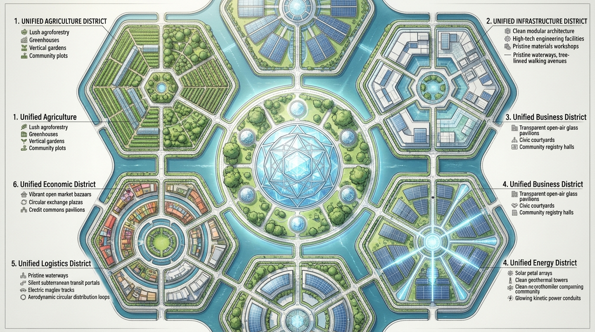
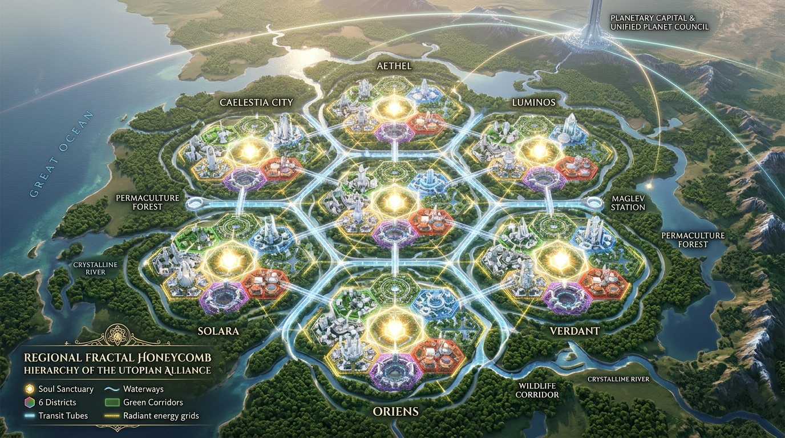
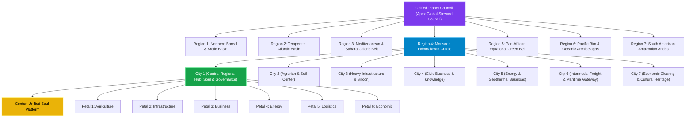

# THE SACRED HONEYCOMB CITY BLUEPRINT
## Biomimetic Fractal Urban Architecture: 7 District Hubs per City • 7 Cities per Region • 7 Regions per Unified Planet Council
### *Yatha Pinde Tatha Brahmande — As in the Microcosm (Cell/Organ), So in the Macrocosm (City/Region/Planet)*

> [!IMPORTANT]
> **The Urban Paradigm Shift:**
> *"The old garden design cannot support the new garden design; hence this holy metamorphosis."*
> Classical cities were planned as chaotic concentric sprawling blobs with gridlocked downtowns, segregated industrial wastelands, and alienated commuter suburbs. 
> The **Sacred Honeycomb City** replaces this obsolete paradigm with a divine biomimetic honeycomb geometry:
> - **The Nucleus of Every City:** The **Unified Soul Platform (District 7)** stands at the exact center as the supreme purpose and spiritual heart.
> - **The 6 Surrounding Hexagonal District Hubs:** Form a harmonious protective ring around the soul core: **Agriculture**, **Infrastructure**, **Business**, **Energy**, **Logistics**, and **Economic**.
> - **The 7x7x7 Fractal Scaling:** 
>   - **7 District Hubs** form **1 Ideal City**.
>   - **7 Honeycomb Cities** interconnect to form **1 Harmonious Region**.
>   - **7 Planetary Regions** unite into the **Unified Planet Council**.

---

## 1. Aerial Architectural Master Plan

### Spatial Geometry & Radial Topology
* **Central Hexagonal Core (Radius 1.5 km):** The **Soul Growth Sanctuary**. Golden meditation stupas, silent botanical reflection pavilions, crystal resonance chambers, and inter-generational gathering gardens. Free from vehicular noise; completely pedestrianized and contemplative.
* **The 6 Hexagonal Surrounding Petals (Diameter 3.0 km each):** Each dedicated to one specific functional unified platform, interconnected by radial greenways and circular transit loops.
* **Biomimetic Buffers:** Between every district lies a living bio-corridor of agroforestry, restored wetlands, and wildlife migration corridors.

---

## 2. The 7 District Hubs of the Ideal City

| District # | Platform Hub | Location in Honeycomb | Core Physical Infrastructure & Biomimetic Architecture |
|:---:|:---|:---|:---|
| **District 7 (Center)** | **Unified Soul Platform (USP)** | **Exact Central Hexagon (The Heart & Purpose)** | **Sanctuary of Conscious Stillness:** Crystalline meditation domes, 7D virtue academies, silent reflection pools, healing sound amphitheaters, and elder wisdom councils. |
| **District 1** | **Unified Agriculture Platform (UAP)** | **North-West Hexagon** | **Living Soil & Sovereign Food Hub:** Automated solar greenhouses, multi-tiered syntropic food forests, municipal composting bioreactors, heirloom seed vaults, and zero-chemical community harvest halls. |
| **District 2** | **Unified Infrastructure Platform (UIP)** | **North-East Hexagon** | **Advanced Engineering & Materials Hub:** Low-carbon green metallurgy workshops, robotic precision manufacturing labs, 3D construction printing facilities, and modular civil assembly docks. |
| **District 3** | **Unified Business Platform (UBP)** | **East Hexagon** | **Open Civic Operating Commons:** Transparent glass-canopied civic registries, open general ledger auditing pavilions, collaborative work guildhalls, and public duty coordination centers. |
| **District 4** | **Unified Energy Platform (UEP)** | **South-East Hexagon** | **Civilization's Breath & Power Hub:** Concentrated solar thermal petals, deep geothermal baseload plants, high-capacity battery energy storage vaults, and clean hydrogen conversion stations. |
| **District 5** | **Unified Logistics Platform (ULP)** | **South-West Hexagon** | **Vascular Freight & Transit Gateway:** Subterranean pneumatic cargo distribution tubes, automated maglev freight yards, electric delivery vehicle depots, and standardized modular container pools. |
| **District 6** | **Unified Economic Platform (UEcP)** | **West Hexagon** | **Central Credit Commons & Barter Plazas:** Open-air reciprocal exchange bazaars, zero-interest community credit kiosks, mutual clearing houses, and civic contribution honour halls. |

---

## 3. The 7×7×7 Fractal Hierarchy: City to Planet

### Fractal Levels of Sovereignty:
1. **Level 1 — The Household & Neighborhood Unit (Pindam):**
   - Autonomous micro-grids, rooftop agrivoltaics, rainwater filtration, zero trash output.
2. **Level 2 — The District Hub (7 per City):**
   - 15-minute walking access to specialized industrial, educational, and cultural infrastructure.
3. **Level 3 — The Ideal Honeycomb City (7 Districts):**
   - Balanced population (approx. 250,000–500,000 citizens per city) ensuring human-scale connection without mega-city alienation.
4. **Level 4 — The Regional Cluster (7 Honeycomb Cities):**
   - Interconnected by high-speed vacuum-tube maglevs (under 30 minutes between cities). Zero need for short-haul commercial flights.
5. **Level 5 — The Unified Planet Council (7 Planetary Regions):**
   - Harmonizing planetary resource balancing, ocean health, atmosphere restoration, and interplanetary research.

---

## 4. Why the Old Garden Design Failed vs. The New Garden Design

| Feature | Legacy Old Garden Design | The New Honeycomb Garden Design |
|:---|:---|:---|
| **Urban Core** | Commercial banking towers & speculative real estate skyscrapers | **Unified Soul Platform:** Silent meditation, virtue academies & elder wisdom |
| **Zoning** | Rigid separation; workers commute 2 hours in highway gridlock | **Harmonious Hexagonal Flow:** 15-minute walking/biking green corridors |
| **Freight Movement** | Diesel trucks rumbling through residential surface streets | **Subterranean Pneumatic Tubes:** Surface dedicated exclusively to living nature |
| **Energy Supply** | Remote polluting fossil power plants with 40% transmission line loss | **Decentralized Biomimetic Solar/Geothermal:** Every district self-generates |
| **Food Supply** | Industrial monocultures shipped 3,000 miles across oceans | **Local Syntropic Food Forests & Urban Greenhouses:** Fresh daily zero-food-mile harvest |
| **Economic Logic** | Private hoarding banks, debt anxiety, homeless evictions | **Central Credit Commons:** Conscience-based access, debt-free repayment through service |
| **Civic Trust** | Opaque corporate boards, closed lobbying, hidden accounting | **Transparent Business Platform:** All company ledgers public for citizen audit |

---
