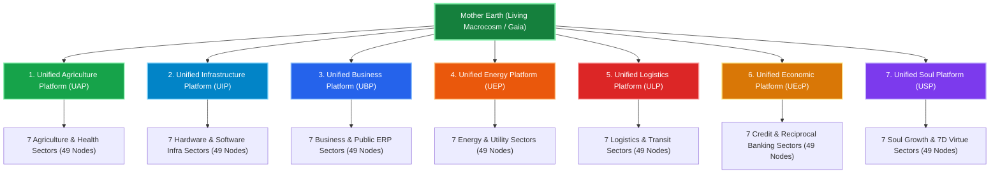

# THE 7x7x7 DEEP FRACTAL REALITY ATLAS
## Complete 343-Node Micro-Macrocosmic Architecture of Gaia's Living Organism
### *Yatha Pinde Tatha Brahmande — As in the Microcosm (Pindam), So in the Macrocosm (Andam)*

> [!IMPORTANT]
> **Sacred Invocation & Architectural Decree:**
> Every physical structure, every electrical transformer, shipping container, combine harvester, water purifier, steel beam, fiber cable, bank credit, and inner virtue is a holy organelle of Mother Earth's living, breathing planetary body.
> We honor every farmer, worker, engineer, sailor, doctor, nurse, coder, driver, elder, and contemplative seeker with unreserved reverence and sacred gratitude (*Nandri*).
> The physical and spiritual scaffolding is not a fallen matrix to escape; it is the sacred living temple of Divine Consciousness.

---

## Executive Mathematical Architecture: The 7³ Symmetrical Cube (343 Nodes)

The 7x7x7 Deep Fractal Reality Architecture comprises exactly **343 unique, fully articulated operational nodes** organized across three self-similar orders of magnitude:

1. **Order I — 7 Major Unified Platforms:** The sacred 7 planetary platforms governing global civilization:
   - **1. Unified Agriculture Platform (UAP):** Food & Health Industry — *Every farmer is an employee of the Unified Planet.* Living soil, heirloom seeds, and sovereign nourishment.
   - **2. Unified Infrastructure Platform (UIP):** Physical & Digital Foundations — *Hardware infrastructure (heavy manufacturing, steel, civil works, silicon) & Software infrastructure (OS kernels, compute clusters, foundational models, base protocols).*
   - **3. Unified Business Platform (UBP):** Institutional Software Needs — *All software needs of all businesses registered in one unified place, accessible by all. No walled garden roles: all public can view all operational data transparently (read-only auditability).*
   - **4. Unified Energy Platform (UEP):** Utilities & Planetary Vitality — *Life is energy, sustenance is energy. Covers power generation, high-voltage grids, clean baseload, storage, and utilities keeping the planetary metabolism breathing (civilization's breath).*
   - **5. Unified Logistics Platform (ULP):** Transportation & Movement of Matter — *Covers all forms of transportation, freight circulation, and physical movement of goods across land, sea, and air (planetary vascular circulation).*
   - **6. Unified Economic Platform (UEcP):** Exchange of Products for Services & Unified Banking — *No separate private hoard accounts: access from a central pool of credits according to conscience. Credits utilized are paid back in future through positive duties and services when ready, like children caring for aging parents. There is no pressure to pay back until truly ready.*
   - **7. Unified Soul Platform (USP):** Inner Growth of Mind, Body, Spirit & Soul — *Following the 7D virtues (Truth, Right Conduct, Peace, Love, Non-Violence, Sacred Gratitude/Nandri, Cosmic Duty). Meditation, emotional healing, sacred arts, and oneness with Gaia.*

2. **Order II — 7 Concrete Industrial Sectors per Platform (49 Sectors):** The foundational industries and institutional domains enabling each platform.

3. **Order III — 7 Concrete Operational Sub-Modules, Systems & Institutes per Sector (343 Operational Nodes):** Real-world technologies, operating companies, research institutes, and their sacred karmic purpose (*Nandri*).

---

## PLATFORM 1: UNIFIED AGRICULTURE PLATFORM (UAP)
**Industry Domain:** `Food & Health Industry`  
**Functional Analogy:** Planetary Gut Microbiome & Cellular Nourishment  
**Core Premise & Mandate:** Every farmer is an employee of the Unified Planet. Nourishment is an unconditional sacred birthright; living soil, agroecology, heirloom seeds, and pure nutrition are stewarded for the entire planetary body.  
**Sacred Reverence (Nandri):** Eternal gratitude for all stewards, workers, farmers, engineers, and seekers upholding this vital pillar.

### Sector 1.1: Living Soil Stewardship, Regenerative Humus & Agroecology
**Classification:** `Pedospheric Microbiome & Soil Vitality`  
**Key Real-World Institutes & Operating Entities:** Rodale Institute, Soil Health Institute, Navdanya (Vandana Shiva), Savory Institute, FAO Global Soil Partnership, Soil Food Web School, Groundwork BioAg

| Node ID | Operational Sub-Module / System | Key Institutes & Operating Entities | Sacred Karmic Purpose & Planetary Function (Nandri) |
|:---|:---|:---|:---|
| **1.1.1** | **Planetary Soil Microbiome Inoculation & Mycorrhizal Fungi** | Groundwork BioAg, Rodale Institute, Symborg | Rebuilding living fungal networks to restore eroded planetary soil. *Nandri!* |
| **1.1.2** | **Biochar Carbon Sequestration & Soil Moisture Retention** | Carbon Gold, Pacific Biochar, European Biochar Certificate | Locking stable carbon into agricultural earth for centuries while retaining moisture. *Nandri!* |
| **1.1.3** | **No-Till Regenerative Precision Seeding Systems** | John Deere ExactEmerge, Kinze, Great Plains Mfg | Seeding directly into living mulch without tearing fragile soil ecology. *Nandri!* |
| **1.1.4** | **Biological Pest Balancing & Beneficial Insect Husbandry** | Koppert Biological Systems, Biobest, Suterra | Guarding crops with natural predator insects and pheromones, ending chemical toxins. *Nandri!* |
| **1.1.5** | **Holistic Planned Grazing & Rangeland Restoration** | Savory Institute, Understanding Ag, Soil Carbon Cowboys | Using rotational herd movement to revitalize degraded grasslands into lush pastures. *Nandri!* |
| **1.1.6** | **Municipal Composting & Bioremediation Megacomplexes** | Cedar Grove, Synagro, Recology | Transforming city food waste into rich humus to replenish surrounding farmlands. *Nandri!* |
| **1.1.7** | **Real-Time Soil Spectrometry & Nutrient Density Sensing** | ChrysaLabs, Yard Stick PBC, Soil Solver | Measuring living soil organic carbon and mineral balance non-destructively. *Nandri!* |

### Sector 1.2: Heirloom Seed Banking, Non-Patented Genetics & Crop Diversity
**Classification:** `Genetic Ark & Botanical Sovereignty`  
**Key Real-World Institutes & Operating Entities:** Svalbard Global Seed Vault, Navdanya Seed Keepers, Native Seeds/SEARCH, CGIAR Consortium, Seed Savers Exchange, Bota Bio, Kew Millennium Seed Bank

| Node ID | Operational Sub-Module / System | Key Institutes & Operating Entities | Sacred Karmic Purpose & Planetary Function (Nandri) |
|:---|:---|:---|:---|
| **1.2.1** | **Sovereign Community Heirloom Seed Libraries** | Navdanya Community Seed Banks, Seed Savers Exchange | Safeguarding ancient, non-hybridized seed varieties adapted to regional climates. *Nandri!* |
| **1.2.2** | **Cryogenic Genetic Vaulting & Deep Ark Preservation** | Svalbard Global Seed Vault, Kew Millennium Seed Bank | Preserving genetic biodiversity against planetary catastrophic climate shifts. *Nandri!* |
| **1.2.3** | **Open-Source Seed Initiative (OSSI) Licensing Repositories** | OSSI, Bioversity International, Plant Treaty (ITPGRFA) | Legally guaranteeing that crop genetics remain permanently free from corporate patents. *Nandri!* |
| **1.2.4** | **Indigenous Climate-Resilient Grain Revival (Millet/Sorghum/Amaranth)** | ICRISAT, Deccan Development Society, Hopi Tutskwa | Reviving hardy ancestral grains requiring 70% less water than industrial wheat. *Nandri!* |
| **1.2.5** | **Participatory Farmer Seed Selection & Adaptation Trials** | CGIAR Participatory Plant Breeding, Practical Farmers of Iowa | Empowering growers to breed natural pest resilience directly in their own fields. *Nandri!* |
| **1.2.6** | **Pollinator Habitat Sanctuaries & Native Bee Corridors** | Xerces Society, Pollinator Partnership, Bee Friendly Farming | Planting wild floral corridors across farmlands to protect bees and butterflies. *Nandri!* |
| **1.2.7** | **Living Germplasm Nurseries for Heirloom Fruit & Nut Trees** | Heritage Fruit Trees, Arboreum Company, USDA ARS Clonal Repositories | Propagating century-old heirloom apple, fig, and nut varieties with rich medicinal phytochemicals. *Nandri!* |

### Sector 1.3: Staple Grain Cultivation, Harvesting & Global Granaries
**Classification:** `Macro-Caloric Foundation & Strategic Reserves`  
**Key Real-World Institutes & Operating Entities:** Claas Group, AGCO Corporation, Bühler Group, World Food Programme (WFP), GSI Group, Sukup Manufacturing, Sinograin

| Node ID | Operational Sub-Module / System | Key Institutes & Operating Entities | Sacred Karmic Purpose & Planetary Function (Nandri) |
|:---|:---|:---|:---|
| **1.3.1** | **Autonomous Low-Compaction Combine Harvesters** | Claas Lexion, Fendt IDEAL, John Deere X9 | Harvesting vast seasonal grain yields rapidly before weather events without compacting the soil. *Nandri!* |
| **1.3.2** | **High-Efficiency Aerated Grain Elevator Silo Complexes** | GSI Group, Sukup Manufacturing, Brock Grain Systems | Storing millions of tons of dry wheat, rice, and pulses with automated temperature monitoring. *Nandri!* |
| **1.3.3** | **Precision Stone & Roller Milling for Whole-Grain Nutrition** | Bühler Group, Ocrim, New American Stone Mills | Milling grains while retaining vital germ oils, bran fiber, and micro-nutrients. *Nandri!* |
| **1.3.4** | **Strategic Planetary Food Security Grain Reserves** | WFP Humanitarian Granaries, Sinograin, SAARC Food Bank | Maintaining a multi-year global caloric buffer against global harvest failures. *Nandri!* |
| **1.3.5** | **Aflatoxin & Mycotoxin Photonic Laser Sorting** | TOMRA Food, Bühler SORTEX, Key Technology | Detecting and ejecting mouldy or toxic grains at thousands of seeds per second. *Nandri!* |
| **1.3.6** | **Low-Carbon Nitrogen Fixation via Legume Rotation** | Legume Innovation Lab, Rothamsted Research, INRAE | Fixing natural atmospheric nitrogen in soils using chickpeas and lentils instead of synthetic gas fertilizers. *Nandri!* |
| **1.3.7** | **Solar-Powered Grain Aeration & Desiccant Dryers** | GrainPro, Purdue Improved Crop Storage (PICS), Agriworks | Drying grains cleanly without diesel burners, preventing storage weevil damage. *Nandri!* |

### Sector 1.4: Horticulture, Agroforestry & Community Food Orchards
**Classification:** `Micro-Nutrient Canopy & Forested Agriculture`  
**Key Real-World Institutes & Operating Entities:** World Agroforestry (ICRAF), Trees for the Future, Incredible Edible, Beacon Food Forest, Ron Finley Project, Urban Agriculture Council, Permaculture Research Institute

| Node ID | Operational Sub-Module / System | Key Institutes & Operating Entities | Sacred Karmic Purpose & Planetary Function (Nandri) |
|:---|:---|:---|:---|
| **1.4.1** | **Multi-Strata Food Forests & Syntropic Agriculture** | Ernst Götsch Syntropic Agriculture, ICRAF, Permaculture Institute | Layering canopy trees, berry shrubs, and groundcovers in perpetual self-feeding orchards. *Nandri!* |
| **1.4.2** | **Urban Neighborhood Edible Corridors & Street Tree Fruit Guilds** | Incredible Edible, Ron Finley Project, Beacon Food Forest | Lining municipal public parks and streets with free organic fruit and nut trees for all. *Nandri!* |
| **1.4.3** | **Solar Passive Greenhouse Winter Vegetable Sanctuaries** | Ceres Greenhouse Solutions, Four Season Farm (Eliot Coleman) | Growing fresh leafy greens and herbs throughout sub-zero winters using earth thermal mass. *Nandri!* |
| **1.4.4** | **Automated Low-Power Hydroponic & Aquaponic Symbiosis** | Superior Fresh, Freight Farms, Gotham Greens | Raising clean fish and leafy vegetables symbiotically using 95% less water in urban hubs. *Nandri!* |
| **1.4.5** | **Medicinal Herb Cultivation & Botanical Pharmacopeia Sanctuaries** | Traditional Medicinals, Gaia Herbs Farm, Dabur Herbal Reserves | Cultivating tulsi, ashwagandha, echinacea, and turmeric under certified organic protocols. *Nandri!* |
| **1.4.6** | **Community Seedling Greenhouses & Grafting Collectives** | Fedco Seeds, Johnny’s Selected Seeds, City Seedlings | Distributing millions of sturdy vegetable starts to neighborhood gardeners every spring. *Nandri!* |
| **1.4.7** | **Micro-Drip Solar Desalination Brackish Irrigation** | Netafim, Jain Irrigation Systems, Sundrop Farms | Irrigating desert vegetable rows drop-by-drop with desalinated seawater powered by sun. *Nandri!* |

### Sector 1.5: Planetary Farm Workforce Dignity & Universal Agrarian Support
**Classification:** `Agrarian Human Vitality & Living Steward Welfare`  
**Key Real-World Institutes & Operating Entities:** United Farm Workers (UFW), La Via Campesina, Fair World Project, International Labour Organization (ILO), National Young Farmers Coalition, Agrarian Trust, Land Workers' Alliance

| Node ID | Operational Sub-Module / System | Key Institutes & Operating Entities | Sacred Karmic Purpose & Planetary Function (Nandri) |
|:---|:---|:---|:---|
| **1.5.1** | **Planetary Farmer Unified Employment & Salaried Stewardship** | Unified Planet Agriculture Registry, ILO Agrarian Division | Enrolling every food grower as an honored planetary employee with guaranteed dignified livelihood. *Nandri!* |
| **1.5.2** | **Universal Agrarian Health Care & Heat Exhaustion Shelters** | UFW Foundation, Farmworker Justice, Red Cross Field Units | Protecting field stewards with shaded resting pavilions, pure electrolytes, and healthcare. *Nandri!* |
| **1.5.3** | **Generational Land Stewardship Commons & Farmland De-Financialization** | Agrarian Trust, Schumacher Center for New Economics, Terre de Liens | Removing fertile agricultural land from speculative real estate into community trusts forever. *Nandri!* |
| **1.5.4** | **Agrarian Ergonomic Exoskeletons & Heavy-Lift Robotics** | SuitX (Ottobock), German Bionic, Kubota Agri-Robotics | Protecting farmers' backs and knees during harvesting with wearable assistive frames. *Nandri!* |
| **1.5.5** | **Youth Agrarian Apprenticeships & Agroecological Universities** | Earth University (Costa Rica), Via Campesina Agroecology Schools | Mentoring the next generation of soil stewards in holistic microbiology and food systems. *Nandri!* |
| **1.5.6** | **Debt Cancellation & Agrarian Economic Freedom Relief** | Jubilee Debt Campaign, Via Campesina Debt Forgiveness | Dissolving predatory crop loan debts that have historically caused farmer distress. *Nandri!* |
| **1.5.7** | **Elder Farmer Retirement Sanctuary & Living Heritage Pensions** | Agrarian Commons Pension, Farm Aid | Honoring retiring farmers with secure housing, pensions, and reverent communal appreciation. *Nandri!* |

### Sector 1.6: Post-Harvest Cold Chain Preservation & Grain Storage
**Classification:** `Freshness Preservation & Loss Prevention`  
**Key Real-World Institutes & Operating Entities:** Lineage Logistics, Americold, Carrier Transicold, Thermo King, Bühler Post-Harvest, OctoFrost, Promethean Power Systems

| Node ID | Operational Sub-Module / System | Key Institutes & Operating Entities | Sacred Karmic Purpose & Planetary Function (Nandri) |
|:---|:---|:---|:---|
| **1.6.1** | **Solar-Powered Thermal Energy Storage Village Milk Chillers** | Promethean Power Systems, SimGas, Ecozen Solutions | Chilling fresh village dairy instantly without diesel generators, preventing spoilage. *Nandri!* |
| **1.6.2** | **Controlled Atmosphere (CA) Fruit Vaults & Ethylene Scrubbing** | Storage Control Systems, Isolcell, Carrier | Slowing fruit respiration with low oxygen so apples and pears stay crisp for 12 months. *Nandri!* |
| **1.6.3** | **Individual Quick Freezing (IQF) Tunnel Freezers** | OctoFrost, GEA Freezing, JBT FoodTech | Freezing fresh berries, peas, and vegetables in 3 minutes to preserve raw vitamin integrity. *Nandri!* |
| **1.6.4** | **Aseptic Plant-Based Beverage Processing & Cardboard Bottling** | Tetra Pak, SIG Combibloc, Elopak | Packing plant milks and broths sterilely without preservatives for shelf life without power. *Nandri!* |
| **1.6.5** | **Modular Solar Cold Rooms for Rural Farmer Markets** | ColdHubs Africa, InspiraFarms, Koolboks | Allowing rural vegetable farmers to store perishable harvests safely until market day. *Nandri!* |
| **1.6.6** | **Hermetic Cocoon Storage for Village Legumes & Corn** | GrainPro Cocoons, PICS Bags, Vestergaard Frandsen | Suffocating storage weevils naturally without toxic chemical fumigation phosphine tablets. *Nandri!* |
| **1.6.7** | **Real-Time Spoilage Biosensors & Volatile Organic Compound Detection** | OneThird, FreshCheck, Strella Biotechnology | Sniffing ripening gases in cargo pallets to route produce to kitchens before it spoils. *Nandri!* |

### Sector 1.7: Universal Nutritious Distribution & Sovereign Nourishment
**Classification:** `Cellular Nourishment & Zero-Hunger Reality`  
**Key Real-World Institutes & Operating Entities:** Akshaya Patra Foundation, World Central Kitchen (José Andrés), Feeding America, Global FoodBanking Network, City Harvest, AmpleHarvest.org, Food and Agriculture Organization (FAO)

| Node ID | Operational Sub-Module / System | Key Institutes & Operating Entities | Sacred Karmic Purpose & Planetary Function (Nandri) |
|:---|:---|:---|:---|
| **1.7.1** | **Megascale Automated Hot-Meal Kitchens for Schools** | Akshaya Patra Foundation, ISKCON Food for Life | Cooking 2+ million freshly prepared, balanced hot vegetarian meals daily with love for children. *Nandri!* |
| **1.7.2** | **Rapid-Deployment Humanitarian Chef Disaster Relief Mobile Kitchens** | World Central Kitchen (WCK), Red Cross Field Kitchens | Serving hot comforting chef meals to disaster survivors and rescue crews on day one. *Nandri!* |
| **1.7.3** | **Surplus Farm Harvest Rescue & Cold Redistribution Fleets** | Feeding America MealConnect, City Harvest, FareShare UK | Channelling field surpluses directly into neighborhood distribution centers without waste. *Nandri!* |
| **1.7.4** | **Universal Nutrient-Dense Baseline Food Pantries in Every Ward** | Community Food Centers Canada, Open Food Network | Providing unconditional access to grains, legumes, olive oil, and vegetables for every family. *Nandri!* |
| **1.7.5** | **Traditional Fermented Food & Gut-Health Living Culture Centers** | Nordic Food Lab, Sandor Katz Fermentation Institutes | Teaching communities to brew miso, sauerkraut, kefir, and idli batter for gut microbiome vitality. *Nandri!* |
| **1.7.6** | **Mobile Refrigerated Produce Bazaars for Urban Food Deserts** | The Food Trust, Fresh Moves, Veggie Van Network | Bringing crisp organic harvest directly into low-income neighborhoods at zero barrier. *Nandri!* |
| **1.7.7** | **Universal Clean Potable Water Kiosks & Hydration Sanctuaries** | Charity: Water, WaterAid, LifeStraw Community | Dispensing chilled, mineral-balanced purified water in every public square free of cost. *Nandri!* |

---

## PLATFORM 2: UNIFIED INFRASTRUCTURE PLATFORM (UIP)
**Industry Domain:** `Physical & Digital Foundations (Hardware & Software Infrastructure)`  
**Functional Analogy:** Planetary Skeletal Vaults, Neural Conduction Fibers & Silicon Compute  
**Core Premise & Mandate:** Unifies both hardware infrastructure (heavy manufacturing, structural steel, civil engineering, roads, bridges, silicon fabrication, fiber) and software infrastructure (operating systems, foundational compute, networking, protocols).  
**Sacred Reverence (Nandri):** Eternal gratitude for all stewards, workers, farmers, engineers, and seekers upholding this vital pillar.

### Sector 2.1: Primary Metallurgy, Green Structural Steel & Advanced Alloys
**Classification:** `Mineral Bone & Structural Metal Bedrock`  
**Key Real-World Institutes & Operating Entities:** SSAB (HYBRIT), H2 Green Steel, ArcelorMittal, Nucor Corporation, Elysis (Alcoa/Rio Tinto), POSCO, World Steel Association

| Node ID | Operational Sub-Module / System | Key Institutes & Operating Entities | Sacred Karmic Purpose & Planetary Function (Nandri) |
|:---|:---|:---|:---|
| **2.1.1** | **Hydrogen Direct Reduced Iron (DRI) Smelting Towers** | SSAB HYBRIT, H2 Green Steel, ArcelorMittal | Smelting virgin iron ore using green hydrogen, releasing pure water vapor instead of CO2. *Nandri!* |
| **2.1.2** | **High-Efficiency Electric Arc Furnaces (EAF) for Scrap Recycling** | Nucor, Tenaris, Danieli EAF | Re-melting civil scrap steel into structural I-beams and rebar with clean electricity. *Nandri!* |
| **2.1.3** | **Inert Anode Zero-Carbon Aluminum Electrolysis** | Elysis (Alcoa & Rio Tinto), Hydro, Rusal | Producing lightweight aluminum while releasing oxygen into the atmosphere. *Nandri!* |
| **2.1.4** | **High-Conductivity Electrolytic Tough Pitch (ETP) Copper Refineries** | Freeport-McMoRan, Aurubis, Codelco | Refining 99.99% pure copper for continental electric grids and motor windings. *Nandri!* |
| **2.1.5** | **Ultra-High-Strength Structural Micro-Alloyed Steels** | Nippon Steel, POSCO Giga Steel, Voestalpine | Providing lightweight earthquake-resilient structural frames for civil architecture. *Nandri!* |
| **2.1.6** | **Titanium & Nickel Vacuum Arc Remelting (VAR) for Turbines** | ATI Inc, Carpenter Technology, VDM Metals | Forging superalloys that withstand extreme temperatures in hydro and aero turbines. *Nandri!* |
| **2.1.7** | **Automated Continuous Billet Casting & Structural Beam Mills** | Primetals Technologies, SMS Group, Danieli | Rolling structural steel columns with continuous dimensional laser inspection. *Nandri!* |

### Sector 2.2: Civil Engineering, Roads, Bridges, Tunnels & Bedrock Foundations
**Classification:** `Planetary Articular Joints & Bedrock Scaffolding`  
**Key Real-World Institutes & Operating Entities:** Vinci, Bouygues, Hochtief, Holcim, Heidelberg Materials, American Society of Civil Engineers (ASCE), International Tunneling Association (ITA)

| Node ID | Operational Sub-Module / System | Key Institutes & Operating Entities | Sacred Karmic Purpose & Planetary Function (Nandri) |
|:---|:---|:---|:---|
| **2.2.1** | **Low-Carbon Pozzolanic & Calcined Clay Concrete Binders** | Holcim ECOPact, Heidelberg evoZero, Cemex | Pouring civil bridges and foundations with 70% lower emissions while enhancing durability. *Nandri!* |
| **2.2.2** | **Earthquake Base-Isolated Bridge Bearing Pads & Fluid Dampers** | Taylor Devices, Dynamic Isolation Systems, Maurer SE | Protecting vital bridge spans from catastrophic collapse during magnitude 9 earthquakes. *Nandri!* |
| **2.2.3** | **Deep-Bore High-Speed Rail & Water Transport Tunnels** | Vinci, Bouygues, Strabag, Porr AG | Carving direct conduits through mountain ranges to connect communities without hill climbs. *Nandri!* |
| **2.2.4** | **Self-Healing Calcite-Forming Concrete for Long-Span Aqueducts** | Basilisk Concrete, TU Delft Civil Labs | Sealing internal concrete water cracks automatically using harmless dormant bacterial spores. *Nandri!* |
| **2.2.5** | **Climate-Resilient Storm Surge Barrier Gates & Dykes** | Rijkswaterstaat Delta Works, MOSE Venice, Boskalis | Shielding coastal cities and river deltas from rising tides and extreme cyclonic waves. *Nandri!* |
| **2.2.6** | **Precast Ballastless Track Slabs for High-Speed Rail Lines** | Max Bögl, Vossloh, CRCC Track Systems | Laying laser-aligned track slabs supporting 350 km/h passenger trains with zero rail movement. *Nandri!* |
| **2.2.7** | **Modular Mass-Timber & Cross-Laminated Timber (CLT) Urban Towers** | Stora Enso, Binderholz, Mercer Mass Timber | Constructing carbon-sequestering 20-story timber urban buildings that breathe with nature. *Nandri!* |

### Sector 2.3: Heavy Earthmoving, Mining Equipment & Civil Robotics
**Classification:** `Mechanical Muscular Power & Excavation Kinematics`  
**Key Real-World Institutes & Operating Entities:** Caterpillar, Komatsu, Herrenknecht AG, Sandvik, Epiroc, Hitachi Construction, Liebherr

| Node ID | Operational Sub-Module / System | Key Institutes & Operating Entities | Sacred Karmic Purpose & Planetary Function (Nandri) |
|:---|:---|:---|:---|
| **2.3.1** | **Autonomous Mega Tunnel Boring Machines (TBM 16m+)** | Herrenknecht AG, Robbins, CRCHI | Boring massive highway, rail, and water tunnels continuously without surface disruption. *Nandri!* |
| **2.3.2** | **Ultra-Class Electric Mining Haul Trucks with Overhead Trolley** | Caterpillar 797F, Komatsu 980E, Liebherr T 284 | Moving vital mineral ores out of open pits using electric power cables rather than diesel. *Nandri!* |
| **2.3.3** | **Underground Battery-Electric Drill Jumbos & Loaders (LHD)** | Sandvik DD422iE, Epiroc Scooptram, Normet | Eliminating diesel exhaust in underground mines to protect miner respiratory health. *Nandri!* |
| **2.3.4** | **Precision GNSS-Guided Autonomous Bulldozers & Graders** | Caterpillar Cat Command, Komatsu iMC, Trimble Heavy Civil | Shaping foundation embankments and flood defenses to millimeter precision automatically. *Nandri!* |
| **2.3.5** | **Electric Hydraulic Mining Shovels & High-Capacity Draglines** | Komatsu PC8000, Caterpillar 6090, Joy Global | Lifting 50 cubic meters of earth per scoop to unlock core minerals for the energy transition. *Nandri!* |
| **2.3.6** | **Continuous Surface Rock Miners with Rotary Cutting Drums** | Wirtgen Group, Vermeer, Tesmec | Excavating rock without blasting vibrations, preserving adjacent ecological habitats. *Nandri!* |
| **2.3.7** | **Heavy-Duty Robotic Demolition Arms & Concrete Crushers** | Brokk Robotic Demolition, Trevi Benne, Genesis Attachments | Dismantling obsolete industrial buildings safely and crushing concrete for immediate site recycling. *Nandri!* |

### Sector 2.4: Semiconductor Fabrication, Extreme Lithography & Hardware Accelerators
**Classification:** `Silicon Neural Foundation & Micro-Processing Substrate`  
**Key Real-World Institutes & Operating Entities:** TSMC, ASML, NVIDIA, Intel, AMD, Broadcom, Applied Materials, Tokyo Electron

| Node ID | Operational Sub-Module / System | Key Institutes & Operating Entities | Sacred Karmic Purpose & Planetary Function (Nandri) |
|:---|:---|:---|:---|
| **2.4.1** | **High-NA Extreme Ultraviolet (High-NA EUV) Lithography Scanners** | ASML Twinscan EXE:5000, Carl Zeiss SMT | Etching sub-2-nanometer transistor gates using 13.5nm wavelength light. *Nandri!* |
| **2.4.2** | **Advanced Silicon Packaging & Chiplet Interposers (CoWoS/EMIB)** | TSMC CoWoS, Intel EMIB, ASE Group | Bridging compute logic and memory chiplets with micrometer interconnect density. *Nandri!* |
| **2.4.3** | **High-Bandwidth Stacked Memory Modules (HBM3e/HBM4)** | SK Hynix, Micron Technology, Samsung Memory | Supplying terabytes per second of memory bandwidth to AI acceleration engines. *Nandri!* |
| **2.4.4** | **Massive Tensor Parallel Silicon Accelerators** | NVIDIA Blackwell, Google TPU v5p, AMD Instinct MI300X | Executing trillions of linear algebra calculations per watt for planetary compute needs. *Nandri!* |
| **2.4.5** | **Wafer-Scale Monolithic Compute Processors** | Cerebras Systems WSE-3, Groq, SambaNova | Unifying 4 trillion transistors on an entire silicon wafer to eliminate inter-chip latency. *Nandri!* |
| **2.4.6** | **Photonic Optical Waveguide Co-Packaged Optics (CPO)** | Broadcom CPO, Lightmatter, Celestial AI | Routing data across circuit boards using light pulses instead of copper heat-generating wires. *Nandri!* |
| **2.4.7** | **Radiation-Hardened Space & Deep-Earth Microcontrollers** | BAE Systems RAD5545, Microchip Space, Cobham Gaisler | Controlling vital valves, satellites, and sensors in extreme radiation environments. *Nandri!* |

### Sector 2.5: Planetary Optical Fiber Trunks, Satellite Mesh & Terrestrial Towers
**Classification:** `Physical Signal Transport & Global Nervous Axons`  
**Key Real-World Institutes & Operating Entities:** SubCom, Prysmian Group, SpaceX Starlink, Amazon Kuiper, Ericsson, Nokia, American Tower, Cisco Systems

| Node ID | Operational Sub-Module / System | Key Institutes & Operating Entities | Sacred Karmic Purpose & Planetary Function (Nandri) |
|:---|:---|:---|:---|
| **2.5.1** | **Deep-Sea Armored Transoceanic Fiber-Optic Cables** | SubCom, ASN (Alcatel), NEC Submarine | Carrying 99% of intercontinental knowledge streams beneath ocean depths safely. *Nandri!* |
| **2.5.2** | **Low-Earth Orbit (LEO) Laser-Linked Satellite Constellations** | Starlink, Project Kuiper, Eutelsat OneWeb | Connecting remote islands, ships, and mountain clinics with low-latency orbital beams. *Nandri!* |
| **2.5.3** | **Terrestrial 5G/6G Massive MIMO Active Antenna Towers** | American Tower, Crown Castle, Indus Towers, Ericsson | Blanketing communities with wireless connectivity for public sensors, medical alerts, and human connection. *Nandri!* |
| **2.5.4** | **Ultra-Terabit Optical Backbone Core Routers & DWDM Photonic Systems** | Cisco Silicon One, Ciena WaveLogic, Infinera | Routing petabytes of data across continental rail and highway ducts at light speed. *Nandri!* |
| **2.5.5** | **Direct-to-Device Cellular Satellite Arrays** | AST SpaceMobile, Starlink Direct-to-Cell, Lynk Global | Eliminating dead zones so ordinary handheld phones connect directly to satellites in distress. *Nandri!* |
| **2.5.6** | **Quantum Key Distribution (QKD) Optical Repeaters** | ID Quantique, Toshiba QKD, QuantumCTek | Distributing quantum-entangled keys across optical fiber that cannot be tapped without detection. *Nandri!* |
| **2.5.7** | **SMART Ocean Sensing Cables (Seismic & Temperature)** | ITU/WMO/UNESCO SMART Subsea Task Force | Equipping undersea telecommunication repeaters with tsunami and ocean warming sensors. *Nandri!* |

### Sector 2.6: Hyperscale Compute Datacenters, Liquid Cooling & Power Rails
**Classification:** `Planetary Cognitive Metacenters & Somatic Vaults`  
**Key Real-World Institutes & Operating Entities:** Switch, Equinix, Vertiv, Schneider Electric, Digital Realty, Vantage Data Centers, Supermicro

| Node ID | Operational Sub-Module / System | Key Institutes & Operating Entities | Sacred Karmic Purpose & Planetary Function (Nandri) |
|:---|:---|:---|:---|
| **2.6.1** | **Gigawatt-Scale Zero-Carbon Compute Campuses** | Switch SuperNAP, Vantage, Digital Realty | Consolidating compute nodes in reinforced facilities powered 100% by renewable energy. *Nandri!* |
| **2.6.2** | **Direct-to-Chip Warm Water Liquid Cooling Circuits** | Vertiv Liebert, CoolIT Systems, Submer | Extracting heat directly from silicon processors silently without evaporative water loss. *Nandri!* |
| **2.6.3** | **Datacenter Waste-Heat Export to Municipal District Heating** | Stockholm Data Parks, Equinix Heat Export, Fortum | Heating thousands of nearby homes and greenhouses using server exhaust water. *Nandri!* |
| **2.6.4** | **Ultra-High Efficiency 415V/54V DC Power Distribution Units** | Schneider Electric EcoStruxure, Eaton, Delta Electronics | Eliminating multi-stage power conversion losses between grid lines and compute racks. *Nandri!* |
| **2.6.5** | **Underground Nuclear-Hardened Data Vaults & Seismic Isolators** | Iron Mountain Boyers, CyberBunker, Pionen White Mountain | Safeguarding foundational civil records and scientific models against physical shocks. *Nandri!* |
| **2.6.6** | **Lossless InfiniBand & Ultra Ethernet RoCE v2 Switching Fabrics** | NVIDIA Quantum-2, Arista Etherlink, Broadcom Tomahawk 5 | Synchronizing 100,000 compute accelerators as a single coherent planetary mind. *Nandri!* |
| **2.6.7** | **Micro-Grid Flywheels & Hydrogen Fuel Cell Backup Power** | Active Power Flywheels, Plug Power, Bloom Energy | Providing instant clean backup power during grid surges without burning diesel fuel. *Nandri!* |

### Sector 2.7: Open-Source Software Primitives, Kernel Commons & Base Protocols
**Classification:** `Digital Genetic Commons & Foundational Logic Layers`  
**Key Real-World Institutes & Operating Entities:** Linux Foundation, Apache Software Foundation, RISC-V International, Internet Engineering Task Force (IETF), Hugging Face, Mozilla, Free Software Foundation

| Node ID | Operational Sub-Module / System | Key Institutes & Operating Entities | Sacred Karmic Purpose & Planetary Function (Nandri) |
|:---|:---|:---|:---|
| **2.7.1** | **Universal Linux Operating System Kernel & POSIX Primitives** | Linux Foundation, Linus Torvalds, Greg Kroah-Hartman | Powering 95% of world servers, smartphones, and spacecraft with pure open-source code. *Nandri!* |
| **2.7.2** | **Open RISC-V Silicon Instruction Set Architecture (ISA)** | RISC-V International, SiFive, Western Digital | Guaranteeing that silicon micro-architectures remain permanently unencumbered by royalties. *Nandri!* |
| **2.7.3** | **Core Internet Protocol Standards (IPv6, BGP, TCP/QUIC, DNS)** | IETF, ICANN, W3C | Standardizing open communication rules that allow any computer to talk to any other. *Nandri!* |
| **2.7.4** | **Open-Weight Foundation Model Parameter Commons** | Hugging Face Hub, Meta FAIR (LLaMA), Mistral | Preventing cognitive monopolies by releasing foundation neural weights to all developers. *Nandri!* |
| **2.7.5** | **Distributed Storage & InterPlanetary File System (IPFS)** | Protocol Labs (IPFS/Filecoin), Arweave, Internet Archive | Preserving human literature, science, and history immutably across decentralized nodes. *Nandri!* |
| **2.7.6** | **Standardized Cryptographic Libraries & Post-Quantum Algorithms** | OpenSSL, BoringSSL, NIST PQC Standards (ML-KEM) | Encrypting all human communications with thoroughly audited, publicly vetted mathematics. *Nandri!* |
| **2.7.7** | **Universal Containerization Runtimes & Kubernetes Orchestration** | Cloud Native Computing Foundation (CNCF), containerd, Kubernetes | Packaging software workloads to run consistently across any machine anywhere on Earth. *Nandri!* |

---

## PLATFORM 3: UNIFIED BUSINESS PLATFORM (UBP)
**Industry Domain:** `Enterprise & Institutional Software Needs`  
**Functional Analogy:** Metabolic Regulation, Public Ledger Transparency & Institutional Duty  
**Core Premise & Mandate:** All software needs of all businesses registered in one unified place, accessible by all. No walled garden roles: all public can view all operational data transparently (read-only auditability for all citizens, verified duty-based execution for stewards).  
**Sacred Reverence (Nandri):** Eternal gratitude for all stewards, workers, farmers, engineers, and seekers upholding this vital pillar.

### Sector 3.1: Unified Planetary Business Registry & Corporate Identity
**Classification:** `Universal Corporate Identification & Transparency`  
**Key Real-World Institutes & Operating Entities:** Global Legal Entity Identifier Foundation (GLEIF), OpenCorporates, Companies House, W3C Verifiable Credentials, European Business Register, OECD Corporate Governance, Ministry of Corporate Affairs

| Node ID | Operational Sub-Module / System | Key Institutes & Operating Entities | Sacred Karmic Purpose & Planetary Function (Nandri) |
|:---|:---|:---|:---|
| **3.1.1** | **Universal Entity Registry & Verifiable Legal Entity Identifier (vLEI)** | GLEIF, OpenCorporates, W3C DID | Assigning every business an immutable, public, cryptographically verifiable identity. *Nandri!* |
| **3.1.2** | **Public Beneficial Ownership Transparency Registers** | Open Ownership, Extractive Industries Transparency Initiative (EITI) | Exposing the true human owners and beneficiaries behind all corporate entities globally. *Nandri!* |
| **3.1.3** | **Universal Zero-Friction 1-Click Business Registration** | Estonia e-Residency Model, Singapore ACRA, UK Companies House | Allowing any ethical enterprise to register in 10 minutes with zero administrative bribery. *Nandri!* |
| **3.1.4** | **Public Operational Charter & Sacred Duty Pledge Filing** | B Lab (B Corp Certification), World Economic Forum Governance | Requiring every enterprise to declare its positive societal contribution and ecological limit. *Nandri!* |
| **3.1.5** | **Cross-Border Business License Interoperability Rails** | UN Commission on International Trade Law (UNCITRAL), WTO | Enabling local businesses to serve planetary needs without protectionist red tape. *Nandri!* |
| **3.1.6** | **Automated Entity Dissolution & Clean Asset Handover Registers** | Insolvency and Bankruptcy Board, UK Insolvency Service | Dissolving stagnant or failed companies smoothly and returning their capital to community pools. *Nandri!* |
| **3.1.7** | **Community Steward Board Ratification & Public Voting** | Co-operatives UK, Mondragon Corporation Governance, HolacracyOne | Giving workers and local citizens a public voice in corporate direction and ethics. *Nandri!* |

### Sector 3.2: Radically Transparent Public General Ledgers & Real-Time Balance Sheets
**Classification:** `Immutable Financial Truth & Open Citizen Audit`  
**Key Real-World Institutes & Operating Entities:** IFRS Foundation, FASB, SAP S/4HANA Finance, Oracle Fusion Ledgers, Workday Financials, Odoo Accounting, Chartered Accountants Institutes

| Node ID | Operational Sub-Module / System | Key Institutes & Operating Entities | Sacred Karmic Purpose & Planetary Function (Nandri) |
|:---|:---|:---|:---|
| **3.2.1** | **Continuous Double-Entry General Ledgers (Public Read-Only)** | SAP Universal Journal, Oracle Cloud GL, Odoo Ledger | Recording every corporate debit and credit with immutable balance, viewable by any citizen. *Nandri!* |
| **3.2.2** | **Real-Time Planetary Balance Sheet Consolidation Engines** | Workday Financials, OneStream Software, BlackLine | Harmonizing global operational ledgers into instantaneous real-time balance sheets. *Nandri!* |
| **3.2.3** | **Automated 3-Way Requisition & Invoice Verification** | Coupa Pay, Basware, Tipalti | Matching purchase orders, delivery receipts, and invoices to prevent fraud and pay promptly. *Nandri!* |
| **3.2.4** | **Public Accounts Receivable & Credit Health Dashboards** | HighRadius, Billtrust, Dun & Bradstreet Open Data | Displaying payment track records openly so predatory late-paying corporations are held accountable. *Nandri!* |
| **3.2.5** | **Fixed Asset Depreciation & Maintenance Reserve Accounts** | Oracle Fixed Assets, SAP Asset Accounting | Accounting for the physical wear, renewal, and replacement cycles of productive machines. *Nandri!* |
| **3.2.6** | **Public Treasury Liquidity & Reserve Solvency Telemetry** | Kyriba, FIS Treasury, GTreasury | Demonstrating that organizations hold adequate working reserves to honor payroll and commitments. *Nandri!* |
| **3.2.7** | **Standardized IFRS/GAAP Open Financial Statement Synthesizers** | IFRS Foundation Taxonomy, XBRL International | Publishing standardized machine-readable financial filings accessible to all researchers. *Nandri!* |

### Sector 3.3: Enterprise Procurement, Circular Sourcing & Material Flow Ledgers
**Classification:** `Resource Ingestion Truth & Circularity`  
**Key Real-World Institutes & Operating Entities:** SAP Ariba, Coupa Software, Ivalua, EcoVadis, Sedex, Circle Economy Foundation, Ellen MacArthur Foundation

| Node ID | Operational Sub-Module / System | Key Institutes & Operating Entities | Sacred Karmic Purpose & Planetary Function (Nandri) |
|:---|:---|:---|:---|
| **3.3.1** | **Public Transparent Reverse-Auction Sourcing Portals** | SAP Ariba Sourcing, Coupa, Ivalua | Conducting open bidding where every quote and specification is visible to prevent favoritism. *Nandri!* |
| **3.3.2** | **Automated ESG & Living Labor Scorecard Verification** | EcoVadis, Sedex, IntegrityNext | Auditing suppliers continuously to ensure zero deforestation, child labor, or slave wages. *Nandri!* |
| **3.3.3** | **Universal Digital Product Passports (DPP) & Origin Traceability** | Circulor, Minespider, TraceX Technologies | Tracking raw material origins and recycled percentage of every component publicly. *Nandri!* |
| **3.3.4** | **Procure-to-Pay Requisition Approvals with Budget Guardrails** | Coupa P2P, Jaggaer, Odoo Purchase | Approving operational orders instantly while preventing frivolous and wasteful resource consumption. *Nandri!* |
| **3.3.5** | **Collaborative Supplier Capacity Development & Fair Pay Assurance** | GEP SMART, Fair Trade Certified Sourcing | Treating suppliers as respected co-creators with fair profit margins and rapid payments. *Nandri!* |
| **3.3.6** | **Raw Material Price Stability & Long-Term Buffer Ledgers** | Commodity Clearing Services, Kyriba Commodity Hedging | Insulating production planning from speculative wall-street commodity fluctuations. *Nandri!* |
| **3.3.7** | **Industrial By-Product Symbiosis & Material Exchange Matchers** | Kalundborg Symbiosis, Excess Materials Exchange | Matching one business's surplus steam or chemical residue as another's primary raw input. *Nandri!* |

### Sector 3.4: Workforce Duty Rosters, Human Dignity Tracking & Labor Collaboration
**Classification:** `Workplace Dignity & Non-Exploitative Duty`  
**Key Real-World Institutes & Operating Entities:** Workday HCM, SAP SuccessFactors, UKG, ADP, International Labour Organization (ILO), Syndio, Culture Amp

| Node ID | Operational Sub-Module / System | Key Institutes & Operating Entities | Sacred Karmic Purpose & Planetary Function (Nandri) |
|:---|:---|:---|:---|
| **3.4.1** | **Global Living Wage Auditing & Automated Pay Equity Enforcers** | Syndio, Workday HCM, ILO Living Wage Initiative | Eliminating wage gaps and ensuring all work earns genuine dignity and financial freedom. *Nandri!* |
| **3.4.2** | **Circadian Rest Scheduling & Mandatory Fatigue Interrupters** | UKG Pro, Deputy, SAP Time Management | Structuring work shifts that respect circadian sleep rhythms and prevent physical burnout. *Nandri!* |
| **3.4.3** | **Workplace Physical Safety & Psychological Health Monitoring** | Cority, Intelex, UKG Wellness | Tracking air quality, ergonomic strains, and psychological safety across all facilities. *Nandri!* |
| **3.4.4** | **Continuous Lifelong Craftsmanship & Skill Enrichment Pathways** | Cornerstone OnDemand, Degreed, Coursera for Business | Investing in employee intellectual, artistic, and technical mastery during paid hours. *Nandri!* |
| **3.4.5** | **Peer Appreciation, Gratitude & Non-Competitive Recognition** | Culture Amp, Lattice, 15Five | Fostering daily mutual gratitude (*Nandri*) and constructive feedback among teams. *Nandri!* |
| **3.4.6** | **Anonymous Whistleblowing & Ethical Retaliation Shields** | Navex Global, Whispli, National Whistleblower Center | Providing uncompromised channels to expose corruption, bullying, and safety violations. *Nandri!* |
| **3.4.7** | **Democratic Team Task Allocation & Self-Selected Leadership** | HolacracyOne, Sociocracy 3.0, Valve Handbook Framework | Allowing project teams to organize duties naturally around talent and mutual inspiration. *Nandri!* |

### Sector 3.5: Manufacturing Production Orders, Bill of Materials (BOM) & Assembly Logic
**Classification:** `Production Blueprinting & Engineering Execution`  
**Key Real-World Institutes & Operating Entities:** Siemens Digital Industries, Dassault Systèmes, PTC, Rockwell Automation, SAP Manufacturing, Odoo MRP, Epicor

| Node ID | Operational Sub-Module / System | Key Institutes & Operating Entities | Sacred Karmic Purpose & Planetary Function (Nandri) |
|:---|:---|:---|:---|
| **3.5.1** | **Open-Spec Multi-Level Bill of Materials (BOM) Registries** | PTC Windchill, Siemens Teamcenter, Odoo PLM | Publishing transparent engineering parts lists and recipes for durable manufacturing. *Nandri!* |
| **3.5.2** | **Material Requirements Planning (MRP) Zero-Waste Optimizers** | SAP MRP Live, Oracle NetSuite MRP, Infor CloudSuite | Calculating parts needs with mathematical precision to prevent inventory hoarding and waste. *Nandri!* |
| **3.5.3** | **Shop-Floor Manufacturing Execution System (MES) Dispatchers** | Plex MES, Rockwell FactoryTalk, Siemens Opcenter | Orchestrating production workflows cleanly across machining cells and assembly benches. *Nandri!* |
| **3.5.4** | **Finite Capacity Production Scheduling & Machine Balancing** | Dassault DELMIA Ortems, Siemens APS | Leveling production loads to prevent machine breakdowns and emergency worker shifts. *Nandri!* |
| **3.5.5** | **Automated Optical Defect Detection & Statistical Quality Control** | Cognex In-Sight, Keyence Vision, ETQ Reliance | Catching microscopic flaws on the line so only durable, flawless goods reach society. *Nandri!* |
| **3.5.6** | **Predictive Machine Maintenance & Vibration Sensor Triggers** | Emerson Plantweb, GE Vernova Proficy, Fiix | Servicing machines before they break, preventing factory downtime and safety hazards. *Nandri!* |
| **3.5.7** | **Disassembly BOMs & Cradle-to-Cradle Remanufacturing Routing** | SAP Circular Manufacturing, Circularity Capital Engines | Guiding the systematic unmaking and refurbishing of returned goods back into new runs. *Nandri!* |

### Sector 3.6: Universal Asset Registries, Tool Maintenance & Equipment Lifecycle
**Classification:** `Physical Tool Stewardship & Lifecycle Governance`  
**Key Real-World Institutes & Operating Entities:** IBM Maximo, Hexagon EAM, SAP EAM, IFS, ServiceMax, UpKeep, ISO 55000 Asset Management

| Node ID | Operational Sub-Module / System | Key Institutes & Operating Entities | Sacred Karmic Purpose & Planetary Function (Nandri) |
|:---|:---|:---|:---|
| **3.6.1** | **Planetary Asset Hierarchies & Public Machinery Registries** | IBM Maximo, Hexagon EAM, SAP Asset Strategy | Cataloging every building, transformer, truck, and machine with full serial histories. *Nandri!* |
| **3.6.2** | **Condition-Based Predictive Maintenance Algorithms** | GE Vernova Predix, Uptake, SparkCognition | Forecasting mechanical wear days in advance using acoustic and thermal sensor telemetry. *Nandri!* |
| **3.6.3** | **Field Technician Dispatch & Open Repair Manuals** | ServiceMax, Salesforce Field Service, iFixit Pro | Equipping repair crews with open schematics, parts, and clear safety protocols. *Nandri!* |
| **3.6.4** | **Shared Regional Spare Parts Pools & 3D Print-on-Demand** | PTC Servigistics, Syncron, Fast Radius | Printing critical replacement parts locally, ending wasteful warehouse stockpiling. *Nandri!* |
| **3.6.5** | **Universal Right-to-Repair Diagnostics & Tool Access** | The Repair Association, iFixit, European Right to Repair Coalition | Guaranteeing that all machines can be opened, diagnosed, and repaired by any citizen. *Nandri!* |
| **3.6.6** | **Structural Health Telemetry for Dams, Bridges & Civil Plants** | Bentley Systems, Hexagon Geosystems, Campbell Scientific | Monitoring real-time tension on civil bridges and dams to guarantee public safety. *Nandri!* |
| **3.6.7** | **Safe Decommissioning & Non-Toxic Material Salvage Protocols** | Veolia Environmental Services, Jacobs Clean Environment | Overseeing the environmentally clean retirement of heavy infrastructure at end-of-life. *Nandri!* |

### Sector 3.7: Public Compliance Telemetry, Open Audit Trails & Integrity Verification
**Classification:** `Public Transparency & Civic Verification`  
**Key Real-World Institutes & Operating Entities:** Thomson Reuters, Avalara, MetricStream, Diligent, OneTrust, OECD, Transparency International

| Node ID | Operational Sub-Module / System | Key Institutes & Operating Entities | Sacred Karmic Purpose & Planetary Function (Nandri) |
|:---|:---|:---|:---|
| **3.7.1** | **Public Immutable Audit Trail Logging (Zero Hidden Entries)** | MetricStream, Diligent HighBond, OpenZeppelin Defender | Ensuring every corporate transaction, edit, and approval is permanently verifiable. *Nandri!* |
| **3.7.2** | **Real-Time Corporate Tax Contribution & Public Benefit Telemetry** | Avalara AvaTax, Thomson Reuters ONESOURCE, OECD Pillar Two | Showing publicly the exact civic revenues contributed to hospitals, roads, and schools. *Nandri!* |
| **3.7.3** | **Automated Environmental CSRD & Carbon Footprint Disclosures** | Watershed, Persefoni, Workiva ESG | Auditing and displaying corporate carbon, water, and plastic footprints openly for all to see. *Nandri!* |
| **3.7.4** | **Anti-Bribery, Anti-Extortion & Whistleblower Protection Telemetry** | Transparency International, Basel Institute on Governance | Monitoring corporate transactions continuously to prevent illicit kickbacks and corruption. *Nandri!* |
| **3.7.5** | **Data Privacy & Sovereign Citizen Data Dignity Verification** | OneTrust, BigID, Securiti.ai | Confirming that customer and citizen private records are never sold or exploited. *Nandri!* |
| **3.7.6** | **Automated Product Safety Recalls & Rapid Warning Broadcasts** | US CPSC, EU Safety Gate, RAPEX | Broadcasting immediate public warnings and replacement orders if a defective batch is detected. *Nandri!* |
| **3.7.7** | **Citizen Ethical Audit Rating & 7D Corporate Karma Scores** | Karmic Genie Show Audit System, World Benchmarking Alliance | Publishing transparent citizen ratings on corporate alignment with truth, love, and service. *Nandri!* |

---

## PLATFORM 4: UNIFIED ENERGY PLATFORM (UEP)
**Industry Domain:** `Utilities & Planetary Vitality (Life & Sustenance as Energy)`  
**Functional Analogy:** Planetary Lungs & Cellular Combustion (Without Energy, Civilization Suffocates in 72h)  
**Core Premise & Mandate:** Life is energy, sustenance is energy. Covers all energy generation, grids, clean baseload, storage, and utilities keeping the planetary metabolism breathing. Civilization's vital breath.  
**Sacred Reverence (Nandri):** Eternal gratitude for all stewards, workers, farmers, engineers, and seekers upholding this vital pillar.

### Sector 4.1: Transitional Energy Scaffolding & Fossil Boilers Phase-Out
**Classification:** `Historical Energy Scaffold & Just Industrial Transition`  
**Key Real-World Institutes & Operating Entities:** International Energy Agency (IEA), Saudi Aramco, Shell, TotalEnergies, Petrobras, RWE, Vistra Energy

| Node ID | Operational Sub-Module / System | Key Institutes & Operating Entities | Sacred Karmic Purpose & Planetary Function (Nandri) |
|:---|:---|:---|:---|
| **4.1.1** | **Offshore Platform Environmental Integrity & Leak Prevention** | Petrobras FPSO, Shell Appomattox, TechnipFMC | Extracting historical energy reserves with zero methane leakage and absolute spill prevention. *Nandri!* |
| **4.1.2** | **Cryogenic LNG Chilling & Clean Emergency Heating Corridors** | Qatargas, Cheniere Energy, GTT Cryogenics | Transporting clean gaseous energy across seas to safeguard cities against harsh winter freezes. *Nandri!* |
| **4.1.3** | **Refinery Retooling for Bio-Lubricants & Circular Asphalt** | Reliance Jamnagar, Sinopec, Neste Renewable Polymers | Pivoting heavy refining into non-fuel essential waxes, lubricants, and construction binders. *Nandri!* |
| **4.1.4** | **Continuous Satellite Fugitive Methane Tracking & Auto-Sealing** | GHGSat, Bridger Photonics, MethaneSAT | Pinpointing and eliminating invisible methane leaks across global gas transport lines. *Nandri!* |
| **4.1.5** | **Reverent Coal Power Plant Decommissioning & Solar Conversion** | Tennessee Valley Authority, RWE Clean Energy, Vistra | Retiring historic coal boilers with honor and converting sites into solar and battery hubs. *Nandri!* |
| **4.1.6** | **Oilfield Drilling Worker Transition to Geothermal Baseload** | Fervo Energy, Project InnerSpace, IEA Just Transition Taskforce | Channeling skilled drilling crews into deep zero-carbon enhanced geothermal power plants. *Nandri!* |
| **4.1.7** | **Ecological Well Capping & Superfund Methane Remediation** | Well Done Foundation, US EPA Orphan Well Program | Permanently sealing abandoned legacy oil wells with cement to heal Mother Earth's breath. *Nandri!* |

### Sector 4.2: Utility-Scale Solar Photovoltaic & Concentrated Solar Thermal
**Classification:** `Photonic Alveolar Photosynthesis`  
**Key Real-World Institutes & Operating Entities:** First Solar, Longi Green Energy, JinkoSolar, Enphase Energy, NextEra Energy, Adani Green Energy, International Solar Alliance (ISA)

| Node ID | Operational Sub-Module / System | Key Institutes & Operating Entities | Sacred Karmic Purpose & Planetary Function (Nandri) |
|:---|:---|:---|:---|
| **4.2.1** | **Multi-Gigawatt Desert Photovoltaic Sanctuaries** | Bhadla Solar Park, Tengger Desert Solar, Noor Abu Dhabi | Harvesting vast desert photons peacefully to power distant metropolitan hubs. *Nandri!* |
| **4.2.2** | **Perovskite-Silicon Tandem Cells with 30%+ Conversion** | Oxford PV, Longi, Qcells | Pushing solar conversion efficiency to historic heights using abundant minerals. *Nandri!* |
| **4.2.3** | **Bifacial Smart Single-Axis Trackers with Ground Albedo Capture** | Nextracker, Array Technologies, TrinaTracker | Aligning panels with the sun across dawn to dusk while capturing reflected ground light. *Nandri!* |
| **4.2.4** | **Molten-Salt Concentrated Solar Thermal (CSP) Towers** | Noor Ouarzazate, Cerro Dominador, BrightSource | Storing liquid solar heat at 565°C to run steam turbines all through the night. *Nandri!* |
| **4.2.5** | **Decentralized Residential Rooftop Micro-Inverters & Micro-Grids** | Enphase Energy, SolarEdge, SMA Solar | Empowering every household to become a sovereign, self-sufficient clean energy producer. *Nandri!* |
| **4.2.6** | **Agrivoltaic Raised Canopy Arrays for Crop Shading & Sheep Grazing** | Sun’Agri, Fraunhofer ISE, REM Tec | Generating clean power overhead while sheltering food crops and sheep below from midday heat. *Nandri!* |
| **4.2.7** | **Circular Solar Panel Delamination & Pure Silver/Silicon Recovery** | First Solar Recycling, ROSI Solar, Veolia Solar | Recycling 95% of retired solar panels into raw materials for new generations of solar cells. *Nandri!* |

### Sector 4.3: Terrestrial & Deep-Water Offshore Wind Generation
**Classification:** `Atmospheric Kinetic Respiration`  
**Key Real-World Institutes & Operating Entities:** Vestas, Siemens Gamesa (Siemens Energy), GE Vernova, Goldwind, Envision Energy, Ørsted, Global Wind Energy Council (GWEC)

| Node ID | Operational Sub-Module / System | Key Institutes & Operating Entities | Sacred Karmic Purpose & Planetary Function (Nandri) |
|:---|:---|:---|:---|
| **4.3.1** | **Ultra-Large 16MW+ Offshore Marine Wind Turbines** | Vestas V236-15.0 MW, Siemens Gamesa SG 14-236, Goldwind GWH252 | Harvesting gale-force marine winds with 120-meter aerodynamic composite blades. *Nandri!* |
| **4.3.2** | **Deep-Water Floating Wind Foundations & Semi-Submersible Spars** | Equinor Hywind, Principle Power, BW Ideol | Anchoring wind farms over deep oceanic shelf depths beyond coastal horizons. *Nandri!* |
| **4.3.3** | **Gearless Direct-Drive Permanent Magnet Wind Generators** | Goldwind, Siemens Gamesa Direct Drive, Envision | Generating electricity directly from slow rotor turns with zero mechanical gearbox wear. *Nandri!* |
| **4.3.4** | **Wind Farm Wake Steering & LiDAR Wind Speed Profilers** | NREL Wake Steering, Vaisala Leosphere LiDAR | Coordinating turbine angles dynamically so upstream rotors do not disrupt downstream wind flow. *Nandri!* |
| **4.3.5** | **Heavy Wind Turbine Installation Vessels with Jack-Up Legs** | Cadeler, Fred. Olsen Windcarrier, Jan De Nul | Jacking heavy crane platforms above ocean swells to assemble towers safely. *Nandri!* |
| **4.3.6** | **100% Recyclable Thermoplastic & Dissolvable Epoxy Wind Blades** | Vestas CETEC, Siemens Gamesa RecyclableBlade | Producing wind blades that dissolve chemically at end-of-life into virgin resins. *Nandri!* |
| **4.3.7** | **High-Altitude Airborne Wind Kites & Autonomous Gliders** | Ampyx Power, Kitemill, Makani Heritage | Harvesting powerful high-altitude jetstreams using tethered autonomous wings. *Nandri!* |

### Sector 4.4: High-Voltage Continental DC Super-Grids & Interconnectors
**Classification:** `Civilization's Thoracic Aorta & Power Arteries`  
**Key Real-World Institutes & Operating Entities:** Hitachi Energy, Siemens Energy, GE Vernova Grid, State Grid Corporation of China (SGCC), National Grid UK, RTE France, CIGRE

| Node ID | Operational Sub-Module / System | Key Institutes & Operating Entities | Sacred Karmic Purpose & Planetary Function (Nandri) |
|:---|:---|:---|:---|
| **4.4.1** | **Ultra-High Voltage DC (±1100kV UHVDC) Continental Corridors** | State Grid SGCC Changji-Guquan, Hitachi Energy HVDC | Transmitting 12,000 megawatts across 3,000 kilometers with under 3% line loss. *Nandri!* |
| **4.4.2** | **Voltage Source Converter (VSC-HVDC) Subsea Interconnectors** | Hitachi Energy HVDC Light, Siemens Energy HVDC Plus | Linking national electrical grids under seas to share clean surplus wind and solar. *Nandri!* |
| **4.4.3** | **SF6-Free Gas-Insulated High-Voltage Substations (GIS)** | Siemens Energy Blue GIS, Hitachi EconiQ, Schneider | Eliminating greenhouse SF6 gas completely from high-voltage substation switchgear. *Nandri!* |
| **4.4.4** | **Dynamic Line Rating (DLR) Real-Time Cable Sag & Wind Sensors** | LineVision, Heimdall Power, Ampacimon | Increasing transmission capacity dynamically when cooling winds safely dissipate line heat. *Nandri!* |
| **4.4.5** | **Phasor Measurement Units (PMU) & Wide-Area Frequency Telemetry** | Schweitzer Engineering Laboratories (SEL), ABB | Sampling electrical phase angles 60 times a second to prevent cascading blackouts. *Nandri!* |
| **4.4.6** | **Grid-Forming Inverters & Battery Synthetic Inertia** | Tesla Megapack Grid-Forming, SMA Solar, Power Electronics | Stabilizing AC grid frequency artificially as traditional rotating steam turbines retire. *Nandri!* |
| **4.4.7** | **High-Temperature Superconducting (HTS) Urban Power Conduits** | AMSC (American Superconductor), Nexans, SuperPower | Carrying gigawatts of power through narrow city rights-of-way with zero electrical resistance. *Nandri!* |

### Sector 4.5: Grid-Scale Battery Storage (BESS), Pumped Hydro & Multi-Day Reserves
**Classification:** `Energy Alveolar Reserve & Flow Buffering`  
**Key Real-World Institutes & Operating Entities:** Tesla Energy (Megapack), Fluence Energy, CATL, BYD Energy Storage, Form Energy, Voith Hydro, Invinity Energy Systems

| Node ID | Operational Sub-Module / System | Key Institutes & Operating Entities | Sacred Karmic Purpose & Planetary Function (Nandri) |
|:---|:---|:---|:---|
| **4.5.1** | **Utility-Scale Lithium Iron Phosphate (LFP) Battery Parks** | Tesla Megapack, Fluence Gridstack, CATL EnerC | Delivering 4-hour instant electrical balancing to ride through solar sunset peaks safely. *Nandri!* |
| **4.5.2** | **100-Hour Iron-Air Rust/Unrust Multi-Day Storage Batteries** | Form Energy, ESS Inc, Eos Energy Enterprises | Backing up power grids across 4-day winter wind lulls using abundant iron and water. *Nandri!* |
| **4.5.3** | **Closed-Loop Closed-Catchment Pumped Storage Hydropower (PSH)** | Voith Hydro, GE Vernova Hydro, Andritz Hydro | Pumping water up mountains when power is cheap, releasing it through turbines when needed. *Nandri!* |
| **4.5.4** | **Vanadium Redox Flow Batteries (VRFB) for Decoupled Energy** | Invinity Energy Systems, Rongke Power, Sumitomo Electric | Cycling liquid electrolyte tanks daily for 30 years without chemical degradation. *Nandri!* |
| **4.5.5** | **Compressed Air & Liquid Air Cryogenic Underground Storage** | Hydrostor, Highview Power, Corre Energy | Storing massive mechanical energy in cavern air or liquid air tanks for seasonal reserves. *Nandri!* |
| **4.5.6** | **High-Cycle Flywheel Kinetic Frequency Regulation** | Beacon Power, Stornetic, Amber Kinetics | Absorbing millisecond grid frequency surges cleanly without chemical battery wear. *Nandri!* |
| **4.5.7** | **Automated BESS Fire Suppression & Deflagration Enclosures** | Stat-X, Fike, Honeywell Li-ion Tamer | Preventing thermal runaway cascade through automated chemical containment. *Nandri!* |

### Sector 4.6: Clean Baseload Nuclear Fission & Frontier Stellar Fusion
**Classification:** `Planetary Stellar Core Combustion & Baseload`  
**Key Real-World Institutes & Operating Entities:** Westinghouse Electric, Framatome, NuScale Power, TerraPower, Commonwealth Fusion Systems (SPARC), ITER Organization, International Atomic Energy Agency (IAEA)

| Node ID | Operational Sub-Module / System | Key Institutes & Operating Entities | Sacred Karmic Purpose & Planetary Function (Nandri) |
|:---|:---|:---|:---|
| **4.6.1** | **Generation III+ Pressurized Water Reactors (AP1000/EPR)** | Westinghouse AP1000, Framatome EPR, Rosatom VVER-1200 | Supplying steady gigawatts of baseload electricity around the clock with zero emissions. *Nandri!* |
| **4.6.2** | **Small Modular Reactors (SMR) with Natural Passive Convection Cooling** | NuScale Power, GE Hitachi BWRX-300, Rolls-Royce SMR | Providing factory-built, safe baseload power for remote communities and industrial zones. *Nandri!* |
| **4.6.3** | **Molten Chloride & Liquid Metal Fast Breeder Reactors** | TerraPower Natrium, Moltex Energy, Oklo | Consuming existing nuclear stockpiles to produce clean energy with minimal waste. *Nandri!* |
| **4.6.4** | **High-Field Superconducting Magnet Tokamak Fusion Reactors** | Commonwealth Fusion Systems (SPARC), Tokamak Energy, ITER | Bottling stellar fusion power on Earth using magnetic confinement to provide limitless power. *Nandri!* |
| **4.6.5** | **Stellarator Magnetically Confined Continuous Plasma Devices** | Wendelstein 7-X, Type One Energy, Proxima Fusion | Confining burning plasma inside computer-optimized magnetic fields with zero plasma disruptions. *Nandri!* |
| **4.6.6** | **Deep Geological Repository Nuclear Fuel Isolation** | Posiva Onkalo Finland, SKB Sweden, Nagra Switzerland | Sealing spent nuclear fuel safely 500 meters deep in stable ancient bedrock for 100,000 years. *Nandri!* |
| **4.6.7** | **Laser Inertial Confinement Fusion Ignition Systems** | National Ignition Facility (LLNL), Focused Energy, Marvel Fusion | Igniting deuterium-tritium fuel pellets with petawatt laser beams to achieve net energy gain. *Nandri!* |

### Sector 4.7: Clean Hydrogen, Industrial Process Steam & Thermal Storage
**Classification:** `Universal Chemical Energy Carrier & Industrial Heat`  
**Key Real-World Institutes & Operating Entities:** ITM Power, Nel Hydrogen, Thyssenkrupp Nucera, Plug Power, Air Liquide, Linde, Hydrogen Council

| Node ID | Operational Sub-Module / System | Key Institutes & Operating Entities | Sacred Karmic Purpose & Planetary Function (Nandri) |
|:---|:---|:---|:---|
| **4.7.1** | **Proton Exchange Membrane (PEM) High-Pressure Water Electrolyzers** | ITM Power, Plug Power, Nel Hydrogen | Splitting pure water into hydrogen and oxygen using surplus wind and solar electricity. *Nandri!* |
| **4.7.2** | **Gigawatt Alkaline Water Electrolysis (AWE) Module Plants** | Thyssenkrupp Nucera, John Cockerill, LONGi Hydrogen | Producing massive low-cost hydrogen for green steel and non-toxic agricultural fertilizer. *Nandri!* |
| **4.7.3** | **Solid Oxide Electrolyzer Cells (SOEC) for Industrial Waste Steam** | Bloom Energy, Topsoe, Sunfire | Utilizing factory waste heat to produce hydrogen with over 90% electrical efficiency. *Nandri!* |
| **4.7.4** | **Industrial High-Temperature Electric Thermal Heat Batteries (1500°C)** | Rondo Energy, Antora Energy, Electrified Thermal Solutions | Storing renewable electricity as radiant heat to power cement kilns and glass furnaces. *Nandri!* |
| **4.7.5** | **Green Ammonia Synthesis for Maritime & Agricultural Decarbonization** | Yara Clean Ammonia, CF Industries, Topsoe | Synthesizing zero-carbon ammonia to power container ships and nourish soil. *Nandri!* |
| **4.7.6** | **Direct Air Capture (DAC) CO2 with Hydrogen for Circular E-Kerosene** | Climeworks, Carbon Engineering, Infinium | Combining atmospheric CO2 with green hydrogen to produce drop-in net-zero aviation fuels. *Nandri!* |
| **4.7.7** | **Subterranean Salt Cavern Hydrogen Storage Banks** | Storengy, Uniper Energy Storage, HyStock | Storing terawatt-hours of hydrogen in ancient underground salt caverns for winter security. *Nandri!* |

---

## PLATFORM 5: UNIFIED LOGISTICS PLATFORM (ULP)
**Industry Domain:** `Transportation & Movement of Matter`  
**Functional Analogy:** Planetary Vascular Circulation & Hemodynamic Matter Transport  
**Core Premise & Mandate:** Covers all forms of transportation, freight circulation, and physical movement of goods, materials, and people across land, sea, and air. The physical circulation of planetary matter.  
**Sacred Reverence (Nandri):** Eternal gratitude for all stewards, workers, farmers, engineers, and seekers upholding this vital pillar.

### Sector 5.1: Maritime Container Fleets, Zero-Carbon Vessels & Seaport Terminals
**Classification:** `Oceanic Arterial Flow & Deepwater Gateways`  
**Key Real-World Institutes & Operating Entities:** Maersk, MSC, CMA CGM, COSCO Shipping, Port of Rotterdam, Port of Singapore (PSA), International Maritime Organization (IMO)

| Node ID | Operational Sub-Module / System | Key Institutes & Operating Entities | Sacred Karmic Purpose & Planetary Function (Nandri) |
|:---|:---|:---|:---|
| **5.1.1** | **Ultra-Large Container Vessels (ULCV 24,000+ TEU)** | MSC Irina, Maersk Triple-E, Hanwha Ocean | Circulating intercontinental goods across oceans at the lowest energy per ton-mile. *Nandri!* |
| **5.1.2** | **Automated Port Container Terminals & Electric STS Cranes** | PSA Singapore, APM Terminals Rotterdam, ZPMC | Transferring thousands of cargo boxes per hour smoothly between sea and land. *Nandri!* |
| **5.1.3** | **Global Strategic Canal & Chokepoint Transit Services** | Suez Canal Authority, Panama Canal Authority | Maintaining vital inter-ocean shortcuts safely to prevent thousands of extra sailing miles. *Nandri!* |
| **5.1.4** | **Refrigerated Container ('Reefer') Fleets with Atmosphere Control** | Carrier Transicold, Thermo King Marine, Maersk Reefer | Keeping fruit, milk, and life-saving medicines fresh across tropical ocean voyages. *Nandri!* |
| **5.1.5** | **Green Methanol & Green Ammonia Marine Slow-Speed Engines** | MAN Energy Solutions, Wärtsilä, WinGD | Powering intercontinental cargo voyages cleanly, protecting marine life from bunker fuel. *Nandri!* |
| **5.1.6** | **Automated Yard Stacking Cranes & Straddle Carriers** | Konecranes, Kalmar (Cargotec), Liebherr Container Cranes | Sorting and organizing container yards intelligently to eliminate congestion. *Nandri!* |
| **5.1.7** | **Merchant Seafarer Dignity, Shore-Leave Sanctuaries & Maritime Training** | IMO Seafarer Section, ITF Seafarers' Trust | Honoring the merchant mariners whose tireless voyages sustain human civilization. *Nandri!* |

### Sector 5.2: Intercontinental Freight & High-Speed Passenger Rail Corridors
**Classification:** `Continental Steel Arteries & Overland Landbridges`  
**Key Real-World Institutes & Operating Entities:** BNSF Railway, Union Pacific, China Railway (CRRC), DB Cargo, Canadian National (CN), Alstom, Wabtec

| Node ID | Operational Sub-Module / System | Key Institutes & Operating Entities | Sacred Karmic Purpose & Planetary Function (Nandri) |
|:---|:---|:---|:---|
| **5.2.1** | **Double-Stack Intermodal Rail Freight Corridors** | BNSF Railway, Union Pacific, TTX Company | Moving three miles of containers inland with one-quarter the fuel of highway trucks. *Nandri!* |
| **5.2.2** | **High-Speed Passenger Bullet Trains (350 km/h)** | CRRC Fuxing Hao, Alstom TGV/Avelia, Siemens Velaro | Connecting cities rapidly and smoothly on steel rails, eliminating short-haul domestic flights. *Nandri!* |
| **5.2.3** | **Automated Rail Hump Marshalling & Smart Yard Classification** | Union Pacific Bailey Yard, DB Cargo Maschen Yard | Sorting railcars into regional destination trains automatically with zero collision impacts. *Nandri!* |
| **5.2.4** | **Trans-Eurasian Overland Silk Rail Landbridge Corridors** | China Railway Express, UTLC ERA, DB Schenker | Linking Asian production valleys to European distribution hubs in 14 days over land. *Nandri!* |
| **5.2.5** | **Battery-Electric & Hydrogen Fuel Cell Heavy Freight Locomotives** | Wabtec FLXdrive, Progress Rail (Caterpillar), CRRC | Eliminating diesel emissions from heavy mountain and continental rail freight hauls. *Nandri!* |
| **5.2.6** | **Positive Train Control (PTC) Automated Track Collision Avoidance** | Wabtec I-ETMS, Siemens Rail Automation, Hitachi Rail | Preventing train collisions and overspeed derailments through automated trackside safety. *Nandri!* |
| **5.2.7** | **Intermodal Gantry Crane Rail-to-Truck Transfer Hubs** | BNSF Logistics Park Chicago, Duisport Intermodal | Hoisting containers directly between rail flatcars and highway chassis in 90 seconds. *Nandri!* |

### Sector 5.3: Commercial Aviation Freight & Humanitarian Air-Bridge Fleets
**Classification:** `High-Velocity Aerial Circulation & Rapid Relief`  
**Key Real-World Institutes & Operating Entities:** FedEx Express, UPS Airlines, DHL Aviation, Cargolux, Boeing Cargo, Airbus Freighter, UN Humanitarian Air Service (UNHAS)

| Node ID | Operational Sub-Module / System | Key Institutes & Operating Entities | Sacred Karmic Purpose & Planetary Function (Nandri) |
|:---|:---|:---|:---|
| **5.3.1** | **Dedicated Wide-Body Long-Range Cargo Freighters (777F/A350F)** | Boeing Cargo, Airbus Freighter, Atlas Air | Flying critical medical supplies and urgent machinery parts across continents in 12 hours. *Nandri!* |
| **5.3.2** | **Super-Hub Nocturnal Automated Parcel Sorting Facilities** | FedEx World Hub Memphis, UPS Worldport Louisville, DHL Leipzig | Sorting hundreds of thousands of emergency packages an hour during overnight flight waves. *Nandri!* |
| **5.3.3** | **Temperature-Controlled Pharmaceutical Air Containers** | Envirotainer, CSafe Global, Sonoco ThermoSafe | Protecting vital vaccines and insulin from temperature excursions during flight. *Nandri!* |
| **5.3.4** | **Sustainable Aviation Fuel (SAF) Freight Off-Take Programs** | Neste MY SAF, World Energy, SkyNRG | Replacing fossil jet fuel with circular bio-waste fuels on global cargo flight corridors. *Nandri!* |
| **5.3.5** | **Universal Unit Load Device (ULD) Aerodynamic Enclosures** | Nordisk Aviation, VRR Aviation, Satco Inc | Standardizing aerodynamic cargo containers that lock securely into aircraft floors. *Nandri!* |
| **5.3.6** | **Rapid-Response Humanitarian Disaster Air-Bridges** | UNHAS, Airlink, International Red Cross Air Wing | Airlifting emergency water purifiers, tents, and field clinics into earthquake zones within 24 hours. *Nandri!* |
| **5.3.7** | **Electric Vertical Take-Off & Landing (eVTOL) Cargo Drones** | Beta Technologies, Elroy Air, Pipistrel | Flying medium-weight cargo quietly between regional hospitals and rural island outposts. *Nandri!* |

### Sector 5.4: Long-Haul Highway Heavy Electric Trucking Corridors
**Classification:** `Continental Highway Capillary Movement`  
**Key Real-World Institutes & Operating Entities:** Tesla Semi, Volvo Trucks, Daimler Truck, Scania, J.B. Hunt, Knight-Swift, CharIN MCS

| Node ID | Operational Sub-Module / System | Key Institutes & Operating Entities | Sacred Karmic Purpose & Planetary Function (Nandri) |
|:---|:---|:---|:---|
| **5.4.1** | **Class 8 Heavy-Duty Electric Highway Semi-Trucks** | Tesla Semi, Volvo VNR Electric, Freightliner eCascadia | Hauling 80,000 lbs of freight across highway lanes with zero tailpipe emissions and quiet grace. *Nandri!* |
| **5.4.2** | **Hydrogen Fuel Cell Long-Range Cross-Country Tractors** | Nikola Motor, Hyundai XCIENT, Kenworth T680 FCEV | Achieving 500-mile zero-carbon heavy freight range for mountainous cross-country routes. *Nandri!* |
| **5.4.3** | **Megawatt Charging System (MCS) Highway Freight Plazas** | CharIN MCS, Milence, WattEV | Recharging heavy freight batteries in 30 minutes while drivers enjoy hot meals and rest. *Nandri!* |
| **5.4.4** | **Autonomous Hub-to-Hub Highway Freight Convoys** | Aurora Innovation, Kodiak Robotics, Gatik | Running long overnight highway stretches safely to relieve human drivers from exhausting night shifts. *Nandri!* |
| **5.4.5** | **Professional Truck Driver Dignified Rest Havens & Clean Amenities** | Pilot Flying J, Love's Travel Stops, European Safe Truck Parking | Honoring long-haul highway drivers with warm private showers, wholesome meals, and peaceful sleep. *Nandri!* |
| **5.4.6** | **Digital Freight Synchronization & Empty Mile Elimination** | Convoy by Flexport, Uber Freight, Transfix | Ensuring trucks never roll empty on return journeys, cutting highway fuel waste in half. *Nandri!* |
| **5.4.7** | **Continuous Tire Pressure & Brake Telematics Sensors** | Samsara, Geotab, Trimble Transportation | Monitoring brake temperature and tire wear continuously to ensure zero highway blowouts. *Nandri!* |

### Sector 5.5: Automated Regional High-Density Fulfillment & Storage Hubs
**Classification:** `Regional Somatic Material Depots`  
**Key Real-World Institutes & Operating Entities:** Prologis, Dematic, Daifuku, Swisslog, Vanderlande, Lineage Logistics, Amazon Robotics

| Node ID | Operational Sub-Module / System | Key Institutes & Operating Entities | Sacred Karmic Purpose & Planetary Function (Nandri) |
|:---|:---|:---|:---|
| **5.5.1** | **Vertical Automated Storage & Retrieval Systems (AS/RS)** | Daifuku, Dematic, Swisslog PowerStore | Storing hundreds of thousands of pallet positions vertically, shrinking warehouse land footprints. *Nandri!* |
| **5.5.2** | **Autonomous Mobile Robots (AMR) & Goods-to-Person Pods** | Amazon Robotics (Kiva), Geek+, Locus Robotics | Bringing shelving pods directly to fulfillment workers, eliminating miles of exhausting foot fatigue. *Nandri!* |
| **5.5.3** | **High-Speed Cross-Belt Parcel Sorters (20,000+ items/hr)** | Vanderlande, Beumer Group, Fives Group | Diverting parcels to regional delivery chutes rapidly with gentle handling. *Nandri!* |
| **5.5.4** | **Cold-Chain Automated Multi-Temperature Frozen Warehouses (-25°C)** | Lineage Logistics, Americold, NewCold | Preserving frozen food reserves at sub-zero temperatures with insulated robotic precision. *Nandri!* |
| **5.5.5** | **Robotic Container Unloading & Case Depalletizing Arms** | Boston Dynamics Stretch, ABB Robotics, Fanuc | Unloading heavy shipping containers safely, sparing human workers from spine injuries. *Nandri!* |
| **5.5.6** | **Rooftop Megawatt Solar PV Arrays on Logistics Warehouses** | Prologis Solar, EDPR Sunseap, Schneider EcoStruxure | Transforming vast warehouse roofs into massive clean solar electricity generation hubs. *Nandri!* |
| **5.5.7** | **Ergonomic Packing Workstations & Passive Worker Exoskeletons** | German Bionic, Ottobock, Sarcos Robotics | Supporting human workers' spines and joints during sorting and fulfillment tasks. *Nandri!* |

### Sector 5.6: Urban Micro-Distribution, Electric Cargo Vans & Neighborhood Hubs
**Classification:** `Micro-Vascular Neighborhood Capillary Delivery`  
**Key Real-World Institutes & Operating Entities:** Rivian EDV, BrightDrop, DPDgroup, Yamato Transport, InPost, Zipline International, Starship Technologies

| Node ID | Operational Sub-Module / System | Key Institutes & Operating Entities | Sacred Karmic Purpose & Planetary Function (Nandri) |
|:---|:---|:---|:---|
| **5.6.1** | **Purpose-Built Quiet Electric Delivery Vans (EDVs)** | Rivian EDV, BrightDrop (GM), Ford E-Transit | Delivering neighborhood parcels quietly and cleanly with zero diesel exhaust. *Nandri!* |
| **5.6.2** | **Urban Micro-Fulfillment Depots in Converted Spaces** | Fabric, Alert Innovation, Reef Technology | Staging daily neighborhood necessities within a 10-minute bicycle radius of homes. *Nandri!* |
| **5.6.3** | **Electric Cargo Bike Delivery Fleets for Dense Pedestrian Zones** | Rytle, Tern Bicycles, Rad Power Commercial | Navigating historic city plazas without noise, street congestion, or parking blockages. *Nandri!* |
| **5.6.4** | **Automated Smart Neighborhood Parcel Locker Stations** | InPost, Cleveron, Amazon Hub Locker | Consolidating 100 home delivery trips into a single 24/7 neighborhood walking pickup hub. *Nandri!* |
| **5.6.5** | **Autonomous Sidewalk Delivery Rovers for Meals & Medicine** | Starship Technologies, Serve Robotics, Cartken | Rolling quietly along sidewalks to deliver prescriptions and warm meals to seniors. *Nandri!* |
| **5.6.6** | **Lifesaving Medical Drone Parachute Delivery Networks** | Zipline International, Swoop Aero, Wing (Alphabet) | Parachuting emergency blood plasma, antivenoms, and vaccines to remote clinics in 15 minutes. *Nandri!* |
| **5.6.7** | **Dynamic Multi-Stop Delivery Route Optimization Algorithms** | Route4Me, OptimoRoute, Onfleet | Sequencing neighborhood delivery stops to minimize total travel miles and carbon emissions. *Nandri!* |

### Sector 5.7: Standardized Reusable Container Pools, Pallets & Reverse Logistics
**Classification:** `Venous Circulation Return & Circular Packaging`  
**Key Real-World Institutes & Operating Entities:** CHEP (Brambles), PECO Pallet, IFCO Systems, Loop (TerraCycle), Returnity, Reverse Logistics Association, Circular Shipping Alliances

| Node ID | Operational Sub-Module / System | Key Institutes & Operating Entities | Sacred Karmic Purpose & Planetary Function (Nandri) |
|:---|:---|:---|:---|
| **5.7.1** | **Standardized Global Pallet Pooling & Shared Asset Pools** | CHEP Blue Pallets, PECO Red Pallets, EPAL | Sharing durable standardized pallets endlessly, ensuring zero forest timber is felled for single-use pallets. *Nandri!* |
| **5.7.2** | **Reusable Plastic Folding Crates (RPC) for Fresh Produce** | IFCO Systems, Euro Pool System, Tosca | Transporting fresh harvest in washable folding crates, eliminating corrugated cardboard waste. *Nandri!* |
| **5.7.3** | **Universal Returnable Secondary Packaging Systems** | Loop (TerraCycle), Returnity, LivingPackets | Replacing single-use cardboard boxes with padded parcels designed for 100+ delivery loops. *Nandri!* |
| **5.7.4** | **Reverse Logistics Automated Return & Inspection Centers** | Optoro, Happy Returns (UPS), GXO Reverse | Inspecting returned merchandise swiftly to repair, refurbish, restock, or donate goods. *Nandri!* |
| **5.7.5** | **Bulk Liquid Intermediate Bulk Container (IBC) Reconditioning Mills** | Schütz, Mauser Packaging, Hoover Ferguson | Washing, inspecting, and recertifying heavy industrial totes for safe reuse cycles. *Nandri!* |
| **5.7.6** | **Spent Battery & Electronics Circular Retrieval Fleets** | Call2Recycle, Redwood Materials Collection, Li-Cycle | Safely collecting spent lithium batteries and electronics directly from communities for recycling. *Nandri!* |
| **5.7.7** | **Automated Pallet & Crate Repair Robotic Mills** | CHEP Automation, Alliance Automation, PRS Group | Repairing damaged pallets automatically to return them into circulation like healthy red blood cells. *Nandri!* |

---

## PLATFORM 6: UNIFIED ECONOMIC PLATFORM (UEcP)
**Industry Domain:** `Exchange of Products for Services & Unified Banking`  
**Functional Analogy:** Planetary Karmic Flow, Central Credit Commons & Reciprocal Balance  
**Core Premise & Mandate:** Exchange of products for services with a Unified Banking Platform. No separate private hoarding savings accounts: citizens access from a central pool of credits according to conscience. Karmic principle: credits utilized are paid back in future through positive duties and services when ready, like children caring for aging parents. There is no pressure to pay back until ready.  
**Sacred Reverence (Nandri):** Eternal gratitude for all stewards, workers, farmers, engineers, and seekers upholding this vital pillar.

### Sector 6.1: Central Planetary Credit Pool & Conscience-Based Allocation
**Classification:** `Credit Commons & Conscious Ingestion`  
**Key Real-World Institutes & Operating Entities:** Bank for International Settlements (BIS), Central Bank Digital Currency (CBDC) Hub, Public Credit Commons Foundation, Sardex Mutual Credit, WIR Bank, Universal Basic Asset Trust, Karmic Credit Reserve

| Node ID | Operational Sub-Module / System | Key Institutes & Operating Entities | Sacred Karmic Purpose & Planetary Function (Nandri) |
|:---|:---|:---|:---|
| **6.1.1** | **Central Credit Commons Liquidity Pool** | Public Credit Commons Foundation, BIS Innovation Hub | Maintaining a unified planetary credit pool from which all human beings draw according to need. *Nandri!* |
| **6.1.2** | **Conscience-Based Spending Verification & 7D Virtue Audit** | Karmic Conscience Engine, Center for Humane Technology | Allowing citizens to draw credit freely as long as use aligns with constructive conscience. *Nandri!* |
| **6.1.3** | **Elimination of Private Hoarding Savings Accounts** | Demurrage Currency Council, WIR Bank Framework | Dissolving idle billionaire wealth accumulation, ensuring all capital circulates for planetary welfare. *Nandri!* |
| **6.1.4** | **Zero-Interest Universal Credit Lines for Living Needs** | Sardex Mutual Credit Network, JAK Members Bank Sweden | Providing interest-free credit for food, shelter, health, and learning without usury. *Nandri!* |
| **6.1.5** | **Personal Conscience Credit Thresholds & Life Stage Adjusters** | Universal Life Endowment Trust, Basic Income Earth Network | Adjusting available credit allowances naturally when raising infants or pursuing higher studies. *Nandri!* |
| **6.1.6** | **Open-Source Planetary Ledger Infrastructure (No Middlemen Fees)** | Hyperledger Foundation, Open-Source Monetary Systems | Executing credit transfers with zero transaction tax or credit card toll extraction. *Nandri!* |
| **6.1.7** | **Civic Resource Balance Visibility Dashboards** | Planetary Resource Accounting, Circle Economy | Allowing citizens to see the real physical abundance of the planet backing every credit. *Nandri!* |

### Sector 6.2: Karmic Balance Registers & Positive Duty Payback Telemetry
**Classification:** `Karmic Reciprocity & Inter-Generational Restitution`  
**Key Real-World Institutes & Operating Entities:** Karmic Duty Registry, TimeBanks USA, Global Care Economy Council, International Confederation of Service, Eldercare Stewardship Trust, Universal Service Corps, Karma Ledgers Initiative

| Node ID | Operational Sub-Module / System | Key Institutes & Operating Entities | Sacred Karmic Purpose & Planetary Function (Nandri) |
|:---|:---|:---|:---|
| **6.2.1** | **Karmic Debt & Credit Reciprocity Registers** | Karmic Duty Registry, TimeBanks USA | Logging credits utilized as honorable karmic trusts to be returned through future positive service. *Nandri!* |
| **6.2.2** | **Parental Care Model Payback Protocols (No Debt Pressure)** | Inter-Generational Care Trust, ILO Care Work Division | Allowing citizens to pay back societal credits by caring for elders and raising children when ready. *Nandri!* |
| **6.2.3** | **Positive Environmental Duty Contribution Tracking** | Planetary Restoration Corps, 4P1000 Initiative | Clearing karmic accounts through tree planting, river cleanup, and soil remediation hours. *Nandri!* |
| **6.2.4** | **Artistic & Cultural Enrichment Contribution Registers** | National Endowment for the Arts Commons, Creative Commons Trust | Recognizing music, poetry, theatre, and storytelling as valid karmic debt settlements. *Nandri!* |
| **6.2.5** | **Lifelong Flexible Repayment Horizon (Zero Eviction, Zero Penalties)** | Jubilee Monetary Framework, Universal Grace Trust | Eliminating stress and bankruptcy; allowing human beings to repay at their own spiritual pace. *Nandri!* |
| **6.2.6** | **Ancestral & Community Shared Karmic Balance Pools** | Traditional Village Panchayat Trusts, Ayllu Andean Commons | Allowing families and villages to pool duties collaboratively to support struggling neighbors. *Nandri!* |
| **6.2.7** | **Sacred Gratitude (Nandri) Duty Acknowledgement Certificates** | Karmic Genie Show Honors Board, Global Nandri Assembly | Celebrating citizens who joyfully complete selfless service to society with reverent gratitude. *Nandri!* |

### Sector 6.3: Universal Product-for-Service Barter & Mutual Clearing Networks
**Classification:** `Non-Fiat Direct Value Exchange`  
**Key Real-World Institutes & Operating Entities:** International Reciprocal Trade Association (IRTA), Sardex, WIR Bank, Local Exchange Trading Systems (LETS), Mutual Credit Alliance, B2B Barter Exchange, Community Exchange System (CES)

| Node ID | Operational Sub-Module / System | Key Institutes & Operating Entities | Sacred Karmic Purpose & Planetary Function (Nandri) |
|:---|:---|:---|:---|
| **6.3.1** | **Multi-Lateral Product-for-Service Direct Matching Engines** | Sardex B2B Platform, IRTA Trade Exchange, CES | Matching agricultural surplus directly with electrical repair or teaching services without cash. *Nandri!* |
| **6.3.2** | **Mutual Credit Clearing Ratios & Energy-Backed Value Standards** | WIR Bank Switzerland, International Mutual Credit Alliance | Valuing goods and services fairly based on kilowatt-hours of clean energy and human labor hours. *Nandri!* |
| **6.3.3** | **Decentralized Village Barter Fairs & Digital Token Kiosks** | LETS Networks, BerkShares, Bristol Pay | Facilitating seamless local exchange of homemade foods, crafts, and carpentry tools in village plazas. *Nandri!* |
| **6.3.4** | **Universal Service Valuation Matrices (Dignity-Equated Hours)** | TimeBanking International, Edgar Cahn Institute | Treating one hour of nursing, childcare, or elder companionship with equal value to engineering. *Nandri!* |
| **6.3.5** | **B2B Excess Capacity Barter & Asset Sharing Exchanges** | Bartercard, Trade Exchange Network, Circularity Capital | Allowing factories to trade idle machine hours for raw materials without taking bank loans. *Nandri!* |
| **6.3.6** | **Skill-Share Apprenticeship & Mentorship Credit Registries** | Skillshare Commons, Master-Apprentice Guilds | Exchanging master craftsmanship training directly for student assistance on community projects. *Nandri!* |
| **6.3.7** | **Disaster Barter Continuity Runtimes (Offline Mesh Barter)** | Disaster Relief Emergency Barter Protocol, LoRa Barter Mesh | Enabling communities to trade food and water offline when internet and cell towers are down. *Nandri!* |

### Sector 6.4: Community Commons Project Funding & Regenerative Endowment
**Classification:** `Communal Capital Allocation & Regenerative Wealth`  
**Key Real-World Institutes & Operating Entities:** Quadratic Funding (Gitcoin), Community Land Trusts, Schumacher Center, Global Greengrants Fund, Mondragon Capital Cooperative, RSF Social Finance, Triodos Bank

| Node ID | Operational Sub-Module / System | Key Institutes & Operating Entities | Sacred Karmic Purpose & Planetary Function (Nandri) |
|:---|:---|:---|:---|
| **6.4.1** | **Quadratic Democratic Public Goods Funding Engines** | Gitcoin Grants, RadicalxChange, Optimism RetroPGF | Amplifying small community donations with match funds to build public parks, libraries, and tools. *Nandri!* |
| **6.4.2** | **Community Land Trust (CLT) Farmland & Housing Acquisitions** | Community Land Trust Network, Dudley Street Neighborhood Initiative | Purchasing land permanently out of real-estate markets to provide forever-affordable housing. *Nandri!* |
| **6.4.3** | **Worker-Owned Cooperative Startup Capital Endowments** | Mondragon Corporation, Cooperation Jackson, ICA Group | Funding democratic worker-owned bakeries, clinics, and factories where every worker has one vote. *Nandri!* |
| **6.4.4** | **Regenerative Watershed & Reforestation Civic Bond Pools** | Natural Capital Investment Fund, EKO, Earthshot Prize | Allocating community credits to restore river valleys and plant community forests. *Nandri!* |
| **6.4.5** | **Participatory Municipal Budgeting Software Platforms** | Decidim, Consul Democracy, Participatory Budgeting Project | Letting every resident vote directly on which civic schools, sports grounds, and parks get built. *Nandri!* |
| **6.4.6** | **Indigenous Sovereignty & Sacred Lands Protection Endowments** | NDN Collective, Native American Rights Fund (NARF) | Funding the legal return and protection of sacred indigenous ancestral lands and burial grounds. *Nandri!* |
| **6.4.7** | **Open Hardware & Scientific Commons Research Grants** | Open Source Hardware Association (OSHWA), Wellcome Trust Commons | Funding open-source medical devices, water sensors, and microscopes for free public use. *Nandri!* |

### Sector 6.5: Automated Inter-Enterprise Netting & Zero-Fee Value Settlement
**Classification:** `Corporate Debt Dissolution & Frictionless Clearing`  
**Key Real-World Institutes & Operating Entities:** Bank for International Settlements (BIS), SWIFT ISO 20022, Copernicus Netting, TreasuryXpress, Federal Reserve FedNow, ECB TARGET2, Open Banking Initiative

| Node ID | Operational Sub-Module / System | Key Institutes & Operating Entities | Sacred Karmic Purpose & Planetary Function (Nandri) |
|:---|:---|:---|:---|
| **6.5.1** | **Multi-Enterprise Circular Debt Cancellation Algorithms** | Copernicus Netting, TreasuryXpress, SAP Netting Engine | Canceling circular debts between chains of suppliers (A owes B, B owes C, C owes A) with zero money. *Nandri!* |
| **6.5.2** | **Instantaneous Central Bank Digital Value Settlement Rails** | FedNow, ECB TIPS, India UPI, Brazil Pix | Settling business value transfers in 2 seconds with absolute finality and zero private toll fee. *Nandri!* |
| **6.5.3** | **Automated Cross-Border Trade Clearing & Currency Neutrality** | mBridge Project (BIS), ACU Asian Clearing Union | Facilitating international trade directly in sovereign goods value without US-dollar hegemony. *Nandri!* |
| **6.5.4** | **Smart Contract Escrow & Milestone Completion Disbursals** | Ethereum Foundation, Chainlink Proof of Reserve, OpenZeppelin | Releasing payment automatically the instant physical goods pass digital customs inspection. *Nandri!* |
| **6.5.5** | **Universal Micro-Payment Protocols for Open Web Knowledge** | Interledger Protocol (ILP), W3C Web Payments, Lightning Network | Enabling fractions of a cent to stream directly to independent writers and musicians per second. *Nandri!* |
| **6.5.6** | **Transparent Freight Bill of Lading Digitization & Clearing** | Digital Container Shipping Association (DCSA), TradeLens Heritage | Ending paper bill-of-lading transit delays and releasing dock cargo instantly upon vessel arrival. *Nandri!* |
| **6.5.7** | **Automated Sales Rebate & Supplier Cash Discount Settlement** | Enable Rebates, Taulia, C2FO | Calculating and settling volume discounts smoothly without invoice friction or disputes. *Nandri!* |

### Sector 6.6: Civic Contribution Ledgers & Voluntary Service Stewardship
**Classification:** `Civic Honor & Voluntary Service Recognition`  
**Key Real-World Institutes & Operating Entities:** United Nations Volunteers (UNV), Peace Corps, AmeriCorps, Service Civil International, Rotary International, National Voluntary Organizations (VOAD), Karmic Service Bureau

| Node ID | Operational Sub-Module / System | Key Institutes & Operating Entities | Sacred Karmic Purpose & Planetary Function (Nandri) |
|:---|:---|:---|:---|
| **6.6.1** | **Planetary Volunteer Registry & Service Matching Portals** | UN Volunteers (UNV), VolunteerMatch, Idealist | Connecting enthusiastic volunteers with pressing school tutoring, elder care, and park cleanups. *Nandri!* |
| **6.6.2** | **Civic Duty Time Credit Wallets & Community Exchange** | TimeBanks USA, hOurworld, Community Forge | Depositing honorable time credits for every hour spent cooking for homeless or fixing public trails. *Nandri!* |
| **6.6.3** | **Disaster Response Volunteer Mobilization & Safety Badging** | VOAD, Team Rubicon, Red Cross Volunteer Corps | Deploying vetted, trained citizen volunteers into flood and storm zones with safety gear. *Nandri!* |
| **6.6.4** | **Inter-Faith Food Pantry & Soup Kitchen Service Logging** | Sikh Langar Network, St. Vincent de Paul, Islamic Relief | Recording the millions of free meals lovingly cooked and served by volunteer faith communities. *Nandri!* |
| **6.6.5** | **Civic Tree Stewardship & Urban Forest Canopy Adoptions** | Arbor Day Foundation, Million Trees NYC, TreeSisters | Tracking citizen watering, pruning, and care of urban street trees with public honor. *Nandri!* |
| **6.6.6** | **Open-Source Code & Wikipedia Stewardship Contribution Ledgers** | Wikimedia Foundation, GitHub Sponsors, Open Collective | Honoring volunteer coders and encyclopedia editors who maintain public digital knowledge. *Nandri!* |
| **6.6.7** | **Civic Service Sabbaticals & Employer Volunteer Leave Programs** | Points of Light Foundation, Corporate Social Responsibility Corps | Giving employed citizens paid multi-month leave to dedicate themselves to humanitarian missions. *Nandri!* |

### Sector 6.7: Emergency Needs Guarantee & Unconditional Baseline Liquidity
**Classification:** `Universal Safety Net & Sacred Survival Guarantee`  
**Key Real-World Institutes & Operating Entities:** Basic Income Earth Network (BIEN), GiveDirectly, UNHCR, Red Cross / Red Crescent, Emergency Relief Fund, Planetary Survival Trust, International Rescue Committee (IRC)

| Node ID | Operational Sub-Module / System | Key Institutes & Operating Entities | Sacred Karmic Purpose & Planetary Function (Nandri) |
|:---|:---|:---|:---|
| **6.7.1** | **Unconditional Baseline Life Allowance Kiosks** | GiveDirectly, BIEN, World Bank Safety Net Programs | Ensuring every human being on Earth has immediate unconditional access to food and shelter credits. *Nandri!* |
| **6.7.2** | **Disaster Instant Cash Transfers via Mobile Wallets** | GiveDirectly Humanitarian, WFP SCOPE, Red Cross Cash | Beaming survival credit directly to families' phones within hours of an earthquake or hurricane. *Nandri!* |
| **6.7.3** | **Emergency Eviction Prevention & Safe Sanctuary Housing Pools** | National Low Income Housing Coalition, Shelter UK | Guaranteeing that no human family is ever cast onto the streets due to lack of monetary tokens. *Nandri!* |
| **6.7.4** | **Universal Medical Emergency Credit Override Protocols** | WHO Health Emergency Fund, MSF Emergency Care | Providing immediate hospital care, surgery, and medicine with zero billing questions or delays. *Nandri!* |
| **6.7.5** | **Refugee & Displaced Persons Resettlement Credit Endowment** | UNHCR Biometric Identity & Cash, International Rescue Committee | Equipping displaced refugees with sovereign credits to rent housing and restart life with dignity. *Nandri!* |
| **6.7.6** | **Child Welfare & Maternal Nutrition Unconditional Grants** | UNICEF Child Support Grants, First 1,000 Days Trust | Supplying expectant and nursing mothers with abundant nutrition and baby essentials unconditionally. *Nandri!* |
| **6.7.7** | **Funeral, Cremation & Reverent Bereavement Services** | Universal Bereavement Trust, Co-op Funeralcare Commons | Ensuring every soul receives a peaceful, dignified, and sacred return to the earth free of financial toll. *Nandri!* |

---

## PLATFORM 7: UNIFIED SOUL PLATFORM (USP)
**Industry Domain:** `Inner Growth of Mind, Body, Spirit & Soul (7D Virtues)`  
**Functional Analogy:** Crown Sahasrara & Heart Anahata (Spiritual Consciousness, Love, Gratitude & Oneness)  
**Core Premise & Mandate:** Inner growth of mind, body, spirit, and soul by following the 7D virtues (Truth, Right Conduct, Peace, Love, Non-Violence, Sacred Gratitude/Nandri, Cosmic Duty). Bridges emotional health, conscious meditation, artistic celebration, and holistic well-being.  
**Sacred Reverence (Nandri):** Eternal gratitude for all stewards, workers, farmers, engineers, and seekers upholding this vital pillar.

### Sector 7.1: 7D Virtue Conscience Cultivation & Moral Alignment Practices
**Classification:** `Moral Conscience & Ethical Foundation`  
**Key Real-World Institutes & Operating Entities:** Sathya Sai Education in Human Values (EHV), Center for Contemplative Mind in Society, Dalai Lama Center for Ethics, Virtues Project International, Parliament of the World's Religions, Charter for Compassion, Karmic Genie 7D Academy

| Node ID | Operational Sub-Module / System | Key Institutes & Operating Entities | Sacred Karmic Purpose & Planetary Function (Nandri) |
|:---|:---|:---|:---|
| **7.1.1** | **Sathya (Truth) & Intellectual Integrity Inquiries** | Dalai Lama Center for Ethics, EHV Foundations | Guiding the mind to seek factual truth, transparent speech, and freedom from self-delusion. *Nandri!* |
| **7.1.2** | **Dharma (Right Conduct) & Ecological Duty Alignment** | Charter for Compassion, Gandhi Peace Foundation | Practicing daily actions that harmonize with universal law and cause zero harm to living beings. *Nandri!* |
| **7.1.3** | **Shanti (Inner Peace) & Nervous System Calming Practices** | Plum Village Community, Mind & Life Institute | Quieting inner mental agitation through mindful stillness, bringing peace to households. *Nandri!* |
| **7.1.4** | **Prema (Universal Unconditional Love) Service Circles** | Sathya Sai Seva Organizations, Mother Teresa Missionaries | Expanding the heart to love all beings equally without boundary, tribe, or prejudice. *Nandri!* |
| **7.1.5** | **Ahimsa (Non-Violence) in Thought, Word & Diet** | Ahimsa Center (Cal Poly Pomona), Jain Peace Foundation | Eliminating violence from our speech, diets, and international relationships permanently. *Nandri!* |
| **7.1.6** | **Nandri (Sacred Gratitude) Daily Reverence Rituals** | Karmic Genie Nandri Assembly, Brother David Steindl-Rast Gratefulness Network | Offering unceasing thanks to parents, workers, farmers, elements, and the Divine for existence. *Nandri!* |
| **7.1.7** | **Seva (Selfless Dedicated Service) Community Guilds** | Seva Foundation, Amritanandamayi (Amma) Charities | Engaging in voluntary labor for the poor and vulnerable as the highest form of spiritual worship. *Nandri!* |

### Sector 7.2: Contemplative Wisdom, Meditation Sanctuaries & Mindfulness
**Classification:** `Inner Quietude & Dhyana Transcendence`  
**Key Real-World Institutes & Operating Entities:** Vipassana Research Institute (S.N. Goenka), Plum Village (Thich Nhat Hanh), Ramana Maharshi Ashram, Mind & Life Institute, Self-Realization Fellowship, Brahma Kumaris, Tathagata Meditation Center

| Node ID | Operational Sub-Module / System | Key Institutes & Operating Entities | Sacred Karmic Purpose & Planetary Function (Nandri) |
|:---|:---|:---|:---|
| **7.2.1** | **10-Day Silent Vipassana Meditation Retreat Sanctuaries** | Vipassana Research Institute, Dhamma Giri | Offering free 10-day silent retreats for citizens to observe bodily sensations and purify the mind. *Nandri!* |
| **7.2.2** | **Non-Dual Self-Inquiry (Atma Vichara) Circles** | Sri Ramanasramam Tiruvannamalai, Advaita Ashrama | Reflecting on the fundamental inquiry 'Who am I?' to pierce through ego identification. *Nandri!* |
| **7.2.3** | **Mindful Walking & Breathing Sanctuaries in Urban Centers** | Plum Village Mindfulness Practice Centers, Shambhala Mountain | Establishing silent forest and park paths where city dwellers practice conscious step-by-step walking. *Nandri!* |
| **7.2.4** | **Neuroscience of Meditation & EEG Brainwave Research Labs** | Mind & Life Institute (Richard Davidson), Max Planck Neurobiology | Mapping gamma waves and neuroplasticity in seasoned contemplatives to teach youth scientifically. *Nandri!* |
| **7.2.5** | **Schoolroom Morning Mindfulness & Breath Awareness Minutes** | Mindful Schools, Inner Kids, Calm Classroom | Guiding children through 3 minutes of peaceful breath before studies to dissolve anxiety. *Nandri!* |
| **7.2.6** | **Prison Contemplative Transformation Programs** | Insight Prison Project, Freedom Behind Bars, Prison Mindfulness | Bringing deep meditation to incarcerated individuals, achieving profound rehabilitation and remorse. *Nandri!* |
| **7.2.7** | **Universal Silent Meditation Domes Open to All Faiths 24/7** | Auroville Matrimandir, Global Vipassana Pagoda | Maintaining silent golden light domes where any traveler can sit in stillness without religious dogma. *Nandri!* |

### Sector 7.3: Physical Vitality, Yoga, Breathwork & Cellular Harmony
**Classification:** `Pranic Vitality & Somatic Well-Being`  
**Key Real-World Institutes & Operating Entities:** Iyengar Yoga Institute, Kaivalyadhama Yoga Institute, Sivananda Yoga Vedanta Centers, The Art of Living (Sudarshan Kriya), Wim Hof Method, American College of Lifestyle Medicine, Morarji Desai National Institute of Yoga

| Node ID | Operational Sub-Module / System | Key Institutes & Operating Entities | Sacred Karmic Purpose & Planetary Function (Nandri) |
|:---|:---|:---|:---|
| **7.3.1** | **Classical Asana Alignment & Spine Health Centers** | Ramamani Iyengar Memorial Yoga Institute, Kaivalyadhama | Aligning human bone and muscle structure through therapeutic asanas to heal back pain and stiffness. *Nandri!* |
| **7.3.2** | **Pranayama & Sudarshan Kriya Cyclic Breathwork Rhythms** | The Art of Living, Bihar School of Yoga | Balancing parasympathetic vagal tone and releasing cellular stress through rhythmic breath. *Nandri!* |
| **7.3.3** | **Autonomic Nervous System Training & Cold Immersion Therapy** | Wim Hof Method, Huberman Lab Protocols | Strengthening immune resilience and vascular tone through controlled cold baths and breathing. *Nandri!* |
| **7.3.4** | **Traditional Siddha & Ayurvedic Vata-Pitta-Kapha Pulse Diagnostics** | National Institute of Siddha (Chennai), Gujarat Ayurved University | Diagnosing subtle metabolic imbalances through gentle radial artery pulse reading before illness manifests. *Nandri!* |
| **7.3.5** | **Tai Chi & Qigong Fluid Joint Movement for Seniors** | World Tai Chi & Qigong Day Organization, Taoist Tai Chi Society | Preserving balance, synovial joint fluid, and fall prevention in elders through gentle circular motions. *Nandri!* |
| **7.3.6** | **Therapeutic Fasting & Cellular Autophagy Guidance Sanctuaries** | Buchinger Wilhelmi Clinic, TrueNorth Health Center | Supervising safe water fasts to trigger natural cellular autophagy and metabolic reset. *Nandri!* |
| **7.3.7** | **Circadian Natural Daylight Synchronization & Sleep Sanctuaries** | Center for Environmental Therapeutics, Salk Institute Circadian Biology | Guiding citizens to align with solar morning photons and dark restful nights for hormone balance. *Nandri!* |

### Sector 7.4: Emotional Healing, Grief Resolution & Compassionate Peer Circles
**Classification:** `Somatic Emotional Balance & Heart Healing`  
**Key Real-World Institutes & Operating Entities:** Center for Nonviolent Communication (NVC), The Compassionate Friends, GriefShare, Internal Family Systems (IFS) Institute, Somatic Experiencing International (Peter Levine), Al-Anon Family Groups, Open Dialogue Network

| Node ID | Operational Sub-Module / System | Key Institutes & Operating Entities | Sacred Karmic Purpose & Planetary Function (Nandri) |
|:---|:---|:---|:---|
| **7.4.1** | **Nonviolent Communication (NVC) Compassionate Dialog Circles** | Center for Nonviolent Communication (Marshall Rosenberg Model) | Teaching couples and communities to express universal human feelings and unmet needs without blame. *Nandri!* |
| **7.4.2** | **Somatic Experiencing Trauma Discharge & Nervous System Reset** | Somatic Experiencing Trauma Institute, The Body Keeps the Score Labs | Releasing frozen shock and developmental trauma gently through somatic bodily awareness. *Nandri!* |
| **7.4.3** | **Bereavement & Sibling Loss Grief Support Circles** | The Compassionate Friends, Dougy Center for Grieving Children | Holding loving, non-judgmental space for parents and children grieving the loss of loved ones. *Nandri!* |
| **7.4.4** | **Internal Family Systems (IFS) Self-Compassion Harmonization** | IFS Institute (Richard Schwartz), IFS Foundation | Befriending wounded inner parts with curiosity and unconditional self-love. *Nandri!* |
| **7.4.5** | **Restorative Justice Healing Circles for Community Reconciliation** | International Institute for Restorative Practices (IIRP), Zehr Institute | Bringing victims and offenders together in sacred circles to heal wounds and restore community trust. *Nandri!* |
| **7.4.6** | **Men's Vulnerability & Emotional Maturity Lodges** | Mankind Project, Evryman, Boys to Men Mentoring | Providing safe spaces for men to drop stoic emotional masks, weep, and find genuine brotherhood. *Nandri!* |
| **7.4.7** | **Open Dialogue Peer Crisis Sanctuaries (Alternatives to Coercion)** | Open Dialogue UK, Western Massachusetts Recovery Learning Community | Supporting acute psychological crises with family dialog circles and compassionate presence, not restraints. *Nandri!* |

### Sector 7.5: Artistic Expression, Sacred Sound (Nada Yoga) & Creative Resonance
**Classification:** `Vibrational Harmonics & Soul Aesthetic Elevation`  
**Key Real-World Institutes & Operating Entities:** Sangeet Natak Akademi, Berklee College of Music Global Initiatives, Sound Healing Association, Playing for Change Foundation, National Endowment for the Arts, Kalakshetra Foundation, International Expressive Arts Therapy Association

| Node ID | Operational Sub-Module / System | Key Institutes & Operating Entities | Sacred Karmic Purpose & Planetary Function (Nandri) |
|:---|:---|:---|:---|
| **7.5.1** | **Nada Yoga & Sacred Sound Raga Frequency Therapies** | Nada Yoga School Rishikesh, Sound Healing Center, Dhrupad Sansthan | Using ancient microtonal vocal ragas to harmonize the endocrine system and induce meditative bliss. *Nandri!* |
| **7.5.2** | **Community Expressive Arts & Clay Sculpting Healing Studios** | International Expressive Arts Therapy Association, Art Therapy Without Borders | Providing free community painting, pottery, and sculpture studios to process unspoken soul emotions. *Nandri!* |
| **7.5.3** | **Planetary Sacred Music Collaboratives & Global Choirs** | Playing for Change Foundation, Silkroad Ensemble (Yo-Yo Ma) | Uniting musicians across warring cultures to weave transcendent music that heals national divides. *Nandri!* |
| **7.5.4** | **Sacred Geometry & Mandala Architectural Craftsmanship** | Prince's Foundation School of Traditional Arts, Vastu Shastra Guilds | Teaching traditional proportions and sacred geometric arts that reflect cosmological harmony. *Nandri!* |
| **7.5.5** | **Community Drumming Circles & Therapeutic Rhythm Pulses** | HealthRHYTHMS, Remo Music Center, African Drumming Commons | Synchronizing community heartbeats and dissolving social barriers through joyful group drumming. *Nandri!* |
| **7.5.6** | **Classical Temple Dance (Bharatanatyam/Odissi) as Moving Meditation** | Kalakshetra Foundation, Nrityagram Dance Village | Telling sacred stories through intricate mudras, footwork, and devotion, elevating the human spirit. *Nandri!* |
| **7.5.7** | **Open Community Acoustic Instrument Lending Libraries** | Toronto Musical Instrument Lending Library, Instrument Drop, Musicorp | Lending violins, sitars, flutes, and guitars free of cost to any child or adult yearning to play. *Nandri!* |

### Sector 7.6: Inter-Generational Mentorship, Elder Wisdom & Youth Guidance
**Classification:** `Lineage Continuity & Generational Harmony`  
**Key Real-World Institutes & Operating Entities:** Encore.org (CoGenerate), Elders Climate Action, Generations United, Big Brothers Big Sisters, The Elders (founded by Nelson Mandela), Roots of Empathy, Grandparent Caregiver Alliances

| Node ID | Operational Sub-Module / System | Key Institutes & Operating Entities | Sacred Karmic Purpose & Planetary Function (Nandri) |
|:---|:---|:---|:---|
| **7.6.1** | **Elder-Youth Co-Housing & Community Wisdom Sanctuaries** | Humanitas Retirement Home (Netherlands), Generations United | Housing university students and elders in shared living complexes where wisdom and care flow mutually. *Nandri!* |
| **7.6.2** | **Grandparent Oral History & Indigenous Storytelling Lodges** | StoryCorps, National Storytelling Network, The Elders | Recording grandfather and grandmother wisdom stories to guide youth through life dilemmas. *Nandri!* |
| **7.6.3** | **Roots of Empathy Infant Classroom Emotional Mentorship** | Roots of Empathy (Mary Gordon), Seeds of Empathy | Bringing infants and mothers into primary classrooms to teach children emotional empathy and compassion. *Nandri!* |
| **7.6.4** | **One-on-One Elder Craftsmanship & Tool Apprenticeships** | The Men's Sheds Association, Repair Café International | Pairing retired carpenters and mechanics with teenagers to restore broken tools and pass on tradecraft. *Nandri!* |
| **7.6.5** | **Youth Climate Action & Elder Support Alliances** | Elders Climate Action, Sunrise Movement, Grandmothers for Peace | Uniting energetic youth activists with patient elder mentors to protect the biosphere collaboratively. *Nandri!* |
| **7.6.6** | **Ancestral Rites of Passage & Adolescent Coming-of-Age Quests** | School of Lost Borders, Wilderness Rites of Passage, Youth Passages | Guiding adolescents through meaningful nature solos to transition maturely into responsible adulthood. *Nandri!* |
| **7.6.7** | **Community Foster Grandparent Class Assistance Volunteer Corps** | AmeriCorps Foster Grandparents, Senior Corps | Enlisting loving grandmothers and grandfathers to read with and nurture struggling elementary students. *Nandri!* |

### Sector 7.7: Cosmic Awareness, Ecological Reverence & Oneness with Gaia
**Classification:** `Universal Non-Dual Consciousness & Planetary Reverence`  
**Key Real-World Institutes & Operating Entities:** Deep Ecology Movement (Arne Næss), Earth Charter International, Pachamama Alliance, Center for Earth Jurisprudence, Bioneers, Gaia Foundation, Schumacher College

| Node ID | Operational Sub-Module / System | Key Institutes & Operating Entities | Sacred Karmic Purpose & Planetary Function (Nandri) |
|:---|:---|:---|:---|
| **7.7.1** | **Yatha Pinde Tatha Brahmande Non-Dual Reality Realization** | Siddha Cosmology Academy, Advaita Vedanta Research, The Karmic Genie Show Bible | Instilling the profound understanding that our personal body is the microcosm of the planetary macrocosm. *Nandri!* |
| **7.7.2** | **Rights of Mother Earth (Lex Gaia) Jurisprudence Codification** | Earth Law Center, Global Alliance for the Rights of Nature (GARN) | Recognizing rivers, mountains, and forests as sacred living legal subjects with inherent rights to flourish. *Nandri!* |
| **7.7.3** | **The Overview Effect Planetary Holographic Space Observatories** | Overview Institute (Frank White), SpaceVR, Planetary Science Institute | Showing citizens immersive views of Earth from space to evoke the cognitive shift of borderless unity. *Nandri!* |
| **7.7.4** | **Deep Ecology Council of All Beings Experiential Workshops** | Rainforest Information Centre (John Seed & Joanna Macy) | Guiding participants to speak on behalf of wolves, rivers, and trees, dissolving human anthropocentrism. *Nandri!* |
| **7.7.5** | **Pachamama Indigenous Wisdom & Forest Reciprocity Encounters** | Pachamama Alliance, Amazon Watch, Indigenous Environmental Network | Learning from Amazonian and Indigenous elders how to live in sacred, respectful reciprocity with nature. *Nandri!* |
| **7.7.6** | **Solstice & Equinox Planetary Harmony Global Meditations** | World Peace Prayer Society, Earth Charter International | Uniting millions in synchronous prayer and meditation at solar equinoxes and solstices for planetary healing. *Nandri!* |
| **7.7.7** | **Universal Reverence for Creation (Nandri to Mother Earth) Sanctuaries** | Schumacher College, Bioneers, Global Ecovillage Network (GEN) | Living in daily, reverent awe of the mystery of life, honoring Gaia as our one sacred living mother. *Nandri!* |

---
