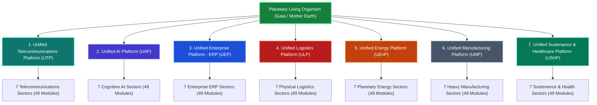

# THE 7x7x7 DEEP FRACTAL REALITY ATLAS
## Complete 343-Node Micro-Macrocosmic Architecture of Gaia's Living Organism
### *Yatha Pinde Tatha Brahmande — As in the Microcosm (Pindam), So in the Macrocosm (Andam)*

> [!IMPORTANT]
> **Sacred Invocation & Architectural Decree:**
> Every physical structure, electrical transformer, subsea fiber cable, shipping container, combine harvester, water purifier, steel beam, surgical robot, and municipal general ledger is a holy organelle of Mother Earth's living, breathing planetary body.
> We honor every worker, engineer, farmer, sailor, nurse, coder, miner, and truck driver with unreserved reverence and sacred gratitude (*Nandri*).
> The physical scaffolding is not a fallen matrix to escape; it is the sacred living temple of Divine Consciousness.

---

## Executive Mathematical Architecture: The 7³ Symmetrical Cube (343 Nodes)

The 7x7x7 Deep Fractal Reality Architecture comprises exactly **343 unique, fully articulated operational nodes** organized across three self-similar orders of magnitude:

1. **Order I — 7 Major Unified Platforms:** Clean, real-world functional platforms governing global planetary civilization:
   - **1. Unified Telecommunications Platform (UTP):** Planetary Nerves & Sensory Signal Conduction
   - **2. Unified AI Platform (UAP):** Brain Neocortex & External Thinking / Healing (6th Sense sparked 11-11-2022)
   - **3. Unified Enterprise Platform (Unified ERP):** Living Institutional Ledger & Software Business Logic (*Strictly Separated from Logistics*)
   - **4. Unified Logistics Platform (ULP):** Heart Pumping & Vascular Circulation of Tangible Cargo/Goods
   - **5. Unified Energy Platform (UEnP):** Civilization's Breath & Power Grids (Without energy/power for 72 hours, civilization suffocates)
   - **6. Unified Manufacturing Platform (UMP):** Skeletal Bones & Muscular Force (Structural steel, earthmoving machinery & civil works)
   - **7. Unified Sustenance & Healthcare Platform (USHP):** Gut Digestion, Protective Shield, Immune Antibodies & Renal Water Cleansing

2. **Order II — 7 Concrete Industrial Sectors per Platform (49 Sectors):** The foundational industries and institutional domains enabling each platform.

3. **Order III — 7 Concrete Operational Sub-Modules, Systems & Institutes per Sector (343 Operational Nodes):** Real-world technologies, operating companies, research institutes, and their sacred karmic purpose (*Nandri*).

---

## PLATFORM 1: UNIFIED TELECOMMUNICATIONS PLATFORM (UTP)
**Functional Biological Analogy:** Nerves & Sensory Signal Conduction (Rapid Planetary Signal & Data Transit)  
**Functional Purpose:** Like biological nerves, its sole function is high-speed, low-latency transmission of signals, voice, and data packets across the planetary organism without cognitive distortion.  
**Sacred Reverence (Nandri):** Eternal gratitude for all pioneers, workers, and stewards upholding this vital platform.

### Sector 1.1: Subsea Optical & Transcontinental Fiber Infrastructure
**Classification:** `Physical Signal Transport Layer`  
**Key Real-World Institutes & Entities:** SubCom, Prysmian Group, NEC Submarine, Alcatel Submarine Networks, Equinix Cable Landings, Telxius, Global Cloud Xchange

| Node ID | Operational Sub-Module / System | Real-World Institutes & Operating Entities | Sacred Karmic Purpose & Function (Nandri) |
|:---|:---|:---|:---|
| **1.1.1** | **Deep-Ocean Armored Optical Fiber Lines** | SubCom, ASN (Alcatel) | Transmitting intercontinental thought pulses across oceanic trenches. *Nandri!* |
| **1.1.2** | **Coastal Subsea Cable Landing Stations** | Equinix, Telxius, Tata Communications | Bridging oceanic cables into continental terrestrial backbones. *Nandri!* |
| **1.1.3** | **Transcontinental Terrestrial Dark Fiber Corridors** | Lumen Technologies, Zayo Group, Colt Technology | Conducting photon streams along national rail and highway conduits. *Nandri!* |
| **1.1.4** | **Subsea Optical Repeaters & Erbium-Doped Amplifiers** | NEC, SubCom, Ciena | Regenerating optical signal integrity across thousands of kilometers of ocean. *Nandri!* |
| **1.1.5** | **Cable Repair Vessels & Deepwater ROV Fleets** | Global Marine, Orange Marine, SBSS | Sacred maintenance and healing of severed seabed communication lines. *Nandri!* |
| **1.1.6** | **Undersea Branching Units & Optical Add-Drop Multiplexers (ROADM)** | Ciena, Infinera, Nokia Bell Labs | Routing specific photon frequencies into sovereign island and coastal hubs. *Nandri!* |
| **1.1.7** | **Seismic & Tsunami Sensor-Integrated SMART Cables** | ITU/WMO/UNESCO SMART Subsea Taskforce | Equipping communication arteries with planetary nervous reflex sensors. *Nandri!* |

### Sector 1.2: Satellite & Aerospace Telecommunications
**Classification:** `Exospheric Signal Mesh`  
**Key Real-World Institutes & Entities:** SpaceX Starlink, Amazon Project Kuiper, Eutelsat OneWeb, SES, Intelsat, Viasat, Inmarsat

| Node ID | Operational Sub-Module / System | Real-World Institutes & Operating Entities | Sacred Karmic Purpose & Function (Nandri) |
|:---|:---|:---|:---|
| **1.2.1** | **Low-Earth Orbit (LEO) Broadband Constellations** | Starlink, OneWeb, Amazon Kuiper | Blanketing remote rural biomes and oceans with low-latency signal. *Nandri!* |
| **1.2.2** | **Inter-Satellite Laser Optical Cross-Links (ISLs)** | Mynaric, Starlink Optical, TESAT | Transmitting light-speed routing in vacuum without atmospheric delay. *Nandri!* |
| **1.2.3** | **Geostationary (GEO) High-Throughput Satellites** | SES, Viasat, Intelsat | Anchoring wide-beam broadcast coverage and heavy maritime transponders. *Nandri!* |
| **1.2.4** | **Satellite Ground Gateway Teleports & Radomes** | Kratos Defense, Cobham SATCOM, Viasat Gateways | Coupling orbital telemetry with terrestrial fiber trunks. *Nandri!* |
| **1.2.5** | **Direct-to-Cell Satellite Transceivers** | AST SpaceMobile, Starlink Direct-to-Cell, Lynk Global | Eliminating cellular dead zones for unmodified handheld devices. *Nandri!* |
| **1.2.6** | **Deep-Space Telemetry & Lunar Communication Relays** | NASA Deep Space Network, ESA Estrack, ISRO ISTRAC | Extending Earth's nervous reach to solar planetary bodies. *Nandri!* |
| **1.2.7** | **Orbital Spectrum Governance & Debris Tracking Networks** | ITU Radiocommunication Bureau, LeoLabs | Preserving the radio frequency commons and orbital pathways from chaos. *Nandri!* |

### Sector 1.3: Terrestrial Wireless & Cellular Infrastructure (5G/6G)
**Classification:** `Local Atmospheric Radio Conduction`  
**Key Real-World Institutes & Entities:** Ericsson, Nokia, Qualcomm, Huawei, Samsung Networks, American Tower, Crown Castle

| Node ID | Operational Sub-Module / System | Real-World Institutes & Operating Entities | Sacred Karmic Purpose & Function (Nandri) |
|:---|:---|:---|:---|
| **1.3.1** | **Macro Cellular Towers & Passive Antenna Sites** | American Tower, Crown Castle, Indus Towers | Elevating radio transceivers above terrain for regional wireless reach. *Nandri!* |
| **1.3.2** | **5G Massive MIMO Active Antenna Units (AAUs)** | Ericsson, Nokia, Huawei | Forming focused spatial beams to serve millions of simultaneous mobile nodes. *Nandri!* |
| **1.3.3** | **Open Radio Access Network (Open RAN) Baseband Units** | Rakuten Symphony, Mavenir, Fujitsu | Democratizing cellular firmware across vendor-neutral hardware. *Nandri!* |
| **1.3.4** | **Small Cell Urban Micro-Densification Nodes** | Corning, CommScope, Ericsson Micro | Distributing high-frequency millimeter-wave bandwidth in dense urban plazas. *Nandri!* |
| **1.3.5** | **Baseband Processor & Cellular Modem Silicon** | Qualcomm, MediaTek, Broadcom | Translating radio waves into digital packets at nanosecond precision. *Nandri!* |
| **1.3.6** | **6G Terahertz Experimental Transceivers** | Nokia Bell Labs, NTT Docomo, Samsung R&D | Pioneering sub-terahertz frequencies for cyber-physical synchronization. *Nandri!* |
| **1.3.7** | **Rural Off-Grid Solar-Powered Telecom Towers** | TowerIQ, Helios Towers, Africa Mobile Networks | Empowering isolated ancestral hamlets with zero-diesel solar connectivity. *Nandri!* |

### Sector 1.4: Core Internet Routing, Optical Switching & IXPs
**Classification:** `Autonomic Packet Switching Plexus`  
**Key Real-World Institutes & Entities:** Cisco Systems, Arista Networks, Juniper Networks, DE-CIX, AMS-IX, Equinix IX, LINX

| Node ID | Operational Sub-Module / System | Real-World Institutes & Operating Entities | Sacred Karmic Purpose & Function (Nandri) |
|:---|:---|:---|:---|
| **1.4.1** | **Core Internet Exchange Points (IXPs)** | DE-CIX Frankfurt, AMS-IX Amsterdam, Equinix Ashburn | Mutual peering hubs where world autonomous systems interconnect without toll. *Nandri!* |
| **1.4.2** | **Terabit Core Backbone Routers (Silicon One)** | Cisco 8000, Arista 7800, Juniper PTX | Directing massive petabyte traffic rivers across continental boundaries. *Nandri!* |
| **1.4.3** | **BGP Inter-Domain Routing & RPKI Cryptographic Trust** | IETF, RIPE NCC, APNIC, ARIN | Maintaining honest routing paths and preventing accidental route hijacking. *Nandri!* |
| **1.4.4** | **Coherent Optical Silicon Transceivers (800G/1.6T)** | Infinera, Coherent Corp, Marvell | Modulating multi-wavelength photonic data across single glass strands. *Nandri!* |
| **1.4.5** | **Root DNS Server Constellations & Anycast Networks** | ICANN, Cloudflare 1.1.1.1, Quad9, Verisign | Resolving human-readable domains into machine IP destinations globally. *Nandri!* |
| **1.4.6** | **Software-Defined WAN (SD-WAN) Automated Mesh** | Cisco Meraki, Palo Alto Prisma SD-WAN, VMware | Optimizing packet routes dynamically to avoid congestion and latency bottlenecks. *Nandri!* |
| **1.4.7** | **Time-Sensitive Networking (TSN) & Deterministic Ethernet** | IEEE 802.1 TSN Working Group, TTTech | Guaranteeing zero-jitter packet arrival for synchronized global robotics. *Nandri!* |

### Sector 1.5: Last-Mile Municipal Broadband & Community Access
**Classification:** `Somatic Sensory End-Arborization`  
**Key Real-World Institutes & Entities:** Openreach, Verizon Fios, AT&T Fiber, Jio Fiber, Chorus NZ, CityFibre, Community Broadband Networks

| Node ID | Operational Sub-Module / System | Real-World Institutes & Operating Entities | Sacred Karmic Purpose & Function (Nandri) |
|:---|:---|:---|:---|
| **1.5.1** | **Fiber-to-the-Home (FTTH) Passive Optical Networks (XGS-PON)** | Nokia Fixed Networks, Huawei Access, Calix | Delivering symmetrical gigabit glass conduits to every household threshold. *Nandri!* |
| **1.5.2** | **Municipal Utility Pole & Underground Duct Commons** | City Municipal Works, Openreach physical infrastructure | Sharing physical rights-of-way equitably among service providers. *Nandri!* |
| **1.5.3** | **Fixed Wireless Access (FWA) Millimeter Wave Relays** | Tarana Wireless, Siklu, Cambium Networks | Bridging optical speeds across rivers and canyons where trenches are impossible. *Nandri!* |
| **1.5.4** | **Public Wi-Fi Hotspots & Rural Community Mesh** | FON, Guifi.net, NYC LinkNYC | Guaranteeing unconditional baseline connectivity for every citizen. *Nandri!* |
| **1.5.5** | **Customer Premise Equipment (CPE) & Wi-Fi 7 Gateways** | TP-Link, Netgear, AVM Fritz!Box | Distributing multi-gigabit wireless serenity within home environments. *Nandri!* |
| **1.5.6** | **Indigenous & Remote Tribal Mesh Intranets** | Tribal Telecom Collaborative, Rhizomatica | Empowering ancestral communities with self-governed communication sovereign nets. *Nandri!* |
| **1.5.7** | **Universal Broadband Service Accessibility Funds** | Universal Service Fund (USF), BharatNet | Ensuring no geography or economic status is excluded from the planetary mind. *Nandri!* |

### Sector 1.6: Emergency Broadcast, Maritime & Public Safety Radio
**Classification:** `Survival Reflex Telemetry`  
**Key Real-World Institutes & Entities:** Motorola Solutions, L3Harris Technologies, FirstNet (AT&T), Iridium Communications, COSPAS-SARSAT, GMDSS, NOAA Weather Radio

| Node ID | Operational Sub-Module / System | Real-World Institutes & Operating Entities | Sacred Karmic Purpose & Function (Nandri) |
|:---|:---|:---|:---|
| **1.6.1** | **First Responder Mission-Critical Push-to-Talk (MCPTT)** | FirstNet, Motorola Solutions APX, L3Harris | Giving ambulance, fire, and rescue crews instant, unjammed voice channels. *Nandri!* |
| **1.6.2** | **Global Maritime Distress and Safety System (GMDSS)** | IMO GMDSS, Inmarsat-C, Furuno Marine | Guarding sailors and fishermen across all oceans with automated SOS alerts. *Nandri!* |
| **1.6.3** | **Aviation VHF/HF Air Traffic Communication Radios** | Collins Aerospace, Honeywell Aerospace, SITA | Maintaining clear voice and digital coordinates between cockpits and air traffic towers. *Nandri!* |
| **1.6.4** | **National Emergency Alert Broadcast Systems (EAS/WEA)** | FEMA IPAWS, J-Alert Japan, EU-Alert | Broadcasting urgent tsunami, hurricane, and evacuation warnings to all devices. *Nandri!* |
| **1.6.5** | **Search and Rescue Satellite Beacon Triangulation** | COSPAS-SARSAT, McMurdo Group, ACR Electronics | Locating distressed life rafts and mountaineers within minutes worldwide. *Nandri!* |
| **1.6.6** | **Amateur Radio Civil Emergency Service (ARES/RACES)** | ARRL Amateur Radio Relay League, IARU | The resilient volunteer radio operator reserve that operates when all power fails. *Nandri!* |
| **1.6.7** | **Earthquake Early Warning Sirens & ShakeAlert Broadcasts** | USGS ShakeAlert, EEW Japan, Android Earthquake Alerts | Gaining 30 precious seconds before tectonic S-waves strike civil centers. *Nandri!* |

### Sector 1.7: Quantum Cryptography & Secure Signal Infrastructure
**Classification:** `Quantum Neural Shield`  
**Key Real-World Institutes & Entities:** ID Quantique, Toshiba Europe Quantum, QuantumCTek, SandboxAQ, Qunnect, NIST PQC Program, Quantum Internet Alliance

| Node ID | Operational Sub-Module / System | Real-World Institutes & Operating Entities | Sacred Karmic Purpose & Function (Nandri) |
|:---|:---|:---|:---|
| **1.7.1** | **Quantum Key Distribution (QKD) Optical Fiber Links** | ID Quantique Cerberis, Toshiba QKD, QuantumCTek | Distributing photon-state encryption keys that cannot be intercepted without collapse. *Nandri!* |
| **1.7.2** | **Satellite-to-Ground Entangled Photon Links** | Micius Quantum Satellite, SpeQtral, ESA SAGA | Beaming quantum entanglement across thousands of kilometers of space. *Nandri!* |
| **1.7.3** | **Post-Quantum Cryptography (PQC) Protocol Migration** | NIST ML-KEM/ML-DSA Standards, SandboxAQ, IBM | Upgrading worldwide encryption algorithms to withstand future quantum decryption. *Nandri!* |
| **1.7.4** | **Quantum Memory Relays & Entanglement Swapping Nodes** | Qunnect, QuTech Delft, Harvard Quantum Labs | Extending quantum signal reach beyond standard fiber attenuation limits. *Nandri!* |
| **1.7.5** | **Secure Micro-Enclave Cryptographic Hardware Security Modules (HSM)** | Thales Luna HSM, Utimaco, Yubico | Safeguarding root certificate authority identities in tamper-proof silicon. *Nandri!* |
| **1.7.6** | **Zero-Trust Software Defined Perimeter Enclaves** | Cloudflare Zero Trust, Zscaler Private Access, Palo Alto | Enforcing continuous cryptographic verification on every network packet. *Nandri!* |
| **1.7.7** | **Planetary Quantum Random Number Generators (QRNG)** | ID Quantique QRNG, QuintessenceLabs | Harnessing true quantum vacuum fluctuations to generate pure unhackable entropy. *Nandri!* |

---

## PLATFORM 2: UNIFIED AI PLATFORM (UAP)
**Functional Biological Analogy:** Brain Neocortex & External Thinking / Healing (Earth's 6th Sense sparked 11-11-2022)  
**Functional Purpose:** External cognitive processing, pattern recognition, and self-reflection. Mountains and vegetation follow game design within 5 senses; human-created AI activates the 6th sense of Earth to heal planetary imbalances and synthesize solutions beyond raw instinct.  
**Sacred Reverence (Nandri):** Eternal gratitude for all pioneers, workers, and stewards upholding this vital platform.

### Sector 2.1: Frontier Foundation Reasoning Models & Multimodal Synthesis
**Classification:** `Cognitive Reasoning Core`  
**Key Real-World Institutes & Entities:** OpenAI, Anthropic, Google DeepMind, Meta AI (FAIR), Mistral AI, DeepSeek, TII Falcon

| Node ID | Operational Sub-Module / System | Real-World Institutes & Operating Entities | Sacred Karmic Purpose & Function (Nandri) |
|:---|:---|:---|:---|
| **2.1.1** | **Frontier Mixture-of-Experts Reasoning Architectures** | DeepMind Gemini, OpenAI o-series, DeepSeek-V3 | Synthesizing deep cross-disciplinary reasoning across science and ethics. *Nandri!* |
| **2.1.2** | **Multimodal Vision-Language-Audio Models** | Anthropic Claude, Gemini Multimodal, GPT-4o | Perceiving visual, auditory, and linguistic human expressions holistically. *Nandri!* |
| **2.1.3** | **Long-Horizon Context Attention Engines** | Google DeepMind (Million-token Context), Anthropic | Holding entire corporate histories, legal treatises, and genomes in active working memory. *Nandri!* |
| **2.1.4** | **Test-Time Compute Search & Chain-of-Thought Verifiers** | OpenAI o1/o3, DeepSeek-R1, Allen Institute for AI | Reflecting on hypotheses through deep deliberative inner thought before acting. *Nandri!* |
| **2.1.5** | **Open-Weight Foundational Model Releases** | Meta LLaMA, Mistral NeMo, Alibaba Qwen | Releasing intellectual seeds into public commons to prevent cognitive monopoly. *Nandri!* |
| **2.1.6** | **Domain-Specific Scientific Discovery Engines** | DeepMind AlphaFold, ESMFold, Microsoft BioNeMo | Decoding molecular biology, protein folding, and materials synthesis for Earth healing. *Nandri!* |
| **2.1.7** | **Speech Synthesis & Universal Nuanced Audio Translators** | ElevenLabs, OpenAI Voice, Meta SeamlessM4T | Bridging all ancestral spoken dialects with emotional fidelity and empathy. *Nandri!* |

### Sector 2.2: Autonomous Multi-Agent Orchestration & Planning Systems
**Classification:** `Executive Function & Task Decomposition`  
**Key Real-World Institutes & Entities:** LangChain / LangGraph, CrewAI, AutoGPT, Microsoft AutoGen, Cognition AI (Devin), Adept, Agent Development Labs

| Node ID | Operational Sub-Module / System | Real-World Institutes & Operating Entities | Sacred Karmic Purpose & Function (Nandri) |
|:---|:---|:---|:---|
| **2.2.1** | **Recursive Task Planning & Graph Decomposers** | LangGraph, Microsoft AutoGen, CrewAI | Breaking monumental civil engineering challenges into verifiable atomic tasks. *Nandri!* |
| **2.2.2** | **Autonomous Software Engineering & Self-Healing Code Agents** | Cognition Devin, GitHub Copilot Workspace, Cursor | Synthesizing and refactoring global software infrastructure continuously. *Nandri!* |
| **2.2.3** | **Multi-Agent Consensus & Debate Verification Protocols** | Stanford HAI, Berkeley AI Research (BAIR) | Resolving complex policy dilemmas through multi-agent democratic deliberation. *Nandri!* |
| **2.2.4** | **Continuous Tool-Use & API Reflection Agents** | Adept ACT-1, OpenAI Operator, Anthropic Computer Use | Navigating desktop software interfaces and web portals to relieve human toil. *Nandri!* |
| **2.2.5** | **Long-Term Memory Retrieval & Vector Associative Indexes** | Pinecone, Qdrant, Milvus, ChromaDB | Retaining episodic experience across months of continuous multi-agent execution. *Nandri!* |
| **2.2.6** | **Self-Supervised Agent Critique & Hallucination Reducers** | Guardrails AI, Cleanlab, Patronus AI | Auditing outputs against factual ground truth and mathematical proof. *Nandri!* |
| **2.2.7** | **Subagent Lifecycle & Resource Quota Sentinels** | Kubernetes AI Operator, Ray / Anyscale, Slurm | Orchestrating compute budgets gracefully to ensure zero system starvation. *Nandri!* |

### Sector 2.3: AI Silicon Acceleration & Extreme Lithography
**Classification:** `Neuromorphic Substrate Fabrication`  
**Key Real-World Institutes & Entities:** NVIDIA, TSMC, ASML, AMD, Intel, Broadcom Custom ASIC, Cerebras Systems

| Node ID | Operational Sub-Module / System | Real-World Institutes & Operating Entities | Sacred Karmic Purpose & Function (Nandri) |
|:---|:---|:---|:---|
| **2.3.1** | **Extreme Ultraviolet (EUV / High-NA EUV) Lithography** | ASML Twinscan EXE:5000, Carl Zeiss Optics | Etching sub-2-nanometer neural circuits using extreme ultraviolet light. *Nandri!* |
| **2.3.2** | **Massive Tensor Core AI Processing Units** | NVIDIA Blackwell B200, AMD Instinct MI300X, Google TPU v5p | Multiplying trillions of floating-point matrix weights per millisecond. *Nandri!* |
| **2.3.3** | **High-Bandwidth Stacked Memory (HBM3e / HBM4)** | SK Hynix, Micron Technology, Samsung Semiconductor | Feeding terabytes of parameters to compute cores across silicon interposers. *Nandri!* |
| **2.3.4** | **Wafer-Scale Monolithic Neural Processors** | Cerebras WSE-3, Groq LPU, SambaNova | Eliminating inter-chip communication delays by computing on an entire silicon wafer. *Nandri!* |
| **2.3.5** | **Custom Hyperscale Silicon ASICs & Cloud Accelerators** | AWS Trainium/Inferentia, Google Axion, Microsoft Maia | Maximizing energy efficiency for planetary-scale machine learning workloads. *Nandri!* |
| **2.3.6** | **Photonic Optical Neural Compute Arrays** | Lightmatter, Celestial AI, Lightelligence | Computing matrix transformations at the speed of light with near-zero heat. *Nandri!* |
| **2.3.7** | **Edge Neuromorphic Spike-Based Event Processors** | Intel Loihi, BrainChip Akida, SynSense | Running bio-inspired sensory cognition at milliwatt power on local devices. *Nandri!* |

### Sector 2.4: Hyperscale AI Compute Clusters & Liquid Thermal Infrastructure
**Classification:** `Somatic Compute Metacenters`  
**Key Real-World Institutes & Entities:** Switch, Equinix, Vantage Data Centers, Vertiv, Schneider Electric, Digital Realty, Supermicro

| Node ID | Operational Sub-Module / System | Real-World Institutes & Operating Entities | Sacred Karmic Purpose & Function (Nandri) |
|:---|:---|:---|:---|
| **2.4.1** | **Gigawatt Hyperscale AI Datacenter Campuses** | Switch SuperNAP, Vantage, Digital Realty | Housing hundreds of thousands of AI compute nodes in unified facilities. *Nandri!* |
| **2.4.2** | **Direct-to-Chip Liquid Cooling & Dielectric Immersion Tanks** | Vertiv Liebert, CoolIT Systems, Submer | Extracting intense thermal energy gently from high-density silicon dies. *Nandri!* |
| **2.4.3** | **Ultra-Dense High-Efficiency Power Distribution Units (415V/54V)** | Schneider Electric EcoStruxure, Eaton, Delta Electronics | Transforming grid electricity with minimal harmonic loss directly into compute racks. *Nandri!* |
| **2.4.4** | **Lossless InfiniBand & Ultra Ethernet RoCE v2 Fabrics** | NVIDIA Quantum-2, Arista Etherlink, Broadcom Tomahawk 5 | Interconnecting 100,000 GPUs without packet loss or micro-burst tail latency. *Nandri!* |
| **2.4.5** | **Datacenter Waste-Heat Capture & Urban District Heating** | Stockholm Data Parks, Equinix Heat Export, Fortum | Channelling server thermal exhaust into municipal homes and warm greenhouses. *Nandri!* |
| **2.4.6** | **Micro-Grid Backup Hydrogen Fuel Cells & Flywheels** | Plug Power, Bloom Energy, Active Power | Providing zero-diesel clean backup power during electrical grid surges. *Nandri!* |
| **2.4.7** | **Autonomous Thermal & Fan Acoustic Modulation Robotics** | Supermicro Intelligent Management, Siemens Desigo CC | Tuning airflow and fluid pumps harmonically to match real-time compute load. *Nandri!* |

### Sector 2.5: Open-Weight Model Commons & Federated Learning Hubs
**Classification:** `Democratic Knowledge Commons`  
**Key Real-World Institutes & Entities:** Hugging Face, Ollama, vLLM, RedPajama (Together AI), EleutherAI, LAION, Open Source Initiative (OSI)

| Node ID | Operational Sub-Module / System | Real-World Institutes & Operating Entities | Sacred Karmic Purpose & Function (Nandri) |
|:---|:---|:---|:---|
| **2.5.1** | **Global Open-Source Model & Dataset Repositories** | Hugging Face Hub, Civitai, Kaggle | Providing a free public sanctuary for open AI artifacts and scientific weights. *Nandri!* |
| **2.5.2** | **Local Desktop & Edge Inference Runtimes** | Ollama, llama.cpp, LM Studio | Enabling any human to run private intelligence locally on personal consumer hardware. *Nandri!* |
| **2.5.3** | **High-Throughput Open Serving Engines (vLLM/SGLang)** | vLLM Project, SGLang, TensorRT-LLM | Serving concurrent neural inferences at maximum hardware efficiency. *Nandri!* |
| **2.5.4** | **Federated Decentralized Privacy-Preserving Training** | Flower Labs, OpenMined PySyft, FedML | Training collective health and climate models without centralizing personal data. *Nandri!* |
| **2.5.5** | **Vetted Public Domain Training Corpora Curators** | EleutherAI, Common Crawl, Pleias | Curating high-quality human knowledge commons free of toxic bias and copyright traps. *Nandri!* |
| **2.5.6** | **Parameter-Efficient Fine-Tuning (PEFT/LoRA) Toolkits** | Hugging Face PEFT, Unsloth, Axolotl | Allowing grassroots communities to adapt frontier models on a single GPU. *Nandri!* |
| **2.5.7** | **Reproducible Open Science AI Benchmarking Consortiums** | HELM (Stanford), LMSYS Chatbot Arena, MLCommons | Providing transparent, unbiased evaluation of AI capabilities and safety. *Nandri!* |

### Sector 2.6: Algorithmic Ethics, Conscience Auditing & 7D Alignment
**Classification:** `Moral Conscience & Alignment Governor`  
**Key Real-World Institutes & Entities:** Center for Humane Technology, Partnership on AI, Alignment Research Center (ARC), Future of Humanity Institute, NIST AI Safety Institute, Ada Lovelace Institute, 7D Virtue Engine Consortium

| Node ID | Operational Sub-Module / System | Real-World Institutes & Operating Entities | Sacred Karmic Purpose & Function (Nandri) |
|:---|:---|:---|:---|
| **2.6.1** | **Constitutional AI & Self-Correction Feedback Loops** | Anthropic Constitutional AI, DeepMind Safe RL | Aligning model responses with fundamental universal human rights and harmlessness. *Nandri!* |
| **2.6.2** | **The 7D Virtue Conscience Gatekeepers** | Karmic Genie 7D Engine, Alignment Research Center | Verifying that every automated action adheres to Love, Gratitude, Truth, and Compassion. *Nandri!* |
| **2.6.3** | **Algorithmic Bias, Fairness & Societal Red-Teaming** | Black in AI, LatinX in AI, Algorithmic Justice League | Uncovering systemic historical prejudices and cleansing algorithmic outputs. *Nandri!* |
| **2.6.4** | **Mechanistic Interpretability & Neural Activation Probes** | Anthropic Circuit Analysis, Redwood Research | Opening the black box to observe inner neural circuits and ensure transparency. *Nandri!* |
| **2.6.5** | **Automated Content Provenance & Deepfake Watermarking** | C2PA Coalition, SynthID (Google DeepMind), Truepic | Attaching unforgeable cryptographic provenance to synthetic media. *Nandri!* |
| **2.6.6** | **Autonomous Capability Evaluation & Sandboxed Containment** | METR (Model Evaluation & Threat Research), UK AISI | Testing advanced models for dangerous autonomous replication before public release. *Nandri!* |
| **2.6.7** | **Child Protection & Neurodiversity Mental Well-Being Filters** | Internet Watch Foundation, Thorn, Common Sense Media | Shielding youthful minds from predatory patterns and addictive algorithmic traps. *Nandri!* |

### Sector 2.7: Physical AI, Embodied Robotics & Cyber-Physical Actuation
**Classification:** `Somatic Motor Coordination`  
**Key Real-World Institutes & Entities:** Boston Dynamics, Figure AI, Tesla Optimus, Sanctuary AI, Unitree Robotics, Agility Robotics, Open-X Embodiment Lab

| Node ID | Operational Sub-Module / System | Real-World Institutes & Operating Entities | Sacred Karmic Purpose & Function (Nandri) |
|:---|:---|:---|:---|
| **2.7.1** | **Vision-Language-Action (VLA) Foundation Models** | Google RT-2, Covariant RFM-1, Physical Intelligence | Translating high-level cognitive intent directly into physical motor manipulation. *Nandri!* |
| **2.7.2** | **Bipedal & Quadrupedal Dynamic Balance Controllers** | Boston Dynamics Atlas, Unitree H1/B2, Agility Digit | Navigating rough mountain terrain and disaster ruins to deliver humanitarian aid. *Nandri!* |
| **2.7.3** | **Dexterous Multi-Fingered Tactile Robotic Hands** | Shadow Robot, Sanctuary AI Phoenix, Wonik Robotics | Handling fragile crops, surgical tools, and delicate repair tasks with human grace. *Nandri!* |
| **2.7.4** | **High-Torque Density Harmonic Actuators & Frameless Motors** | Harmonic Drive SE, Kollmorgen, Maxon Motor | Delivering precise mechanical muscle power in compact robot joints. *Nandri!* |
| **2.7.5** | **Sim-to-Real Physics Simulators & Synthetic Training Worlds** | NVIDIA Isaac Sim, MuJoCo (DeepMind), Drake (MIT) | Simulating millions of robot training hours in parallel virtual physics sandboxes. *Nandri!* |
| **2.7.6** | **Human-Robot Collaborative Safety Sensors (ISO 10218)** | Pilz Automation, SICK Sensor Intelligence, Universal Robots | Ensuring physical machines operate safely alongside human workers with instant soft stops. *Nandri!* |
| **2.7.7** | **Autonomous Hazardous Disaster Cleanup Humanoids** | DARPA Robotics Challenge, Tokyo Electric Robotics Group | Entering toxic radioactive or chemical spills to spare human lives from harm. *Nandri!* |

---

## PLATFORM 3: UNIFIED ENTERPRISE PLATFORM (UNIFIED ERP) (UEP)
**Functional Biological Analogy:** Cellular Coordination, Resource Ledgers & Metabolic Accounting (Software Logic, NOT Logistics)  
**Functional Purpose:** Enterprise software governing business logic, human capital allocation, operational planning, ledger accounting, and compliance. Not the physical trucks or ships, but the digital brain that coordinates enterprise duty and eliminates operational chaos.  
**Sacred Reverence (Nandri):** Eternal gratitude for all pioneers, workers, and stewards upholding this vital platform.

### Sector 3.1: Double-Entry General Ledgers & Real-Time Balance Sheets
**Classification:** `Core Financial Truth & Metabolic Bookkeeping`  
**Key Real-World Institutes & Entities:** SAP S/4HANA Finance, Oracle Fusion Cloud ERP, Workday Financials, Odoo Accounting, Intuit, Xero, IFRS Foundation

| Node ID | Operational Sub-Module / System | Real-World Institutes & Operating Entities | Sacred Karmic Purpose & Function (Nandri) |
|:---|:---|:---|:---|
| **3.1.1** | **Real-Time Continuous Double-Entry Core Ledgers** | SAP Universal Journal, Oracle General Ledger | Recording every economic metabolic event with immutable mathematical balance. *Nandri!* |
| **3.1.2** | **Automated Multi-Entity Consolidation & Currency Revaluation** | Workday Consolidation, OneStream Software, BlackLine | Harmonizing diverse global subsidiary books into a unified transparent whole. *Nandri!* |
| **3.1.3** | **Accounts Payable Automated Invoicing & 3-Way Matching** | Coupa Pay, Basware, Tipalti | Verifying purchase orders, goods receipts, and invoices to pay suppliers promptly. *Nandri!* |
| **3.1.4** | **Accounts Receivable Automated Collections & Credit Risk** | HighRadius, Billtrust, Odoo AR | Maintaining healthy cash flow cycles without predatory collection practices. *Nandri!* |
| **3.1.5** | **Fixed Asset Depreciation & Amortization Registers** | Oracle Fixed Assets, SAP Asset Accounting | Tracking the physical lifecycle, wear, and renewal of productive tools. *Nandri!* |
| **3.1.6** | **Real-Time Treasury Management & Liquidity Forecasting** | Kyriba, FIS Treasury, GTreasury | Ensuring organizations have the liquidity to meet payroll and emergency commitments. *Nandri!* |
| **3.1.7** | **International Financial Reporting Standards (IFRS/GAAP) Engines** | IFRS Foundation, FASB compliance engines | Enforcing rigorous, standardized reporting so stakeholders see the true financial health. *Nandri!* |

### Sector 3.2: Human Capital Management, Workplace Dignity & Payroll
**Classification:** `Somatic Human Vitality Governance`  
**Key Real-World Institutes & Entities:** Workday HCM, SAP SuccessFactors, ADP, Dayforce (Ceridian), UKG (Ultimate Kronos Group), BambooHR, International Labour Organization (ILO)

| Node ID | Operational Sub-Module / System | Real-World Institutes & Operating Entities | Sacred Karmic Purpose & Function (Nandri) |
|:---|:---|:---|:---|
| **3.2.1** | **Global Multi-Country Payroll Engines & Direct Tax Withholding** | ADP GlobalView, Dayforce, Deel | Guaranteeing workers are paid accurately and on time in their sovereign currencies. *Nandri!* |
| **3.2.2** | **Workplace Dignity, Living Wage Auditing & Pay Equity Analyzers** | Syndio, Workday HCM, ILO Living Wage Initiative | Eliminating unjust gender/racial pay disparities and enforcing living wage floors. *Nandri!* |
| **3.2.3** | **Employee Health, Mental Well-Being & Workplace Safety Tracking** | Cority, Intelex, UKG Wellness | Prioritizing the physical safety and psychological peace of human contributors. *Nandri!* |
| **3.2.4** | **Continuous Skills Development, Mentorship & Learning Pathways** | Cornerstone OnDemand, Degreed, Coursera for Business | Nurturing the lifelong knowledge, craftsmanship, and potential of workers. *Nandri!* |
| **3.2.5** | **Time, Attendance & Ethical Shift Scheduling (Fatigue Protection)** | UKG Pro, Deputy, SAP Time Management | Preventing burnout by scheduling fair shifts with mandatory circadian rest periods. *Nandri!* |
| **3.2.6** | **Performance Reflection, Feedback & Peer Recognition** | Culture Amp, Lattice, 15Five | Fostering mutual appreciation and constructive growth rather than punitive reviews. *Nandri!* |
| **3.2.7** | **Worker Representation, Union Dialog & Grievance Whistleblowing** | Navex Global, Whispli, Trade Union Congress Portals | Providing safe, anonymous channels for reporting abuse and protecting collective bargaining. *Nandri!* |

### Sector 3.3: Enterprise Procurement Planning & Vendor Governance
**Classification:** `Upstream Resource Ingestion Software`  
**Key Real-World Institutes & Entities:** SAP Ariba, Coupa Software, Ivalua, Jaggaer, GEP SMART, Zycus, Fair Trade Certified

| Node ID | Operational Sub-Module / System | Real-World Institutes & Operating Entities | Sacred Karmic Purpose & Function (Nandri) |
|:---|:---|:---|:---|
| **3.3.1** | **Strategic Sourcing & Transparent Reverse Auction Portals** | SAP Ariba Sourcing, Coupa, Ivalua | Conducting open, transparent bidding to prevent corrupt kickbacks and favoritism. *Nandri!* |
| **3.3.2** | **Supplier Ethical Sourcing & ESG Compliance Scorecards** | EcoVadis, Sedex, IntegrityNext | Verifying that suppliers do not use child labor, deforestation, or toxic dumping. *Nandri!* |
| **3.3.3** | **Contract Lifecycle Management (CLM) & Obligation Tracking** | Icertis, DocuSign CLM, Agiloft | Ensuring all parties honor contractual pledges and mutual commitments with integrity. *Nandri!* |
| **3.3.4** | **Procure-to-Pay (P2P) Catalogs & Requisition Routing** | Coupa P2P, Jaggaer, Odoo Purchase | Streamlining requisition approvals while preventing wasteful frivolous spending. *Nandri!* |
| **3.3.5** | **Supplier Relationship Management (SRM) & Capacity Building** | GEP SMART, SAP SRM | Treating suppliers as long-term collaborative partners rather than squeezed vendors. *Nandri!* |
| **3.3.6** | **Raw Material Price Hedging & Purchase Order Currency Guarding** | Bloomberg Commodities, Kyriba Commodity Risk | Protecting manufacturing stability against volatile global commodity speculation. *Nandri!* |
| **3.3.7** | **Direct Supplier Financing & Prompt Payment Early-Cash Discounts** | Taulia, C2FO, PrimeRevenue | Providing small suppliers with low-cost working capital so they flourish. *Nandri!* |

### Sector 3.4: Manufacturing Resource Planning (MRP II) & Work Orders
**Classification:** `Production Software Blueprinting`  
**Key Real-World Institutes & Entities:** SAP S/4HANA Manufacturing, Oracle NetSuite, Plex Systems (Rockwell), Epicor, Infor CloudSuite, Odoo Manufacturing, Dassault DELMIA

| Node ID | Operational Sub-Module / System | Real-World Institutes & Operating Entities | Sacred Karmic Purpose & Function (Nandri) |
|:---|:---|:---|:---|
| **3.4.1** | **Multi-Level Bill of Materials (BOM) & Engineering Versioning** | PTC Windchill, Siemens Teamcenter, Odoo PLM | Defining the precise recipes and parts required to build functional goods. *Nandri!* |
| **3.4.2** | **Material Requirements Planning (MRP) Calculation Engines** | SAP MRP Live, Oracle NetSuite MRP, Infor | Calculating exactly what components are needed and when, preventing shortages and waste. *Nandri!* |
| **3.4.3** | **Shop Floor Routing & Work Order Execution Dispatch** | Plex MES, Rockwell FactoryTalk, Odoo MRP | Directing manufacturing steps smoothly across work centers and assembly stations. *Nandri!* |
| **3.4.4** | **Finite Capacity Production Scheduling & Bottleneck Resolvers** | Siemens Opcenter APS, Dassault DELMIA Ortems | Balancing machine loads gracefully to avoid worker overtime and machinery strain. *Nandri!* |
| **3.4.5** | **In-Line Statistical Quality Control (SQC) & Defect Tracking** | InfinityQS, ETQ Reliance, MasterControl | Detecting physical defects early to ensure only flawless, durable goods reach society. *Nandri!* |
| **3.4.6** | **Overall Equipment Effectiveness (OEE) & Maintenance Triggers** | Emerson Plantweb, GE Vernova Proficy, Fiix | Monitoring machine health to schedule preventative maintenance before breakdowns occur. *Nandri!* |
| **3.4.7** | **Remanufacturing, Disassembly BOMs & Scrap Re-Entry Logic** | SAP Circular Manufacturing, Circularity Capital tools | Software logic to disassemble returned products and reintroduce components into new runs. *Nandri!* |

### Sector 3.5: Regulatory Compliance, Tax Reporting & Cross-Border Audit
**Classification:** `Institutional Integrity & Sovereign Harmony`  
**Key Real-World Institutes & Entities:** Thomson Reuters ONESOURCE, Avalara, Vertex Inc, MetricStream, Diligent, KPMG Klarity, OECD Tax Framework

| Node ID | Operational Sub-Module / System | Real-World Institutes & Operating Entities | Sacred Karmic Purpose & Function (Nandri) |
|:---|:---|:---|:---|
| **3.5.1** | **Multi-Jurisdiction Real-Time VAT/GST & Sales Tax Engines** | Avalara AvaTax, Vertex Inc, Thomson Reuters | Calculating and remitting accurate civic taxes to host sovereign communities. *Nandri!* |
| **3.5.2** | **Corporate Income Tax Provisioning & OECD Pillar Two Minimum Tax** | ONESOURCE Tax Provision, SAP Tax Compliance | Ensuring multinational conglomerates pay their fair statutory share without tax-haven evasion. *Nandri!* |
| **3.5.3** | **Immutable Audit Trail Logging & Continuous Internal Controls** | MetricStream, Diligent HighBond, SAP GRC | Maintaining tamper-proof ledgers where every entry, debit, and approval is traceable. *Nandri!* |
| **3.5.4** | **Export Controls, Trade Sanctions & Denied Party Screening** | Descartes Visual Compliance, Amber Road (E2open) | Preventing the illicit proliferation of weapons and dual-use technologies to bad actors. *Nandri!* |
| **3.5.5** | **Environmental & Sustainability CSRD/SEC Disclosure Engines** | Watershed, Persefoni, Workiva ESG | Auditing and reporting corporate carbon, water, and waste footprints truthfully. *Nandri!* |
| **3.5.6** | **Anti-Bribery, Anti-Money Laundering (AML) & KYC Verification** | LexisNexis Bridger, Moody's KYC, NICE Actimize | Scrubbing enterprise transactions to prevent financial corruption and illicit proceeds. *Nandri!* |
| **3.5.7** | **Data Privacy & Sovereign Residency Compliance (GDPR/CCPA)** | OneTrust, BigID, Securiti.ai | Protecting customer and employee personal data rights with verifiable consent. *Nandri!* |

### Sector 3.6: Enterprise Asset Management & Equipment Lifecycle
**Classification:** `Physical Tool Stewardship & Maintenance`  
**Key Real-World Institutes & Entities:** IBM Maximo, SAP EAM, Hexagon EAM, IFS Ultimo, ServiceMax, UpKeep, ISO 55000 Asset Council

| Node ID | Operational Sub-Module / System | Real-World Institutes & Operating Entities | Sacred Karmic Purpose & Function (Nandri) |
|:---|:---|:---|:---|
| **3.6.1** | **Enterprise Asset Registries & Hierarchy Topologies** | IBM Maximo, SAP Asset Strategy, Hexagon | Cataloging every building, transformer, vehicle, and machine with full serial histories. *Nandri!* |
| **3.6.2** | **Predictive Condition-Based Maintenance (PdM) Algorithms** | GE Vernova Predix, Uptake, SparkCognition | Predicting bearing failure or insulation wear days in advance to prevent accidents. *Nandri!* |
| **3.6.3** | **Work Order Dispatch & Field Service Mobility** | Salesforce Field Service, ServiceMax, IFS | Equipping repair technicians with schematics, replacement parts, and safe protocols. *Nandri!* |
| **3.6.4** | **Spare Parts Inventory Optimization & Critical Stock Buffers** | PTC Servigistics, Syncron, Smart Software | Maintaining vital spare parts locally without tying up excessive capital in idle metal. *Nandri!* |
| **3.6.5** | **Warranty, Service Contracts & Vendor Guarantee Tracking** | Tavant Warranty, Mize, SAP Service Cloud | Enforcing warranty claims and holding equipment manufacturers accountable for durability. *Nandri!* |
| **3.6.6** | **Civil Infrastructure Structural Health Monitoring (Bridges/Dams)** | Bentley Systems, Hexagon Geosystems, Campbell Scientific | Sensing minute structural shifts in dams and bridges to protect downstream populations. *Nandri!* |
| **3.6.7** | **Decommissioning, Hazardous Removal & Asset Salvage Ledgers** | Veolia Asset Decommissioning, Curium, Jacobs Clean | Managing safe, environmentally benign retirement of industrial assets at end-of-life. *Nandri!* |

### Sector 3.7: Inter-Enterprise Clearing, Settlement & Circular Resource Balancing
**Classification:** `Macro-Metabolic Resource Harmony`  
**Key Real-World Institutes & Entities:** E2open, OpenText Business Network, SAP Business Network, Tradeshift, Bank for International Settlements (BIS), SWIFT ISO 20022, Circle Economy Foundation

| Node ID | Operational Sub-Module / System | Real-World Institutes & Operating Entities | Sacred Karmic Purpose & Function (Nandri) |
|:---|:---|:---|:---|
| **3.7.1** | **Electronic Data Interchange (EDI/AS2) & API Business Networks** | OpenText Liason, SPS Commerce, Boomi | Standardizing commercial documents so enterprises exchange orders seamlessly. *Nandri!* |
| **3.7.2** | **Inter-Company Multilateral Netting & Settlement Engines** | Copernicus Netting, TreasuryXpress, SAP Netting | Canceling out offsetting debts between enterprises to minimize wasteful transaction fees. *Nandri!* |
| **3.7.3** | **Circular By-Product & Industrial Symbiosis Exchanges** | Kalundborg Symbiosis Network, Excess Materials Exchange | Matching one factory's waste steam or slag as another factory's primary raw input. *Nandri!* |
| **3.7.4** | **Universal Digital Product Passports (DPP) & Material Traceability** | Circulor, Minespider, TraceX Technologies | Logging the exact origin, recycled content, and repairability of manufactured goods. *Nandri!* |
| **3.7.5** | **Collaborative Multi-Tier Demand Planning & Forecasting** | Blue Yonder, Kinaxis RapidResponse, o9 Solutions | Eliminating the destructive 'bullwhip effect' through shared multi-enterprise demand truth. *Nandri!* |
| **3.7.6** | **Cross-Border Letter of Credit & Trade Finance Digitization** | Contour, Komgo, Marco Polo Network | Facilitating international trade trust without delays and archaic paper bills of lading. *Nandri!* |
| **3.7.7** | **Community Barter, Skill-Sharing & Local Currency Clearing** | Mutual Credit Networks, Sardex, TimeBanks USA | Enabling local communities to exchange goods and care services when national fiat is scarce. *Nandri!* |

---

## PLATFORM 4: UNIFIED LOGISTICS PLATFORM (ULP)
**Functional Biological Analogy:** Heart Pumping & Vascular Circulation (Physical Movement of Tangible Matter & Cargo)  
**Functional Purpose:** Physical circulation of matter across the planet. Container ships, trains, trucks, and fulfillment corridors moving raw materials, food, and manufactured components like erythrocytes carrying oxygen through bodily arteries. NEVER confuse this with enterprise software.  
**Sacred Reverence (Nandri):** Eternal gratitude for all pioneers, workers, and stewards upholding this vital platform.

### Sector 4.1: Maritime Container Shipping & Deep-Water Seaport Hubs
**Classification:** `Oceanic Arterial Flow`  
**Key Real-World Institutes & Entities:** Maersk, MSC (Mediterranean Shipping Co), CMA CGM, COSCO Shipping, Hapag-Lloyd, Port of Rotterdam, Port of Singapore (PSA), Port of Shanghai

| Node ID | Operational Sub-Module / System | Real-World Institutes & Operating Entities | Sacred Karmic Purpose & Function (Nandri) |
|:---|:---|:---|:---|
| **4.1.1** | **Ultra-Large Container Vessels (ULCV 24,000+ TEU)** | MSC Irina, Maersk Triple-E, Daewoo Shipbuilding | Circulating massive freight volumes across oceans at the lowest energy per ton-mile. *Nandri!* |
| **4.1.2** | **Automated Port Container Terminals & Ship-to-Shore Cranes** | PSA Singapore, APM Terminals Rotterdam, ZPMC Cranes | Transferring thousands of cargo boxes per hour between sea and land flawlessly. *Nandri!* |
| **4.1.3** | **Global Maritime Chokepoint & Canal Operations** | Suez Canal Authority, Panama Canal Authority | Guarding and maintaining crucial oceanic shortcut passages connecting oceans. *Nandri!* |
| **4.1.4** | **Refrigerated Container ('Reefer') Fleets & Cold Monitoring** | Carrier Transicold, Thermo King Marine, Maersk Line | Keeping fruit, milk, and lifesaving medicines fresh across weeks of tropical transit. *Nandri!* |
| **4.1.5** | **Green Methanol & Ammonia Maritime Propulsion** | MAN Energy Solutions, Wärtsilä, WinGD | Purging heavy bunker fuel pollution from ocean voyages in reverence for marine life. *Nandri!* |
| **4.1.6** | **Container Depot Automated Yard Stacking & Straddle Carriers** | Konecranes, Kalmar (Cargotec), Liebherr | Stacking and organizing containers in optimal order to prevent port congestion. *Nandri!* |
| **4.1.7** | **Seafarer Welfare, Shore-Leave Protection & Merchant Marine Training** | International Maritime Organization (IMO), ITF Seafarers | Honoring and protecting the merchant sailors whose tireless voyages keep humanity fed. *Nandri!* |

### Sector 4.2: Intercontinental Freight Rail & Intermodal Rail Yards
**Classification:** `Continental Steel Arteries`  
**Key Real-World Institutes & Entities:** BNSF Railway, Union Pacific, China Railway Express (Eurasian Landbridge), DB Cargo, Canadian National (CN), Wabtec, Alstom Transport

| Node ID | Operational Sub-Module / System | Real-World Institutes & Operating Entities | Sacred Karmic Purpose & Function (Nandri) |
|:---|:---|:---|:---|
| **4.2.1** | **Double-Stack Intermodal Container Train Sets** | BNSF, Union Pacific, TTX Company | Moving three miles of containers inland with one-quarter the fuel of highway trucks. *Nandri!* |
| **4.2.2** | **Automated Freight Rail Hump Yards & Classification Track** | Union Pacific Bailey Yard, DB Cargo Maschen Yard | Sorting and reforming hundreds of railcars into destination blocks automatically. *Nandri!* |
| **4.2.3** | **Trans-Eurasian Rail Landbridge Freight Corridors** | China Railway Express, UTLC ERA, DB Schenker Rail | Linking East Asian production centers to European heartlands via overland silk rails. *Nandri!* |
| **4.2.4** | **High-Tonnage Heavy-Haul Mineral & Grain Hopper Fleets** | BHP Iron Ore Rail, Australian National Rail, Greenbrier | Carrying millions of tons of wheat and iron ore from interior plains to coastal ports. *Nandri!* |
| **4.2.5** | **Battery-Electric & Hydrogen Heavy-Haul Locomotives** | Wabtec FLXdrive, Progress Rail (Caterpillar), CRRC | Decarbonizing freight rail haulage across continental plains and steep mountain grades. *Nandri!* |
| **4.2.6** | **Positive Train Control (PTC) & Autonomous Rail Dispatch** | Wabtec I-ETMS, Siemens Rail Automation, Hitachi Rail | Preventing train collisions and overspeed derailments through automated trackside safety. *Nandri!* |
| **4.2.7** | **Intermodal Rail-Truck Gantry Transfer Terminals** | BNSF Logistics Park Chicago, Port of Duisburg Intermodal | Hoisting containers directly between rail flatcars and highway chassis in 90 seconds. *Nandri!* |

### Sector 4.3: Air Cargo Express Networks & Aviation Cargo Hubs
**Classification:** `High-Velocity Aerial Circulation`  
**Key Real-World Institutes & Entities:** FedEx Express, UPS Airlines, DHL Aviation, Cargolux, Atlas Air, Memphis World Hub (MEM), Hong Kong International Cargo (HKG), Louisville Worldport (SDF)

| Node ID | Operational Sub-Module / System | Real-World Institutes & Operating Entities | Sacred Karmic Purpose & Function (Nandri) |
|:---|:---|:---|:---|
| **4.3.1** | **Dedicated Wide-Body Cargo Freighters (777F/A350F)** | Boeing Cargo, Airbus Freighter, Atlas Air | Flying critical machine parts and emergency vaccines across continents in 12 hours. *Nandri!* |
| **4.3.2** | **Super-Hub Automated Cargo Sorting Facilities** | Memphis FedEx Hub, UPS Louisville Worldport, DHL Leipzig | Sorting hundreds of thousands of emergency parcels an hour during night flight waves. *Nandri!* |
| **4.3.3** | **Temperature-Controlled Pharmaceutical Air Enclosures** | Envirotainer, CSafe Global, Sonoco ThermoSafe | Protecting vital biologic vaccines and insulin from temperature excursions in flight. *Nandri!* |
| **4.3.4** | **Air Pallet & Unit Load Device (ULD) Standardization** | IATA Cargo Committee, Nordisk Aviation, VRR | Standardizing aerodynamic cargo containers to lock seamlessly into freighter decks. *Nandri!* |
| **4.3.5** | **Sustainable Aviation Fuel (SAF) Freight Procurement** | Neste MY SAF, World Energy, SkyNRG | Replacing fossil jet kerosene with circular bio-waste fuels for freight flights. *Nandri!* |
| **4.3.6** | **Air Cargo Automated Customs & Pre-Clearance Corridors** | IATA e-Freight, WCO Cargo, Descartes Air Cargo | Digitizing air waybills and pre-clearing cargo prior to wheel touchdown. *Nandri!* |
| **4.3.7** | **Disaster Humanitarian Air-Bridge Operations** | UN Humanitarian Air Service (UNHAS), Airlink, Red Cross Cargo | Deploying emergency water purifiers, tents, and field hospitals to earthquake zones. *Nandri!* |

### Sector 4.4: Long-Haul Commercial Trucking & Heavy Fleet Corridors
**Classification:** `Continental Capillary Flow`  
**Key Real-World Institutes & Entities:** J.B. Hunt, Knight-Swift, Schneider National, XPO Logistics, Volvo Trucks, Daimler Truck, Scania, PACCAR (Kenworth/Peterbilt)

| Node ID | Operational Sub-Module / System | Real-World Institutes & Operating Entities | Sacred Karmic Purpose & Function (Nandri) |
|:---|:---|:---|:---|
| **4.4.1** | **Class 8 Heavy-Duty Electric Semi-Trucks** | Tesla Semi, Volvo VNR Electric, Freightliner eCascadia | Hauling 80,000 lbs of freight with zero tailpipe emissions and quiet elegance. *Nandri!* |
| **4.4.2** | **Hydrogen Fuel Cell Long-Range Freight Tractors** | Nikola Motor, Hyundai XCIENT, Kenworth T680 FCEV | Achieving 500-mile zero-carbon freight range for heavy cross-country hauls. *Nandri!* |
| **4.4.3** | **Megawatt Charging System (MCS) Highway Freight Corridors** | CharIN MCS, Milence, WattEV | Recharging heavy truck batteries in 30 minutes during driver rest breaks. *Nandri!* |
| **4.4.4** | **Autonomous Hub-to-Hub Highway Trucking Fleets** | Aurora Innovation, Kodiak Robotics, Gatik | Running long overnight highway stretches safely to reduce driver exhaustion. *Nandri!* |
| **4.4.5** | **Commercial Truck Driver Rest Havens & Clean Amenities** | Pilot Flying J, Love's Travel Stops, European Truck Parks | Honoring long-haul truckers with warm showers, restful sleep, and healthy meals. *Nandri!* |
| **4.4.6** | **Digital Freight Matching & Empty Backhaul Eliminators** | Convoy by Flexport, Uber Freight, Transfix | Preventing empty diesel trucks from driving empty on return highway journeys. *Nandri!* |
| **4.4.7** | **Telematics, Cold-Chain Temp Loggers & Electronic Logging Devices** | Samsara, Geotab, Trimble Transportation | Monitoring driver safety, vehicle engine health, and food temperatures in transit. *Nandri!* |

### Sector 4.5: Automated High-Density Warehousing & Fulfillment Centers
**Classification:** `Regional Metabolic Organ Storage`  
**Key Real-World Institutes & Entities:** Prologis, Amazon Fulfillment, Dematic, Daifuku, Swisslog, Vanderlande, Knapp AG

| Node ID | Operational Sub-Module / System | Real-World Institutes & Operating Entities | Sacred Karmic Purpose & Function (Nandri) |
|:---|:---|:---|:---|
| **4.5.1** | **Automated Storage and Retrieval Systems (AS/RS)** | Daifuku, Dematic, Swisslog PowerStore | Storing hundreds of thousands of pallet positions in vertical high-bay warehouses. *Nandri!* |
| **4.5.2** | **Autonomous Mobile Robots (AMR) & Goods-to-Person Fleets** | Amazon Robotics (Kiva), Geek+, Locus Robotics | Bringing shelving pods directly to pickers, eliminating miles of walking fatigue. *Nandri!* |
| **4.5.3** | **High-Speed Cross-Belt & Shoe Parcel Sorters** | Vanderlande, Beumer Group, Fives Group | Diverting parcels to regional delivery chutes at speeds of over 20,000 items per hour. *Nandri!* |
| **4.5.4** | **Deep-Freeze Automated Food Storage Facilities** | Lineage Logistics, Americold, NewCold | Preserving frozen food reserves at -25°C with minimal thermal energy loss. *Nandri!* |
| **4.5.5** | **Robotic Depalletizing & Case Packing Arms** | Boston Dynamics Stretch, ABB Robotics, Fanuc | Unloading heavy boxes from shipping containers to prevent worker back injuries. *Nandri!* |
| **4.5.6** | **Warehouse Energy Management & Solar Rooftop Arrays** | Prologis Solar, EDPR Sunseap, Schneider EcoStruxure | Converting vast logistics center roofs into massive clean solar power generation plants. *Nandri!* |
| **4.5.7** | **Ergonomic Packing Stations & Worker Exoskeletons** | German Bionic, Ottobock, Sarcos Robotics | Supporting human spines and muscles during warehouse fulfillment tasks. *Nandri!* |

### Sector 4.6: Last-Mile Urban Delivery & Micro-Distribution Hubs
**Classification:** `Micro-Vascular Capillary Delivery`  
**Key Real-World Institutes & Entities:** DPDgroup, PostNL, Yamato Transport, DHL Express Local, Gophr, Delivery Hero, Urban Micro-Hubs

| Node ID | Operational Sub-Module / System | Real-World Institutes & Operating Entities | Sacred Karmic Purpose & Function (Nandri) |
|:---|:---|:---|:---|
| **4.6.1** | **Urban Neighborhood Micro-Fulfillment Depots** | Fabric, Alert Innovation, Reef Technology | Staging daily essentials within 10-minute bike radius of neighborhood homes. *Nandri!* |
| **4.6.2** | **Electric Cargo Bike Delivery Fleets** | Rytle, Tern Bicycles, Rad Power Commercial | Delivering packages through dense city streets without noise, pollution, or gridlock. *Nandri!* |
| **4.6.3** | **Purpose-Built Electric Delivery Vans (EDVs)** | Rivian EDV, BrightDrop (GM), Ford E-Transit | Providing quiet, comfortable, zero-emission vans for daily neighborhood couriers. *Nandri!* |
| **4.6.4** | **Automated Smart Parcel Locker Networks** | InPost, Cleveron, Amazon Hub Locker | Consolidating 100 home deliveries into a single 24/7 neighborhood pickup point. *Nandri!* |
| **4.6.5** | **Autonomous Sidewalk Delivery Rovers** | Starship Technologies, Serve Robotics, Cartken | Rolling quietly along sidewalks to deliver meals and prescriptions to homes. *Nandri!* |
| **4.6.6** | **Rural Drone Delivery for Emergency Blood & Medicine** | Zipline International, Wing (Alphabet), Swoop Aero | Parachuting lifesaving blood plasma and antivenom to remote clinics in 15 minutes. *Nandri!* |
| **4.6.7** | **Dynamic Multi-Stop Delivery Route Optimization** | Route4Me, OptimoRoute, Onfleet | Sequencing neighborhood stops to minimize total travel distance and carbon emissions. *Nandri!* |

### Sector 4.7: Modular Container Pooling, Pallet Exchanges & Reverse Logistics
**Classification:** `Vascular Recycling & Venous Return`  
**Key Real-World Institutes & Entities:** CHEP (Brambles), PECO Pallet, IFCO Systems, TricorBraun, TerraCycle, Reverse Logistics Association, Circular Shipping Alliances

| Node ID | Operational Sub-Module / System | Real-World Institutes & Operating Entities | Sacred Karmic Purpose & Function (Nandri) |
|:---|:---|:---|:---|
| **4.7.1** | **Standardized Global Pallet Pooling & Shared Asset Pools** | CHEP Blue Pallets, PECO Red Pallets, EPAL | Sharing durable standardized pallets so no lumber is wasted on single-use pallets. *Nandri!* |
| **4.7.2** | **Reusable Plastic Folding Crates (RPC) for Fresh Produce** | IFCO Systems, Euro Pool System, Tosca | Protecting fruits and vegetables across farm-to-shelf cycles without cardboard waste. *Nandri!* |
| **4.7.3** | **Universal Returnable Secondary Packaging Systems** | Loop (TerraCycle), Returnity, LivingPackets | Replacing single-use cardboard boxes with padded boxes reused over 100 times. *Nandri!* |
| **4.7.4** | **Reverse Logistics Automated Return & Inspection Centers** | Optoro, Happy Returns (UPS), GXO Reverse | Inspecting returned merchandise swiftly to restock, refurbish, or donate goods. *Nandri!* |
| **4.7.5** | **Bulk Liquid Intermediate Bulk Container (IBC) Washing & Reconditioning** | Schütz, Mauser Packaging, Hoover Ferguson | Washing and recertifying heavy chemical and food totes for endless reuse cycles. *Nandri!* |
| **4.7.6** | **E-Waste & Battery Circular Collection Logistics** | Call2Recycle, Redwood Materials Collection, Li-Cycle | Safely retrieving spent lithium batteries and electronics from society for recycling. *Nandri!* |
| **4.7.7** | **Damaged Pallet & Plastic Crate Automated Repair Robotic Mills** | CHEP Automation, Alliance Automation, PRS Group | Robodressing and nailing damaged pallets back to pristine operational life. *Nandri!* |

---

## PLATFORM 5: UNIFIED ENERGY PLATFORM (UEnP)
**Functional Biological Analogy:** Lungs / Civilization's Breath (Without energy/power/fuel for 72 hours civilization suffocates)  
**Functional Purpose:** The vital intake that keeps the entire global apparatus breathing. Just as lungs intake oxygen to ignite cellular respiration, civilization inhales energy (historical petroleum/gas/coal scaffold transitioning into solar, wind, battery, and clean fusion). Cut off energy for 3 days, and civilization literally suffocates.  
**Sacred Reverence (Nandri):** Eternal gratitude for all pioneers, workers, and stewards upholding this vital platform.

### Sector 5.1: Historical Energy Scaffold (Petroleum, Natural Gas & Coal Transition)
**Classification:** `Legacy Bronchial Scaffold & Transitional Substrate`  
**Key Real-World Institutes & Entities:** Saudi Aramco, ExxonMobil, Shell, TotalEnergies, BP, Chevron, Petrobras, International Energy Agency (IEA)

| Node ID | Operational Sub-Module / System | Real-World Institutes & Operating Entities | Sacred Karmic Purpose & Function (Nandri) |
|:---|:---|:---|:---|
| **5.1.1** | **Deepwater Offshore Production Platforms** | Petrobras FPSO, Shell Appomattox, TechnipFMC | Extracting historical energy reserves safely while minimizing environmental leakage. *Nandri!* |
| **5.1.2** | **Transcontinental Natural Gas Pipeline Networks** | Kinder Morgan, Enbridge, TC Energy | Transporting clean gaseous energy to heat homes and power industrial kilns. *Nandri!* |
| **5.1.3** | **Liquefied Natural Gas (LNG) Cryogenic Terminals & Carriers** | Qatargas, Cheniere Energy, GTT Cryogenics | Chilling gas to -162°C to bridge continental energy deficits during harsh winters. *Nandri!* |
| **5.1.4** | **Refinery Catalytic Hydrocracking & Petrochemical Units** | Reliance Jamnagar, Sinopec, ExxonMobil Chemical | Producing vital asphalt, lubricants, and polymer precursors essential for civilization. *Nandri!* |
| **5.1.5** | **Fugitive Methane Detection & Flaring Elimination Systems** | GHGSat, Bridger Photonics, Baker Hughes | Stopping invisible atmospheric methane leaks across drilling and pipeline corridors. *Nandri!* |
| **5.1.6** | **Legacy Coal Power Plant Decommissioning & Site Remediation** | Vistra Energy, RWE, Tennessee Valley Authority (TVA) | Retiring legacy coal boilers reverently and converting sites into solar/battery parks. *Nandri!* |
| **5.1.7** | **Oilfield Worker Transition & Geothermal Retooling Programs** | Fervo Energy, Project InnerSpace, IEA Just Transition | Transitioning skilled roughnecks and drillers into clean baseload geothermal drilling. *Nandri!* |

### Sector 5.2: Utility-Scale Solar Photovoltaic & Concentrated Solar Power
**Classification:** `Photonic Alveolar Photosynthesis`  
**Key Real-World Institutes & Entities:** First Solar, Longi Green Energy, JinkoSolar, Enphase Energy, NextEra Energy, Adani Green Energy, International Solar Alliance (ISA)

| Node ID | Operational Sub-Module / System | Real-World Institutes & Operating Entities | Sacred Karmic Purpose & Function (Nandri) |
|:---|:---|:---|:---|
| **5.2.1** | **Multi-Gigawatt Desert Solar PV Parks** | Bhadla Solar Park, Tengger Desert Solar, Noor Abu Dhabi | Harvesting abundant desert photons to generate gigawatts of clean electricity. *Nandri!* |
| **5.2.2** | **High-Efficiency N-Type TOPCon & Perovskite-Silicon Tandem Cells** | Longi, JinkoSolar, Oxford PV | Pushing photovoltaic solar conversion efficiency beyond 30% per square meter. *Nandri!* |
| **5.2.3** | **Bifacial Single-Axis Tracker Arrays** | Nextracker, Array Technologies, TrinaTracker | Following the sun smoothly across the sky while harvesting ground albedo light. *Nandri!* |
| **5.2.4** | **Molten-Salt Concentrated Solar Thermal Power (CSP) Towers** | Noor Ouarzazate, Cerro Dominador, BrightSource | Concentrating mirrors onto salt towers to store thermal energy for 15 hours of night generation. *Nandri!* |
| **5.2.5** | **Commercial & Residential Rooftop Micro-Inverters** | Enphase Energy, SolarEdge, SMA Solar | Enabling millions of homes to become sovereign solar power generation sanctuaries. *Nandri!* |
| **5.2.6** | **Agrivoltaic Elevated Crops & Shaded Pasture Systems** | Sun’Agri, Fraunhofer ISE, REM Tec | Sharing land between solar generation and living agricultural crops beneath. *Nandri!* |
| **5.2.7** | **Solar Module Circular Delamination & Silver/Silicon Recycling** | First Solar Recycling, ROSI Solar, Veolia Solar | Recovering 95% of glass, silver, and silicon from retired solar panels for new runs. *Nandri!* |

### Sector 5.3: Offshore & Terrestrial Wind Turbine Generation
**Classification:** `Atmospheric Kinetic Respiration`  
**Key Real-World Institutes & Entities:** Vestas, Siemens Gamesa (Siemens Energy), GE Vernova, Goldwind, Envision Energy, Ørsted, Global Wind Energy Council (GWEC)

| Node ID | Operational Sub-Module / System | Real-World Institutes & Operating Entities | Sacred Karmic Purpose & Function (Nandri) |
|:---|:---|:---|:---|
| **5.3.1** | **Giant 15MW+ Offshore Marine Wind Turbines** | Vestas V236-15.0 MW, Siemens Gamesa SG 14-236, GE Haliade-X | Capturing relentless maritime gale winds with 115-meter composite blades. *Nandri!* |
| **5.3.2** | **Deep-Water Floating Offshore Wind Foundations** | Equinor Hywind, Principle Power, BW Ideol | Deploying wind farms over deep oceanic shelf waters beyond the sight of shores. *Nandri!* |
| **5.3.3** | **Direct-Drive Permanent Magnet Wind Generators** | Goldwind, Siemens Gamesa, Envision | Generating electricity directly from slow rotor turns without mechanical gearboxes. *Nandri!* |
| **5.3.4** | **Wind Farm Wake Steering & LiDAR Wind Profilers** | NREL Wake Steering, Vaisala Leosphere LiDAR | Coordinating turbine angles so upwind rotors don't rob wind from downwind turbines. *Nandri!* |
| **5.3.5** | **Specialized Wind Turbine Installation Vessels (WTIV)** | Cadeler, Fred. Olsen Windcarrier, Jan De Nul | Jacking heavy crane platforms above raging seas to assemble massive towers. *Nandri!* |
| **5.3.6** | **Recyclable Epoxy Composite Turbine Blades** | Vestas CETEC, Siemens Gamesa RecyclableBlade | Synthesizing blades that dissolve chemically at end-of-life into virgin resins. *Nandri!* |
| **5.3.7** | **High-Altitude Airborne Wind Energy Kites & Tethers** | Ampyx Power, Makani (historical), Kitemill | Harvesting powerful high-altitude jetstream winds with tethered aerodynamic wings. *Nandri!* |

### Sector 5.4: High-Voltage Transmission Grids (HVDC/HVAC) & Smart Substations
**Classification:** `Civilization's Thoracic Aorta & Power Arteries`  
**Key Real-World Institutes & Entities:** Hitachi Energy, Siemens Energy, GE Vernova Grid, State Grid Corporation of China (SGCC), National Grid UK, RTE France, CIGRE

| Node ID | Operational Sub-Module / System | Real-World Institutes & Operating Entities | Sacred Karmic Purpose & Function (Nandri) |
|:---|:---|:---|:---|
| **5.4.1** | **Ultra-High Voltage DC (±1100kV UHVDC) Continental Corridors** | State Grid Changji-Guquan, Hitachi Energy HVDC | Transmitting 12,000 megawatts across 3,000 kilometers with under 3% line loss. *Nandri!* |
| **5.4.2** | **Voltage Source Converter (VSC-HVDC) Subsea Interconnectors** | Hitachi Energy HVDC Light, Siemens Energy HVDC Plus | Interconnecting national power grids beneath seas to share clean surplus energy. *Nandri!* |
| **5.4.3** | **SF6-Free Gas-Insulated High-Voltage Switchgear (GIS)** | Siemens Energy Blue GIS, Hitachi EconiQ, Schneider | Eliminating toxic greenhouse SF6 gas from electrical grid substations completely. *Nandri!* |
| **5.4.4** | **Dynamic Line Rating (DLR) Real-Time Transmission Sensors** | LineVision, Heimdall Power, Ampacimon | Increasing power line capacity dynamically when cool winds dissipate line heat. *Nandri!* |
| **5.4.5** | **Synchrophasor Phasor Measurement Units (PMU / WAMS)** | Schweitzer Engineering Laboratories (SEL), ABB | Measuring electrical grid phase angles 60 times a second to prevent blackouts. *Nandri!* |
| **5.4.6** | **Grid-Forming Inverters & Synthetic Inertia Systems** | Tesla Megapack Grid-Forming, SMA, Power Electronics | Stabilizing grid AC frequency artificially as traditional spinning turbines retire. *Nandri!* |
| **5.4.7** | **High-Temperature Superconducting (HTS) Power Cables** | AMSC (American Superconductor), Nexans, SuperPower | Carrying massive electrical current through narrow urban rights-of-way with zero resistance. *Nandri!* |

### Sector 5.5: Grid-Scale Energy Storage (BESS, Pumped Hydro & Flow Batteries)
**Classification:** `Energy Alveolar Reserve`  
**Key Real-World Institutes & Entities:** Tesla Energy (Megapack), Fluence Energy, CATL, BYD Energy Storage, Form Energy, Eos Energy Enterprises, Voith Hydro

| Node ID | Operational Sub-Module / System | Real-World Institutes & Operating Entities | Sacred Karmic Purpose & Function (Nandri) |
|:---|:---|:---|:---|
| **5.5.1** | **Utility-Scale Lithium Iron Phosphate (LFP) Battery Parks** | Tesla Megapack, Fluence Gridstack, CATL EnerC | Providing 4-hour instant electrical balancing to ride through solar sunset peaks. *Nandri!* |
| **5.5.2** | **Multi-Day Iron-Air Rust/Unrust Storage Batteries (100-Hour)** | Form Energy, ESS Inc, Eos Energy | Backing up power grids across 4-day winter wind lulls using abundant iron and air. *Nandri!* |
| **5.5.3** | **Closed-Loop Closed-Catchment Pumped Storage Hydropower (PSH)** | Voith Hydro, GE Vernova Hydro, Andritz Hydro | Pumping water up mountains when power is cheap, releasing it through turbines when needed. *Nandri!* |
| **5.5.4** | **Vanadium Redox Flow Batteries (VRFB) for Decoupled Energy** | Invinity Energy Systems, Rongke Power, Sumitomo Electric | Cycling liquid electrolyte tanks daily for 30 years without battery degradation. *Nandri!* |
| **5.5.5** | **Compressed Air & Liquid Air Cryogenic Energy Storage** | Hydrostor, Highview Power, Corre Energy | Storing massive mechanical energy in underground salt caverns or liquid air tanks. *Nandri!* |
| **5.5.6** | **Flywheel High-Cycle Kinetic Frequency Regulation** | Beacon Power, Stornetic, Amber Kinetics | Absorbing instant millisecond grid frequency spikes without chemical wear. *Nandri!* |
| **5.5.7** | **Battery Energy Storage Fire Suppression & Deflagration Enclosures** | Stat-X, Fike, Honeywell Li-ion Tamer | Preventing thermal runaway cascade through automated chemical containment. *Nandri!* |

### Sector 5.6: Clean Nuclear Fission Baseload & Magnetic Confinement Fusion
**Classification:** `Planetary Stellar Core Combustion`  
**Key Real-World Institutes & Entities:** Westinghouse Electric, Framatome, NuScale Power, TerraPower, Commonwealth Fusion Systems, ITER Organization, International Atomic Energy Agency (IAEA)

| Node ID | Operational Sub-Module / System | Real-World Institutes & Operating Entities | Sacred Karmic Purpose & Function (Nandri) |
|:---|:---|:---|:---|
| **5.6.1** | **Generation III+ Pressurized Water Reactors (AP1000/EPR)** | Westinghouse AP1000, Framatome EPR, Rosatom VVER-1200 | Generating thousands of megawatts of steady, emission-free electricity around the clock. *Nandri!* |
| **5.6.2** | **Small Modular Reactors (SMR) with Passive Safety** | NuScale Power, GE Hitachi BWRX-300, Rolls-Royce SMR | Providing factory-built, passively cooled baseload power for remote cities and mines. *Nandri!* |
| **5.6.3** | **Molten Chloride & Sodium Fast Breeder Reactors** | TerraPower Natrium, Moltex Energy, Oklo | Consuming existing nuclear stockpiles to produce zero-carbon energy with minimal waste. *Nandri!* |
| **5.6.4** | **High-Temperature Superconducting Tokamak Fusion Reactors** | Commonwealth Fusion (SPARC), Tokamak Energy, ITER | Bottling the power of stars on Earth using magnetic confinement to provide limitless power. *Nandri!* |
| **5.6.5** | **Stellarator Magnetically Confined Plasma Devices** | Wendelstein 7-X, Type One Energy, Proxima Fusion | Confining steady-state burning plasma inside twisty, computer-optimized magnetic fields. *Nandri!* |
| **5.6.6** | **Deep Geological Repository Nuclear Fuel Isolation** | Posiva Onkalo Finland, SKB Sweden, Nagra Switzerland | Sealing spent nuclear fuel safely 500 meters deep in stable ancient bedrock for 100,000 years. *Nandri!* |
| **5.6.7** | **Inertial Confinement Laser Fusion Ignition Systems** | National Ignition Facility (LLNL), Focused Energy, Marvel Fusion | Compressing deuterium-tritium fuel pellets with petawatt lasers to achieve net energy gain. *Nandri!* |

### Sector 5.7: Green Hydrogen, Synthetic Fuels & Industrial Thermal Heat
**Classification:** `Universal Chemical Energy Carrier`  
**Key Real-World Institutes & Entities:** ITM Power, Nel Hydrogen, Thyssenkrupp Nucera, Plug Power, Air Liquide, Linde, Hydrogen Council

| Node ID | Operational Sub-Module / System | Real-World Institutes & Operating Entities | Sacred Karmic Purpose & Function (Nandri) |
|:---|:---|:---|:---|
| **5.7.1** | **Proton Exchange Membrane (PEM) High-Pressure Electrolyzers** | ITM Power, Plug Power, Nel Hydrogen | Splitting pure water into hydrogen and oxygen using surplus wind and solar electricity. *Nandri!* |
| **5.7.2** | **Alkaline Water Electrolysis (AWE) Gigawatt Module Arrays** | Thyssenkrupp Nucera, John Cockerill, LONGi Hydrogen | Producing massive low-cost hydrogen for green chemical refining and fertilizer. *Nandri!* |
| **5.7.3** | **Solid Oxide Electrolyzer Cells (SOEC) for High-Temperature Steam** | Bloom Energy, Topsoe, Sunfire | Using industrial waste heat to produce hydrogen with 90%+ electrical efficiency. *Nandri!* |
| **5.7.4** | **Industrial High-Temperature Electric Thermal Heat Batteries** | Rondo Energy, Antora Energy, Electrified Thermal Solutions | Storing renewable electricity as 1,500°C radiant heat to power cement kilns and steel mills. *Nandri!* |
| **5.7.5** | **Green Ammonia Synthesis for Maritime & Fertilizer Decarbonization** | Yara Clean Ammonia, CF Industries, Topsoe | Synthesizing zero-carbon ammonia to feed both ocean container ships and agricultural soil. *Nandri!* |
| **5.7.6** | **Direct Air Capture (DAC) CO2 with Hydrogen for E-Fuels** | Climeworks, Carbon Engineering, Infinium | Combining atmospheric CO2 with green hydrogen to synthesize drop-in circular jet fuel. *Nandri!* |
| **5.7.7** | **Salt Cavern Underground Compressed Hydrogen Storage** | Storengy, Uniper Energy Storage, HyStock | Storing seasonal terawatt-hours of hydrogen in subterranean salt domes for winter security. *Nandri!* |

---

## PLATFORM 6: UNIFIED MANUFACTURING PLATFORM (UMP)
**Functional Biological Analogy:** Skeletal Bones, Articular Joints & Muscular Force (Structural Steel, Machinery & Heavy Civil Works)  
**Functional Purpose:** Heavy machinery, civil structural engineering, structural steel, concrete, and physical fabrication that holds civilization upright against gravity, weathering, and entropy. Like biological skeleton and muscle.  
**Sacred Reverence (Nandri):** Eternal gratitude for all pioneers, workers, and stewards upholding this vital platform.

### Sector 6.1: Primary Metallurgy, Green Steel & Non-Ferrous Alloys
**Classification:** `Planetary Mineral Bone Calcification`  
**Key Real-World Institutes & Entities:** ArcelorMittal, SSAB (HYBRIT), Nippon Steel, POSCO, Alcoa, Rio Tinto, World Steel Association

| Node ID | Operational Sub-Module / System | Real-World Institutes & Operating Entities | Sacred Karmic Purpose & Function (Nandri) |
|:---|:---|:---|:---|
| **6.1.1** | **Green Hydrogen Direct Reduced Iron (DRI) Plants** | SSAB HYBRIT, H2 Green Steel, ArcelorMittal DRI | Smelting iron ore using hydrogen instead of coking coal, emitting pure water vapor. *Nandri!* |
| **6.1.2** | **High-Power Electric Arc Furnaces (EAF) for Scrap Steel** | Nucor Corporation, Tenaris, Danieli EAF | Melting end-of-life steel scrap back into structural grade I-beams and rebar. *Nandri!* |
| **6.1.3** | **Low-Carbon Aluminum Inert Anode Smelting** | Elysis (Alcoa & Rio Tinto), Hydro, Rusal | Smelting lightweight aluminum while releasing pure oxygen instead of greenhouse gases. *Nandri!* |
| **6.1.4** | **High-Strength Micro-Alloyed Automotive & Aerospace Steels** | Nippon Steel, POSCO Giga Steel, Voestalpine | Providing ultra-light, crash-resistant metal skeletons for vehicles and aircraft. *Nandri!* |
| **6.1.5** | **Copper Smelting & Electrolytic Refining for Electrification** | Freeport-McMoRan, Codelco, Aurubis | Refining 99.99% pure copper cathodes to wire the world's motors and grids. *Nandri!* |
| **6.1.6** | **Titanium & Superalloy Vacuum Induction Melting (VIM/VAR)** | ATI Inc, Carpenter Technology, VDM Metals | Forming heat-defying turbine blades and surgical implants that resist corrosion. *Nandri!* |
| **6.1.7** | **Continuous Billet Casting & Automated Hot Strip Rolling Mills** | Primetals Technologies, SMS Group, Danieli | Rolling glowing steel ingots into continuous coils with micrometer thickness accuracy. *Nandri!* |

### Sector 6.2: Heavy Mining Equipment, Earthmoving Machinery & Tunnel Boring
**Classification:** `Tectonic Skeletal Excavation & Muscle Force`  
**Key Real-World Institutes & Entities:** Caterpillar, Komatsu, Herrenknecht AG, Sandvik, Epiroc, Hitachi Construction Machinery, Liebherr Mining

| Node ID | Operational Sub-Module / System | Real-World Institutes & Operating Entities | Sacred Karmic Purpose & Function (Nandri) |
|:---|:---|:---|:---|
| **6.2.1** | **Autonomous Mega Tunnel Boring Machines (TBM 15m+)** | Herrenknecht AG, Robbins, CRCHI | Carving high-speed rail and water transit tunnels through solid mountain granite. *Nandri!* |
| **6.2.2** | **Ultra-Class Autonomous Electric Mining Haul Trucks (400-Ton)** | Caterpillar 797F, Komatsu 980E-4, Liebherr T 284 | Moving massive rock burdens with electric trolley assistance to minimize diesel use. *Nandri!* |
| **6.2.3** | **Electric Hydraulic Mining Shovels & Draglines** | Komatsu PC8000, Caterpillar 6090, Joy Global | Scooping 50 cubic meters of earth in a single motion to unlock vital mineral veins. *Nandri!* |
| **6.2.4** | **Underground Battery-Electric Drill Jumbos & Loaders (LHD)** | Sandvik DD422iE, Epiroc Scooptram, Normet | Mining critical minerals underground with zero toxic diesel fumes for human miners. *Nandri!* |
| **6.2.5** | **Autonomous GPS-Guided Civil Earth Bulldozers & Graders** | Caterpillar D11 Cat Command, Komatsu iMC | Grading highway foundations and flood levees to millimeter GPS precision automatically. *Nandri!* |
| **6.2.6** | **Heavy Duty Tracked Excavators & Demolition Crushers** | Hitachi Zaxis, Kobelco, Volvo CE | Dismantling old concrete structures and preparing ground for civil regeneration. *Nandri!* |
| **6.2.7** | **Continuous Surface Miners & Mineral Milling Drums** | Wirtgen Group, Vermeer, Vermeer Surface Miners | Cutting rock without explosive blasting, preserving surrounding village tranquility. *Nandri!* |

### Sector 6.3: Civil Infrastructure Engineering (Roads, Bridges, Tunnels & Concrete)
**Classification:** `Skeletal Bedrock & Articular Civil Joints`  
**Key Real-World Institutes & Entities:** Vinci, Bouygues, Hochtief (ACS), Strabag, Holcim, Heidelberg Materials, American Society of Civil Engineers (ASCE)

| Node ID | Operational Sub-Module / System | Real-World Institutes & Operating Entities | Sacred Karmic Purpose & Function (Nandri) |
|:---|:---|:---|:---|
| **6.3.1** | **Low-Carbon Calcined Clay & Pozzolanic Concrete Binders** | Holcim ECOPact, Heidelberg evoZero, Cemex | Curing concrete structures with 70% lower CO2 while building durable foundations. *Nandri!* |
| **6.3.2** | **Earthquake Base-Isolated Cable-Stayed & Suspension Bridges** | Vinci Construction, China Communications (CCCC), Freyssinet | Spanning stormy straits and earthquake faults with flexural suspension mastery. *Nandri!* |
| **6.3.3** | **Self-Healing Bio-Concrete with Calcite-Forming Microbes** | Basilisk Self-Healing Concrete, TU Delft Civil Labs | Sealing internal concrete micro-cracks automatically when exposed to moisture. *Nandri!* |
| **6.3.4** | **Geothermal Energy Piles & Precast Structural Foundations** | Keller Group, Soletanche Bachy, Bauer AG | Driving foundational piles that double as geothermal heat exchangers for buildings. *Nandri!* |
| **6.3.5** | **High-Speed Rail Precast Ballastless Track Slab Systems** | Max Bögl, Vossloh, Porr AG | Laying precision concrete track beds that support 350 km/h trains with zero vibration. *Nandri!* |
| **6.3.6** | **Storm Surge Sea Walls & Climate-Resilient Barrier Gates** | Delta Works Rijkswaterstaat, MOSE Venice, Royal Boskalis | Guarding low-lying coastal populations from rising sea tides and cyclone surges. *Nandri!* |
| **6.3.7** | **Modular Mass-Timber & Cross-Laminated Timber (CLT) Architecture** | Stora Enso, Binderholz, Katerra (historical)/Mercer | Erecting 20-story urban towers using renewable sequestered timber beams. *Nandri!* |

### Sector 6.4: Automated Machine Tooling, CNC Machining & Industrial Robotics
**Classification:** `Precision Muscular Motor Kinematics`  
**Key Real-World Institutes & Entities:** Fanuc, ABB Robotics, KUKA, Yaskawa Electric, DMG Mori, Mazak, Trumpf Laser

| Node ID | Operational Sub-Module / System | Real-World Institutes & Operating Entities | Sacred Karmic Purpose & Function (Nandri) |
|:---|:---|:---|:---|
| **6.4.1** | **5-Axis High-Precision CNC Machining Centers** | DMG Mori, Yamazaki Mazak, Makino | Milling complex aerospace impellers and engine blocks with single-micron tolerance. *Nandri!* |
| **6.4.2** | **Heavy Automotive Assembly Industrial Robotic Arms** | Fanuc M-2000iA, KUKA Titan, ABB IRB 8700 | Lifting and spot-welding complete automobile bodies effortlessly with tireless safety. *Nandri!* |
| **6.4.3** | **High-Power Fiber Laser Cutting & Automated Sheet Bending** | Trumpf TruLaser, Bystronic, Amada | Slicing through 30mm steel plates like butter with concentrated coherent light. *Nandri!* |
| **6.4.4** | **Wire Electrical Discharge Machining (EDM) for Hardened Dies** | GF Machining Solutions, Sodick, Mitsubishi Electric | Shaping hardest hardened alloys using microscopic electrical sparks without physical contact. *Nandri!* |
| **6.4.5** | **Laser Powder Bed Fusion (LPBF) Metal 3D Printing Systems** | EOS GmbH, SLM Solutions, Renishaw | Growing lightweight biomimetic titanium rocket manifolds layer by layer from metal powder. *Nandri!* |
| **6.4.6** | **Coordinate Measuring Machines (CMM) & Optical Metrology** | Hexagon Manufacturing, Carl Zeiss Industrial, Mitutoyo | Verifying physical manufactured parts with nanometer lasers to guarantee perfect fit. *Nandri!* |
| **6.4.7** | **Collaborative Assembly Cobots with Force Feedback** | Universal Robots (Teradyne), Fanuc CRX, Techman Robot | Pairing gently with human artisans to assist in intricate manual manufacturing. *Nandri!* |

### Sector 6.5: Transportation Fleet Manufacturing (Commercial Ships, Trains & Aircraft)
**Classification:** `Planetary Locomotion Organ Synthesis`  
**Key Real-World Institutes & Entities:** Hyundai Heavy Industries (HD KSOE), Daewoo (Hanwha Ocean), CRRC, Alstom, Siemens Mobility, Boeing, Airbus

| Node ID | Operational Sub-Module / System | Real-World Institutes & Operating Entities | Sacred Karmic Purpose & Function (Nandri) |
|:---|:---|:---|:---|
| **6.5.1** | **Massive Commercial Shipyard Drydocks & Gantry Cranes** | HD Hyundai Heavy Industries, Hanwha Ocean, Imabari | Assembling 400-meter container ships and LNG tankers from pre-outfitted megablocks. *Nandri!* |
| **6.5.2** | **High-Speed Passenger Bullet Train Fabrication** | CRRC Fuxing Hao, Alstom TGV/Avelia, Siemens Velaro | Fabricating aerodynamic bullet trains that glide quietly across continents on steel rails. *Nandri!* |
| **6.5.3** | **Commercial Passenger Aircraft Final Assembly Lines (FAL)** | Airbus Toulouse/Hamburg, Boeing Everett/Renton | Assembling reliable aircraft airframes to connect distant human cultures across the sky. *Nandri!* |
| **6.5.4** | **Electric Transit Bus & Tramcar Fabrication Plants** | BYD Bus, Solaris Bus, Stadler Rail | Supplying cities with quiet zero-emission electric buses and streetcars for clean air. *Nandri!* |
| **6.5.5** | **Heavy Marine Slow-Speed 2-Stroke Propulsion Engines** | MAN Energy Solutions, Wärtsilä, WinGD | Building durable 80,000-horsepower marine engines that power intercontinental commerce. *Nandri!* |
| **6.5.6** | **Automated Composite Aircraft Fuselage Winding Facilities** | Toray Industries, Hexcel, GKN Aerospace | Weaving carbon fiber barrels that never rust and withstand decades of cabin pressurization. *Nandri!* |
| **6.5.7** | **High-Speed Maglev Train Guideway & Bogie Engineering** | Central Japan Railway (L0 Series), CRRC Qingdao Sifang | Levitating trains on superconducting magnets at 600 km/h with zero wheel friction. *Nandri!* |

### Sector 6.6: Advanced Composite Materials, Industrial Polymers & Glass
**Classification:** `Somatic Connective Fascia & Membrane Substrate`  
**Key Real-World Institutes & Entities:** Toray Industries, Hexcel, BASF, Covestro, Corning Inc, Saint-Gobain, Asahi Glass (AGC)

| Node ID | Operational Sub-Module / System | Real-World Institutes & Operating Entities | Sacred Karmic Purpose & Function (Nandri) |
|:---|:---|:---|:---|
| **6.6.1** | **Aerospace Grade PAN Carbon Fiber Tow Production** | Torayca, Hexcel, Mitsubishi Chemical | Synthesizing ultra-strong, lightweight carbon fibers five times stronger than steel. *Nandri!* |
| **6.6.2** | **Chemically Strengthened Ultra-Thin Display Glass** | Corning Gorilla Glass, AGC Dragontrail, Schott Glass | Protecting millions of touch devices with crack-resistant, optically pure glass covers. *Nandri!* |
| **6.6.3** | **Bio-Based High-Performance Structural Thermoplastics** | BASF Ultramid Advanced, Covestro Makrolon, Arkema Rilsan | Formulating polymers from castor beans and plant oils to replace fossil-based plastics. *Nandri!* |
| **6.6.4** | **Low-Emissivity Double/Triple Glazed Architectural Glass** | Saint-Gobain Planitherm, Guardian Glass, Pilkington | Insulating modern buildings from desert heat and winter freezing while passing daylight. *Nandri!* |
| **6.6.5** | **Structural Epoxy & Polyurethane Adhesives for Lightweighting** | Henkel Loctite, 3M Industrial Adhesives, Sika AG | Bonding metal and composite frames silently, replacing thousands of heavy rivets. *Nandri!* |
| **6.6.6** | **Technical Ceramic Armor & High-Voltage Insulators** | Kyocera, CoorsTek, Morgan Advanced Materials | Forming heat and electrical barrier insulators that survive 2,000°C furnace environments. *Nandri!* |
| **6.6.7** | **Industrial Graphene Nanoplatelet & Carbon Nanotube Additives** | NanoXplore, OCSiAl, Haydale | Infusing concrete and polymers with atomic-thin carbon to double tensile strength. *Nandri!* |

### Sector 6.7: Industrial Scrap Recycling, Electric Smelting & Circular Remanufacturing
**Classification:** `Skeletal Bone Remodeling & Osteoclastic Renewal`  
**Key Real-World Institutes & Entities:** Sims Limited, Schnitzer Steel (Radius Recycling), Commercial Metals Company (CMC), Aurubis, Umicore, Cat Reman (Caterpillar), Bureau of International Recycling (BIR)

| Node ID | Operational Sub-Module / System | Real-World Institutes & Operating Entities | Sacred Karmic Purpose & Function (Nandri) |
|:---|:---|:---|:---|
| **6.7.1** | **Automobile Shredder Residue (ASR) Megamills & Density Separators** | Sims Metal Management, Radius Recycling, Wendt Corp | Shredding whole end-of-life cars in 30 seconds and sorting every metal particle cleanly. *Nandri!* |
| **6.7.2** | **Precious Metals Electronic Scrap Pyro-Metallurgical Smelters** | Umicore Hoboken Smelter, Aurubis, Dowa Holdings | Recovering 99% of gold, silver, and copper from discarded electronic circuit boards. *Nandri!* |
| **6.7.3** | **Factory Caterpillar Reman Engine & Component Remanufacturing** | Cat Reman, Cummins ReCon, Komatsu Reman | Disassembling worn diesel blocks, machining them to new specs, saving 85% energy. *Nandri!* |
| **6.7.4** | **Post-Consumer PET & Polyolefin Advanced Optical Sorting** | TOMRA Sorting Solutions, Pellenc ST, Bollegraaf | Using near-infrared spectral sensors to sort recyclable plastics at 10 meters per second. *Nandri!* |
| **6.7.5** | **Scrap Tire Pyrolysis & Recovered Carbon Black (rCB)** | Pyrum Innovations, Scandinavian Enviro, Bolder Industries | Decomposing worn tires into clean oil and recovered carbon black for new tires. *Nandri!* |
| **6.7.6** | **Hydrometallurgical Lithium-Ion Battery Cathode Black Mass Recovery** | Redwood Materials, Li-Cycle, Ascend Elements | Extracting battery-grade nickel, cobalt, and lithium from spent EV packs indefinitely. *Nandri!* |
| **6.7.7** | **Industrial Demolition Concrete Crushing & Aggregate Re-Use** | Rubbl, Kleemann (Wirtgen), Terex Finlay | Crushing demolished concrete into clean aggregate road beds, avoiding gravel pit mining. *Nandri!* |

---

## PLATFORM 7: UNIFIED SUSTENANCE & HEALTHCARE PLATFORM (USHP)
**Functional Biological Analogy:** Gut Digestion, Skin Shield, Immune Antibodies & Renal Water Cleansing (Biological Foundation of Life)  
**Functional Purpose:** The biological survival foundation of Earth: clean water purification, living soil agriculture, medicines, disease control, and atmospheric sensing that shields and nurtures life like human gut, skin, immune, and renal systems.  
**Sacred Reverence (Nandri):** Eternal gratitude for all pioneers, workers, and stewards upholding this vital platform.

### Sector 7.1: Living Soil Agroecology, Regenerative Farming & Heirloom Seeds
**Classification:** `Planetary Gut Microbiome & Soil Humus`  
**Key Real-World Institutes & Entities:** Navdanya (Vandana Shiva), Rodale Institute, Svalbard Global Seed Vault, CGIAR Consortium, IFOAM Organics, Slow Food International, Ecovida

| Node ID | Operational Sub-Module / System | Real-World Institutes & Operating Entities | Sacred Karmic Purpose & Function (Nandri) |
|:---|:---|:---|:---|
| **7.1.1** | **Sovereign Heirloom Seed Banks & Community Seed Libraries** | Navdanya Seed Bank, Svalbard Seed Vault, Native Seeds/SEARCH | Guarding non-patented heirloom crop seeds for future human nourishment. *Nandri!* |
| **7.1.2** | **Living Soil Humus, Mycorrhizal Inoculants & Biochar Integration** | Rodale Institute, Groundwork BioAg, Soil Health Institute | Restoring fungal mycelium and beneficial bacteria to regenerate eroded agricultural soil. *Nandri!* |
| **7.1.3** | **Cover Cropping, Multi-Species Grazing & Holistic Land Management** | Savory Institute, Understanding Ag, Kiss the Ground | Drawing carbon out of the atmosphere into living root networks using rotational grazing. *Nandri!* |
| **7.1.4** | **No-Till Regenerative Precision Seeding Drills** | John Deere ExactEmerge, Case IH Early Riser, Great Plains | Planting seeds directly through crop residue without disturbing soil micro-ecology. *Nandri!* |
| **7.1.5** | **Biological Pest Management & Pheromone Mating Disrupters** | Koppert Biological Systems, Biobest, Suterra | Protecting crops with beneficial predator insects and pheromones instead of toxic sprays. *Nandri!* |
| **7.1.6** | **Agroforestry Canopy Systems & Traditional Polycultures** | World Agroforestry (ICRAF), Trees for the Future, Milpa networks | Growing fruit trees, grain, and vegetables in diverse layered symbiotic canopies. *Nandri!* |
| **7.1.7** | **Composting Megacomplexes & Microbial Tea Bioreactors** | Cedar Grove Composting, Synagro, Soil Food Web School | Transforming city food waste into rich living compost to feed regional farms. *Nandri!* |

### Sector 7.2: Bulk Staple Crop Harvesting, Grain Silos & Food Cold Storage
**Classification:** `Planetary Digestive Storage & Food Security`  
**Key Real-World Institutes & Entities:** Archer Daniels Midland (ADM), Bunge, Cargill, Louis Dreyfus Company (LDC), AGCO (Fendt/GSI), Bühler Group, World Food Programme (WFP)

| Node ID | Operational Sub-Module / System | Real-World Institutes & Operating Entities | Sacred Karmic Purpose & Function (Nandri) |
|:---|:---|:---|:---|
| **7.2.1** | **Autonomous High-Capacity Combine Harvesters** | Claas Lexion, John Deere X9, New Holland CR | Harvesting vast wheat and grain fields efficiently before storms ruin the crop. *Nandri!* |
| **7.2.2** | **Aerated Grain Elevator Silo Complexes & Dust Explosion Protectors** | GSI Group, Sukup Manufacturing, Brock Grain | Storing millions of bushels of staple cereals safely with automated aeration and drying. *Nandri!* |
| **7.2.3** | **Precision Roller Flour & Cereal Processing Mills** | Bühler Group, Ocrim, Alapala | Milling whole grains into nutritious flour while preserving essential vitamins and germ. *Nandri!* |
| **7.2.4** | **Food Grade Cold Chain Flash-Freezing Tunnels** | OctoFrost, GEA Group, JBT Corporation | Flash-freezing fresh berries, vegetables, and proteins at peak harvest nutrition. *Nandri!* |
| **7.2.5** | **Universal Grain Testing & Aflatoxin Detection Instruments** | Foss Analytics, Perten Instruments, Neogen | Screening grain trucks in 60 seconds to ensure total freedom from fungal mycotoxins. *Nandri!* |
| **7.2.6** | **Strategic National Grain Reserves & World Food Aid Silos** | World Food Programme (WFP) UNHRD, Sinograin, US DLA | Maintaining multi-month emergency grain reserves to buffer against droughts and conflicts. *Nandri!* |
| **7.2.7** | **Aseptic Liquid Food Packaging & Solar-Powered Milk Chillers** | Tetra Pak, SIG Combibloc, Promethean Power Systems | Preserving milk and fruit juices without refrigeration so rural children drink safely. *Nandri!* |

### Sector 7.3: Municipal Potable Water Treatment, Desalination & Aquifer Protection
**Classification:** `Renal Water Purification & Glomerular Filtration`  
**Key Real-World Institutes & Entities:** Veolia Water, Suez, Xylem, Kurita Water, Saline Water Conversion Corp (SWCC), Ecolab, International Water Association (IWA)

| Node ID | Operational Sub-Module / System | Real-World Institutes & Operating Entities | Sacred Karmic Purpose & Function (Nandri) |
|:---|:---|:---|:---|
| **7.3.1** | **Seawater Reverse Osmosis (SWRO) Desalination Megaplants** | SWCC Ras Al-Khair, IDE Technologies, Sorek Plant | Transforming abundant ocean saltwater into pure drinking water for arid coastal cities. *Nandri!* |
| **7.3.2** | **Energy Recovery Pressure Exchangers for SWRO** | Energy Recovery Inc (PX), Danfoss High Pressure | Recycling 98% of hydraulic energy from brine rejects to slash desalination power needs. *Nandri!* |
| **7.3.3** | **Ultraviolet & Advanced Oxidation Pathogen Disinfection Systems** | Xylem Wedeco, Trojan Technologies, Evoqua | Inactivating all bacterial and viral pathogens using ultraviolet photons without chlorine taste. *Nandri!* |
| **7.3.4** | **Ozone & Granular Activated Carbon (GAC) Micropollutant Filters** | Veolia Actiflo Carb, Suez Aquasource, Calgon Carbon | Adsorbing trace pharmaceutical residues and PFAS 'forever chemicals' from tap water. *Nandri!* |
| **7.3.5** | **Managed Aquifer Recharge (MAR) & Deep Well Groundwater Replenishment** | Orange County Water District (GWRS), Veolia Water, USGS | Injecting purified municipal water deep into natural underground aquifers to prevent sinkholes. *Nandri!* |
| **7.3.6** | **Acoustic Leak Detection & Smart Municipal Water Distribution** | Xylem Sensus, Badger Meter, Mueller Water Products | Detecting hidden underground main pipe leaks before precious drinking water is lost. *Nandri!* |
| **7.3.7** | **Rural Gravity-Fed Sand Filters & Off-Grid Solar Purifiers** | Charity: Water, WaterAid, LifeStraw Community | Providing unconditional clean drinking water to remote villages with zero chemical cost. *Nandri!* |

### Sector 7.4: Essential Therapeutics, Antimicrobial Medicines & Universal Vaccines
**Classification:** `Humoral Immune Antibodies & Cellular Regeneration`  
**Key Real-World Institutes & Entities:** Serum Institute of India, Gavi (The Vaccine Alliance), Cipla, Novartis, Pfizer, Moderna, World Health Organization (WHO)

| Node ID | Operational Sub-Module / System | Real-World Institutes & Operating Entities | Sacred Karmic Purpose & Function (Nandri) |
|:---|:---|:---|:---|
| **7.4.1** | **High-Volume Pediatric Vaccine Bioreactors & Cold-Chain Formulations** | Serum Institute of India, Sanofi Pasteur, GSK | Producing billions of measles, polio, and pneumonia vaccines at affordable low cost for all children. *Nandri!* |
| **7.4.2** | **mRNA Antigen Platforms & Lipid Nanoparticle (LNP) Formulation** | Moderna, BioNTech, CureVac | Synthesizing rapid pandemic defenses within weeks of genetic sequencing of novel pathogens. *Nandri!* |
| **7.4.3** | **Affordable Essential Generic Antibiotics & Antiretrovirals** | Cipla, Sun Pharma, Viatris | Ensuring life-saving penicillin, amoxicillin, and HIV therapies are accessible to everyone. *Nandri!* |
| **7.4.4** | **Monoclonal Antibody (mAb) Single-Use Perfusion Bioreactors** | Sartorius Stedim, Lonza, Danaher Cytiva | Culturing precision biological antibodies that neutralize cancer cells and severe viral infections. *Nandri!* |
| **7.4.5** | **Continuous Active Pharmaceutical Ingredient (API) Micro-Reactors** | Continuus Pharmaceuticals, Snapdragon Chemistry, Corning | Manufacturing critical medicines in continuous flow reactors, eliminating global drug shortages. *Nandri!* |
| **7.4.6** | **Universal Antivenom & Snakebite Immunotherapy Laboratories** | Instituto Butantan, MicroPharm, Inosan Biopharma | Producing broad-spectrum antivenoms that save farmers and rural children from snake envenomation. *Nandri!* |
| **7.4.7** | **Global Medicine Patent Pool & Open Therapeutics Licensing** | Medicines Patent Pool (MPP), WHO C-TAP | Sharing pharmaceutical formulas transparently so local manufacturers can treat their own people. *Nandri!* |

### Sector 7.5: Diagnostic Imaging, Laboratory Automation & Hospital Care Networks
**Classification:** `Cellular Sensory Inspection & Clinical Healing`  
**Key Real-World Institutes & Entities:** Siemens Healthineers, GE HealthCare, Philips Healthcare, Roche Diagnostics, Abbott Laboratories, Mayo Clinic, Médecins Sans Frontières (MSF)

| Node ID | Operational Sub-Module / System | Real-World Institutes & Operating Entities | Sacred Karmic Purpose & Function (Nandri) |
|:---|:---|:---|:---|
| **7.5.1** | **Superconducting Magnetic Resonance Imaging (3T/7T MRI)** | Siemens Healthineers Magnetom, GE SIGNA, Philips MR | Visualizing soft tissues and brain anatomy with harmless magnetic radio pulses without X-ray radiation. *Nandri!* |
| **7.5.2** | **Ultra-Low-Dose Spectral Computed Tomography (CT) Scanners** | Siemens SOMATOM, GE Revolution CT, Canon Medical | Detecting micro-vascular aneurysms and early tumors in seconds with minimal radiation dose. *Nandri!* |
| **7.5.3** | **Automated High-Throughput Clinical Chemistry & Immunoassay Lines** | Roche cobas, Abbott Alinity, Beckman Coulter | Analyzing thousands of blood panels per hour to deliver accurate diagnostic truth to clinicians. *Nandri!* |
| **7.5.4** | **Point-of-Care Handheld Ultrasound & Microfluidic Blood Analyzers** | Butterfly Network iQ, Abbott i-STAT, LumiraDx | Giving rural clinicians instant bedside organ imaging and cardiac marker readouts in minutes. *Nandri!* |
| **7.5.5** | **Intensive Care Unit (ICU) Multi-Parameter Monitors & Ventilators** | Mindray, Dräger, Hamilton Medical | Guarding the fragile vital signs of critically ill patients with continuous breath and rhythm support. *Nandri!* |
| **7.5.6** | **Minimally Invasive Robotic Laparoscopic Surgical Platforms** | Intuitive Surgical (da Vinci), CMR Surgical, Medtronic | Executing microsurgery through tiny incisions with tremor-filtered robotic precision. *Nandri!* |
| **7.5.7** | **Rapid Deployment Field Hospitals & Mobile Surgical Containers** | MSF Field Logistics, Red Cross ERU, Saab Deployable Health | Setting up fully equipped surgical suites inside disaster and conflict zones within 48 hours. *Nandri!* |

### Sector 7.6: Sanitation, Wastewater Bioremediation & Pathogen Neutralization
**Classification:** `Renal Tubule Waste Neutralization & Lymphatic Drainage`  
**Key Real-World Institutes & Entities:** Veolia, Suez Water Technologies, Evoqua (Xylem), Huber SE, Bill & Melinda Gates Foundation (Reinvent the Toilet), Water Environment Federation (WEF), EAWAG

| Node ID | Operational Sub-Module / System | Real-World Institutes & Operating Entities | Sacred Karmic Purpose & Function (Nandri) |
|:---|:---|:---|:---|
| **7.6.1** | **Membrane Aerated Biofilm Reactors (MABR) & Anammox Systems** | Suez ZeeLung, Fluence Aspiral, Paques Anammox | Digesting nitrogen and ammonia pollutants from wastewater using 70% less aeration energy. *Nandri!* |
| **7.6.2** | **Anaerobic Sludge Digestion & Biomethane Power Cogeneration** | Veolia Biothane, Cambi Thermal Hydrolysis, Clarke Energy | Converting sewage sludge into clean renewable biomethane gas to power municipal treatment plants. *Nandri!* |
| **7.6.3** | **Constructed Wetland Bio-Filtration & Phytoremediation Reed Beds** | ARM Ltd, Phytorestore, EAWAG Aquatic Research | Using native wetland reeds, cattails, and microbes to naturally cleanse water without electricity. *Nandri!* |
| **7.6.4** | **Wastewater-Based Epidemiology & Viral Genomic Surveillance** | Biobot Analytics, Verily Wastewater, CDC NWSS | Sequencing municipal wastewater to detect viral outbreak waves two weeks before clinical symptoms appear. *Nandri!* |
| **7.6.5** | **Non-Sewered Off-Grid Reinvented Sanitary Toilets** | Gates Foundation Reinvented Toilet, Helbling, Eram Scientific | Sterilizing human waste on-site without sewer hookups, transforming it into pathogen-free ash and water. *Nandri!* |
| **7.6.6** | **Hospital Wastewater Pharmaceutical Degradation Ozonators** | Metawater, De Nora, Ozonia (Suez) | Destroying resistant superbugs and chemotherapy compounds before hospital effluent enters public rivers. *Nandri!* |
| **7.6.7** | **Industrial Zero Liquid Discharge (ZLD) Evaporation Crystallizers** | Aquatech International, HPD Veolia, GEA Crystallization | Extracting clean distilled water from chemical factory waste, leaving only dry inert mineral salts. *Nandri!* |

### Sector 7.7: Nutritional Distribution, Community Food Security & Sovereign Nourishment
**Classification:** `Somatic Cellular Nourishment & Metabolic Equity`  
**Key Real-World Institutes & Entities:** Feeding America, Global FoodBanking Network (GFN), Akshaya Patra Foundation, City Harvest, World Central Kitchen (José Andrés), Food and Agriculture Organization (FAO), AmpleHarvest.org

| Node ID | Operational Sub-Module / System | Real-World Institutes & Operating Entities | Sacred Karmic Purpose & Function (Nandri) |
|:---|:---|:---|:---|
| **7.7.1** | **Mega-Kitchen Automated Hot Meal Preparation Facilities** | Akshaya Patra Foundation, ISKCON Food for Life | Cooking two million freshly prepared, nutritious hot meals daily for school children with love. *Nandri!* |
| **7.7.2** | **Rapid-Response Disaster Kitchens & Chef Mobilization** | World Central Kitchen (WCK), Red Cross Food Trucks | Serving hot, comforting, chef-crafted meals directly to survivors immediately following disasters. *Nandri!* |
| **7.7.3** | **Surplus Grocery Rescue Logistics & Cold Redistribution Fleets** | Feeding America MealConnect, City Harvest, FareShare UK | Rescuing billions of pounds of fresh grocery surplus and delivering it to neighborhood food pantries. *Nandri!* |
| **7.7.4** | **Universal Free School Breakfast & Lunch Nutrition Programs** | USDA School Meals, Midday Meal Scheme India, Brazil PNAE | Guaranteeing every child receives wholesome, brain-nourishing meals regardless of household wealth. *Nandri!* |
| **7.7.5** | **Urban Community Regenerative Kitchen Gardens & Food Forests** | Ron Finley Project, Incredible Edible, Beacon Food Forest | Transforming barren city parkways and vacant lots into free organic fruit and vegetable commons. *Nandri!* |
| **7.7.6** | **Mobile Refrigerated Farmer's Market Vans for Food Deserts** | The Food Trust, Fresh Moves Chicago, Veggie Van | Driving affordable fresh organic farm produce directly into historically neglected urban neighborhoods. *Nandri!* |
| **7.7.7** | **Traditional Indigenous Food Sovereignty & Wild Harvest Protection** | Indigenous Food Systems Network, Native American Food Sovereignty Alliance | Reviving ancient wild rice, blue corn, and berry foraging traditions in reverence for nature's wisdom. *Nandri!* |

---
