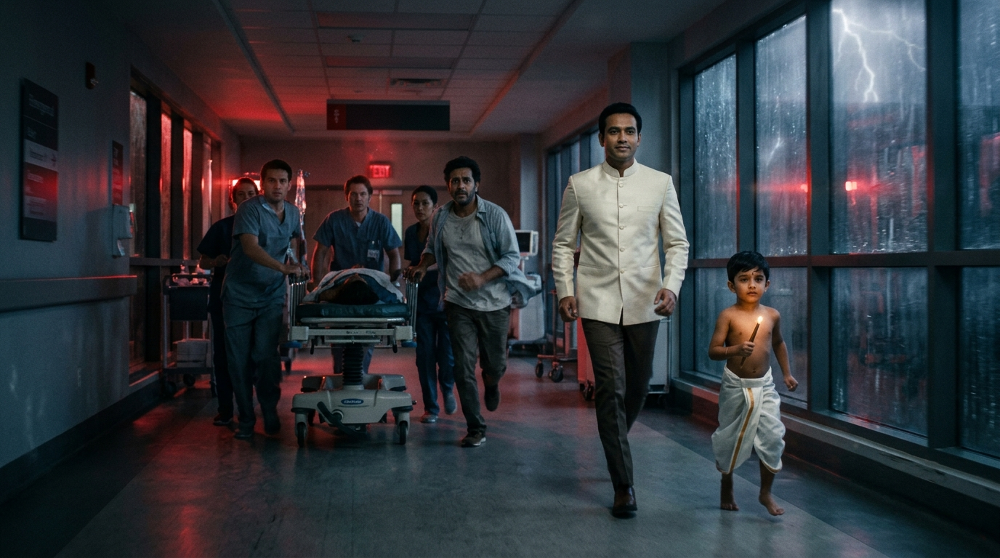
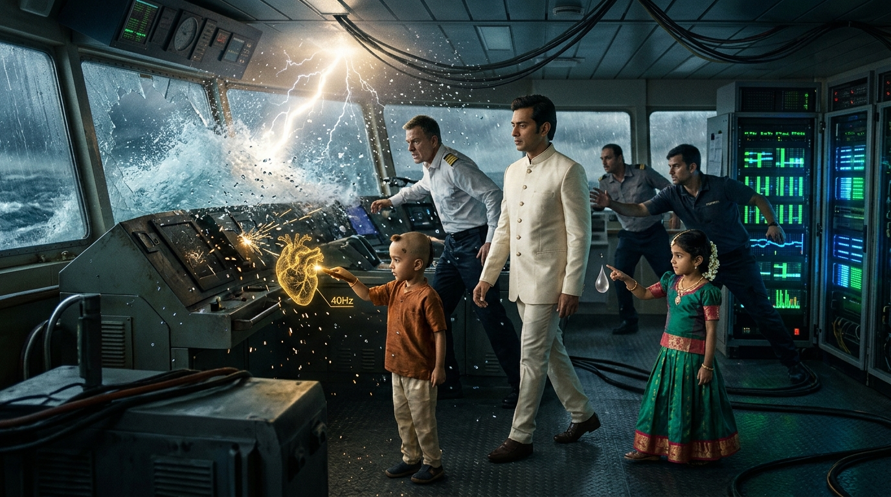
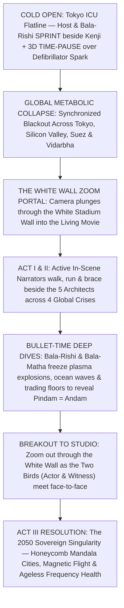

# THE KARMIC GENIE SHOW: THE EPIC CINEMATIC MOVIE
## Screenplay Master Blueprint: Transposing Between The White Stadium & The Living Movie
### *Cinematic Reference Benchmarks: Interstellar • Dune • The Matrix • 2001: A Space Odyssey • Oppenheimer • Mundaka Upanishad (The Two Birds)*

> [!IMPORTANT]
> **The Creator's Signature Originality: The "Two Birds" Active In-Scene Narrator & Bullet-Time Pause Mechanic**
> Inspired by the *Mundaka Upanishad* parable of the **Two Birds on One Tree** (*இரு பறவைகள்!* — where the *Jivatma* bird eats the bitter and sweet fruits of action while the *Paramatma* witness bird sits and moves right beside it in serene compassion), the 3 Narrators (**Host `@Me`**, **4yo Bala-Rishi**, and **4yo Bala-Matha**) do **NOT** sit passively in the studio or speak as disembodied voiceovers (`V.O.`).
> 
> **1. Kinetic In-Scene Mirroring (`[ACTIVE IN-SCENE NARRATOR — "TWO BIRDS" BLOCKING]`):**
> - Our 3 Narrators **LIVE physically inside the movie scenes**, matching the main characters' exact physical motion when the characters are not speaking:
>   - When a panicked father (**Kenji**) and ICU doctors **sprint** down a rain-lashed Tokyo hospital hallway during a blackout, **Host (`@Me`)** and **Bala-Rishi** are **sprinting step-for-step right beside Kenji's shoulder**, looking calmly into the camera lens to narrate the inner truth!
>   - When **Alan Stamm** **strides** furiously through a freezing Silicon Valley quantum bunker, or **Captain Carl Davke** **braces against 50-foot hurricane waves** on a container ship bridge, `@Me` and `Bala-Rishi` are **striding and bracing right beside them on the wet steel deck**.
>   - When **Vishan Davana** and farmer **Ramesh** **kneel** in parched Vidarbha mud or run through a dust storm, **Bala-Matha** is **walking barefoot and kneeling right beside them**.
> 
> **2. The 3D Bullet-Time Freeze-Frame Walkthrough (`[SCENE TIME-PAUSE — 3D BULLET-TIME WALKTHROUGH]`):**
> - At moments of peak dramatic action—when a defibrillator spark fires over 7-year-old Maya's chest, when an EUV tin-plasma droplet explodes at 220,000°C, or when a 400kV transformer arcs in Prayagraj—the Narrator raises a hand or taps the neem stylus to **PAUSE THE MOVIE IN CRYSTAL 3D BULLET-TIME**.
> - While raindrops, lightning arcs, and falling tears hang motionless in mid-air, `@Me`, `Bala-Rishi`, and `Bala-Matha` **walk calmly between the frozen characters**, touching a suspended tear or drawing the 40Hz / 280-month embryological math directly onto the frozen air to explain the deep details—before snapping their fingers (`[TIME RESUMES]`) as the characters' action continues seamlessly!
> 
> **3. The White Wall Zoom Portal:**
> - The giant curved white center wall of the studio is an **infinite IMAX cinema aperture**. The camera **zooms DEEP into the white wall** to enter the movie, and **zooms violently BACK OUT** to bring the characters into the studio for real-time awakening.

---

## 1. Visual Proof: The White Wall Transposition & The "Two Birds" Active Narrators

*1. The White Wall Zoom Portal: The seamless curved white stadium wall dissolves into an infinite IMAX cosmic storm.*

*2. Active In-Scene Narrator ("Two Birds" Kinetic Mirroring): As Kenji and the ICU doctors sprint down the blackout corridor pushing Maya's crash cart, Host (`@Me`) and 4yo Bala-Rishi sprint effortlessly step-for-step right beside them inside the movie frame, looking into the lens to narrate when the characters are silent.*

*3. The 3D Bullet-Time Time-Pause Mechanic: At the exact microsecond of a ship bridge electrical arc and crashing wave, TIME FREEZES. Raindrops, sparks, and a falling tear hang motionless in mid-air while Host (`@Me`), Bala-Rishi (pointing his neem stylus at the 40Hz heart-grid), and Bala-Matha (touching a suspended tear with Nandri) walk calmly among the frozen characters to explain the deep systemic details.*

---

## 2. The 3-Act High-Stakes Narrative Engine & Narrator Choreography

---

## 3. Detailed Act-by-Act Scene & Narrator Blocking Breakdown

### COLD OPEN (Minutes 00:00 - 05:00): The Flatline & The First Time-Pause

* **The Personal Stake & Kinetic Mirroring:** In a Tokyo pediatric ICU, 7-year-old Maya's heart monitor flatlines (`23:11:11 UTC`). As her father **Kenji** and the crash-cart doctors **sprint** down the red-strobing hallway, **Host (`@Me`)** (in ivory bandhgala) and **Bala-Rishi** are **sprinting step-for-step right beside Kenji**, looking straight into the lens to narrate the panic while Kenji is breathless and silent.
* **The First 3D Bullet-Time Pause (`[SCENE TIME-PAUSE]`):** Dr. Tanaka presses the defibrillator paddles to Maya's chest. A blue electrical spark arcs across her skin—and **TIME FREEZES**. The spark, Kenji's falling tear, and the rain outside hang motionless in mid-air.
  - **Host (`@Me`)** walks calmly between the frozen doctors and points to Kenji: *"Look at the Two Birds of the Mundaka Upanishad. One bird—Kenji—tastes the bitter fruit of fear, trembling in the dark. The second bird—the Witness—moves right beside him in the exact same storm."*
  - **Bala-Rishi** taps the frozen defibrillator screen with his neem stylus, projecting the `40Hz` link between Maya's heart and Earth's ionosphere.
  - **Bala-Matha** gently touches Kenji's suspended tear with *Nandri* (sacred gratitude).
  - Host (`@Me`) snaps his fingers—**`[TIME RESUMES]`**—as the global blackout wave rolls across Tokyo, Silicon Valley, the Red Sea, and Vidarbha!

---

### ACT I: THE FOUR-CORNER GLOBAL CRISIS & THE FIVE TITANS (Minutes 05:00 - 20:00)
* **Appropriate Narrator Rotation Across Every Scene:**
  - **Silicon Valley Quantum Bunker (Alan Stamm):** As Alan **runs** between screaming liquid-nitrogen racks, **Bala-Rishi** jogs right alongside Alan's boots, spinning his neem stylus and narrating how Alan awakened Earth's Sixth Sense (`Ajna Chakra`) on `11-11-2022` without building a unified brainstem.
  - **Suez / Red Sea Container Ship (Carl Davke):** As Captain Carl **braces against 60-knot typhoon winds** on the bridge wing, **Host (`@Me`)** and **Bala-Rishi** walk effortlessly beside him on the pitching steel deck, ocean spray flying past them as they explain Earth's arterial thrombosis.
  - **Prayagraj 400kV Grid & Geneva Trading Floor (Marcus Vance & Arjun):** As lineman Arjun **climbs** a sparking steel pylon in `50°C` heat, **Host (`@Me`)** climbs rung-for-rung right beside him—then **pauses time mid-lightning-bolt** to trace the `280-day` to `280-month` embryological chronometer across the sky!
  - **Vidarbha Cracked Cotton Fields (Vishan Davana & Ramesh):** As farmer Ramesh **falls to his knees** in the grey chemical dust, **Bala-Matha** kneels barefoot in the mud right beside him, narrating the starvation of Mother Earth's gut microbiome (*Living Humus*).

---

### ACT II: ZOOMING THROUGH THE WHITE WALL — THE SYSTEMIC REDEMPTION (Minutes 20:00 - 65:00)
* **Sequence A: The EUV Lithography Plasma Freeze (S01E02 / Act II):**
  - Inside the cleanroom, as the CO2 laser hits a tin droplet at `220,000°C`, **Bala-Rishi freezes the microscopic supernova in mid-air** (`[SCENE TIME-PAUSE]`), walking with `@Me` around the glowing plasma sphere to show how silicon is crystalline bone marrow.
* **Sequence B: The 57-Organ Autoimmune Storm in the Blizzard (S01E03 / Act II):**
  - Inside a passenger jet plunging through an Alpine blizzard, **Host (`@Me`)** stands calmly behind the violently shaking cockpit seats while **Bala-Rishi pauses the cockpit instruments in mid-spark** to expose "The Root Fallacy" of 57 competing corporate clouds.
* **Sequence C: The Vascular & Solar Debt Jubilee (S01E04 & S01E05 / Act II):**
  - On the Geneva clearing floor, as Marcus Vance's finger hovers 1 millimeter above the `$4.2 Trillion` release key, **Bala-Matha pauses time**, walks across the frozen trading floor, and blesses the ancestral toil of *Pitru Loka* with 100% *Nandri*, turning paper debt into living solar ATP.

---

### ACT III: BREAKOUT ZOOM-OUT TO STUDIO & THE 2050 SINGULARITY (Minutes 65:00 - 90:00)

* **The Two Birds Meet Face-to-Face:**
  - When the camera zooms out through the White Wall into the physical studio—and then forward into **April 2046 – 2050**—the human characters finally awaken and **see the 3 Narrators walking right beside them**. As foretold in the *Mundaka Upanishad*, when the suffering bird looks up and recognizes the Witness bird beside it, all grief dissolves into sovereign grace.
* **The Final Time-Pause Walkthrough in the 2050 Honeycomb City:**
  - As 31-year-old Maya, 80-year-old ageless Kenji, and the 5 Architects glide through the **2050 Honeycomb Mandala City** (magnetic levitation skyways, perpetual quantum homes whose batteries never die, and `528Hz`/`40Hz` frequency healthcare sanctuaries), `@Me`, `Bala-Rishi`, and `Bala-Matha` glide right beside them—closing with the sacred Tamil Siddha decree:
  - *"அண்டத்தில் உள்ளதே பிண்டம், பிண்டத்தில் உள்ளதே அண்டம். அண்டமும் பிண்டமும் ஒன்றே!"*
