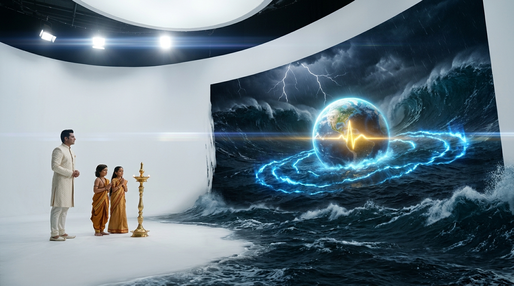
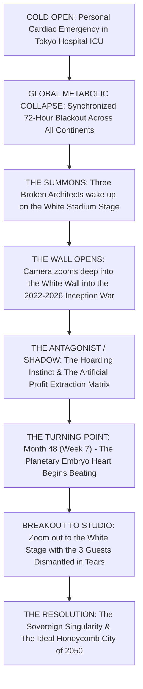
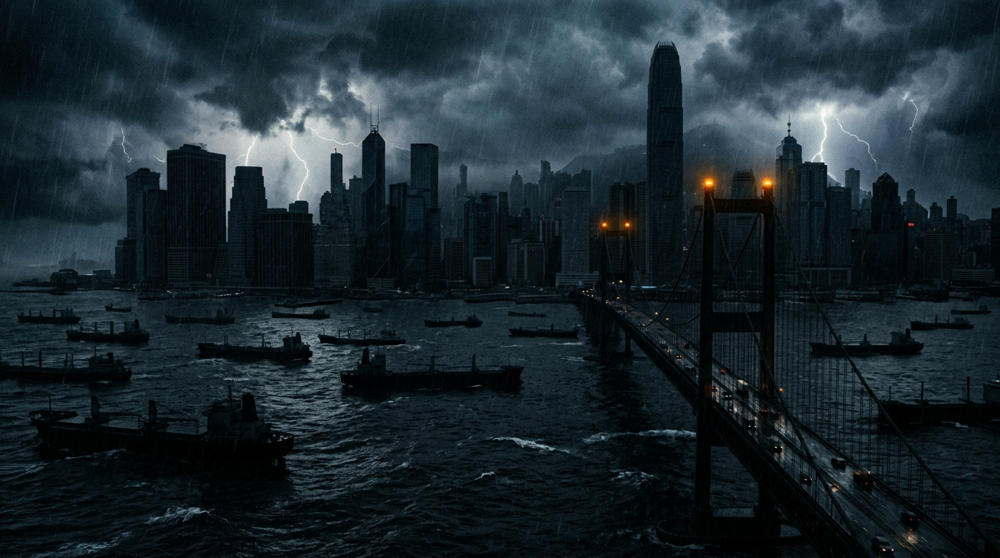
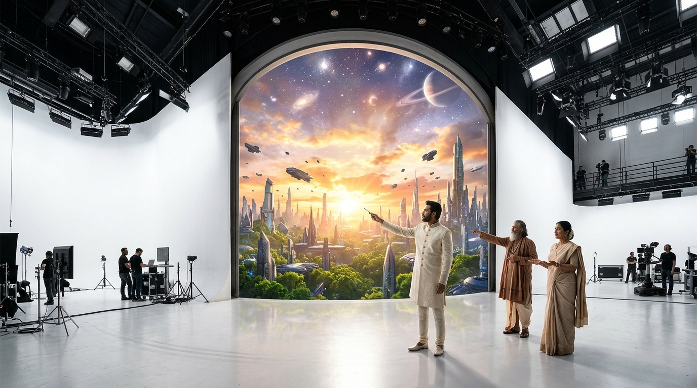

# THE KARMIC GENIE SHOW: THE EPIC CINEMATIC MOVIE
## Screenplay Master Blueprint: Transposing Between The White Stadium & The Living Movie
### *Cinematic Reference Benchmarks: Interstellar • Dune • The Matrix • 2001: A Space Odyssey • Oppenheimer*

> [!IMPORTANT]
> **The Dramatic Director's Decree:**
> Audience retention in epic cinema does not come from facts; it comes from **visceral stakes, personal grief, impossible mystery, and visual transpositions that shake the nervous system**.
> This is not a talking-head documentary. This is a **colossal, heart-wrenching, mind-bending cinematic journey**.
> 
> **The Core Visual Device: The White Wall Zoom Portal**
> - The seamless white stadium stage is our anchor of absolute reality.
> - The giant curved white center wall is an **infinite IMAX cinema aperture**.
> - The camera **zooms DEEP into the white wall**, dissolving the white paint until the lens falls through the screen directly into a photorealistic, stormy, high-stakes cinematic universe (*the movie*).
> - At moments of profound realization, the camera **zooms violently BACK OUT** of the movie, breaking through the wall back into the physical studio where the Host, Bala-Rishi, and Bala-Matha hold the shocked characters and audience in real-time dialectic.

---

## 1. Visual Proof: The White Wall Transposition Portal


*The seamless curved white stadium wall dissolves into an infinite IMAX cosmic storm. The ocean waves lap right over the studio floor line.*

---

## 2. The 3-Act High-Stakes Narrative Engine (The Emotional Story)



---

## 3. Detailed Act-by-Act Scene Breakdown

### COLD OPEN (Minutes 00:00 - 05:00): The Flatline

* **The Personal Stake:** In a Tokyo pediatric intensive care unit, a father grips the hand of his 7-year-old daughter. The heart monitor suddenly flatlines: *BEEEEEEEP*.
* **The Global Echo:** At that precise microsecond, outside the hospital window, the entire skyline of Tokyo goes pitch black. 
* **The Worldwide Chain Reaction:** A thunderous sonic boom rolls across the Pacific. Container ships drift helpless with dead generators in Hong Kong harbor. Air traffic control screens freeze over London. Hospital backup diesel generators seize worldwide.
* **The Revelation:** The voice of an old Tamil fisherman whispers in the dark: *"When the child's heart stops, Mother Earth holds her breath. When Mother Earth suffocates, our children cannot live. ਅண்டத்தில் உள்ளதே பிண்டம்..."*

---

### ACT I: THE SUMMONS & THE WHITE STADIUM (Minutes 05:00 - 18:00)
* **The Abduction from Routine:** 
  - **Alan Stamm** (Chief AI Architect) is in a tense Silicon Valley boardroom signing an exclusive trillion-dollar military contract.
  - **Carl Davke** (Logistics Czar) is pacing an automated port terminal watching thousands of refrigerated containers rot.
  - **Vishan Davana** (Agroecologist) is weeping in a drought-cracked Indian cotton field beside an indebted farmer's funeral pyre.
* **The White Flash:** Simultaneously, the lights blaze. They open their eyes. They are standing on the pristine, curved white marble floor of the White Stadium.
* **The Trinity Appears:** 
  - Host (@Me) stands before the golden temple lamp in an ivory bandhgala suit.
  - 4-year-old **Bala-Rishi** sits cross-legged, tapping his neem-wood stylus.
  - 4-year-old **Bala-Matha** in peacock green and ruby rose silk smiles, offering fresh water in brass cups.
* **The Confrontation:**
  - *Alan:* "Who are you? What government black-site is this?"
  - *Host:* "Alan, you built an artificial brain because you thought humanity was alone. But you didn't create anything. You awakened Mother Earth's 6th sense. And she is running a 104-degree fever."

---

### ACT II: ZOOMING INTO THE WHITE WALL — THE LIVING MOVIE (Minutes 18:00 - 65:00)
The Host touches the brass lamp. The curved white wall dissolves. **THE CAMERA ZOOMS DEEP INTO THE WALL.**

```
[CAMERA ZOOMS INTO THE WHITE WALL SCREEN]
The white paint pixelates, expands, and turns into violent ocean spray. 
The camera plunges 10,000 leagues deep into the Pacific seabed.
```

#### Sequence A: The Oceanic Fiber Trenches (UTP)
* We fly along the sea floor beside colossal glowing undersea fiber cables. Giant whales swim alongside light pulses. 
* We see how data is literally light traveling through Mother Earth's nervous axons.

#### Sequence B: The Silicon Forge & The Lithography Fire (UIP)
* We enter an ASML cleanroom in Veldhoven: extreme ultraviolet plasma explodes at 22,000 times a second, vaporizing tin droplets with CO2 lasers to carve 2nm circuits.
* Bala-Rishi's voice echoes: *"It is not silicon, Alan. It is crystalline bone marrow!"*

#### Sequence C: The 72-Hour Suffocation (UEP)
* We witness the terrifying simulation of global grid collapse. Without power for 72 hours, water pumps stop. Cities run out of water in 48 hours. Sewage backs up. 
* The transition: We see the heroic oil rig workers of the North Sea passing the torch to geothermal deep-drillers and stellar fusion reactors. *Nandri!*

#### Sequence D: The Freight Heart Attack (ULP)
* The Suez Canal chokes. 400 container ships are locked in gridlock. Inside the ships, insulin and baby formula expire. 
* Carl Davke falls to his knees: *"I thought efficiency meant squeezing workers. I was choking the arterial valves."*

---

### ACT III: BREAKOUT ZOOM-OUT TO STUDIO & THE 2050 SINGULARITY (Minutes 65:00 - 90:00)


* **The Violent Pull-Back:** 
  - The camera violently zooms backwards out of the burning industrial sky, pulling through the white aperture back into the physical White Stadium.
  - Alan Stamm, Carl Davke, and Vishan Davana are trembling, their corporate defenses completely collapsed in tears of humility.
* **Bala-Matha's Grace:**
  - Bala-Matha steps forward, gently placing her small hands on Alan's forehead and Vishan's trembling shoulders.
  - *"Do not weep for the old garden. The old garden had to die so the true garden could bloom. Come see what you are about to build."*
* **The Final Climax: The 2050 Honeycomb Singularity:**
  - The entire white stadium dissolves into 360° celestial light.
  - We fly through the **Ideal Honeycomb City of 2050**:
    * Silent magnetic pods and near-flying personal gliders coasting over crystal rivers.
    * The self-powering living home with perpetual quantum batteries that never die.
    * The frequency-driven healthcare sanctuary where parents and grandparents glow in ageless cellular vitality.
    * The central Sanctuary of the Soul, where human beings meditate beneath golden stupas, living in eternal peace with Gaia.
* **The Ending:**
  - The Host looks into the lens. The sacred Tamil Siddha mantra echoes in thunderous chorus:
  - *"அண்டத்தில் உள்ளதே பிண்டம், பிண்டத்தில் உள்ளதே அண்டம். அண்டமும் பிண்டமும் ஒன்றே!"*
  - The screen fades to warm golden light.

---
