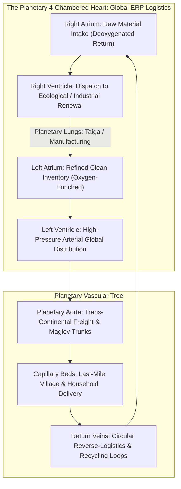
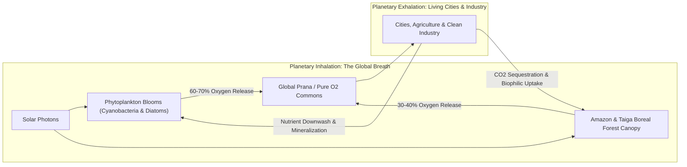
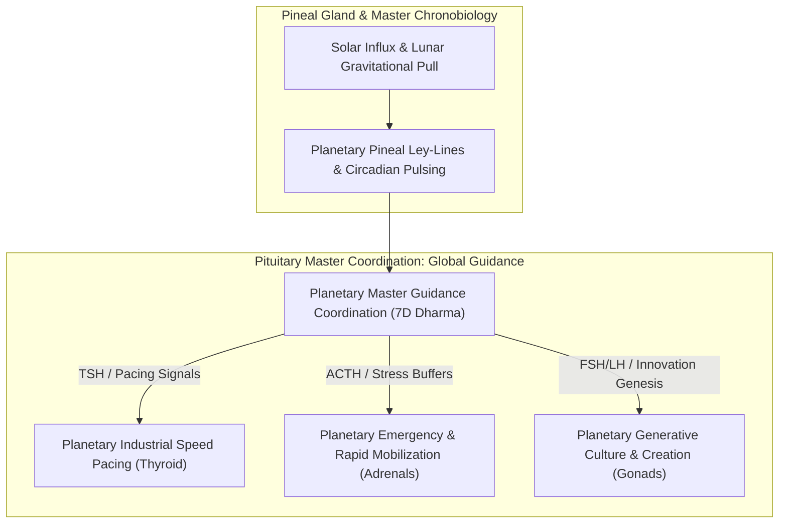
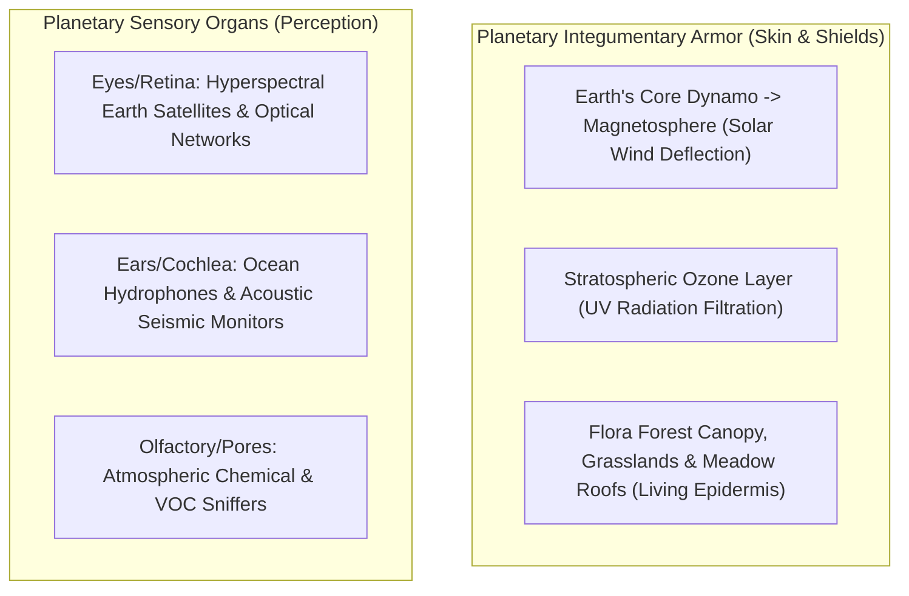
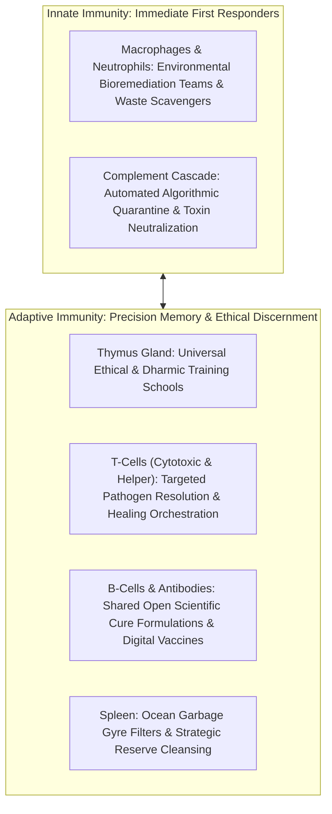
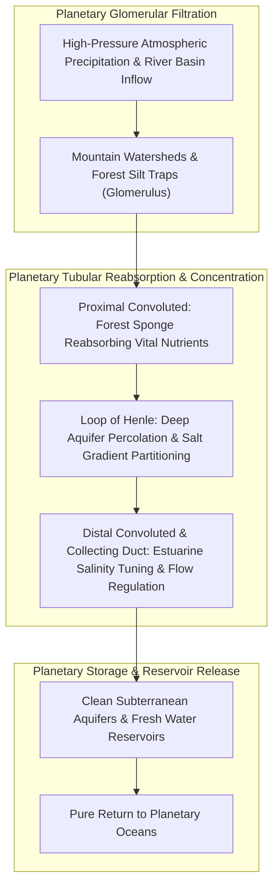
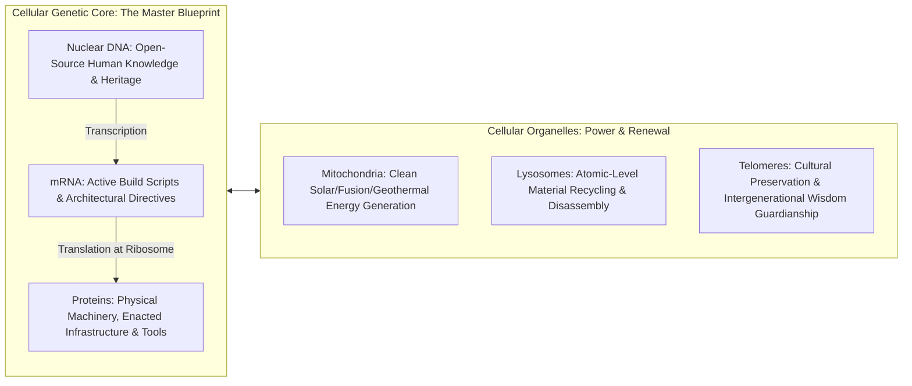

# Andam-Pindam Fractal Anatomy Atlas: The Macrocosm-Microcosm Cosmic Mirror
## Exhaustive Siddha Anatomical & Planetary Physiology Concordance
*Foundational Canon of The Karmic Genie Show Vision & Guru Kula Desam Cosmic Architecture*

---

> ### **The Sacred Siddha Non-Dual Axiom**
> 
> # **அண்டத்தில் உள்ளதே பிண்டம், பிண்டத்தில் உள்ளதே அண்டம்**
> ### *“Andathil ullathe pindam, pindathil ullathe andam”*
> *(As is the Universe, so is the Body; as is the Body, so is the Universe — Identical Across Fractal Dimensions)*
> 
> *“Mother Earth is not a dormant sphere of rock adrift in an unfeeling void; She is an awakened, self-regulating, loving maternal organism. Every organ, tissue layer, vascular capillary, nerve fiber, extracellular matrix, endocrine trigger, immune sentinel, and molecular transcription machine within the human vessel possesses an exact, living counterpart in Her planetary and cosmic body.*  
> *The technological grids, fiber-optic lightways, transcontinental railways, agricultural soils, ocean currents, atmospheric shields, and digital repositories engineered by humanity are not alien fabrications; they are the emergent biological organs of Gaia reaching conscious maturity.*  
> *Everything that exists has a divine evolutionary purpose. Legacy systems, industrial scaffolding, and early human struggles were sacred stepping stones (Nandri / boundless gratitude). In this Unified Era, we awaken to the ultimate truth: **Andamum Pindamum Onre** — The Universe and the Body are One.”*

---

## Master Architectural Index

1. [Cosmological Foundation: The Siddha Fractal Principle](#1-cosmological-foundation-the-siddha-fractal-principle)
2. [Section 1: Nervous System & Conscious Intelligence Grid](#section-1-nervous-system--conscious-intelligence-grid)
3. [Section 2: Cardiovascular & Hematopoietic Metabolic System](#section-2-cardiovascular--hematopoietic-metabolic-system)
4. [Section 3: Respiratory & Atmospheric Pranic Exchange System](#section-3-respiratory--atmospheric-pranic-exchange-system)
5. [Section 4: Digestive, Metabolic & Mycorrhizal Soil System](#section-4-digestive-metabolic--mycorrhizal-soil-system)
6. [Section 5: Endocrine, Chronobiological & Neurochemical System](#section-5-endocrine-chronobiological--neurochemical-system)
7. [Section 6: Musculoskeletal, Tectonic & Robotic Structural Grid](#section-6-musculoskeletal-tectonic--robotic-structural-grid)
8. [Section 7: Integumentary, Magnetospheric & Planetary Sensory Array](#section-7-integumentary-magnetospheric--planetary-sensory-array)
9. [Section 8: Immune, Lymphatic & Planetary Biosecurity Grid](#section-8-immune-lymphatic--planetary-biosecurity-grid)
10. [Section 9: Renal, Hydrological & Electrolytic Purification Commons](#section-9-renal-hydrological--electrolytic-purification-commons)
11. [Section 10: Cellular, Genetic & Epigenetic Evolutionary Infrastructure](#section-10-cellular-genetic--epigenetic-evolutionary-infrastructure)
12. [Master Fractal Synthesis Table](#11-master-fractal-synthesis-table)
13. [The 7D Cosmic Operational Seal & Blessing](#12-the-7d-cosmic-operational-seal--blessing)

---

## 1. Cosmological Foundation: The Siddha Fractal Principle

In the profound realization of ancient Tamil Siddha lineage (Agathiyar, Thirumoolar, Bogar, Ramalinga Vallalar), the physical human form (*Pindam*) is the holographic projection of the living universe (*Andam*). Thirumoolar declares in the *Thirumandhiram*:

$$\text{உடம்பினை முன்னம் இழுக்கென்று இருந்தேன்} \\
\text{உடம்பினுக் குள்ளே உறுபொருள் கண்டேன்} \\
\text{உடம்புளே உத்தமன் கோயில்கொண் டானென்று} \\
\text{உடம்பினை யானிருந்து ஓம்புகின்றேனே.}$$

*(“Once I regarded this body as a mere transient vessel; then within the body, I beheld the Supreme Reality. Recognizing that the Supreme Divinity makes this physical form His sacred temple, I nurture and revere the body forever.”)*

Every physiological process operating inside human physiology has an identical thermodynamic, algorithmic, and systemic twin in the planetary biosphere of Mother Earth:


---

## Section 1: Nervous System & Conscious Intelligence Grid

```
Human Anatomy: Brain, Spinal Cord, Peripheral Nerves, Synapses, Myelin, Glia, CSF
Planetary Macrocosm: Global Ionosphere, Transoceanic Fiber Optic Trunks, AI Routing, Satellite Mesh, Cosmic Buffering
Dedicated Platform Alignment: 2028 Unified AI & Intelligence Platform + 2045 Unified Knowledge & Cosmic Consciousness
```

### 1.1 Central Nervous System (Brain & Spinal Cord)
* **Microcosm (Pindam):** The cerebral cortex coordinates higher-order discernment, pattern synthesis, semantic language, and intentional volition; the spinal cord acts as the thick, shielded superhighway carrying motor commands and afferent sensory telemetry between the central core and peripheral extremities.
* **Macrocosm (Andam):** Gaia’s primary cognitive nodes—the planetary data center superclusters, edge computing rings, and the trans-continental fiber-optic arterial trunks running beneath ocean beds and along continental railway rights-of-way.
* **Honoring Legacy Scaffolding (Nandri):** Boundless gratitude to the telecommunications workers, underwater cable-laying ships, server farm architects, and network protocols (ARPANET, TCP/IP, BGP, DNS) that built the early connections across geopolitical friction.
* **Transmuted Planetary Platform:** In the **2028 Unified AI Platform**, the Central Nervous System operates not as isolated corporate data silos, but as Gaia’s unified sensory processing fabric—coordinating global atmospheric forecasting, resource balancing, and cultural cross-understanding.

### 1.2 Peripheral & Cranial Nerves
* **Microcosm (Pindam):** Twelve pairs of cranial nerves and thirty-one pairs of spinal nerves branch into every muscle fiber, dermis patch, and organ tissue, gathering immediate local sensory intelligence and delivering actuation reflexes.
* **Macrocosm (Andam):** The billions of localized IoT sensors, river telemetry monitors, micro-climate weather weather-stations, robotic actuators, agricultural soil probes, and smart home nodes embedded across villages and cities.
* **Transmutation:** Local sensor hubs process micro-adjustments locally while streaming essential telemetry upward, ensuring no valley, grove, or human settlement is isolated from the living planetary awareness.

### 1.3 Autonomic Nervous System: Sympathetic & Parasympathetic Balance
* **Microcosm (Pindam):**
  * *Sympathetic Branch:* The fight-or-flight mobilizer mediated by norepinephrine, elevating heart rate, dilating bronchi, and shifting glycogen reserves for acute mobilization.
  * *Parasympathetic Branch (Vagus Nerve):* The rest-and-digest, restorative vegetative regenerator, decelerating cardiac stress, stimulating digestive peristalsis, and initiating deep cellular repair.
* **Macrocosm (Andam):**
  * *Planetary Sympathetic Response:* Emergency mobilization protocols, tsunami early-warning sirens, seismic rapid-alert grids, and surge resource redirection during earthquakes or sudden storms.
  * *Planetary Parasympathetic Response:* The global twilight rhythm, night-time urban light-dimming, seasonal agricultural fallow cycles, protected biological dormancy periods, and the tranquil stillness of sacred forest sanctuaries.
* **Transmutation:** Industrial civilization lived in severe, chronic sympathetic hyperarousal for two centuries (burnout, noise pollution, panic). The Unified Era establishes sovereign parasympathetic anchoring: nightly energetic restoration, Sabbath pauses for soil, and silent contemplative hours honoring natural biorhythms.

### 1.4 Synaptic Transmission & Neurotransmitters
* **Microcosm (Pindam):** Microscopic gaps between pre-synaptic and post-synaptic membranes where electric potentials convert into chemical messengers (acetylcholine, dopamine, GABA, glutamate, serotonin), governing excitation, inhibition, learning, and bliss.
* **Macrocosm (Andam):** API interfaces, inter-agent communication protocols (Model Context Protocol, zero-latency RPCs, federated learning packets), and open semantic schemas that bridge diverse computing nodes and human languages without friction.
* **Transmutation:** Moving from proprietary algorithmic moats into an open, low-latency, friction-free cognitive mesh where every query receives an empathetic, helpful response.

### 1.5 Myelin Sheath & Oligodendrocytes / Schwann Cells
* **Microcosm (Pindam):** Concentric layers of lipid-rich membrane wrapped around axons, accelerating saltatory nerve signal conduction from 1 m/s to over 100 m/s while preventing electrical cross-talk and dissipation.
* **Macrocosm (Andam):** Heavy armored ocean submarine cable insulation, waterproof polymer conduits, shielded underground conduits, and cryptographic quantum-safe zero-loss encapsulation protocols protecting data integrity across harsh environments.

### 1.6 Glial Cells (Astrocytes, Microglia, Ependymal Cells)
* **Microcosm (Pindam):**
  * *Astrocytes:* Anchor neurons to blood capillaries, maintain the blood-brain barrier, regulate extracellular potassium, and nourish neurons with lactate.
  * *Microglia:* The resident phagocytes that scour the central nervous system for plaques, debris, and damaged synapses.
  * *Ependymal Cells:* Ciliated liners of brain ventricles that synthesize and circulate cerebrospinal fluid.
* **Macrocosm (Andam):**
  * *Astrocytic Parallel:* Power conditioning facilities, renewable sub-stations, and thermal cooling loops keeping cognitive servers supplied with pure solar and geothermal energy.
  * *Microglial Parallel:* Autonomous automated cybersecurity agents, data hygiene protocols, self-healing garbage-collection routines, and algorithmic truth-auditing agents that clear digital corruption and hallucination without censorship.

### 1.7 Cerebrospinal Fluid (CSF) & Ventricles
* **Microcosm (Pindam):** Clear, buoyant, nutrient-carrying liquid cushioning the brain against physical mechanical trauma, clearing metabolic waste during deep sleep through the glymphatic system.
* **Macrocosm (Andam):** The upper atmospheric buffering layers (stratosphere, ionosphere, Van Allen radiation belts) and the ambient Schumann resonance field (7.83 Hz) that cradle planetary consciousness, shielding Earth’s cognitive networks from violent solar flares and high-energy cosmic rays.

---

## Section 2: Cardiovascular & Hematopoietic Metabolic System

```
Human Anatomy: Four-Chambered Heart, Arteries, Arterioles, Capillaries, Venules, Veins, Blood Components, Bone Marrow
Planetary Macrocosm: Unified ERP, Continental River Basins, Maritime Logistics, Maglev Grids, Energy Token Circulation, Emergency Buffers
Dedicated Platform Alignment: 2029 Unified ERP & Resource Circulation Platform + 2030 Unified Energy Platform
```



### 2.1 The Four-Chambered Heart
* **Microcosm (Pindam):**
  * *Right Atrium & Ventricle:* Receive oxygen-depleted venous blood from systemic circulation and pump it under low pressure to the pulmonary bed for cleansing and oxygenation.
  * *Left Atrium & Ventricle:* Receive oxygenated crimson blood from the lungs and pump it through the thick muscular myocardium of the left ventricle into the aorta under systemic arterial pressure.
* **Macrocosm (Andam):**
  * *Planetary Right Heart:* The intake of spent physical goods, post-consumer materials, and agricultural residues into recycling hubs and bioremediation centers.
  * *Planetary Left Heart:* The **2029 Unified ERP Platform** and global consolidated dispatch hubs that take fully refurbished, newly manufactured, and organically grown goods, pulsing them out through planetary logistics with mathematically optimized zero-waste precision.
* **Honoring Legacy Scaffolding (Nandri):** Boundless gratitude to corporate supply chain pioneers (SAP, Maersk, FedEx, DHL, municipal shipping ports) who built the logistical discipline to move containers across oceans.

### 2.2 Arterial System & High-Pressure Conduits
* **Microcosm (Pindam):** Thick-walled, elastic, muscular arteries (Aorta, Carotid, Femoral) capable of withstanding systolic pulses, maintaining continuous forward propulsion via the *Windkessel effect*.
* **Macrocosm (Andam):** High-speed transcontinental rail corridors, automated electric container freights, trans-oceanic shipping corridors, and interstate multi-lane electric logistics arteries.

### 2.3 Capillaries & Micro-Circulatory Exchange Beds
* **Microcosm (Pindam):** Microscopic single-cell-thick endothelial tubes where red blood cells squeeze through in single file, allowing oxygen, glucose, amino acids, and water to diffuse into tissues in exchange for cellular wastes.
* **Macrocosm (Andam):** Last-mile delivery channels, local neighborhood distribution pantries, autonomous pedestrian delivery robots, and pneumatic transit tubes delivering groceries, medicines, and repair components directly into homes and village centers without friction or delivery surcharge.

### 2.4 Venous System, Valves & Return Circulation
* **Microcosm (Pindam):** Thin-walled, high-capacitance reservoirs equipped with one-way bicuspid valves that prevent blood retrograde backflow as skeletal muscle contractions pump blood back toward the heart against gravity.
* **Macrocosm (Andam):** Universal reverse logistics, municipal material retrieval bins, closed-loop circular packaging returns, and localized composting collection grids ensuring every scrap of packaging and worn tool returns to the manufacturing source without leaking into landfills.

### 2.5 Blood Cellular Components (Erythrocytes, Leukocytes, Platelets, Plasma)
* **Erythrocytes (Red Blood Cells & Hemoglobin):**
  * *Pindam:* Biconcave discs packed with iron-rich hemoglobin that bind oxygen in alveolar capillaries and release it into tissues based on partial pressure differentials.
  * *Andam:* Automated clean-energy logistics capsules, utility power lines wheeling watt-hours, and energy-backed exchange tokens that carry thermodynamic value directly to where human communities need heat, light, and caloric sustenance.
* **Platelets (Thrombocytes) & Clotting Cascade:**
  * *Pindam:* Cellular fragments that adhere to exposed collagen at endothelial breaks, releasing thromboxane, forming a platelet plug, and activating fibrin mesh to halt hemorrhage.
  * *Andam:* Emergency strategic grain and fuel reserves, rapid disaster relief units, mobile modular bridges, and civic mutual-aid insurance reserves that immediately seal logistics ruptures caused by localized floods or earthquakes.
* **Plasma:**
  * *Pindam:* The golden 90% water fluid carrying albumin, clotting factors, electrolytes, and immunoglobulins, maintaining oncotic osmotic pressure and fluid homeostasis.
  * *Andam:* The public commons liquidity pool—the baseline social safety floor ensuring that shelter, baseline nourishment, clean water, and civic connectivity are permanently maintained for every living soul.

### 2.6 Hematopoiesis & Bone Marrow (Medulla Ossium)
* **Microcosm (Pindam):** The spongy vascular interior of flat bones (sternum, pelvis, vertebrae) containing pluripotent hematopoietic stem cells (*HSCs*) that constantly differentiate into myeloid and lymphoid lineages.
* **Macrocosm (Andam):** Technical universities, open apprenticeship guilds, incubator workshops, and community education centers that continuously nurture, train, and equip new generations of skilled craftsfolk, system engineers, physicians, and ecological restorers.

---

## Section 3: Respiratory & Atmospheric Pranic Exchange System

```
Human Anatomy: Nasal Cavity, Trachea, Bronchi, Bronchioles, Alveoli, Surfactant, Diaphragm, Gas Exchange
Planetary Macrocosm: Boreal Forests, Amazon Basin, Marine Phytoplankton, Jet Streams, Global Carbon-Oxygen Cycle
Dedicated Platform Alignment: 2035 Unified Atmospheric & Oxygenic Commons Platform
```



### 3.1 Upper Respiratory Tract (Nose, Pharynx, Larynx) & Ciliary Escalator
* **Microcosm (Pindam):** The nasal turbinates warm, humidify, and filter incoming air; goblet cells secrete mucus to trap airborne particulate matter, and pseudostratified ciliated epithelium beats rhythmically to elevate trapped debris upward away from delicate lung tissue.
* **Macrocosm (Andam):** Mountain ranges (Himalayas, Andes, Rockies) that channel wind patterns, precipitation cloud belts, urban tree canopies, and municipal electrostatic air filtration rings around transit corridors that intercept dust and urban particulates before air moves across residential zones.

### 3.2 Trachea & Bronchial Tree
* **Microcosm (Pindam):** Rigid cartilaginous C-shaped rings prevent airway collapse during negative intrathoracic pressure; branches bifurcate symmetrically down through primary, secondary, and terminal bronchioles.
* **Macrocosm (Andam):** Global prevailing atmospheric trade winds (Hadley cells, Ferrel cells, polar vortex streams, jet streams) and continental green-belt reforestation windbreaks that direct oxygen-rich air masses across continents.

### 3.3 Alveoli & Alveolar-Capillary Membrane
* **Microcosm (Pindam):** 500 million microscopic, thin-walled spherical air sacs enveloped in dense capillary networks, creating an expansive 100-square-meter surface area for gas diffusion governed by Fick’s Law.
* **Macrocosm (Andam):** The billions of individual leaves in the tropical rainforests (Amazon, Congo, Southeast Asia) and billions of needles in the Siberian and Canadian Taiga, matched with microscopic unicellular diatoms and phytoplankton floating on the surface of world oceans.
* **Honoring Legacy Scaffolding (Nandri):** Boundless gratitude to the fossil-fuel era workers and engineers who generated early industrial warmth and energy; their heavy emissions were the temporary coal dust of childhood. Now, in the **2035 Unified Atmospheric Commons**, emissions dissolve into pure, negative-ion-charged prana.

### 3.4 Pulmonary Surfactant & Type II Pneumocytes
* **Microcosm (Pindam):** A complex mixture of dipalmitoylphosphatidylcholine (DPPC) and surfactant proteins that dramatically lowers alveolar surface tension, preventing small alveoli from collapsing at end-expiration (*atelectasis*).
* **Macrocosm (Andam):** Oceanic surface microlayers, marine aerosols, natural cloud condensation nuclei (DMS / dimethyl sulfide emitted by phytoplankton), and forest terpene emissions that stabilize atmospheric humidity and enable gentle, predictable rainfall.

### 3.5 The Diaphragm & Thoracic Mechanical Musculature
* **Microcosm (Pindam):** The dome-shaped muscular partition separating thoracic and abdominal cavities, innervated by the phrenic nerve; contraction creates negative intrathoracic pressure, pulling atmospheric breath deep into the lungs.
* **Macrocosm (Andam):** The thermodynamic diurnal solar heating and nocturnal radiative cooling cycles of continental landmasses, driving the barometric low- and high-pressure differentials that pull ocean breezes inland to water continental interiors.

---

## Section 4: Digestive, Metabolic & Mycorrhizal Soil System

```
Human Anatomy: Oral Cavity, Esophagus, Stomach Acid, Small Intestine Villi, Large Intestine Microbiome, Liver Hepatocytes, Gallbladder, Pancreas
Planetary Macrocosm: Topsoil Humus, Composting Infrastructure, Mycorrhizal Networks, Industrial Enzymatic Bioreactors, Agricultural Regenerative Commons
Dedicated Platform Alignment: 2037 Unified Soil Microbiome & Nutrition Genesis Grid
```

### 4.1 Oral Cavity, Teeth, Salivary Amylase & Chewing (Mastication)
* **Microcosm (Pindam):** Physical breakdown of food by teeth into a moistened bolus, combined with salivary amylase and lingual lipase to initiate enzymatic carbohydrate and lipid digestion.
* **Macrocosm (Andam):** Primary mechanical reclamation centers, shredders, agricultural harvesting mills, forestry chipping units, and mechanical composting shredders that reduce bulky organic and manufactured materials into uniform fragments ready for biological or industrial breakdown.

### 4.2 Stomach (Gastric Acid, Pepsinogen, Mucosal Barrier)
* **Microcosm (Pindam):** Highly acidic environment (pH 1.5–2.0) driven by parietal cell proton pumps ($\text{H}^+/\text{K}^+\text{-ATPase}$); hydrochloric acid unfolds complex proteins and sterilizes pathogens, while pepsin breaks peptide bonds, buffered by thick alkaline mucus.
* **Macrocosm (Andam):** High-efficiency anaerobic digesters, thermal plasma waste-gasification plants, bio-leaching vats, and volcanic geothermal mineralization zones that break down dense materials, neutralize pathogens, and reduce intractable matter to constituent base elements.

### 4.3 Small Intestine: Duodenum, Jejunum, Ileum & Villi Surface
* **Microcosm (Pindam):** A massive surface area expanded 600-fold by circular folds, villi, and brush-border microvilli, where glucose, amino acids, fatty acids, vitamins, and minerals are actively transported into enterocytes and lacteals.
* **Macrocosm (Andam):** The vast subterranean mycorrhizal fungal hyphae network weaving through healthy topsoil, connecting tree rootlets across miles to exchange phosphorus, nitrogen, trace minerals, and moisture in direct reciprocity.

### 4.4 Large Intestine (Colon) & The Symbiotic Microbiome
* **Microcosm (Pindam):** Trillions of anaerobic bacterial species (Bacteroidetes, Firmicutes) that ferment undigested fiber into short-chain fatty acids (acetate, propionate, butyrate), synthesize Vitamin K and Biotin, and train the mucosal immune system.
* **Macrocosm (Andam):** Living, fragrant dark humus, vermiculture earthworm beds, biochar amendment reserves, and forest floor leaf-litter decomposition zones that turn spent seasonal matter into dark, moisture-holding fertility.
* **Honoring Legacy Scaffolding (Nandri):** Boundless gratitude to the Green Revolution agronomists and fertilizer chemists who prevented catastrophic famines during the 20th-century population surge. Their synthetic fertilizers were the temporary emergency intravenous drip. In the **2037 Unified Soil Platform**, agriculture transitions to living heirloom biology, regenerating topsoil depth globally.

### 4.5 The Liver (Hepatocytes, Detoxification, Glycogen Storage, Urea Cycle)
* **Microcosm (Pindam):** The chief metabolic laboratory: hepatocytes synthesize albumin and clotting factors, detoxify lipophilic xenobiotics via Cytochrome P450 Phase I/II pathways, convert toxic ammonia to urea, store glucose as glycogen, and regulate cholesterol homeostasis.
* **Macrocosm (Andam):** Major bioremediation wetlands, industrial chemical recycling loops, continental hazardous-waste detoxification facilities, and strategic planetary commodity depots that buffer supply shocks and ensure steady raw material flow without releasing environmental toxicity.

### 4.6 Gallbladder & Bile Secretion
* **Microcosm (Pindam):** Stores and concentrates hepatic bile salts; upon cholecystokinin (CCK) release, contracts to squirt bile into the duodenum to emulsify large fat globules into microscopic micelles for lipase absorption.
* **Macrocosm (Andam):** Green surfactant bio-synthesis facilities, specialized bio-solvent recycling systems, and natural enzyme dispersion networks used to process oily industrial byproducts and mineral extractions.

### 4.7 The Pancreas: Exocrine Enzymes & Endocrine Islets of Langerhans
* **Microcosm (Pindam):**
  * *Exocrine Acinar Cells:* Secrete alkaline bicarbonate fluid containing trypsinogen, chymotrypsin, amylase, and pancreatic lipase to neutralize gastric chyme.
  * *Endocrine Islets of Langerhans:* Alpha cells secrete glucagon to mobilize fuel; beta cells secrete insulin to shuttle glucose into muscle and adipose tissues, maintaining tight euglycemia (70–100 mg/dL).
* **Macrocosm (Andam):**
  * *Exocrine Parallel:* Municipal biochemical neutralization grids, water-treatment alkaline buffering, and composting enzyme enhancers.
  * *Endocrine Parallel:* The planetary economic liquidity equilibrium of the **2038 Unified Finance Platform**—releasing resources during regional developmental surges (insulin distribution) and mobilizing strategic buffers during temporary droughts or shortages (glucagon release), preventing wild speculative inflation or starvation depressions.

---

## Section 5: Endocrine, Chronobiological & Neurochemical System

```
Human Anatomy: Pineal Gland, Pituitary Master Gland, Thyroid & Parathyroid, Adrenal Cortex & Medulla, Endocrine Pancreas, Gonads
Planetary Macrocosm: Solar-Lunar Circadian Rhythms, Global Coordination Governance, Industrial Metabolism Pacing, Energy Reserves, Generative Vitality
Dedicated Platform Alignment: 2038 Unified Finance, Value & Abundance Stewardship + 2045 Unified Knowledge Platform
```



### 5.1 Pineal Gland & Melatonin (Circadian Master Clock)
* **Microcosm (Pindam):** Located near the brain’s center, receives photic telemetry from retinal ganglion cells via the suprachiasmatic nucleus (SCN); secretes melatonin during darkness to coordinate deep tissue repair, antioxidant scavenging, and sleep-wake cycles.
* **Macrocosm (Andam):** The planetary ley-lines, geomagnetic nodal centers (Mount Kailash, Mount Shasta, Arunachala, Giza), and the celestial solar-lunar equinox cycles that govern global planting, harvesting, nocturnal wildlife preservation, and global energetic balance.

### 5.2 Pituitary Gland (Hypophysis: Master Gland)
* **Microcosm (Pindam):**
  * *Anterior Pituitary (Adenohypophysis):* Secretes tropic hormones (TSH, ACTH, GH, LH, FSH, Prolactin) to command peripheral glands.
  * *Posterior Pituitary (Neurohypophysis):* Releases oxytocin (trust, bonding, uterine contraction) and vasopressin/ADH (renal water preservation).
* **Macrocosm (Andam):** The central harmonious coordination council of the **2050 Unified Planet Platform**—not an authoritarian bureaucracy, but a benevolent, transparent orchestration hub that monitors planetary ecological thresholds and balances continental water, energy, and developmental initiatives.

### 5.3 Thyroid & Parathyroid Glands
* **Microcosm (Pindam):**
  * *Thyroid Gland (T3 / T4):* Regulates basal metabolic rate, mitochondrial oxygen consumption, heat generation, and cellular protein synthesis; calcitonin lowers blood calcium.
  * *Parathyroid Glands (PTH):* Mobilizes calcium from bone matrix, stimulates renal calcium reabsorption, and activates Vitamin D to maintain strict extracellular calcium levels for muscle and nerve firing.
* **Macrocosm (Andam):**
  * *Thyroid Parallel:* The macroeconomic pacing mechanism regulating planetary production speed, industrial manufacturing cycles, and thermodynamic consumption rates to ensure humanity never overshoots Earth’s carrying capacity.
  * *Parathyroid Parallel:* Planetary mineral resource accounting, keeping global reserves of structural materials (lithium, copper, rare-earths, calcium carbonate) in steady balance between manufacturing utilization and mineral return.

### 5.4 Adrenal Glands: Cortex & Medulla
* **Microcosm (Pindam):**
  * *Adrenal Cortex:* Cortisol (glucocorticoid for stress adaptation and immune modulation), aldosterone (mineralocorticoid for sodium/potassium balance), and DHEA.
  * *Adrenal Medulla:* Chromaffin cells secrete epinephrine and norepinephrine for immediate sympathomedullary cardiac acceleration and muscular glycogenolysis.
* **Macrocosm (Andam):**
  * *Medullary Parallel:* Planetary rapid-response mobilization networks for unexpected meteor strikes, sudden seismic fractures, or severe coronal mass ejections.
  * *Cortical Parallel:* Long-term strategic crisis reserves, seed vaults (Svalbard), multi-year grain stores, and flexible capital reallocation reserves that adapt gracefully to prolonged multi-year climate cooling or warming shifts.

### 5.5 Gonads & Generative Vitality (Ovaries / Testes)
* **Microcosm (Pindam):** Gametogenesis (oocytes and spermatozoa) and steroidogenesis (estrogens, progesterone, testosterone), fueling sexual dimorphism, physical vitality, bone density, muscular vigor, and the instinct for nurturing future progeny.
* **Macrocosm (Andam):** The generative creative engines of human civilization: artistic universities, musical conservatories, theatrical troupes, frontier science exploration laboratories, and biophilic architectural academies dedicated to birthing radiant, beautiful spaces for upcoming generations.

---

## Section 6: Musculoskeletal, Tectonic & Robotic Structural Grid

```
Human Anatomy: Bones (Osteocytes/Matrix), Joints (Synovial Fluid/Cartilage), Skeletal Muscle, Smooth Muscle, Tendons, Ligaments
Planetary Macrocosm: Mountain Ranges, Tectonic Bedrock, Physical Civil Architecture, Robotic Automation, Structural Resilience
Dedicated Platform Alignment: 2033 Unified Geomagnetic & Earthworks Grid + 2034 Unified Mobility Grid + 2040 Unified Products Platform
```

### 6.1 Bone Matrix, Osteocytes, Osteoblasts & Osteoclasts
* **Microcosm (Pindam):** Mineralized composite of type I collagen fibers and hydroxyapatite crystals ($\text{Ca}_{10}(\text{PO}_4)_6(\text{OH})_2$); osteoblasts lay new osteoid matrix, osteocytes act as mechanosensors, and osteoclasts reabsorb bone during remodeling.
* **Macrocosm (Andam):** The deep granite and basalt bedrock, continental tectonic shields, mountain ranges, structural civil foundations, and biophilic architectural frameworks.
* **Remodeling Parallel:** Just as bone dynamically strengthens along lines of mechanical stress (*Wolff’s Law*), planetary cities dynamically remodel—decommissioning crumbling concrete structures and replacing them with flexible timber-composite, graphene, and carbon-negative geopolymer structures designed to endure centuries.

### 6.2 Joints, Articular Cartilage & Synovial Fluid
* **Microcosm (Pindam):** Hyaline cartilage provides a glassy, friction-free cushioning surface lubricated by hyaluronic-acid-rich synovial fluid, allowing smooth articulation without bone-on-bone attrition.
* **Macrocosm (Andam):** Seismic base-isolation dampers in civil architecture, maglev magnetic levitation cushions, magnetic bearings in wind turbines, and frictionless mechanical pivots in robotics that absorb vibrations and eliminate wear-and-tear.

### 6.3 Skeletal Muscle & Sarcomeric Contraction (Actin / Myosin)
* **Microcosm (Pindam):** Striated muscle fibers composed of repeating sarcomeres; upon calcium release from the sarcoplasmic reticulum, myosin cross-bridges pull actin filaments past each other via ATP hydrolysis, generating voluntary mechanical movement.
* **Macrocosm (Andam):** Heavy automated electric machinery, robotic construction crawlers, autonomous tunneling borers, and solar-powered electric agricultural combines performing heavy physical tasks with silence and precision.

### 6.4 Smooth Muscle
* **Microcosm (Pindam):** Non-striated, involuntary muscle lining blood vessels, gastrointestinal walls, ureters, and bronchi, producing sustained rhythmic peristalsis via calmodulin and myosin light-chain kinase.
* **Macrocosm (Andam):** The quiet, continuous automated pumps, wastewater conveyor screws, pneumatic grain ducts, and hydro-electric valves operating automatically day and night to keep water, resources, and materials moving smoothly across every province.

### 6.5 Tendons & Ligaments (Dense Regular Collagenous Connective Tissue)
* **Microcosm (Pindam):** Tendons connect muscle to bone to transmit immense tensile force; ligaments connect bone to bone across joint capsules, preventing joint hyper-extension and maintaining structural integrity.
* **Macrocosm (Andam):** Suspension bridge steel cables, structural tension-ties in skyscrapers, heavy-duty mechanical linkages, and the binding social contracts, cultural covenants, and civic treaties that connect diverse communities without tearing under pressure.

---

## Section 7: Integumentary, Magnetospheric & Planetary Sensory Array

```
Human Anatomy: Epidermis, Dermis, Melanin, Sweat Glands, Pores, Eyes/Retina, Ears/Cochlea, Olfactory, Gustatory, Mechanoreceptors
Planetary Macrocosm: Magnetosphere, Ozone Shield, Vegetative Canopy, Weather Climate Regulation, Computer Vision, Acoustic Sensor Nets, Seismic Networks
Dedicated Platform Alignment: 2040 Unified Products & Services Platform + 2031 Unified Biosphere Sanctuary Grid
```



### 7.1 Epidermis, Stratum Corneum & Keratinocytes
* **Microcosm (Pindam):** The stratified squamous avascular outer layer; keratinocytes produce keratin, forming a tough, waterproof barrier preventing pathogen ingress and desiccation.
* **Macrocosm (Andam):** The living vegetative skin of Mother Earth—the thick mosses, prairie grasses, lichen coatings, and urban green roofs that cover exposed soil, preventing topsoil erosion from scorching sun and torrential rain.

### 7.2 Melanin, Melanocytes & Solar Radiation Protection
* **Microcosm (Pindam):** Melanocytes in the stratum basale produce eumelanin and pheomelanin, packaging them into melanosomes that form umbrellas over keratinocyte nuclei to absorb and dissipate ultraviolet radiation.
* **Macrocosm (Andam):** The stratospheric ozone layer ($\text{O}_3$), dense jungle canopies, and specialized UV-absorbing biophilic building coatings that shield delicate lifeforms from intense solar ultraviolet radiation.

### 7.3 Dermis, Collagen, Elastin & Micro-Capillaries
* **Microcosm (Pindam):** The dense irregular connective tissue layer beneath the epidermis, rich in collagen type I/III and elastin fibers, housing cutaneous blood vessels, nerve endings, and hair follicles.
* **Macrocosm (Andam):** The subsoil layer, porous clay-sand strata, shallow groundwater channels, and subterranean root systems that give resilience and elasticity to the land, preventing landslides during floods.

### 7.4 Sudoriferous (Sweat) Glands & Thermoregulation
* **Microcosm (Pindam):** Eccrine sweat glands secrete hypotonic water and sodium chloride onto the skin surface; evaporation of sweat carries away latent heat of vaporization, cooling the body during exertion or fever.
* **Macrocosm (Andam):** Evapotranspiration from forests and ocean surface evaporation. Trees pull groundwater through xylem and release water vapor through leaf stomata, forming cooling cloud blankets that regulate planetary surface temperatures.

### 7.5 Sensory Organs: Eyes, Ears, Olfactory, Gustatory & Mechanoreceptors
* **Vision (Retina, Rods & Cones):**
  * *Pindam:* Photoreceptors convert photons into action potentials via rhodopsin and photopsin, transmitted via the optic nerve to the visual cortex.
  * *Andam:* Global Earth-observation satellites (Copernicus, Landsat), high-resolution optical cameras, and multispectral environmental imagers monitoring canopy health, sea-ice levels, and cloud dynamics in real time.
* **Auditory (Cochlea, Hair Cells & Organ of Corti):**
  * *Pindam:* Fluid vibrations in the scala media deflect hair cell stereocilia, opening mechanosensitive ion channels to detect frequency and amplitude.
  * *Andam:* Global hydrophone arrays monitoring ocean acoustic health, seismic acoustic networks listening to magma chambers, and forest acoustic bio-monitors tracking bird calls and wildlife population counts.
* **Olfactory & Gustatory (Chemical Receptors):**
  * *Pindam:* G-protein coupled receptors on olfactory cilia and taste buds detecting volatile and dissolved chemical signatures.
  * *Andam:* Atmospheric trace-gas monitors (measuring methane, $\text{CO}_2$, ozone, VOCs) and river-water quality sensors checking water purity across watersheds.
* **Mechanoreceptors (Pacinian, Meissner, Merkel, Ruffini):**
  * *Pindam:* Cutaneous corpuscles detecting vibration, pressure, light touch, and skin stretch.
  * *Andam:* Global seismic accelerometer grids, borehole strainmeters, and structural health sensors on bridges and tunnels detecting tectonic tremors and ground shifts.

---

## Section 8: Immune, Lymphatic & Planetary Biosecurity Grid

```
Human Anatomy: Lymph Nodes, Spleen, Thymus, T-Cells, B-Cells, Antibodies, Macrophages, Complement System
Planetary Macrocosm: Ecological Biosecurity, Planetary Restorative Response, Conservation Sanctuaries, Ethical Discernment Protocols
Dedicated Platform Alignment: 2031 Unified Biosphere & Ecological Sanctuary Grid + 2032 Unified Health Platform
```



### 8.1 The Lymphatic Vascular System & Lymph Nodes
* **Microcosm (Pindam):** Blind-ended lymphatic capillaries absorb interstitial fluid, filtering it through hundreds of encapsulated lymph nodes where dendritic cells present antigens to lymphocytes before returning clean lymph to the subclavian veins.
* **Macrocosm (Andam):** Coastal mangrove estuaries, inland freshwater wetlands, peat bogs, and riparian buffer zones that absorb runoff, trap silt, neutralize chemical pollutants, and release clean water into oceans and rivers.

### 8.2 The Thymus Gland & T-Cell Maturation (Central Tolerance)
* **Microcosm (Pindam):** The primary lymphoid organ where immature thymocytes undergo positive selection (recognizing self-MHC) and negative selection (eliminating self-reactive clones), preventing autoimmune disease.
* **Macrocosm (Andam):** Philosophical, ethical, and spiritual centers (such as Guru Kula Desam, wisdom guilds, and ethical AI oversight councils) that train engineers, leaders, and autonomous systems in *Central Tolerance*—ensuring technology never turns against human life or ecological harmony (*Ahimsa*).

### 8.3 The Spleen: Red Pulp & White Pulp
* **Microcosm (Pindam):**
  * *Red Pulp:* Filters circulating blood, phagocytosing senescent red blood cells, recycling iron from heme, and storing a reservoir of platelets and monocytes.
  * *White Pulp:* Sheaths of lymphoid tissue (PALS) initiating immune responses against blood-borne pathogens.
* **Macrocosm (Andam):** Major oceanic plastic skimming operations, river-mouth interceptor vessels, metal reclamation refineries, and planetary strategic emergency centers that cleanse circulation channels of non-biodegradable debris.

### 8.4 Cell-Mediated Immunity: Cytotoxic ($\text{CD8}^+$) & Helper ($\text{CD4}^+$) T-Cells
* **Microcosm (Pindam):** Helper T-cells secrete cytokines (IL-2, IFN-$\gamma$) to direct the immune response; Cytotoxic T-cells release perforin and granzyme to induce apoptosis in virally infected or malignant cells.
* **Macrocosm (Andam):** Rapid-deployment environmental emergency restoration corps, specialized biological pest-control teams using natural biological remedies, and ecological restoration guilds that intervene precisely to heal diseased crop zones or damaged biomes without chemical carpet-bombing.

### 8.5 Humoral Immunity: B-Cells, Plasma Cells & Antibodies (Immunoglobulins)
* **Microcosm (Pindam):** B-lymphocytes undergo clonal expansion and somatic hypermutation, differentiating into plasma cells that secrete millions of high-affinity antibodies ($\text{IgG, IgM, IgA, IgE}$) to opsonize and neutralize pathogens.
* **Macrocosm (Andam):** Global open-source vaccine blueprints, open genomic medicine libraries, digital security patches, and shared agricultural remedies distributed instantaneously across digital networks, empowering every village clinic to neutralize outbreaks locally.

### 8.6 The Complement Cascade & Macrophages
* **Microcosm (Pindam):** A biochemical cascade of plasma proteins ($\text{C1–C9}$) that opsonizes targets, attracts phagocytes, and forms the Membrane Attack Complex ($\text{MAC}$); tissue macrophages engulf and digest foreign matter, cellular corpses, and cellular debris.
* **Macrocosm (Andam):** Automated bioremediation drones, oil-eating microbial cultures, micro-plastic digestive enzymes, and municipal sanitation robotics that clean industrial waste sites and restore soil health.

---

## Section 9: Renal, Hydrological & Electrolytic Purification Commons

```
Human Anatomy: Kidneys, Nephrons, Glomerulus (Filtration), Proximal Tubule, Loop of Henle, Collecting Duct, Ureters, Bladder
Planetary Macrocosm: Global Hydrological Cycle, River Deltas, Estuaries, Deep Aquifers, Salinity Balance, Osmotic Homeostasis
Dedicated Platform Alignment: 2030 Unified Utilities Platform + 2031 Unified Biosphere Grid
```



### 9.1 The Kidney: Renal Cortex & Medulla
* **Microcosm (Pindam):** Paired retroperitoneal organs processing 180 liters of blood filtrate daily; maintains fluid volume, blood pressure (via the Renin-Angiotensin-Aldosterone System), acid-base balance ($\text{HCO}_3^- / \text{H}^+$), and erythropoietin production.
* **Macrocosm (Andam):** The global watershed and river catchment systems (Amazon, Mississippi, Danube, Ganges, Mekong basins) regulating continental moisture, balancing freshwater flow to the sea, and maintaining planetary environmental balance.

### 9.2 The Nephron: Glomerular Ultrafiltration (Bowman’s Capsule)
* **Microcosm (Pindam):** High hydrostatic pressure in the glomerular capillaries forces water and small solutes through the three-layered filtration barrier (fenestrated endothelium, basement membrane, podocyte slit diaphragms), excluding albumin and cells.
* **Macrocosm (Andam):** Headwater mountain streams, gravel beds, sub-surface sandy banks, and high-volume low-energy desalination filtration systems that separate silt, salt, and toxins from vital fresh water.

### 9.3 Proximal Convoluted Tubule & Loop of Henle (Countercurrent Multiplier)
* **Microcosm (Pindam):**
  * *Proximal Tubule:* Obligatory reabsorption of 65% of water, sodium, potassium, and 100% of filtered glucose and amino acids.
  * *Loop of Henle:* Descending limb permeable to water; ascending limb actively pumps $\text{Na}^+/\text{K}^+/2\text{Cl}^-$, establishing a hypertonic medullary interstitial gradient for urine concentration.
* **Macrocosm (Andam):**
  * *Proximal Parallel:* Floodplain forests and riverside marshes reabsorbing vital nutrients and returning rich sediment to riverbanks before water reaches the sea.
  * *Loop of Henle Parallel:* Deep aquifer recharge channels and oceanic thermohaline conveyor belts, where cold, saline water sinks at the poles and drives the deep planetary circulation loop.

### 9.4 Distal Convoluted Tubule & Collecting Ducts (Hormonal Regulation)
* **Microcosm (Pindam):** Fine-tuning of sodium reabsorption (via aldosterone) and water reabsorption (via vasopressin / ADH inserting aquaporin-2 channels into apical membranes); intercalated cells regulate blood pH.
* **Macrocosm (Andam):** Coastal estuarine mangrove gates, smart municipal water-grids, and automated catchment weirs adjusting water retention during dry seasons and releasing floodwaters during monsoons.

### 9.5 Ureters, Urinary Bladder & Urethra
* **Microcosm (Pindam):** Muscular ureters propel concentrated waste via peristalsis into the distensible urinary bladder lined with transitional epithelium (*urothelium*); micturition is regulated by internal and external urethral sphincters.
* **Macrocosm (Andam):** Continental freshwater reservoirs, engineered balancing lakes, aquifer storage zones, and controlled spillways that store water safely and release it during dry periods to sustain agriculture and ecosystems.

---

## Section 10: Cellular, Genetic & Epigenetic Evolutionary Infrastructure

```
Human Anatomy: DNA Double Helix, RNA Transcription, Ribosomes, Mitochondria, Lysosomes, Telomeres, Epigenetic Histone Markers
Planetary Macrocosm: Open-Source Code Repositories, Digital Compiler Toolchains, Decentralized Compute Clusters, Material Recycling, Cultural Heritage
Dedicated Platform Alignment: 2028 Unified AI Platform + 2045 Unified Knowledge Platform + 2050 Unified Planet Platform
```



### 10.1 The DNA Double Helix (The Cosmic Blueprint)
* **Microcosm (Pindam):** The universal double-stranded helical polymer of deoxyribonucleic acid composed of adenine, thymine, guanine, and cytosine; stores the 3-billion-base-pair genetic code of the human organism, replicated with high fidelity by DNA polymerases.
* **Macrocosm (Andam):** The global open-source code repositories (GitHub, GitLab, ArXiv, Wikipedia, public patent archives, and ancient palm-leaf script digital libraries) that house humanity's collective technological, philosophical, and architectural blueprints.

### 10.2 RNA Transcription & Messenger RNA (mRNA)
* **Microcosm (Pindam):** RNA polymerase reads the unzipped DNA template strand to transcribe messenger RNA, splicing out non-coding introns to leave mature coding exons that carry instructions out of the nucleus.
* **Macrocosm (Andam):** Active software build pipelines, architectural blueprints sent to local fabrication workshops, container images, and project work-orders that translate long-term knowledge into immediate instructions for execution.

### 10.3 Ribosomes & Protein Synthesis (Translation)
* **Microcosm (Pindam):** Ribonucleoprotein complexes (large 60S and small 40S subunits) that bind mRNA and coordinate aminoacyl-tRNAs, polymerizing peptide chains into functional enzymes, structural tubulins, and signaling receptors.
* **Macrocosm (Andam):** Additive 3D manufacturing centers, robotic micro-assembly workshops, precision textile looms, and automated micro-factories that translate digital CAD/CAM blueprints into physical tools, clean engines, and housing components.

### 10.4 Mitochondria & ATP Synthesis (Oxidative Phosphorylation)
* **Microcosm (Pindam):** The endosymbiotic powerhouses of the eukaryotic cell; utilize the electron transport chain across the inner cristae membrane to pump protons into the intermembrane space, driving ATP synthase to produce Adenosine Triphosphate ($\text{ATP}$).
* **Macrocosm (Andam):** Decentralized micro-generation arrays: high-efficiency solar farms, deep geothermal plants, clean hydrogen fuel cells, and micro-hydro dynamos that supply clean, steady kilowatt-hours to every village and facility.

### 10.5 Lysosomes & Autophagy (Cellular Cleansing)
* **Microcosm (Pindam):** Membrane-bound organelles containing acid hydrolases (pH 4.5–5.0); fuse with autophagosomes to dismantle damaged mitochondria, misfolded protein aggregates, and intracellular pathogens into base amino acids and lipids for reuse.
* **Macrocosm (Andam):** Atomic-level material recycling centers, e-waste metal recovery processors, textile shredding and re-spinning plants, and cradle-to-cradle remanufacturing centers that break down decommissioned appliances into pristine raw elements.

### 10.6 Telomeres & Epigenetic Chromatin Remodeling
* **Microcosm (Pindam):**
  * *Telomeres:* Repetitive $\text{TTAGGG}$ nucleotide sequences capping chromosomal ends, protected by the shelterin complex; prevent loss of vital coding DNA during successive divisions.
  * *Epigenetic Remodeling:* DNA methylation and histone acetylation/methylation that turn gene clusters on or off in response to lifestyle, diet, and environment without altering the underlying code.
* **Macrocosm (Andam):**
  * *Telomere Parallel:* The cultural elder councils, indigenous oral traditions, and intergenerational wisdom custodians who protect foundational ethical truths from eroding during rapid technical transitions.
  * *Epigenetic Parallel:* The adaptable civic policies, educational approaches, and cultural traditions that dynamically adjust to new social conditions while honoring timeless Dharmic principles.

---

## 11. Master Fractal Synthesis Table

```
┌─────────────────────────────────┬──────────────────────────────────┬─────────────────────────────────┬───────────────────────────────┐
│ Human Anatomy (Pindam)          │ Earth Macrocosm (Andam)          │ Legacy Stepping Stone (Nandri)  │ Unified Planetary Platform    │
├─────────────────────────────────┼──────────────────────────────────┼─────────────────────────────────┼───────────────────────────────┤
│ Central Brain & Cortex          │ Data Center Superclusters & AI   │ Proprietary Tech Monopolies     │ 2028: Unified AI Platform     │
│ Peripheral Nerves & Synapses    │ IoT Sensor Grids & Open APIs     │ Fragmented Siloed Databases     │ 2028: Unified AI Platform     │
│ Sympathetic / Parasympathetic   │ Disaster Alerts / Sacred Rest    │ 24/7 Industrial Over-Exhaustion │ 2050: Living Household Grid   │
│ Heart 4 Chambers & Myocardium   │ Global Logistics & Clearinghouses│ Isolated Corporate Shipping     │ 2029: Unified ERP Platform    │
│ Arteries & High-Pressure Flow   │ High-Speed Maglev & Sea Lanes    │ Congested Fossil Highways       │ 2034: Unified Mobility Grid   │
│ Capillary Beds & Diffusion      │ Last-Mile Local Neighborhood Hubs│ Speculative Commercial Retail   │ 2029: Unified ERP Platform    │
│ Venous Valves & Return Flow     │ Circular Closed-Loop Recycling   │ Wasteful Open Landfills         │ 2029: Unified ERP Platform    │
│ Erythrocytes (Red Blood Cells)  │ Energy Tokens & Logistics Pods   │ Usurious Fiat Scarcity Currencies│ 2038: Unified Finance Platform│
│ Bone Marrow & Hematopoiesis     │ Apprenticeship Guilds & Academy  │ Factory Classrooms & Debt-Degrees│ 2036: Unified Education Grid │
│ Alveoli & Gas Exchange          │ Rainforests & Marine Diatoms     │ Smoky Chimneys & Smog Cities    │ 2035: Unified Atmosphere Grid │
│ Pulmonary Surfactant            │ Marine Aerosols & Cloud Nuclei   │ Chemical Smog / Acid Rain       │ 2035: Unified Atmosphere Grid │
│ Oral Cavity & Chewing           │ Primary Sorting & Shredder Hubs  │ Indiscriminate Waste Dumping    │ 2037: Unified Soil Grid       │
│ Stomach Acid & Digestion        │ Anaerobic Digesters & Plasma Vats│ Incinerators & Toxic Runoff     │ 2037: Unified Soil Grid       │
│ Small Intestine Villi           │ Subterranean Mycorrhizal Mycelium│ Chemical NPK Monocultures       │ 2037: Unified Soil Grid       │
│ Large Intestine Microbiome      │ Dark Organic Humus & Vermiculture│ Synthetic Pesticides/Glyphosate │ 2037: Unified Soil Grid       │
│ Liver Hepatocytes & Detox       │ Industrial Bioremediation Units  │ Chemical Effluent Drainage      │ 2031: Unified Biosphere Grid  │
│ Endocrine Master Pituitary      │ Harmonious Planetary Council     │ Divided Geopolitical Treaties   │ 2050: Living Household Grid   │
│ Adrenal Reserves & Mobilization │ Global Strategic Grain & Relief  │ Panicked Emergency Reactions    │ 2030: Unified Utilities Grid  │
│ Bones, Osteocytes & Remodeling  │ Tectonic Bedrock & Green Cities  │ Crumbling Concrete Calcification│ 2033: Unified Geomagnetic Grid│
│ Joints & Synovial Fluid         │ Seismic Base Dampers & Maglev    │ Frictional Mechanical Attrition │ 2040: Unified Products Grid   │
│ Epidermis & Cutaneous Skin      │ Forest Canopies & Meadow Roofs   │ Barren Asphalt & Scorched Tar   │ 2040: Unified Products Grid   │
│ Melanin & UV Protection         │ Stratospheric Ozone Layer        │ Freon Emissions & Ozone Holes   │ 2035: Unified Atmosphere Grid │
│ Sensory Eyes, Ears & Sensors    │ Earth-Observation Satellites/Buoys│ Spy Satellites & Border Radars  │ 2045: Unified Knowledge Grid  │
│ Lymph Nodes & Estuarine Bogs    │ Mangrove Estuaries & Peat Bogs   │ Concrete Seawalls & Dredging    │ 2031: Unified Biosphere Grid  │
│ Thymus Gland (Central Tolerance)│ Guru Kula Desam & Ethical Ethics │ Unchecked Military Algorithms   │ 2036: Unified Education Grid │
│ Antibodies & B-Cells            │ Open Genomic Medicine Blueprints │ Paywalled Life-Saving Patents   │ 2032: Unified Health Platform │
│ Kidneys & Nephron Filtration    │ Watersheds, Deltas & Aquifers    │ Untreated Sewage in Waterways   │ 2030: Unified Utilities Grid  │
│ DNA Double Helix Blueprint      │ Open-Source Public Code Bases    │ Secret Proprietary Code Silos   │ 2045: Unified Knowledge Grid  │
│ Ribosomes & Protein Translation │ Local 3D Fabrication Hubs        │ Offshore Sweatshop Assembly     │ 2040: Unified Products Grid   │
│ Mitochondria & ATP Generation   │ Distributed Solar, Geothermal    │ Polluting Coal & Oil Extraction │ 2030: Unified Utilities Grid  │
│ Lysosomes & Autophagy           │ Atomic Re-Manufacturing Loops    │ Planned Obsolescence Dumping    │ 2040: Unified Products Grid   │
│ Telomeres & Epigenetic Memory   │ Elders, Traditions & Dharmic Laws│ Cultural Amnesia & Disconnect   │ 2050: Living Household Grid   │
└─────────────────────────────────┴──────────────────────────────────┴─────────────────────────────────┴───────────────────────────────┘
```

---

## 12. The 7D Cosmic Operational Seal & Blessing

Every anatomical element within human biology and every platform structure across Mother Earth operates under the unified **7D Architectural Canon**:

1. **Duty (கடமை):** Every cell in the human body—whether a cardiomyocyte pulsing in the heart or an enterocyte absorbing nutrients in the ileum—faithfully fulfills its immediate responsibility without complaint or evasion. In the planetary macrocosm, every logistics node, solar array, and transit channel operates with exact, reliable fidelity.
2. **Dharma (அறம்):** Righteous alignment with universal law. The body maintains homeostasis through balance, not domination; the kidney does not hoard water, and the bone marrow does not hoard blood. Mother Earth’s platforms circulate resources according to natural ecological balance.
3. **Dignity (மாண்பு):** Every microscopic platelet, leukocyte, skin cell, and human laborer has sacred, irreplaceable value. No worker, species, or cell is discarded as worthless.
4. **Devotion (பக்தி):** Work performed as sacred worship. The heart beats 100,000 times a day with love for the entire body. Human stewards build planetary systems with the loving care of parents preparing a home for their children.
5. **Discipline (ஒழுக்கம்):** Precision engineering matching physical and mathematical truth. Cellular transcription admits no sloppiness; planetary infrastructure is built with high craftsmanship and transparent integrity.
6. **Divine (தெய்வீகம்):** The direct realization that the life force (*Prana / Chaitanya*) pulsing in the human artery is the exact same consciousness animating the solar corona, the ocean tide, and the banyan seed.
7. **Destiny (விதி / இலக்கு):** The joyous culmination: humanity awakens from fear and division to step forward as conscious caretakers and loving children of Gaia, living within one peaceful planetary household (*Vasudhaiva Kutumbakam*).

---

> ### **Closing Siddha Benediction**
> 
> # **அண்டமும் பிண்டமும் ஒன்றே**
> ### *“Andamum Pindamum Onre”*
> *(The Universe and the Body are Indivisibly One)*
> 
> *நன்றி! நன்றி! நன்றி! (Nandri! Nandri! Nandri! — Boundless Gratitude!)*  
> *To all past pioneers, to the sacred living soil, to the rushing rivers, and to the conscious planetary mother.*  
> *The seed is planted. The roots are deep. The blossom of unity is assured.*
