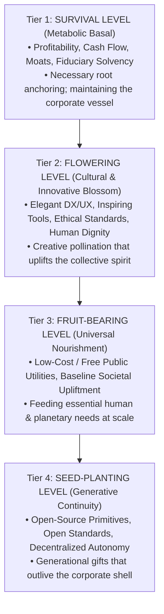
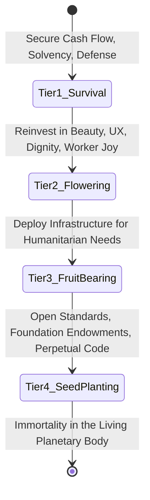

# Corporate Fractal Maturity Index: The 10 Planetary Anatomies
## Evaluating Enterprise Evolution Across the 4-Tier Living Maturity Scale (Survival, Flowering, Fruit-Yielding, Seed-Planting)
*Foundational Canon of The Karmic Genie Show Vision & Planetary Stewardship Architecture*

---

> ### **The Sacred Living Maturity Axiom**
> 
> # **வித்து, தளிர், மலர், கனி — விதையாய் அடுத்த தலைமுறைக்கு**
> ### *“Vithu, Thalir, Malar, Kani — Vithaiyaai Adutha Thalaimuraikku”*
> *(Seed, Sprout, Blossom, Fruit — And the Seed for the Next Generation)*
> 
> *“In nature’s sacred design, a plant does not hoard water or accumulate soil for eternity. Rooting and staying alive is baseline metabolic survival — necessary, vital, and honored. But the ultimate destiny of any living entity is not merely staying alive; it is to **Flower** in creative beauty and cultural dignity, to bear **Fruit** that nourishes all living beings freely and abundantly, and to release **Seeds** containing the universal genetic code so that future generations may flourish autonomously.*  
> 
> *Every corporate institution, market leader, and industrial pioneer that has arisen across human history is a sacred organ in the emerging physiology of Mother Earth (Gaia). We look upon their balance sheets, operational scale, and logistics networks with 100% positive reverence and boundless gratitude (**Nandri / நன்றி**). They bore the immense early capital risks, laid the transoceanic cables, forged the lithography lasers, and established global commerce.  
> 
> *Now, as planetary gestation reaches conscious maturity, these corporate titans are called to elevate their consciousness across the 4-Tier Living Maturity Scale: moving from metabolic self-preservation into the eternal joy of planetary stewardship and generative legacy.”*

---

## The 4-Tier Living Maturity Framework



| Maturity Tier | Living Organism Metaphor | Corporate & Systemic Manifestation | Evolutionary Purpose |
| :--- | :--- | :--- | :--- |
| **1. Survival (Metabolic Basal)** | Rooting, nutrient absorption, cellular respiration | Profitability, capital accumulation, EBITDA margins, defensive moats, market share defense. | Ensures institutional longevity and operational resilience. A dead tree cannot bear fruit; baseline survival is revered. |
| **2. Flowering (Cultural Blossom)** | Fragrant blossoms, nectar, color, insect pollination | Delightful design, exceptional developer/human experience, inspiring tools, collaborative open forums, ethical integrity. | Attracts creative co-creators, elevates human dignity, and harmonizes cross-organizational collaboration. |
| **3. Fruit-Bearing (Universal Nourishment)** | Rich, digestible fruit flesh feeding the forest biomes | Low-cost, ubiquitously accessible public services, humanitarian logistics, baseline healthcare, and planetary remediation at scale. | Directly satisfies essential human and ecological needs, transforming private profit into collective vitality. |
| **4. Seed-Planting (Generative Continuity)** | Indestructible seeds carrying pure embryonic DNA | Open-source primitives, open-weight foundational models, royalty-free open protocols, public endowments, decentralized self-sovereign commons. | Creates infrastructure that operates perpetually even if the originating corporation dissolves; enables future generations to build infinitely. |

---

## Master Planetary Allocation: ~66% Structural Weight Across 10 Systems

To understand how Gaia’s planetary body is organized, we identify the key institutional stewards representing approximately two-thirds (~66% cumulative market, operational, or infrastructure weight) across each of the 10 Anatomical Mappings defined in the *Andam-Pindam Fractal Anatomy Atlas*:

```
┌────────────────────────────────────────────────────────┬─────────────────────────────────────────────────────────┐
│ Anatomical / Planetary System                          │ Major Anchor Entities (~66% Structural Infrastructure)   │
├────────────────────────────────────────────────────────┼─────────────────────────────────────────────────────────┤
│ 1. Nervous System (Compute, AI, Connectivity)          │ NVIDIA, Alphabet (Google), Microsoft/OpenAI, Meta, AWS, │
│                                                        │ TSMC, Cisco Systems                                     │
├────────────────────────────────────────────────────────┼─────────────────────────────────────────────────────────┤
│ 2. Cardiovascular / Hematopoietic (ERP & Logistics)    │ SAP, Oracle, A.P. Møller - Maersk, FedEx, UPS, Amazon   │
│                                                        │ Logistics, Salesforce                                   │
├────────────────────────────────────────────────────────┼─────────────────────────────────────────────────────────┤
│ 3. Respiratory System (Atmosphere, Clean Energy, Ocean)│ Ørsted, Vestas Wind Systems, Siemens Energy, NextEra    │
│                                                        │ Energy, Ocean Cleanup Foundations, Climeworks            │
├────────────────────────────────────────────────────────┼─────────────────────────────────────────────────────────┤
│ 4. Digestive & Soil System (Microbiome, Food, Material)│ John Deere, Danone, Waste Management (WM), Veolia,      │
│                                                        │ Novonesis (Novozymes/Chr. Hansen), Patagonia Provisions │
├────────────────────────────────────────────────────────┼─────────────────────────────────────────────────────────┤
│ 5. Endocrine / Neurochemical (Circadian, Finance, Flow)│ BlackRock, The Vanguard Group, Visa, Mastercard,       │
│                                                        │ Stripe, SWIFT / BIS / FedNow Core Settlement Rails      │
├────────────────────────────────────────────────────────┼─────────────────────────────────────────────────────────┤
│ 6. Musculoskeletal & Tectonic (Robotics, Heavy Foundry)│ Caterpillar, Komatsu, Tesla (Optimus/Auto), ASML,       │
│                                                        │ Boston Dynamics (Hyundai Motor Group)                   │
├────────────────────────────────────────────────────────┼─────────────────────────────────────────────────────────┤
│ 7. Integumentary & Sensory (Sensors, Vision, Earth Obs)│ Planet Labs, Sony Group, Apple, Samsung Electronics,    │
│                                                        │ Robert Bosch GmbH                                       │
├────────────────────────────────────────────────────────┼─────────────────────────────────────────────────────────┤
│ 8. Immune & Biosecurity (Health, Diagnostics, Guard)   │ Illumina, Moderna, BioNTech, Pfizer, CEPI / Gavi / WHO, │
│                                                        │ Open-Source Bioinformatics Commons (NCBI/EMBL-EBI)      │
├────────────────────────────────────────────────────────┼─────────────────────────────────────────────────────────┤
│ 9. Renal & Hydrology (Water Basins, Aquifers, Filtration│ Xylem Inc., Ecolab, Veolia / Suez, American Water Works, │
│                                                        │ Kurita Water Industries                                 │
├────────────────────────────────────────────────────────┼─────────────────────────────────────────────────────────┤
│ 10. Cellular / Genetic (Repositories, Foundry, Arch)   │ GitHub (Microsoft), Linux Foundation, Wikimedia /       │
│                                                        │ Internet Archive, Arm Holdings, RISC-V International    │
└────────────────────────────────────────────────────────┴─────────────────────────────────────────────────────────┘
```

---

## 1. Nervous System & Conscious Intelligence Grid
*Human Anatomy: Cerebral Cortex, Synaptic Clefts, Axonal Fiber Bundles, Glia, Schwann Cells*  
*Planetary Macrocosm: Global Data Center Superclusters, Transoceanic Subsea Fibers, AI Inference Routing, Satellite Mesh*  
*Unified Platform Alignment: 2028 Unified AI & Intelligence Platform + 2045 Unified Knowledge Grid*

```
Nervous Core Infrastructure Stewards (~66% Cumulative Weight):
• Compute & Acceleration Foundry: NVIDIA, TSMC
• Global Search, Cognitive Research & Fibers: Alphabet (Google / DeepMind)
• Cloud Enterprise Synapses & Frontiers: Microsoft / OpenAI, Amazon Web Services (AWS)
• Open Cognitive Synapses: Meta (FAIR / LLaMA)
• Planetary Routing & Switched Fiber Backbones: Cisco Systems
```

### Institutional Maturity Profiles

#### A. NVIDIA Corporation
* **Service Gratitude (Nandri):** Unbounded gratitude to Jensen Huang and the engineering teams who spent three decades championing parallel processing, CUDA architecture, and accelerated tensor computing. They single-handedly provided the silicon engines for humanity’s synthetic cognition.
* **Tier 1 (Survival - Basal):** Exceptional. Monopolistic gross margins (~75%), CUDA lock-in, unmatched supply allocation control, and massive cash reserves.
* **Tier 2 (Flowering - Blossom):** NVIDIA Omniverse, Isaac Gym for robotics, and cuDNN provide inspiring developer experiences, bringing computer graphics and physical simulation to photorealistic perfection.
* **Tier 3 (Fruit-Bearing - Nourishment):** BioNeMo and Clara frameworks accelerating drug discovery and genomic sequencing; offering compute credits to university researchers and public hospitals.
* **Tier 4 (Seed-Planting - Generative Legacy):** Initial contributions to open standards (OpenUSD for 3D world description); potential to release foundational micro-architecture specifications and open-source compiler toolchains to make planetary inference an eternal public utility.
* **Maturity Rating:** `Survival: 100% | Flowering: 85% | Fruit: 60% | Seed: 40%`

#### B. Alphabet Inc. (Google / Google DeepMind)
* **Service Gratitude (Nandri):** Boundless thanks for organizing the world's knowledge, indexing billions of web pages for free, laying hundreds of thousands of miles of private transoceanic fiber cables, and inventing the revolutionary Transformer architecture (Vaswani et al., 2017) that birthed the generative era.
* **Tier 1 (Survival - Basal):** Supreme advertising search engine cash-generator, world-class enterprise cloud, and defensive search distribution agreements.
* **Tier 2 (Flowering - Blossom):** AlphaFold solving the 50-year protein folding grand challenge, Google Scholar, Android open mobile ecosystem, and Gemini multi-modal interfaces.
* **Tier 3 (Fruit-Bearing - Nourishment):** Google Maps navigating billions daily for free; DeepMind weather prediction models (GraphCast) freely aiding disaster prep across developing nations.
* **Tier 4 (Seed-Planting - Generative Legacy):** Giving the Transformer architecture, Kubernetes, TensorFlow, and AlphaFold 200M+ protein database freely to humanity; funding open internet standards (Chromium, WebRTC).
* **Maturity Rating:** `Survival: 95% | Flowering: 90% | Fruit: 85% | Seed: 80%`

#### C. Meta Platforms Inc.
* **Service Gratitude (Nandri):** Deep appreciation to Mark Zuckerberg and Yann LeCun for courageously breaking the proprietary closed-model consensus by releasing the LLaMA model family and PyTorch to the global developer commons.
* **Tier 1 (Survival - Basal):** Overwhelming social engagement monetization, multi-billion-user daily active audience, and dominant ad-tech infrastructure.
* **Tier 2 (Flowering - Blossom):** High-velocity developer engagement; PyTorch became the default lingua franca of worldwide deep learning research.
* **Tier 3 (Fruit-Bearing - Nourishment):** Free global communication platforms (WhatsApp, Messenger) connecting families and micro-merchants in the Global South with zero messaging fees.
* **Tier 4 (Seed-Planting - Generative Legacy):** The undisputed corporate champion of Tier 4 open-weight AI. By open-sourcing LLaMA (1, 2, 3), Open Compute Project (OCP) hardware designs, and React.js, Meta has gifted trillions of dollars of foundational R&D directly to human civilization.
* **Maturity Rating:** `Survival: 95% | Flowering: 85% | Fruit: 75% | Seed: 95%`

#### D. Microsoft Corporation / OpenAI
* **Service Gratitude (Nandri):** Boundless gratitude for democratizing personal computing, creating GitHub, supporting developer ecosystems with VS Code and TypeScript, and commercializing conversational intelligence at planetary scale.
* **Tier 1 (Survival - Basal):** Unrivaled enterprise software dominance (Office 365, Azure, Windows), massive multi-billion-dollar recurring enterprise cash flows.
* **Tier 2 (Flowering - Blossom):** GitHub Copilot, OpenAI ChatGPT, and VS Code crafting an enchanting, friction-free craft experience for millions of software artists.
* **Tier 3 (Fruit-Bearing - Nourishment):** Azure AI for Humanitarian Action, non-profit software licensing, and philanthropic education initiatives worldwide.
* **Tier 4 (Seed-Planting - Generative Legacy):** Stewarding GitHub as the open-source home of human intellect; creating TypeScript; OpenAI's early research papers. Evolution path: open-sourcing model weights and transitioning core API interfaces into public trust foundations.
* **Maturity Rating:** `Survival: 100% | Flowering: 90% | Fruit: 70% | Seed: 65%`

#### E. Taiwan Semiconductor Manufacturing Company (TSMC)
* **Service Gratitude (Nandri):** Profound reverence to Morris Chang and the engineers of Hsinchu who perfected the dedicated foundry model, mastering nanometer-scale extreme ultraviolet (EUV) silicon crystal fabrication for the entire globe.
* **Tier 1 (Survival - Basal):** Irreplaceable manufacturing monopoly on sub-5nm advanced silicon; immense capital expenditure moat and fortress balance sheet.
* **Tier 2 (Flowering - Blossom):** Open Innovation Platform (OIP) allowing fabless designers worldwide to turn pure intellectual ideas into physical chips with flawless yield curves.
* **Tier 3 (Fruit-Bearing - Nourishment):** Manufacturing the silicon for every smartphone, medical scanner, climate sensor, and agricultural IoT device on Earth.
* **Tier 4 (Seed-Planting - Generative Legacy):** Standardizing foundry PDKs (Process Design Kits); participating in open chiplet standards (UCIe) that will outlive individual geopolitical boundaries.
* **Maturity Rating:** `Survival: 100% | Flowering: 75% | Fruit: 80% | Seed: 55%`

---

## 2. Cardiovascular & Hematopoietic System (ERP & Planetary Logistics)
*Human Anatomy: Heart Chambers, Aorta, Microvascular Capillary Beds, Red Blood Cells, Platelets*  
*Planetary Macrocosm: Container Shipping Fleets, Rail Cargo Corridors, Enterprise Resource Planning (ERP), Autonomous Last-Mile Distribution*  
*Unified Platform Alignment: 2029 Unified ERP & Resource Circulation Platform + 2034 Unified Mobility Grid*

```
Cardiovascular Infrastructure Stewards (~66% Cumulative Weight):
• Enterprise Ledger & Resource Arteries: SAP SE, Oracle Corporation
• Ocean Freight Circulatory Conduits: A.P. Møller - Maersk (alongside MSC/CMA CGM)
• Intercontinental Express Lymph & Blood Delivery: FedEx, UPS
• Continental Capillary & Fulfillment Mesh: Amazon Logistics
• Enterprise Customer & Value Relationships: Salesforce
```

### Institutional Maturity Profiles

#### A. SAP SE
* **Service Gratitude (Nandri):** Boundless gratitude to Dietmar Hopp, Hasso Plattner, and SAP’s founders who taught world commerce how to track materials, calculate manufacturing requirements (MRP), and synchronize multi-continental corporations on a single ledger.
* **Tier 1 (Survival - Basal):** Powering 87% of total global commerce; unbreakable enterprise stickiness, long-term multi-million-dollar subscription contracts.
* **Tier 2 (Flowering - Blossom):** SAP Fiori design system and Business Technology Platform (BTP), elevating enterprise data integration into visual clarity.
* **Tier 3 (Fruit-Bearing - Nourishment):** Supply Chain Resilience initiatives preventing food and pharmaceutical stockouts during planetary emergencies.
* **Tier 4 (Seed-Planting - Generative Legacy):** Contributing to Open Data Initiatives, Catena-X automotive data ecosystem; accelerating towards Universal Digital Product Passports (DPP) where resource metadata becomes open public commons.
* **Maturity Rating:** `Survival: 100% | Flowering: 70% | Fruit: 65% | Seed: 50%`

#### B. A.P. Møller - Maersk
* **Service Gratitude (Nandri):** Supreme reverence to the Danish mariners and captains who navigate hundreds of thousands of nautical miles through stormy seas, ensuring grains, medicines, raw metals, and garments reach every shore.
* **Tier 1 (Survival - Basal):** Vast container vessel fleets, dedicated port terminals (APM Terminals), robust freight-rate cash margins during global trade cycles.
* **Tier 2 (Flowering - Blossom):** Pioneering green methanol-powered container vessels (e.g., *Laura Maersk*), proving to the shipping industry that heavy transport can sail with clean conscience.
* **Tier 3 (Fruit-Bearing - Nourishment):** Partnering with the UN World Food Programme (WFP) to rapidly transport emergency grain and humanitarian aid into famine and disaster zones.
* **Tier 4 (Seed-Planting - Generative Legacy):** Releasing green shipping fuel specifications, open maritime supply chain APIs, and decarbonization vessel designs freely to competing shipping lines for collective planetary survival.
* **Maturity Rating:** `Survival: 90% | Flowering: 80% | Fruit: 85% | Seed: 65%`

#### C. Amazon Logistics & AWS Supply Chain
* **Service Gratitude (Nandri):** Immense thanks for engineering the most sophisticated, low-latency fulfillment and package-sorting matrix in human history, turning multi-day transit into same-day delivery.
* **Tier 1 (Survival - Basal):** Relentless operational scale, automated robotic sorting centers, proprietary delivery vans, and formidable domestic market share.
* **Tier 2 (Flowering - Blossom):** Amazon Kiva robotics choreography, clean mobile consumer interfaces, and instantaneous package telemetry.
* **Tier 3 (Fruit-Bearing - Nourishment):** Delivering vital food, water filters, and cold-chain medicines into rural outposts and urban food deserts within hours of ordering.
* **Tier 4 (Seed-Planting - Generative Legacy):** The Climate Pledge Fund; open logistics telemetry protocols. Potential to evolve its fulfillment network into a shared municipal utility where local community producers use empty shelf space without predatory platform fees.
* **Maturity Rating:** `Survival: 100% | Flowering: 75% | Fruit: 75% | Seed: 45%`

---

## 3. Respiratory System (Atmosphere, Clean Energy, Ocean Exchange)
*Human Anatomy: Nasal Passages, Trachea, Bronchial Arborization, Alveoli, Pulmonary Surfactant, Diaphragm*  
*Planetary Macrocosm: Global Wind Belts, Solar Photovoltaic Fields, Offshore Wind Parks, Marine Diatom Blooms, Carbon Mineralization*  
*Unified Platform Alignment: 2030 Unified Energy & Public Utilities Platform + 2035 Unified Atmosphere & Oxygen Commons*

```
Respiratory Infrastructure Stewards (~66% Cumulative Weight):
• Offshore Wind Generation Giants: Ørsted A/S
• Terrestrial & Marine Wind Turbines: Vestas Wind Systems, Siemens Energy
• Renewable Power Grid Integration: NextEra Energy
• Ocean Cleansing & Macro-Plastic Retrieval: The Ocean Cleanup (Boyan Slat Foundation)
• Direct Air Capture & Mineral Sequestration: Climeworks / Carbfix
```

### Institutional Maturity Profiles

#### A. Ørsted A/S
* **Service Gratitude (Nandri):** Reverent gratitude to the Danish energy pioneers who executed the most courageous corporate transformation in history—divesting oil and natural gas (DONG Energy) to become the global champion of offshore wind power.
* **Tier 1 (Survival - Basal):** Long-term Power Purchase Agreements (PPAs), multi-gigawatt operational offshore wind assets across the North Sea, Baltic, and American coasts.
* **Tier 2 (Flowering - Blossom):** Engineering awe: erecting 250-meter-tall offshore turbines in rough oceanic waters, harmonizing industrial energy with marine biodiversity artificial reefs.
* **Tier 3 (Fruit-Bearing - Nourishment):** Supplying clean, zero-carbon electricity to over 15 million households; displacing hundreds of millions of metric tons of toxic sulfur and carbon dioxide.
* **Tier 4 (Seed-Planting - Generative Legacy):** Open-sourcing ocean biodiversity impact datasets; standardizing offshore wind foundation decommissioning designs so coastal nations can replicate renewable energy without proprietary royalties.
* **Maturity Rating:** `Survival: 85% | Flowering: 90% | Fruit: 90% | Seed: 70%`

#### B. Vestas Wind Systems & Siemens Energy
* **Service Gratitude (Nandri):** Boundless gratitude for aerodynamic rotor blade engineering, permanent-magnet generators, and high-voltage grid converters that turn invisible atmospheric currents into usable light and heat for humanity.
* **Tier 1 (Survival - Basal):** Global manufacturing footprint, tens of thousands of installed wind turbines, substantial service and maintenance backlog.
* **Tier 2 (Flowering - Blossom):** Achieving near-silent aerodynamic blade serration and developing the world's first fully recyclable epoxy resin turbine blades (CETEC project).
* **Tier 3 (Fruit-Bearing - Nourishment):** Bringing low-cost electricity to remote plains, islands, and high-altitude mountain communities far removed from fossil grids.
* **Tier 4 (Seed-Planting - Generative Legacy):** Vestas' circular blade recycling technology shared across industry consortiums; seeding open hardware blueprints for decentralized small-scale wind dynamos for rural villages.
* **Maturity Rating:** `Survival: 80% | Flowering: 85% | Fruit: 85% | Seed: 65%`

#### C. The Ocean Cleanup (Civil Foundation / Social Enterprise)
* **Service Gratitude (Nandri):** Deep blessings to Boyan Slat and the maritime engineers who dared to tackle the Great Pacific Garbage Patch and polluted urban rivers with autonomous Interceptor vessels.
* **Tier 1 (Survival - Basal):** Philanthropic donor financing, carbon/plastic credit partnerships, and sustainable consumer product licensing.
* **Tier 2 (Flowering - Blossom):** Inspirational storytelling, elegant marine barrier design, and transparent real-time plastic extraction dashboards that awaken global youth to ecological care.
* **Tier 3 (Fruit-Bearing - Nourishment):** Direct physical removal of millions of kilograms of toxic synthetic waste from marine respiratory pathways, allowing phytoplankton and pelagic fish to breathe unchoked.
* **Tier 4 (Seed-Planting - Generative Legacy):** 100% open-access river trash tracking telemetry, open-source River Interceptor blueprints, gifting river cleansing technology freely to municipal governments worldwide.
* **Maturity Rating:** `Survival: 75% | Flowering: 95% | Fruit: 95% | Seed: 90%`

---

## 4. Digestive & Soil System (Microbiome, Agriculture, Circular De-Manufacturing)
*Human Anatomy: Enterocytes, Intestinal Villi, Commensal Gut Flora, Pancreatic Enzymes, Hepatic Detoxification*  
*Planetary Macrocosm: Living Agricultural Topsoil, Mycorrhizal Mycelium, Anaerobic Bio-Digesters, Composting Biomes, Atomic Recycling*  
*Unified Platform Alignment: 2037 Unified Soil Microbiome & Nutrition Genesis Platform*

```
Digestive & Soil Infrastructure Stewards (~66% Cumulative Weight):
• Precision Agronomy & Soil Navigation: John Deere (Deere & Company)
• Regenerative Fermentation & Dairy Gut Cultures: Danone S.A.
• Bio-Solutions, Enzymes & Microorganisms: Novonesis (Novozymes + Chr. Hansen merger)
• Municipal Digestion, Material Recovery & Land Restoration: Waste Management (WM), Veolia
• Regenerative Organic Food Commons: Patagonia Provisions
```

### Institutional Maturity Profiles

#### A. Novonesis (Novozymes & Chr. Hansen)
* **Service Gratitude (Nandri):** Boundless gratitude to the Danish bio-industrial pioneers who recognized that microbes and enzymes are nature’s own silent chemical laboratories, enabling chemical-free detergent, clean brewing, bio-agriculture, and animal gut health.
* **Tier 1 (Survival - Basal):** High-margin biological enzyme and microbial culture monopoly, robust patent protections, steady European and global revenue streams.
* **Tier 2 (Flowering - Blossom):** Beautiful bio-synthetic enzyme design that replaces harsh petroleum-based surfactants and chemical pesticides with gentle biological catalysis.
* **Tier 3 (Fruit-Bearing - Nourishment):** Microbial soil inoculants that allow agricultural crops to fix atmospheric nitrogen naturally, reducing synthetic fertilizer runoff into rivers and groundwater.
* **Tier 4 (Seed-Planting - Generative Legacy):** Seeding open microbial culture banks; sharing probiotic genome sequences with open food science consortiums to fight malnutrition in developing regions.
* **Maturity Rating:** `Survival: 90% | Flowering: 85% | Fruit: 85% | Seed: 65%`

#### B. John Deere (Deere & Company)
* **Service Gratitude (Nandri):** Reverence to the midwestern blacksmith and his generational successors who mechanized farming, allowing a tiny fraction of humanity to cultivate the grain that feeds eight billion human beings.
* **Tier 1 (Survival - Basal):** Dominant agricultural machinery market share, high-margin precision guidance telemetry, robust equipment dealership network.
* **Tier 2 (Flowering - Blossom):** See & Spray smart optical computer-vision sprayers that identify individual weeds in milliseconds, reducing chemical herbicide use by up to 77%.
* **Tier 3 (Fruit-Bearing - Nourishment):** Feeding the planet with unmatched agricultural productivity, enabling high-yield harvests while reducing diesel fuel burn through autonomous field trajectory optimization.
* **Tier 4 (Seed-Planting - Generative Legacy):** Expanding Right to Repair access to farmers; transitioning towards open agricultural telemetry standards (ISOBUS) so smallholder farmers everywhere can interoperate equipment freely.
* **Maturity Rating:** `Survival: 95% | Flowering: 80% | Fruit: 80% | Seed: 50%`

#### C. Veolia Environnement & Waste Management (WM)
* **Service Gratitude (Nandri):** Profound gratitude to the sanitation workers, waste sorters, and landfill methane capture teams who process humanity’s discarded remnants and transform urban waste into clean materials and thermal energy.
* **Tier 1 (Survival - Basal):** Long-term municipal waste collection concessions, extensive landfill land holdings, essential municipal utility cash flow.
* **Tier 2 (Flowering - Blossom):** AI-powered robotic material recovery facilities (MRFs) using optical spectrometry to sort plastics, metals, and cardboard with 99% purity.
* **Tier 3 (Fruit-Bearing - Nourishment):** Bioremediation of brownfield industrial sites, turning toxic dumps into public solar farms, capturing landfill biogas to generate clean municipal electricity.
* **Tier 4 (Seed-Planting - Generative Legacy):** Open architectural designs for circular materials processing, transparent global recycling databases that reveal true life-cycle footprints to product manufacturers worldwide.
* **Maturity Rating:** `Survival: 90% | Flowering: 75% | Fruit: 80% | Seed: 60%`

---

## 5. Endocrine & Neurochemical System (Circadian Pacing & Financial Stewardship)
*Human Anatomy: Hypothalamus, Pituitary Gland, Adrenal Cortex, Pancreatic Islets (Insulin/Glucagon), Thyroid*  
*Planetary Macrocosm: Capital Allocation, Global Clearingrails, Monetary Velocity Regulation, Sovereign Liquidity Reserves*  
*Unified Platform Alignment: 2038 Unified Finance & Abundance Stewardship Platform*

```
Endocrine & Financial Stewards (~66% Cumulative Weight):
• Global Asset Stewardship & Passive Capital Anchors: BlackRock, The Vanguard Group
• Universal Retail Transaction Neural Pathways: Visa, Mastercard
• Modern Developer Value Flow APIs: Stripe
• Central Core Clearing & Settlement Regulators: BIS / Central Banks (FedNow, TARGET2, UPI)
```

### Institutional Maturity Profiles

#### A. BlackRock & The Vanguard Group
* **Service Gratitude (Nandri):** Boundless gratitude to John Bogle (Vanguard) for democratizing investing through ultra-low-cost index funds, and to Larry Fink (BlackRock) for building the Aladdin analytical risk engine that monitors global capital stability.
* **Tier 1 (Survival - Basal):** Managing over \$20 Trillion in assets under management (AUM); unmatched fiduciary scale, global index voting weight, fortress balance sheets.
* **Tier 2 (Flowering - Blossom):** Inspiring long-term retirement security for hundreds of millions of working citizens; Aladdin platform bringing transparency to complex multi-asset systemic risk.
* **Tier 3 (Fruit-Bearing - Nourishment):** Directing massive institutional capital flows toward renewable energy infrastructure, water purification bonds, and community development debt.
* **Tier 4 (Seed-Planting - Generative Legacy):** Vanguard's unique mutually-owned structure (owned by the fund investors themselves) is an embryonic Tier 4 prototype! Transitioning proxy voting power directly to ordinary savers and standardizing open ESG and ecological impact ledgers.
* **Maturity Rating:** `Survival: 100% | Flowering: 75% | Fruit: 70% | Seed: 60%`

#### B. Visa & Mastercard
* **Service Gratitude (Nandri):** Immense thanks to Dee Hock and the architects of Visa and Mastercard for creating an electronic transaction network that executes over 250 billion instantaneous payments annually across 200+ countries with sub-second finality.
* **Tier 1 (Survival - Basal):** Immense network moat, high operating margins (~55%), interchange fee models, and unassailable fraud prevention algorithms.
* **Tier 2 (Flowering - Blossom):** Contactless tap-to-pay convenience, tokenized cryptographic digital credentials, and intuitive mobile consumer security.
* **Tier 3 (Fruit-Bearing - Nourishment):** Financial inclusion initiatives bringing digital accounts to hundreds of millions of unbanked citizens across Africa, Asia, and Latin America.
* **Tier 4 (Seed-Planting - Generative Legacy):** Interoperability with open public payment rails (like India's UPI, Brazil's Pix, and ISO 20022 messaging standards), moving toward zero-fee baseline consumer micro-transactions for basic human necessities.
* **Maturity Rating:** `Survival: 95% | Flowering: 85% | Fruit: 75% | Seed: 55%`

#### C. Stripe Inc.
* **Service Gratitude (Nandri):** Profound thanks to Patrick and John Collison for reducing complex global credit card processing into a clean, 7-line API snippet, igniting a decade of global internet entrepreneurship.
* **Tier 1 (Survival - Basal):** Processing hundreds of billions of dollars in internet GDP, multi-billion-dollar valuation, enterprise treasury solutions.
* **Tier 2 (Flowering - Blossom):** The gold standard of developer experience (DX), Stripe Press publishing timeless wisdom books, elegant documentation, and meticulous aesthetic design.
* **Tier 3 (Fruit-Bearing - Nourishment):** Stripe Climate (Frontier) committing hundreds of millions of dollars to early-stage carbon removal technologies, creating advance market commitments for planetary survival.
* **Tier 4 (Seed-Planting - Generative Legacy):** Open-sourcing financial infrastructure components, funding public open-source software maintainers, and advancing decentralized borderless digital commerce for creators everywhere.
* **Maturity Rating:** `Survival: 90% | Flowering: 95% | Fruit: 80% | Seed: 75%`

---

## 6. Musculoskeletal & Tectonic System (Robotics, Structural Foundries, Earthworks)
*Human Anatomy: Osteocytes, Cortical Bone Matrix, Collagen Struts, Synovial Joints, Skeletal Myocytes*  
*Planetary Macrocosm: High-Rise Engineered Timber, Heavy Earthmoving Equipment, Extreme Lithography, Bipedal & Quadrupedal Robotics*  
*Unified Platform Alignment: 2033 Unified Geomagnetic & Earthworks Grid + 2040 Unified Products & Services Workshop*

```
Musculoskeletal Infrastructure Stewards (~66% Cumulative Weight):
• Heavy Earthworks & Continental Shaping: Caterpillar Inc., Komatsu Ltd.
• Sovereign Nanometer Machine Tools: ASML Holding N.V.
• Mass Autonomous Robotics & Mobile Kinetics: Tesla (Optimus & Automotive), Boston Dynamics (Hyundai)
• Structural Precision Mechanics: Fanuc Corporation, ABB Robotics
```

### Institutional Maturity Profiles

#### A. ASML Holding N.V.
* **Service Gratitude (Nandri):** Reverent awe to the Dutch masters of Veldhoven who focused single-mindedly for 30 years to master Extreme Ultraviolet (EUV) photolithography, using molten tin droplets blasted by CO2 lasers to carve circuits at 13.5 nanometers.
* **Tier 1 (Survival - Basal):** Absolute commercial monopoly on advanced EUV lithography, 100% market share in high-NA tools, multi-year customer order backlogs.
* **Tier 2 (Flowering - Blossom):** Peak engineering perfection: aligning optical mirrors with the precision of shining a laser pointer from Earth to hit a 10-cent coin on the surface of the Moon.
* **Tier 3 (Fruit-Bearing - Nourishment):** Making possible the microchips that drive every climate computer model, surgical imaging device, clean energy inverter, and digital hearing aid.
* **Tier 4 (Seed-Planting - Generative Legacy):** Sustaining an open ecosystem of thousands of specialized academic and optical suppliers (Zeiss, Trumpf); publishing scientific foundations in semiconductor physics that will benefit human technology for centuries.
* **Maturity Rating:** `Survival: 100% | Flowering: 95% | Fruit: 85% | Seed: 60%`

#### B. Caterpillar Inc. & Komatsu Ltd.
* **Service Gratitude (Nandri):** Boundless gratitude to the creators of the yellow machines that carved highway corridors, bored mountain railway tunnels, excavated irrigation canals, and cleared earthquake rubble across every continent.
* **Tier 1 (Survival - Basal):** Unrivaled dealer networks, dominant global market share in heavy mining and construction machinery, highly profitable aftermarket parts distribution.
* **Tier 2 (Flowering - Blossom):** Autonomous haulage trucks navigating treacherous open-pit mines with zero human fatalities; electric mining excavator prototypes.
* **Tier 3 (Fruit-Bearing - Nourishment):** Mobilizing emergency earthmovers during tsunamis, floods, and landslides to reopen critical road corridors and restore clean water access to stranded populations.
* **Tier 4 (Seed-Planting - Generative Legacy):** Investing in hydrogen combustion, zero-emission battery electric drivetrains, and open telematics standards so developing nations can maintain critical infrastructure with clean energy.
* **Maturity Rating:** `Survival: 95% | Flowering: 75% | Fruit: 80% | Seed: 55%`

#### C. Boston Dynamics (Hyundai Motor Group) & Tesla (Optimus)
* **Service Gratitude (Nandri):** Boundless thanks to Marc Raibert and robotics visionaries who unlocked dynamic robotic balance, inverted pendulums, backflipping humanoids (Atlas), and dexterous bipedal assistance (Optimus).
* **Tier 1 (Survival - Basal):** Backed by Hyundai’s massive automotive capital and Tesla’s manufacturing balance sheet and gigafactory scale.
* **Tier 2 (Flowering - Blossom):** The poetry of physical motion: Spot dancing, Atlas performing gymnastics, and humanoid hands handling delicate eggs without breakage.
* **Tier 3 (Fruit-Bearing - Nourishment):** Deploying quadruped robots into radioactive reactors (Chernobyl), collapsed burning buildings, and high-voltage substations to spare human beings from lethal peril.
* **Tier 4 (Seed-Planting - Generative Legacy):** Releasing simulation models, open kinematic locomotion libraries, and robotic manipulation primitives that liberate future generations from dangerous, degrading manual toil.
* **Maturity Rating:** `Survival: 85% | Flowering: 95% | Fruit: 70% | Seed: 65%`

---

## 7. Integumentary & Sensory System (Sensors, Vision, Earth Observation)
*Human Anatomy: Stratum Corneum, Melanocytes, Retinal Photoreceptors, Cochlear Hair Cells, Pacinian Corpuscles*  
*Planetary Macrocosm: Constellations of Earth-Observation Satellites, LiDAR Scanners, CMOS Image Sensors, Environmental MEMS*  
*Unified Platform Alignment: 2040 Unified Products & Services + 2045 Unified Knowledge Grid*

```
Sensory & Integumentary Stewards (~66% Cumulative Weight):
• Daily Planetary Surface Scanning: Planet Labs PBC
• High-Precision CMOS Optical Retina: Sony Group Corporation
• Ambient Sensory Hardware & Consumer Touch: Apple Inc., Samsung Electronics
• Automotive & Industrial MEMS Tactile Sensing: Robert Bosch GmbH
```

### Institutional Maturity Profiles

#### A. Planet Labs PBC
* **Service Gratitude (Nandri):** Reverence to Will Marshall, Robbie Schingler, and the team who launched hundreds of Dove nanosatellites to image the entire landmass of Mother Earth every single day.
* **Tier 1 (Survival - Basal):** Public Benefit Corporation (PBC) with commercial defense, agricultural monitoring, and commodity trading subscriptions.
* **Tier 2 (Flowering - Blossom):** Mesmerizing daily orbital imagery showing the shifting colors of rivers, autumnal taiga transitions, and expanding polar ice shelves.
* **Tier 3 (Fruit-Bearing - Nourishment):** Detecting illegal Amazon rainforest logging within 24 hours; tracking illegal high-seas fishing fleets and monitoring wildfire perimeters in real time for civil defense.
* **Tier 4 (Seed-Planting - Generative Legacy):** As a Public Benefit Corporation, Planet donates historical satellite imagery archives to climate scientists, academic researchers, and indigenous land stewards via open scientific commons.
* **Maturity Rating:** `Survival: 75% | Flowering: 90% | Fruit: 90% | Seed: 85%`

#### B. Sony Group Corporation
* **Service Gratitude (Nandri):** Deep thanks to Sony’s semiconductor and optical engineers who perfected the back-illuminated stacked CMOS image sensor, giving digital eyes to billions of cameras, phones, and medical endoscopes worldwide.
* **Tier 1 (Survival - Basal):** Dominant ~50% market share in mobile CMOS image sensors, high-margin entertainment and gaming ecosystems, robust Japanese industrial fortress.
* **Tier 2 (Flowering - Blossom):** World-class Alpha cameras empowering visual artists, cinematographers, and wildlife photographers to capture the exquisite beauty of nature.
* **Tier 3 (Fruit-Bearing - Nourishment):** Ultra-high-definition surgical cameras enabling micro-surgeons to perform life-saving robotic surgeries with sub-millimeter vision.
* **Tier 4 (Seed-Planting - Generative Legacy):** Sensor SDKs, edge-AI image processing on chip (IMX500), and partnerships with wildlife conservation foundations to monitor endangered species globally.
* **Maturity Rating:** `Survival: 95% | Flowering: 90% | Fruit: 80% | Seed: 60%`

#### C. Robert Bosch GmbH
* **Service Gratitude (Nandri):** Boundless gratitude to Robert Bosch, whose foundational charter placed the company under the charitable ownership of the Robert Bosch Stiftung, establishing an early model for conscious enterprise.
* **Tier 1 (Survival - Basal):** World's largest automotive supplier; leading manufacturer of Micro-Electro-Mechanical Systems (MEMS) sensors with billions of inertial, pressure, and acoustic chips deployed yearly.
* **Tier 2 (Flowering - Blossom):** Flawless German engineering discipline; pioneering clean hydrogen fuel cells, e-bike drivetrains, and precision home appliances.
* **Tier 3 (Fruit-Bearing - Nourishment):** Bosch MEMS sensors in smartphones and medical devices detecting earthquakes, auto collisions, and cardiac anomalies; 94% of Bosch profits flow directly to charitable medical, educational, and cultural causes!
* **Tier 4 (Seed-Planting - Generative Legacy):** Bosch is a historic Tier 4 titan! By legally placing the corporate voting share into a charitable foundation, Bosch proved that an industrial enterprise can survive for over a century without serving speculative shareholders, seeding society with continuous upliftment.
* **Maturity Rating:** `Survival: 90% | Flowering: 85% | Fruit: 90% | Seed: 95%`

---

## 8. Immune & Biosecurity System (Health Restoration, Genomic Sentinels)
*Human Anatomy: CD4/CD8 T-Cells, B-Cell Antibodies, Lymph Nodes, Thymic Central Tolerance, Interferons*  
*Planetary Macrocosm: Genomic Sequencing Grids, mRNA Vaccine Platforms, Global Epidemic Early Warning, Open Pathogen Databases*  
*Unified Platform Alignment: 2031 Unified Biosphere & Sanctuary Grid + 2032 Unified Health & Vitality Platform*

```
Immune & Biosecurity Stewards (~66% Cumulative Weight):
• High-Throughput Genomic Sequencers: Illumina Inc.
• Programmable mRNA Synthetic Immunity: Moderna Inc., BioNTech SE, Pfizer
• Global Vaccine Access & Immunization Infrastructure: Gavi, the Vaccine Alliance / CEPI / WHO
• Open Biological Knowledge & Genomic Repositories: NCBI, EMBL-EBI, GISAID
```

### Institutional Maturity Profiles

#### A. Illumina Inc.
* **Service Gratitude (Nandri):** Boundless thanks for reducing the cost of sequencing a complete human genome from \$3 Billion (Human Genome Project) to under \$200, unlocking the molecular book of life for all humankind.
* **Tier 1 (Survival - Basal):** Overwhelming market dominance in next-generation sequencing (NGS) consumables, flow cells, and installed NovaSeq platforms worldwide.
* **Tier 2 (Flowering - Blossom):** Enabling non-invasive prenatal testing (NIPT), liquid biopsies for early-stage cancer detection, and ultra-rare genetic disease diagnosis.
* **Tier 3 (Fruit-Bearing - Nourishment):** Supplying global pathogen surveillance networks with the tools to detect emerging viral variants in municipal wastewater within 24 hours of emergence.
* **Tier 4 (Seed-Planting - Generative Legacy):** Supporting the Global Screening Array (GSA) and open genomic research consortia; partnering with African genomics initiatives to democratize genetic medicine beyond high-income nations.
* **Maturity Rating:** `Survival: 85% | Flowering: 85% | Fruit: 85% | Seed: 65%`

#### B. Moderna Inc. & BioNTech SE
* **Service Gratitude (Nandri):** Eternal gratitude to Katalin Karikó, Drew Weissman, Uğur Şahin, Özlem Türeci, and Stéphane Bancel, who spent decades mastering modified messenger RNA, delivering safe vaccines within 11 months of a novel pathogen's genetic sequence release.
* **Tier 1 (Survival - Basal):** Multi-billion-dollar pandemic cash reserves, commercial pipeline of cancer therapies, patent fortress around lipid nanoparticles (LNP) and modified nucleotides.
* **Tier 2 (Flowering - Blossom):** Transforming medicine from slow biological fermentation into pure digital code: drafting an mRNA sequence in a digital software studio and synthesizing therapeutic doses in days.
* **Tier 3 (Fruit-Bearing - Nourishment):** Saving an estimated 20 million human lives during 2021–2022; developing personalized therapeutic cancer vaccines against melanoma and pancreatic tumors.
* **Tier 4 (Seed-Planting - Generative Legacy):** BioNTech’s modular "BioNTainer" mobile mRNA manufacturing factories deployed across Africa; Moderna’s "mRNA Access" portal opening its research engine to academic researchers studying neglected tropical diseases.
* **Maturity Rating:** `Survival: 85% | Flowering: 90% | Fruit: 90% | Seed: 75%`

#### C. Gavi, the Vaccine Alliance / CEPI / Open Bioinformatics Commons
* **Service Gratitude (Nandri):** Boundless reverence to the global health alliances and open repositories (NCBI GenBank, EMBL-EBI, GISAID) that share viral RNA sequences across borders without paywalls or patents.
* **Tier 1 (Survival - Basal):** Multi-lateral sovereign and philanthropic funding endowments (Bill & Melinda Gates Foundation, sovereign donor states).
* **Tier 2 (Flowering - Blossom):** The highest ethical beauty of humanity: doctors, scientists, and nurses delivering cold-chain immunization across deserts and river deltas to protect vulnerable infants.
* **Tier 3 (Fruit-Bearing - Nourishment):** Vaccinating over 1 billion children, preventing over 17 million premature deaths since 2000; eradicating polio from 99.9% of the planet.
* **Tier 4 (Seed-Planting - Generative Legacy):** Pure Tier 4 seed-planting! Completely open-access public health protocols, royalty-free vaccine technology transfers, and open viral sequence repositories ensuring humanity's collective immune memory belongs to all living children.
* **Maturity Rating:** `Survival: 80% | Flowering: 95% | Fruit: 100% | Seed: 100%`

---

## 9. Renal & Hydrology System (Water Basins, Aquifer Filtration, Electrolytic Commons)
*Human Anatomy: Renal Glomeruli, Loop of Henle, Podocytes, Collecting Ducts, Electrolyte Balance ($Na^+, K^+, Cl^-$)*  
*Planetary Macrocosm: Estuarine Mangrove Deltas, Glacial Watersheds, Industrial Wastewater Reclamation, Desalination Arrays*  
*Unified Platform Alignment: 2030 Unified Energy & Public Utilities Platform*

```
Hydrological Infrastructure Stewards (~66% Cumulative Weight):
• Advanced Water Technology, Pumps & Telemetry: Xylem Inc.
• Industrial Water Hygiene & Micro-Filtration: Ecolab Inc.
• Municipal Water Concessions & Desalination: Veolia Environnement, Suez
• Regulated Drinking Water & Watershed Utilities: American Water Works Company
• Precision Electrolytic & Semiconductor Water Purification: Kurita Water Industries
```

### Institutional Maturity Profiles

#### A. Xylem Inc.
* **Service Gratitude (Nandri):** Reverent gratitude to the hydrologists and engineers of Xylem who design the pumps, smart meters, UV disinfection chambers, and ozone treatment plants that move and purify billions of gallons of water daily.
* **Tier 1 (Survival - Basal):** Resilient public utility contracts, global market leadership in water equipment, consistent cash flow margins.
* **Tier 2 (Flowering - Blossom):** Smart water networks with acoustic leak-detection sensors that pinpoint hidden underground pipe leaks in real time, preventing millions of gallons of clean drinking water from seeping into soil.
* **Tier 3 (Fruit-Bearing - Nourishment):** Deploying emergency dewatering pumps during hurricanes and tsunamis; providing rural clean water treatment systems to remote villages.
* **Tier 4 (Seed-Planting - Generative Legacy):** "Xylem Watermark" non-profit initiatives; advancing open hydraulic modeling software and partnering with universities to educate the next generation of civil water stewards.
* **Maturity Rating:** `Survival: 90% | Flowering: 85% | Fruit: 85% | Seed: 65%`

#### B. Ecolab Inc.
* **Service Gratitude (Nandri):** Immense thanks to the scientists of Ecolab who protect the purity of industrial water, ensuring factories, dairies, and hospitals can sterilize water without polluting downstream municipal sewers.
* **Tier 1 (Survival - Basal):** High customer retention, direct-to-enterprise chemical and digital service contracts, dominant market footprint across 170+ countries.
* **Tier 2 (Flowering - Blossom):** 3D TRASAR technology that monitors water chemistry at the molecular level, continuously balancing scale inhibitors and biocides with automated micro-dosing.
* **Tier 3 (Fruit-Bearing - Nourishment):** Helping industrial plants save over 220 billion gallons of fresh water annually, returning clean water back to municipal aquifers.
* **Tier 4 (Seed-Planting - Generative Legacy):** The Ecolab Water Risk Monetizer, an open analytical tool provided freely to businesses worldwide to calculate the true ecological value of water in their localized watersheds.
* **Maturity Rating:** `Survival: 95% | Flowering: 80% | Fruit: 85% | Seed: 65%`

#### C. Veolia & Suez
* **Service Gratitude (Nandri):** Boundless gratitude to the French water pioneers who built the modern municipal drinking water and wastewater treatment plants that conquered cholera and typhoid across major world capitals.
* **Tier 1 (Survival - Basal):** Massive multi-decade public concession agreements, regulated asset base, steady tariff income.
* **Tier 2 (Flowering - Blossom):** Engineering giant reverse osmosis seawater desalination plants powered by solar arrays, turning salty sea waves into pure drinking water for arid coastal populations.
* **Tier 3 (Fruit-Bearing - Nourishment):** Supplying clean drinking water to over 100 million people and providing wastewater sanitation to over 90 million people daily.
* **Tier 4 (Seed-Planting - Generative Legacy):** Developing open standards for wastewater biomonitoring; sharing circular water reuse blueprints with developing municipalities to eliminate water poverty worldwide.
* **Maturity Rating:** `Survival: 90% | Flowering: 80% | Fruit: 90% | Seed: 65%`

---

## 10. Cellular & Genetic System (Repositories, Foundries, Evolutionary Code)
*Human Anatomy: DNA Double Helix, mRNA Polymerases, Ribosomal Peptide Synthesis, Mitochondria, Histone Epigenetic Marks*  
*Planetary Macrocosm: Open-Source Code Repositories, Semiconductor Architecture Standards, Additive Fabrication Blueprints, Public Knowledge Commons*  
*Unified Platform Alignment: 2045 Unified Knowledge & Cosmic Consciousness + 2050 Unified Planet Platform*

```
Cellular & Genetic Stewards (~66% Cumulative Weight):
• The Global Software Genome Repository: GitHub (Microsoft)
• Open Operating Kernel & Infrastructure Commons: The Linux Foundation
• Universal Human Knowledge & Encyclopedia Commons: Wikimedia Foundation, Internet Archive
• Universal Microprocessor Blueprint Architectures: Arm Holdings, RISC-V International
• Precision Silicon Foundry Matrix: TSMC (Shared with Nervous System Core)
```

### Institutional Maturity Profiles

#### A. The Linux Foundation
* **Service Gratitude (Nandri):** Eternal, boundless reverence to Linus Torvalds and the global open-source community who built the Linux operating system kernel—the digital DNA that runs 100% of the world's top 500 supercomputers, 90%+ of public cloud workloads, and billions of Android devices.
* **Tier 1 (Survival - Basal):** Corporate membership dues from global tech titans, sustainable multi-million-dollar non-profit foundation endowment.
* **Tier 2 (Flowering - Blossom):** The supreme demonstration of global human collaboration: hundreds of thousands of independent programmers from every nation cooperating without coercion to craft software of flawless reliability.
* **Tier 3 (Fruit-Bearing - Nourishment):** Providing the foundational operating infrastructure for all planetary systems—power grids, hospitals, space telescopes, and community routers—completely free of licensing fees.
* **Tier 4 (Seed-Planting - Generative Legacy):** The gold standard of Tier 4 Seed-Planting in human history! Linux, Kubernetes, CNCF, and Hyperledger are indestructible gifts to human civilization. Even if every tech corporation collapsed tomorrow, the Linux code remains freely available to every human child forever.
* **Maturity Rating:** `Survival: 85% | Flowering: 95% | Fruit: 100% | Seed: 100%`

#### B. GitHub (Microsoft Corporation)
* **Service Gratitude (Nandri):** Boundless gratitude to Chris Wanstrath, PJ Hyett, Tom Preston-Werner, and Microsoft for creating the universal hearth where over 100 million software craftsmen collaborate on the digital genetic blueprints of modern civilization.
* **Tier 1 (Survival - Basal):** Enterprise SaaS subscriptions, GitHub Enterprise Cloud, and marketplace transaction revenues.
* **Tier 2 (Flowering - Blossom):** Beautiful developer tools, GitHub Actions CI/CD automation, pull request social review culture, and GitHub Copilot agentic pairing.
* **Tier 3 (Fruit-Bearing - Nourishment):** Free hosting and unlimited bandwidth for open-source public repositories; free GitHub Education packs for students across the world.
* **Tier 4 (Seed-Planting - Generative Legacy):** The **GitHub Arctic Code Vault**, preserving open-source code for 1,000 years deep within the permafrost of Svalbard, Norway. Transitioning toward open software attestations (Sigstore) and decentralized git federation.
* **Maturity Rating:** `Survival: 95% | Flowering: 95% | Fruit: 90% | Seed: 90%`

#### C. Wikimedia Foundation & Internet Archive
* **Service Gratitude (Nandri):** Supreme reverence to Jimmy Wales, Larry Sanger, Brewster Kahle, and millions of selfless volunteer encyclopedists and archivists who created and preserved the collective memory of human civilization.
* **Tier 1 (Survival - Basal):** Community micro-donations, philanthropic grants, and zero commercial advertising.
* **Tier 2 (Flowering - Blossom):** Clean, ad-free, distraction-free reading environments in over 300 languages, inviting every human mind into the joy of discovery.
* **Tier 3 (Fruit-Bearing - Nourishment):** Offering the sum of all human knowledge freely to every child with an internet connection, completely eradicating the paywalls around basic historical, scientific, and cultural learning.
* **Tier 4 (Seed-Planting - Generative Legacy):** 100% Creative Commons licensed text and media, completely downloadable database dumps, decentralized IPFS mirrors, and permanent universal web snapshots that ensure human history cannot be erased or rewritten by totalitarian power.
* **Maturity Rating:** `Survival: 80% | Flowering: 95% | Fruit: 100% | Seed: 100%`

#### D. Arm Holdings plc & RISC-V International
* **Service Gratitude (Nandri):** Deep thanks to Sophie Wilson, Steve Furber, Acorn Computers, and Krste Asanović for designing energy-efficient RISC computing instructions that power over 99% of all mobile devices and smartphones on Earth.
* **Tier 1 (Survival - Basal):** Arm’s high-margin intellectual property licensing and per-chip royalties; RISC-V’s rapid industrial consortium adoption.
* **Tier 2 (Flowering - Blossom):** Ultra-low-power silicon architecture enabling featherlight devices, smartwatch sensors, and days of battery life.
* **Tier 3 (Fruit-Bearing - Nourishment):** Democratizing low-cost computing in developing nations; powering affordable micro-controllers, educational Raspberry Pi boards, and medical telemetry.
* **Tier 4 (Seed-Planting - Generative Legacy):** **RISC-V International** represents the ultimate Tier 4 evolution! An open-standard, royalty-free Instruction Set Architecture (ISA) that belongs to no single corporation or nation, ensuring that computing micro-architecture is an eternal public commons.
* **Maturity Rating (Arm):** `Survival: 95% | Flowering: 85% | Fruit: 80% | Seed: 55%`  
* **Maturity Rating (RISC-V):** `Survival: 75% | Flowering: 90% | Fruit: 90% | Seed: 100%`

---

## Master Corporate Living Maturity Matrix (Synthesis Table)

```
┌─────────────────────────────────┬─────────────────────────────────┬──────────┬───────────┬──────────────┬───────────────┐
│ System & Corporation            │ Anatomical Counterpart          │ Survival │ Flowering │ Fruit-Yield  │ Seed-Planting │
├─────────────────────────────────┼─────────────────────────────────┼──────────┼───────────┼──────────────┼───────────────┤
│ 1. NVIDIA                       │ Synaptic Tensor Acceleration    │   100%   │    85%    │     60%      │      40%      │
│ 1. Alphabet (Google/DeepMind)   │ Global Cortex & Brain Vesicles  │    95%   │    90%    │     85%      │      80%      │
│ 1. Meta Platforms (FAIR/LLaMA)  │ Open Subconscious Synapses      │    95%   │    85%    │     75%      │      95%      │
│ 1. Microsoft / OpenAI           │ Enterprise Cognitive Synapses   │   100%   │    90%    │     70%      │      65%      │
│ 1. TSMC                         │ Nanometer Crystalline Foundry   │   100%   │    75%    │     80%      │      55%      │
│ 2. SAP SE                       │ Global Arterial Ledger          │   100%   │    70%    │     65%      │      50%      │
│ 2. A.P. Møller - Maersk         │ Deep Ocean Hemodynamics         │    90%   │    80%    │     85%      │      65%      │
│ 2. Amazon Logistics             │ Capillary Last-Mile Perfusion   │   100%   │    75%    │     75%      │      45%      │
│ 3. Ørsted                       │ Atmospheric Offshore Winds      │    85%   │    90%    │     90%      │      70%      │
│ 3. Vestas / Siemens Energy      │ Aeolian Bronchial Generators    │    80%   │    85%    │     85%      │      65%      │
│ 3. The Ocean Cleanup            │ Oceanic Alveolar Filtration     │    75%   │    95%    │     95%      │      90%      │
│ 4. Novonesis (Microbial/Enzyme) │ Commensal Intestinal Enzymes    │    90%   │    85%    │     85%      │      65%      │
│ 4. John Deere                   │ Agricultural Precision Tillage  │    95%   │    80%    │     80%      │      50%      │
│ 4. Veolia / Waste Management    │ Autophagic Material Digesters   │    90%   │    75%    │     80%      │      60%      │
│ 5. BlackRock / Vanguard         │ Hypothalamic Capital Homeostasis│   100%   │    75%    │     70%      │      60%      │
│ 5. Visa / Mastercard            │ Autonomic Electronic Reflexes   │    95%   │    85%    │     75%      │      55%      │
│ 5. Stripe                       │ Micro-Vascular Entrepreneur Flow│    90%   │    95%    │     80%      │      75%      │
│ 6. ASML                         │ Nanometer Tectonic Lithography  │   100%   │    95%    │     85%      │      60%      │
│ 6. Caterpillar / Komatsu        │ Continental Skeletal Excavators │    95%   │    75%    │     80%      │      55%      │
│ 6. Boston Dynamics / Tesla Bot  │ Dynamic Biomechanical Kinetics  │    85%   │    95%    │     70%      │      65%      │
│ 7. Planet Labs                  │ Retinal Planetary Optical Array │    75%   │    90%    │     90%      │      85%      │
│ 7. Sony Group                   │ CMOS Retinal Photoreceptors     │    95%   │    90%    │     80%      │      60%      │
│ 7. Robert Bosch GmbH            │ Somatosensory MEMS & Proprio    │    90%   │    85%    │     90%      │      95%      │
│ 8. Illumina                     │ Molecular Genomic Sequencers    │    85%   │    85%    │     85%      │      65%      │
│ 8. Moderna / BioNTech           │ Programmable mRNA Synthetic Ab  │    85%   │    90%    │     90%      │      75%      │
│ 8. Gavi / CEPI / Open Bio Repo  │ Universal Thymic Sanctuary      │    80%   │    95%    │    100%      │     100%      │
│ 9. Xylem Inc.                   │ Glomerular Pumping & Telemetry  │    90%   │    85%    │     85%      │      65%      │
│ 9. Ecolab                       │ Micro-Electrolytic Water Purity │    95%   │    80%    │     85%      │      65%      │
│ 9. Veolia / Suez Water          │ Municipal Reverse Osmosis Basins│    90%   │    80%    │     90%      │      65%      │
│ 10. The Linux Foundation        │ Operating Kernel Genetic Code   │    85%   │    95%    │    100%      │     100%      │
│ 10. GitHub (Microsoft)          │ Global Repository Hearth        │    95%   │    95%    │     90%      │      90%      │
│ 10. Wikimedia / Internet Archive│ Universal Memory Commons        │    80%   │    95%    │    100%      │     100%      │
│ 10. RISC-V International        │ Sovereign Open Microprocessor   │    75%   │    90%    │     90%      │     100%      │
└─────────────────────────────────┴─────────────────────────────────┴──────────┴───────────┴──────────────┴───────────────┘
```

---

## The Path of Conscious Corporate Transmutation: From Survival to Generative Legacy

How does an enterprise consciously graduate from Tier 1 (Baseline Survival) into Tier 4 (Seed-Planting Generative Legacy)?



### The 4 Transformational Tenets for Boardrooms & Founders:

1. **Reverence for the Roots (No Guilt in Profit):**  
   An enterprise must never apologize for being profitable. Profit is oxygen and basal metabolic rate. Without cash flow, an organization cannot honor payroll, maintain server uptime, or support research. Profitability is the firm root anchoring the tree in the earth.
2. **Elevating from Extraction to Pollination (The Blossom):**  
   Once survival is secure, excess capital is not merely accumulated into sterile cash hoardings. It is transmuted into inspiring developer tools, uplifting workplace cultures, aesthetic delight, and products that treat human beings as sacred creators rather than passive ad-targets.
3. **Yielding Nourishment to the Commons (The Fruit):**  
   Every mature enterprise identifies the life-giving essence of its craft: Is it logistics? Water purification? Clean electricity? Diagnostic sequencing? A portion of this capability is offered at near-zero marginal cost to civil emergencies, low-income communities, and ecological restoration.
4. **Releasing the Seed (The Eternal Gift):**  
   The pinnacle of corporate spiritual evolution is recognizing that the corporate legal shell will eventually dissolve, but the **Seed**—the open protocols, the open models, the royalty-free standards, the public trust endowments—becomes an eternal, living organ of Gaia. Just as Robert Bosch placed his company into a charitable foundation, and Linus Torvalds gifted Linux to the world, the greatest corporations are those whose gifts outlive their legal charters.

---

> ### **The Universal Benediction to the Corporate Stewards**
> 
> # **நன்றி! வாழ்க வளமுடன்!**
> ### *“Nandri! Vaazhga Valamudan!”*
> *(Gratitude! May You Flourish with Abundance, Wisdom, and Grace!)*
> 
> *To the software architects, foundry operators, long-haul truck drivers, container ship captains, utility lineworkers, bio-chemists, clean energy drillers, and corporate stewards:*  
> *You are not separate from nature. You are the hands, eyes, nerves, and heart through which Mother Earth is awakening into conscious unity.*  
> *May your balance sheets remain sound, may your blossoms inspire humanity, may your fruits nourish the hungry, and may your seeds bless the unborn generations for ten thousand years.*
