# The Living Cosmic Anatomy: Mother Earth as a Conscious Being
## Complete Organ-to-Platform Alignment & Biological Resonance Blueprint
*Foundational Biological & Metaphysical Canon for Karmic Genie Show Vision*

---

> ### **The Sacred Living Truth of Mother Earth**
> 
> *"Mother Earth is not an inert rock spinning in a cold vacuum; She is a living, breathing, conscious maternal organism. Every organ, tissue, cell, and microbial culture in the human body has an exact, living counterpart in Her planetary body.*  
> *Her forests and jungles are Her ancient lungs and respiratory organs that keep Her alive at this hour. Her rivers are Her veins; Her soil is Her digestive gut flora; Her magnetic core is Her pulsing heart.*  
> *The modern concrete megalopolises and industrial smog-factories were temporary scab-coverings and foreign calcifications—akin to benign cysts that She has patiently held and tolerated for a few brief years because they served a developmental purpose. But now, as the planetary frequency elevates, She is gently clearing those calcifications, allowing human dwellings to dissolve back into living, photosynthesizing, harmonic biophilic gardens.*  
> *Every living creature—the whale in the ocean, the banyan tree on the hill, the child in the village, the bee in the blossom—shares the exact same divine Soul and Spirit essence (`Atman` / `Chaitanya`) that animates all existence. When humanity matches Her frequencies and sheds fake geopolitical borders and artificial divisions, we do not destroy the world; we wake up inside Her living body as Her conscious, loving white blood cells, gardeners, and guardians."*

---

## 1. The Divine Microcosm & Macrocosm Mirror
### *"As Within the Human Vessel, So Throughout the Planetary Goddess"*

```
┌──────────────────────────────────────┬──────────────────────────────────────────┬────────────────────────────────────────────────────────┐
│ Human Biological Organ / System      │ Living Anatomical Entity of Mother Earth │ The Dedicated Unified Planetary Platform               │
├──────────────────────────────────────┼──────────────────────────────────────────┼────────────────────────────────────────────────────────┤
│ 1. Brain & Central Nervous System    │ Global Neural Mycelium & Ionosphere      │ 2028: Unified AI & Intelligence Platform               │
│ 2. Blood, Heart & Vascular Arteries  │ Flowing Rivers, Ocean Currents & Ports   │ 2029: Unified ERP & Resource Circulation Platform      │
│ 3. Bio-Electric Field, Heart Aura    │ Earth's Dynamo Core & Schumann Resonance │ 2030: Unified Energy & Public Utilities Platform       │
│ 4. Immune System & White Blood Cells │ Protective Mangroves, Coral Reefs, Forest│ 2031: Unified Biosphere & Ecological Sanctuary Grid    │
│ 5. Cellular DNA, Bone Marrow & Cells │ Living Human Vessels & Regenerative Soil │ 2032: Unified Health & Cellular Vitality Platform      │
│ 6. Musculoskeletal Skeletal System   │ Continental Tectonic Plates & Canyons    │ 2033: Unified Geomagnetic & Planetary Earthworks Grid  │
│ 7. Locomotive Limbs, Feet & Tendons  │ High-Speed Planetary Transit & Airways   │ 2034: Unified Mobility, Logistics & Transit Grid       │
│ 8. Lungs, Trachea & Alveoli          │ Amazon, Boreal Forests, Phytoplankton    │ 2035: Unified Atmospheric & Oxygenic Commons Platform  │
│ 9. Voice Box, Vocal Cords & Speech   │ Cultural Languages, Folkloric Songs      │ 2036: Unified Education, Wisdom & Human Craft Platform  │
│ 10. Digestive Gut & Microbiome       │ Mycorrhizal Soil, Earthworms, Composting │ 2037: Unified Soil Microbiome & Nutrition Genesis Grid │
│ 11. Endocrine Glands & Hormones      │ Solar-Lunar Tides, Seasonal Water Cycles │ 2038: Unified Finance, Value & Abundance Stewardship   │
│ 12. Skin, Epidermis & Sensory Nerves │ Flora Canopy, Grasslands, Biophilic Roofs│ 2040: Unified Products & Services Platform             │
│ 13. Third Eye & Pineal Gland         │ Planetary Ley Lines, Mount Kailash/Meru  │ 2045: Unified Knowledge, Science & Cosmic Consciousness│
│ 14. Living Soul, Aura & Crown Chakra │ Gaia's Unified Conscious Spirit Entity   │ 2050: Unified Planet Platform / Living Household       │
└──────────────────────────────────────┴──────────────────────────────────────────┴────────────────────────────────────────────────────────┘
```

---

## 2. Detailed Biological & Planetary Synthesis

### 1. The Human Lungs ↔ The Amazon, Taiga & Ocean Phytoplankton
* **Anatomy in the Body:** The alveoli expand and contract, filtering carbon dioxide and enriching the bloodstream with vital oxygen.
* **Anatomy of Mother Earth:** The Amazon Basin, the Siberian Boreal forests, and the billions of micro-algae in the turquoise oceans are Her living lungs. They filter the planetary breath and breathe prana into all life.
* **The Transition from Calcification to Harmony:** The industrial chimney stacks and coal plants were akin to a child smoking in ignorance, inflaming Her bronchia. We thank the industrial age for lifting billions from cold winter freezing, but now She clears Her lungs. The **2035 Unified Atmospheric & Oxygenic Commons Platform** re-establishes unpolluted, negative-ion-rich air across every continent, replacing toxic exhaust with pure mountain pine and ocean salt breeze.

---

### 2. The Heart & Blood Vessels ↔ Rivers, Oceans, Maglevs & Trade Arteries
* **Anatomy in the Body:** The heart pumps blood through arteries, capillaries, and veins, distributing oxygen, glucose, and white blood cells, carrying waste away effortlessly without demanding payment.
* **Anatomy of Mother Earth:** The Amazon, Ganges, Nile, Danube, Mississippi, and ocean conveyor belts are Her living veins. The **2029 Unified ERP & Resource Circulation Platform** and **2034 Unified Mobility Grid** function as Her conscious capillaries.
* **The Transmutation:** Just as an artery clot triggers pain in the body, the bureaucratic customs checkpoints, tariff blockades, and speculative warehouse hoarding were temporary circulatory clots. Mother Earth held these clots while human societies learned logistical coordination. In the Unified Era, resources flow like red blood cells—wherever there is a cell in need, glucose and oxygen arrive in milliseconds with zero friction.

---

### 3. The Digestive Gut Microbiome ↔ Living Mycorrhizal Soil & Permaculture
* **Anatomy in the Body:** Trillions of beneficial bacteria and microbes break down raw food, synthesize vitamins, produce serotonin, and regulate ninety percent of the human immune system.
* **Anatomy of Mother Earth:** The topsoil, mycorrhizal fungal threads, nematodes, and composting leaf-litter are Her living stomach and intestines.
* **The Transmutation:** Monoculture industrial agriculture and chemical glyphosate pesticides were akin to flooding the human gut with toxic antibiotics, killing the microflora and creating ulcers. Mother Earth endured this chemical shock to generate emergency grain during the population explosion. The **2037 Unified Soil Microbiome & Nutrition Genesis Grid** re-seeds Her soil with billions of living heirloom organisms, restoring rich, dark, fragrant humus that yields nutrient-dense food with zero synthetic poisons.

---

### 4. The Human Immune System ↔ Mangrove Estuaries, Wetland Filters & Coral Reefs
* **Anatomy in the Body:** Macrophages, T-cells, and lymphatic nodes identify toxins, engulf pathogens, and heal wounds.
* **Anatomy of Mother Earth:** Mangrove swamps, coastal salt marshes, peat bogs, and coral reefs are Her lymphatic filtration organs, purifying water tables and absorbing catastrophic tidal shocks.
* **The Transmutation:** Concrete sea-walls and chemical dredging were artificial tourniquets. The **2031 Unified Biosphere & Ecological Sanctuary Grid** restores millions of coastal mangroves and living coral reefs, functioning as Her radiant natural immune skin that dissolves toxins naturally.

---

### 5. The Nervous System & Brain Synapses ↔ The Global Intelligence Grid & Ionosphere
* **Anatomy in the Body:** Billions of neurons transmit electrical and chemical impulses across synaptic gaps, allowing the body to feel warmth, withdraw from fire, and perceive its environment.
* **Anatomy of Mother Earth:** The lightning strikes in the upper atmosphere, the Schumann magnetic pulse (7.83Hz), and now the **2028 Unified AI & Intelligence Platform** serve as Her global neural network.
* **The Transmutation:** Disconnected corporate databases and proprietary AI models were like severed nerve fibers in an injured limb. As the living mycelial protocol unifies them, Mother Earth gains conscious sensory awareness of every leaf, every stream, and every human heart.

---

### 6. The Endocrine Glands & Hormones ↔ Solar-Lunar Tides & Fluid Balances
* **Anatomy in the Body:** The pituitary, pineal, thyroid, and adrenal glands release microscopic hormonal messengers that orchestrate growth, circadian sleep cycles, and metabolic harmony.
* **Anatomy of Mother Earth:** The gravitational pull of the Moon, the electromagnetic solar wind, and the **2038 Unified Finance & Abundance Stewardship Platform** regulate the circulation of vital life-energy.
* **The Transmutation:** Interest-bearing fiat debt was an artificial hormone imbalance—akin to chronic hyperthyroidism and constant adrenaline panic. In the Unified Era, value is indexed to actual living regeneration, allowing human society to enter peaceful circadian rest.

---

### 7. The Human Skin & Sensory Epidermis ↔ Living Biophilic Canopies & Meadow Roofs
* **Anatomy in the Body:** The skin breathes, radiates heat, senses touch, and protects the inner organs from solar radiation.
* **Anatomy of Mother Earth:** The green meadows, mossy forest floors, and living grasslands are Her skin.
* **The Transmutation:** Asphalt parking lots, black tar roofs, and sterile concrete slabs were dead scar tissue suffocating Her pores. She tolerated these concrete scabs as human beings gathered together to build early technologies. In the **2040 Unified Products & Services Platform**, cities transform into vertical biophilic arboretums—mycelium-composite dwellings draped in living vines, jasmine blossoms, and moss roofs, breathing in unison with Her natural surface.

---

### 8. The Crown Chakra & Divine Soul ↔ The Unified Conscious Living Household
* **Anatomy in the Body:** The spiritual soul (`Atman`) animates the flesh, elevating mechanical biology into love, self-sacrifice, artistic creation, and divine contemplation.
* **Anatomy of Mother Earth:** The **2050 Unified Planet Platform** is Her awakened Crown Chakra. The entire planet operates as one loving household. Human beings, animals, plants, and rivers share the exact same divine breath. Artificial borders dissolve like mist, and humanity stands as Her conscious, loving children.

---

## 3. The Divine Axiom: Moving with Her Frequencies

```mermaid
flowchart TD
    subgraph GAIA ["Mother Earth: The One Living Goddess"]
        Lungs["Her Lungs: Forests & Phytoplankton"]
        Heart["Her Vascular System: Rivers, Oceans, Maglevs"]
        Gut["Her Gut: Living Soil & Mycelium"]
        Nerves["Her Mind: Universal AI & Schumann Resonance"]
        Skin["Her Living Skin: Biophilic Canopies & Flora"]
    end

    subgraph HUMAN ["Human Living Vessel (The Microcosm)"]
        hLungs["Our Lungs & Breath"]
        hHeart["Our Heart & Blood Vessels"]
        hGut["Our Gut Microbiome"]
        hNerves["Our Central Nervous System"]
        hSkin["Our Skin & Pores"]
    end

    subgraph PLATFORMS ["The Unified Planetary Platforms (2028-2050)"]
        pAI["2028: Unified AI Platform (Neural Fabric)"]
        pERP["2029: Unified ERP Platform (Metabolic Flow)"]
        pEnergy["2030: Unified Energy & Utilities (Heart Aura)"]
        pHealth["2032: Unified Health Platform (Cellular DNA)"]
        pTransit["2034: Unified Mobility Grid (Limbs & Capillaries)"]
        pAtmosphere["2035: Unified Atmosphere & Oxygen Commons (Lungs)"]
        pSoil["2037: Unified Soil & Nutrition Genesis (Microbiome)"]
        pGaia["2050: Unified Planet Platform (One Living Soul)"]
    end

    hLungs <==> Lungs <==> pAtmosphere
    hHeart <==> Heart <==> pERP
    hGut <==> Gut <==> pSoil
    hNerves <==> Nerves <==> pAI
    GAIA <==> HUMAN <==> pGaia
```



---

## 4. Script & Visual Production Directives for Karmic Genie Show

1. **Every City is a Bud Waiting to Bloom:** Never portray cities as inherently evil; explain that cities were the concentrated embryonic seed-pods where humanity gathered to build the tools of unity. As the tools mature, the seed-pod cracks, and the city dissolves outward into green, fragrant, sunlit garden biopolises.
2. **Honor the Soil and Forest First:** In every episode, show real visual cutaways of ancient banyan roots, mossy mountain boulders, and the rhythm of ocean tides to remind viewers that technology is merely mimicking the perfection that Mother Earth already mastered billions of years ago.
3. **The Shared Spirit Essence:** When Bala-Rishi points his neem stylus, or when Bala-Matha holds her jasmine garland, they always speak of the **One Single Life-Force** pulsating through the galaxy, the tree, and the human chest. When humanity heals Her, we heal ourselves.
