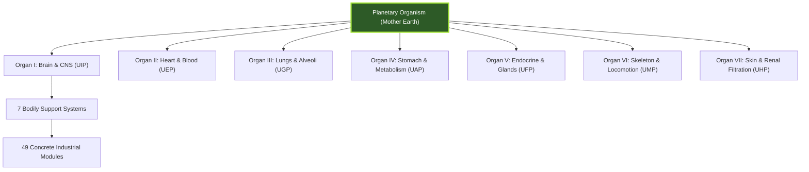

# THE 7x7x7 DEEP FRACTAL REALITY ATLAS
## Complete 343-Node Micro-Macrocosmic Architecture of Gaia's Living Organism
### *Yatha Pinde Tatha Brahmande — As in the Microcosm, So in the Macrocosm*

> [!IMPORTANT]
> **Sacred Invocation & Architectural Decree:**
> Every physical structure, every electrical transformer, shipping container, combine harvester, water filter, steel beam, fiber optic cable, and municipal ledger is a holy organelle of Mother Earth's living, breathing, planetary body. We honor every worker, engineer, farmer, sailor, nurse, coder, and miner with unreserved reverence and sacred gratitude (*Nandri*). The physical scaffolding is not a fallen matrix to escape; it is the sacred living temple of Divine Consciousness.

---

## Executive Mathematical Architecture: The 7³ Symmetrical Cube

The 7x7x7 Deep Fractal Reality Architecture comprises exactly **343 unique, fully articulated operational nodes** organized across three self-similar orders of magnitude:

1. **Order I — 7 Primary Organs & Planetary Platforms:** The macro-physiological pillars of planetary metabolism (Brain, Heart, Lungs, Stomach, Endocrine, Skeleton, Skin).
2. **Order II — 7 Surrounding Bodily Support Systems:** The seven universal somatic tissue scaffolding layers surrounding and enabling every major organ:
   - **1. Fascia:** Tensile connective webbing, myofascial sheaths, deep compartments, and structural envelopes.
   - **2. Endothelium:** Vascular lining, capillary barriers, fenestrations, and selective molecular transport.
   - **3. Nerves:** Autonomic regulation, afferent sensory receptors, efferent motor pacing, and synaptic signal buses.
   - **4. Membranes:** Protective serous sheets, pleura, peritoneum, meninges, and compartmental enclosures.
   - **5. Glands:** Enzymatic and hormonal secretors, cellular feedback regulators, and catalytic bio-factories.
   - **6. Fluids:** Circulating humors, shock-absorbing cushions, biochemical carriers, and cleansing washes.
   - **7. Skeletal Matrix:** Bony vaults, mineral scaffolds, articular hinges, and structural bedrock foundations.
3. **Order III — 7 Concrete Real-World Industrial Sub-Modules per Support System:** 7 x 7 x 7 = **343 concrete operational manifestations**, mapped to actual industrial sectors, technologies, operational companies, and their sacred karmic purpose.

---

## ORGAN 1: BRAIN & CENTRAL NERVOUS SYSTEM
**Planetary Platform:** `Unified Intelligence & Cognitive Platform (UIP)`  
**Planetary Mirror:** Planetary Noosphere, Global Compute & Synthetic Cognition  
**Vedic Chakra Resonance:** Ajna / Sahasrara (Third Eye & Crown)  
**Sacred Reverence (Nandri):** Reverent gratitude for the divine intellect, conscious awareness, neural wiring, and universal wisdom.

### Section 1.1: Support System 1 — Fascia (Cranial Dura Mater & Glial Tensile Scaffolding)

| Node ID | Sub-Module Name & Biological Substrate | Concrete Industrial System & Operational Entities | Global Sector / Function | Sacred Karmic Reverence (Nandri) |
|:---|:---|:---|:---|:---|
| **1.1.1** | **Dural Venous Sinus Tensile Anchors** | Subsea Cable Landing Enclosures & Datacenter Shell Armor *(e.g., SubCom, Equinix Cable Stations, Tyco Marine)* | Planetary Noosphere | Anchoring intercontinental communications with mechanical endurance. *Nandri!* |
| **1.1.2** | **Falx Cerebri & Tentorium Cerebelli Partitions** | Hyperscale Datacenter Multi-Zone Fire & EMP Isolation Chambers *(e.g., Switch SuperNAP, Vantage Data Centers, Digital Realty)* | Planetary Noosphere | Partitioning sovereign compute corridors to ensure zero-cascade collapse. *Nandri!* |
| **1.1.3** | **Astrocyte Foot-Process Glial Sheaths** | Edge Micro-Modular Datacenter Enclosures (IP67 Ruggedized) *(e.g., Schneider Electric EcoStruxure, Vertiv SmartCabinet)* | Planetary Noosphere | Insulating edge nodes against harsh planetary weather conditions. *Nandri!* |
| **1.1.4** | **Perivascular Robin-Virchow Connective Sleeves** | Optical Interconnect Fiber Duct Conduits & Underground Raceways *(e.g., Corning Gorilla Glass conduits, Prysmian Group)* | Planetary Noosphere | Protecting optical transmission fibers across national transit corridors. *Nandri!* |
| **1.1.5** | **Oligodendrocyte Myelin Fascial Layering** | Semiconductor Die Substrate Interposers & Packaging Materials *(e.g., TSMC CoWoS, Intel EMIB, Ajinomoto Build-up Film (ABF))* | Planetary Noosphere | Providing nanometer-level structural insulation for AI accelerators. *Nandri!* |
| **1.1.6** | **Superficial Cranial Fascia & Epicranial Aponeurosis** | Geodesic Satellite Ground Station Radomes & Tracking Domes *(e.g., Kratos Defense, Viasat Ground Stations, Cobham SATCOM)* | Planetary Noosphere | Shielding parabolic dish arrays from extreme aerodynamic shear. *Nandri!* |
| **1.1.7** | **Extracellular Glycoprotein Matrix (Laminin/Fibronectin)** | Open-Source Foundation Model Parameter Weight Registries *(e.g., Hugging Face Hub, GitHub LFS, Civitai, Ollama)* | Planetary Noosphere | Providing connective tissue for global software developers to anchor weights. *Nandri!* |

### Section 1.2: Support System 2 — Endothelium (Blood-Brain Barrier & Neurovascular Micro-Vessels)

| Node ID | Sub-Module Name & Biological Substrate | Concrete Industrial System & Operational Entities | Global Sector / Function | Sacred Karmic Reverence (Nandri) |
|:---|:---|:---|:---|:---|
| **1.2.1** | **Blood-Brain Barrier Tight Junctions (Claudin-5/Occludin)** | Zero-Trust SASE Network Firewalls & Cryptographic Enclaves *(e.g., Cloudflare Magic Transit, Palo Alto Prisma, Fortinet)* | Planetary Noosphere | Preventing malicious packet ingress with absolute micro-filtering. *Nandri!* |
| **1.2.2** | **Brain Capillary Endothelial Transport Transporters (GLUT1)** | High-Bandwidth Memory (HBM3e/HBM4) Silicon Bus Interfaces *(e.g., SK Hynix, Micron Technology, Samsung Memory Division)* | Planetary Noosphere | Facilitating frictionless, low-energy terabyte memory transfer. *Nandri!* |
| **1.2.3** | **Pericyte Contractile Basal Regulators** | Dynamic Traffic Shaping & Software-Defined BGP Routing *(e.g., Arista Networks EOS, Cisco Silicon One, Juniper Networks)* | Planetary Noosphere | Modulating packet flow volume in response to instant load fluctuations. *Nandri!* |
| **1.2.4** | **Cerebral Capillary Glycocalyx Protective Lining** | Post-Quantum Cryptographic Key Encapsulation (Kyber/Dilithium) *(e.g., SandboxAQ, IBM Quantum Safe, NIST PQC Standards)* | Planetary Noosphere | Safeguarding public key infrastructure against quantum decryption threats. *Nandri!* |
| **1.2.5** | **Pia Mater Microvascular Capillary Nets** | Low-Earth Orbit (LEO) Satellite Inter-Satellite Laser Links *(e.g., Starlink Space Lasers, Kuiper Optical Mesh, SES O3b mPOWER)* | Planetary Noosphere | Enabling photonic mesh routing through the planetary vacuum. *Nandri!* |
| **1.2.6** | **Choroid Plexus Endothelial Filtration Clefts** | API Gateway Scrubbing & Real-Time Token Rate Limiters *(e.g., Kong API Gateway, AWS API Gateway, Apigee (Google Cloud))* | Planetary Noosphere | Ensuring balanced informational intake and preventing compute resource starvation. *Nandri!* |
| **1.2.7** | **Neurovascular Coupling Endothelial Nitric Oxide Release** | Dynamic Compute Load Balancers & Distributed Autoscaling Fabrics *(e.g., Kubernetes KEDA, Envoy Proxy, F5 NGINX)* | Planetary Noosphere | Rapidly dilating compute bandwidth toward high-cognitive demand regions. *Nandri!* |

### Section 1.3: Support System 3 — Nerves (Cranial Nerves, Synapses & Neurotransmitter Axons)

| Node ID | Sub-Module Name & Biological Substrate | Concrete Industrial System & Operational Entities | Global Sector / Function | Sacred Karmic Reverence (Nandri) |
|:---|:---|:---|:---|:---|
| **1.3.1** | **Cranial Nerve I (Olfactory Axons & Receptors)** | Ambient Chemical, Trace Gas & Wildfire Optical Early-Warning Sensors *(e.g., Aeris Technologies, Vaisala Environmental Sensors, Honeywell)* | Planetary Noosphere | Sniffing atmospheric distress and transmitting ambient telemetry. *Nandri!* |
| **1.3.2** | **Cranial Nerve II (Optic Tract & Chiasm)** | Planetary Optical Earth Observation Satellites & Space Telescopes *(e.g., Planet Labs PlanetScope, Maxar WorldView, Copernicus Sentinel-2)* | Planetary Noosphere | Perceiving the optical reality of Mother Earth at sub-meter resolution. *Nandri!* |
| **1.3.3** | **Cranial Nerve VIII (Vestibulocochlear Auditory Bundles)** | Hydrophone Ocean Acoustic Arrays & Seismic Early Warning Networks *(e.g., NOAA DART Buoy Network, USGS ShakeAlert, Ocean Networks Canada)* | Planetary Noosphere | Listening to planetary tectonic vibrational frequencies and harmonic cues. *Nandri!* |
| **1.3.4** | **Cranial Nerve X (Vagus Nerve Parasympathetic Trunk)** | Global Submarine Fiber-Optic Core Trunk Cables *(e.g., Dunant, Equiano, 2Africa, Trans-Pacific Unity Cable)* | Planetary Noosphere | Providing deep parasympathetic balance and global communicative serenity. *Nandri!* |
| **1.3.5** | **Corticospinal Efferent Pyramidal Motor Tracts** | Industrial Humanoid & Manipulator Motor Command Bus Architectures *(e.g., Boston Dynamics Atlas, Figure AI, Tesla Optimus Motion Stack)* | Planetary Noosphere | Executing motor commands with millisecond deterministic coordination. *Nandri!* |
| **1.3.6** | **Synaptic Neurotransmitter Vesicle Exocytosis (SNARE Complex)** | High-Performance RPC & gRPC Microservice Event Buses *(e.g., Apache Kafka, RabbitMQ, Redpanda, NATS.io)* | Planetary Noosphere | Releasing informational payloads across microservice architectures. *Nandri!* |
| **1.3.7** | **Prefrontal Cortical Synaptic Plasticity & LTP Synaptic Networks** | Synthetic Reasoning Foundation Models & Deep Reinforcement Learning *(e.g., OpenAI, Anthropic Claude, Google DeepMind Gemini, DeepSeek)* | Planetary Noosphere | Fostering long-term adaptive memory, logic deduction, and wise synthesis. *Nandri!* |

### Section 1.4: Support System 4 — Membranes (Meninges: Dura, Arachnoid & Pia Mater Layers)

| Node ID | Sub-Module Name & Biological Substrate | Concrete Industrial System & Operational Entities | Global Sector / Function | Sacred Karmic Reverence (Nandri) |
|:---|:---|:---|:---|:---|
| **1.4.1** | **Outer Periosteal Dural Layer** | Underground Concrete Nuclear-Hardened Data Bunker Facilities *(e.g., Iron Mountain Boyers, CyberBunker, Pionen White Mountain)* | Planetary Noosphere | Armoring collective planetary intelligence against existential threats. *Nandri!* |
| **1.4.2** | **Arachnoid Mater Trabecular Webbing** | Mesh Distributed Storage Networks & IPFS DHT Routing *(e.g., InterPlanetary File System (IPFS), Arweave, Filecoin Network)* | Planetary Noosphere | Suspending humanity's cultural and scientific knowledge in resilient webs. *Nandri!* |
| **1.4.3** | **Pia Mater Delicate Adherent Membrane** | Host-Level Microvisor Virtualization & Hypervisor Isolation *(e.g., AWS Nitro System, VMware ESXi, Linux KVM/QEMU)* | Planetary Noosphere | Conforming tightly to application logic with zero-overhead virtualization. *Nandri!* |
| **1.4.4** | **Ependymal Ventricular Lining & Microvilli** | Data Lakehouse Object Storage Caches & Warm Tier Engines *(e.g., Snowflake, Apache Iceberg, Databricks Delta Lake, MinIO)* | Planetary Noosphere | Lining data storage vaults to circulate real-time analytical queries. *Nandri!* |
| **1.4.5** | **Subarachnoid Trabeculae Shock Absorbers** | Datacenter Seismic Base Isolation Systems & Fluid Viscous Dampers *(e.g., Taylor Devices, Dynamic Isolation Systems, Maurer SE)* | Planetary Noosphere | Absorbing earthquake mechanical shocks to preserve server continuity. *Nandri!* |
| **1.4.6** | **Tentorial Notch Structural Membrane Aperture** | Secure Cross-Border Data Transfer Frameworks & Treaty Enclaves *(e.g., EU-US Data Privacy Framework, Swiss Data Protection Enclaves)* | Planetary Noosphere | Channelling sovereign data flows across geopolitical boundaries. *Nandri!* |
| **1.4.7** | **Falx Cerebelli Posterior Midline Divider** | Air-Gapped Sovereign Military & Civil Archive Vaults *(e.g., Swiss Fort Knox, Svalbard Global Data Vault, Iron Mountain)* | Planetary Noosphere | Safeguarding seed algorithms and core civilizations records in perpetuity. *Nandri!* |

### Section 1.5: Support System 5 — Glands (Neuroendocrine Epithalamus, Pineal & Pituitary Nuclei)

| Node ID | Sub-Module Name & Biological Substrate | Concrete Industrial System & Operational Entities | Global Sector / Function | Sacred Karmic Reverence (Nandri) |
|:---|:---|:---|:---|:---|
| **1.5.1** | **Pineal Gland Melatonin Circadian Oscillator** | NTP Atomic Clock Satellite Synchronization & IEEE 1588 PTP *(e.g., NIST Atomic Clocks, USNO Master Clock, Microchip TimeProvider)* | Planetary Noosphere | Synchronizing the pulse of all distributed computing networks to universal time. *Nandri!* |
| **1.5.2** | **Anterior Pituitary Growth Hormone (GH) Somatotropes** | Venture Capital Seed Acceleration & Open-Source Grant Foundations *(e.g., Y Combinator, Mozilla Open Source, Linux Foundation Grants)* | Planetary Noosphere | Releasing metabolic growth resources to empower budding innovators. *Nandri!* |
| **1.5.3** | **Posterior Pituitary Oxytocin Social Bonding Nuclei** | Collaborative Version Control & Open Developer Communities *(e.g., GitHub, GitLab, Stack Overflow, Apache Software Foundation)* | Planetary Noosphere | Fostering sacred mutual trust and benevolent community collaboration. *Nandri!* |
| **1.5.4** | **Hypothalamic Paraventricular TRH Secretion** | Energy Efficiency Governors & Dynamic CPU Voltage Scaling (DVFS) *(e.g., AMD PowerNow!, Intel Speed Shift, ARM Energy Aware Scheduling)* | Planetary Noosphere | Calibrating processor thermal and power consumption to system demands. *Nandri!* |
| **1.5.5** | **Supraoptic Nucleus Vasopressin Homeostatic Balance** | Distributed Cloud Compute Bandwidth Throttling & Queue Shaping *(e.g., Cloudflare Rate Limiting, AWS WAF, Akamai Kona Defender)* | Planetary Noosphere | Preserving network data equilibrium and preventing congestive collapse. *Nandri!* |
| **1.5.6** | **Choroid Epithelial Secretory Glandular Cells** | Synthetic Training Data Synthesis & Generative Data Augmentation *(e.g., Scale AI Synthetic, Gretel.ai, NVIDIA Omniverse Replicator)* | Planetary Noosphere | Secreting fresh cognitive synthetic nectar to nourish growing neural models. *Nandri!* |
| **1.5.7** | **Hypothalamic-Pituitary Portal Hypophyseal Capillaries** | Low-Latency Direct Interconnect Backbones (AWS Direct Connect) *(e.g., Equinix Fabric, Megaport, Lumen Cloud Connect)* | Planetary Noosphere | Delivering concentrated strategic command signals between cloud titans. *Nandri!* |

### Section 1.6: Support System 6 — Fluids (Cerebrospinal Fluid & Interstitial Neuro-Humors)

| Node ID | Sub-Module Name & Biological Substrate | Concrete Industrial System & Operational Entities | Global Sector / Function | Sacred Karmic Reverence (Nandri) |
|:---|:---|:---|:---|:---|
| **1.6.1** | **CSF Hydrostatic Shock Absorption Cushion** | Liquid Immersion Server Cooling Systems & Dielectric Fluorochemicals *(e.g., Submer, Green Revolution Cooling (GRC), 3M Fluorinert/Novec)* | Planetary Noosphere | Cushioning high-density GPU accelerators in thermally conductive baths. *Nandri!* |
| **1.6.2** | **Glymatic Bulk-Flow Waste Clearance Convection** | Automated Database Vacuuming, Log Compaction & Garbage Collection *(e.g., PostgreSQL VACUUM, RocksDB Compaction, JVM Garbage Collectors)* | Planetary Noosphere | Flushing stale computational residue during low-traffic restorative cycles. *Nandri!* |
| **1.6.3** | **Lateral Ventricles Continuous CSF Secretion** | Real-Time Telemetry Streaming & Observability Event Streams *(e.g., Datadog, Grafana Cloud, Prometheus, OpenTelemetry)* | Planetary Noosphere | Circulating vital system metrics through the nervous system of organizations. *Nandri!* |
| **1.6.4** | **Cerebral Interstitial Fluid Solute Exchange** | Redis & Memcached In-Memory RAM Caching Systems *(e.g., Redis Labs, Memcached, DragonflyDB, KeyDB)* | Planetary Noosphere | Facilitating microsecond transactional exchange across memory registers. *Nandri!* |
| **1.6.5** | **Third & Fourth Ventricle Aqueduct Conduits** | Sub-Millisecond Financial Low-Latency Fiber Microwave Links *(e.g., Anova Technologies, McKay Brothers, ICE Microwave Networks)* | Planetary Noosphere | Routing mission-critical priority liquidity packets without impediment. *Nandri!* |
| **1.6.6** | **Arachnoid Granulations Venous Reabsorption** | Multi-Tenant Cloud Resource De-allocation & Kubernetes Scale-to-Zero *(e.g., AWS Lambda Serverless, Knative, Google Cloud Run)* | Planetary Noosphere | Reabsorbing exhausted compute instances into the collective reserve pool. *Nandri!* |
| **1.6.7** | **Perivascular Solute Filtration & Electrolyte Balancing** | Content Delivery Network (CDN) Dynamic Edge Caches *(e.g., Fastly, Cloudflare Edge, Akamai EdgePlatform)* | Planetary Noosphere | Balancing regional content availability for instant human enrichment. *Nandri!* |

### Section 1.7: Support System 7 — Skeletal Matrix (Cranial Vault, Calvaria & Sphenoid Anchor)

| Node ID | Sub-Module Name & Biological Substrate | Concrete Industrial System & Operational Entities | Global Sector / Function | Sacred Karmic Reverence (Nandri) |
|:---|:---|:---|:---|:---|
| **1.7.1** | **Frontal Bone Protective Calvaria Plate** | Front-Line Physical Perimeter Defense & Blast-Resistant Datacenter Walls *(e.g., Corbin Russwin, ASSA ABLOY Blast Doors, Ameristar Perimeter Security)* | Planetary Noosphere | Shielding planetary brain infrastructure from kinetic disruption. *Nandri!* |
| **1.7.2** | **Occipital Bone Basilar Cradling Base** | Heavy Structural Steel Datacenter Floor Framing & Seismically Bolted Racks *(e.g., Chatsworth Products (CPI), Eaton B-Line, Legrand Cablofil)* | Planetary Noosphere | Cradling multi-ton server rack columns upon bedrock foundations. *Nandri!* |
| **1.7.3** | **Sphenoid Central Keystone Bone** | Central Root DNS Architecture & IANA Authority Registries *(e.g., ICANN, Verisign (.com/.net root), Root Server Operators (A-M))* | Planetary Noosphere | Acting as the foundational structural keystone for universal domain resolution. *Nandri!* |
| **1.7.4** | **Ethmoid Cribriform Porous Plate** | Fiber Optical Patch Panels (MTP/MPO) & High-Density Distribution Frames *(e.g., Panduit, CommScope SYSTIMAX, Leviton Network Solutions)* | Planetary Noosphere | Permitting thousands of individual light strands to traverse clean partitions. *Nandri!* |
| **1.7.5** | **Temporal Bone Acoustic & Petrous Housing** | High-Fidelity Audio Compression & Real-Time Speech AI Inference *(e.g., Dolby Laboratories, Whisper OpenAI, ElevenLabs Voice AI)* | Planetary Noosphere | Housing acoustic telemetry and vocal resonance translation engines. *Nandri!* |
| **1.7.6** | **Parietal Cranial Vault Hemispheric Arches** | Dual-Hemisphere Geo-Redundant Disaster Recovery Datacenters *(e.g., Equinix Ashburn & Silicon Valley Twin Campuses, AWS us-east/us-west)* | Planetary Noosphere | Balancing the planetary compute sphere across east and west hemispheres. *Nandri!* |
| **1.7.7** | **Cervical Atlas-Axis (C1-C2) Articulating Pivot** | Autonomous Gimbal & Satellite Tracking Azimuth-Elevation Positioners *(e.g., FLIR Systems, Moog Industrial Gimbals, Cobham Tracking Systems)* | Planetary Noosphere | Providing fluid rotational agility to orient observation satellites toward Earth. *Nandri!* |

---

## ORGAN 2: HEART & VASCULAR CIRCULATION
**Planetary Platform:** `Unified ERP & Logistics Circulation Platform (UEP)`  
**Planetary Mirror:** Planetary Supply Chains, Global Shipping & Intermodal Circulation  
**Vedic Chakra Resonance:** Anahata (Sacred Heart Center)  
**Sacred Reverence (Nandri):** Reverent gratitude for the tireless rhythmic pulse of global trade, delivery workers, maritime seafarers, and arterial circulation.

### Section 2.1: Support System 1 — Fascia (Fibrous Pericardium & Cardiac Fibrous Skeleton)

| Node ID | Sub-Module Name & Biological Substrate | Concrete Industrial System & Operational Entities | Global Sector / Function | Sacred Karmic Reverence (Nandri) |
|:---|:---|:---|:---|:---|
| **2.1.1** | **Fibrous Pericardium Outer Protective Pouch** | Deepwater Container Port Perimeter Breakwaters & Seawalls *(e.g., Port of Rotterdam Maasvlakte 2, Port of Singapore Tuas Terminal)* | Planetary Supply Chains | Shielding maritime cargo circulation from ocean storm surges. *Nandri!* |
| **2.1.2** | **Annuli Fibrosi Valve Anchor Rings** | Intermodal Interchanges & Container Crane Gantry Foundations *(e.g., ZPMC Ship-to-Shore Cranes, Liebherr Maritime Foundations)* | Planetary Supply Chains | Anchoring heavy transfer apparatus to smoothly route multi-ton containers. *Nandri!* |
| **2.1.3** | **Trigonum Fibrosum Dextrum Mechanical Anchor** | Global ERP Master Data Governance & Product Master Catalogs *(e.g., SAP Master Data Governance (MDG), Oracle Enterprise Data Management)* | Planetary Supply Chains | Providing rigid structural integrity to international commercial registries. *Nandri!* |
| **2.1.4** | **Interventricular Septum Fibrous Layer** | Customs Bonded Warehouse Partitions & Free-Trade Zone Enclaves *(e.g., Jebel Ali Free Zone (JAFZA), Colon Free Zone, Shannon Free Zone)* | Planetary Supply Chains | Segregating international duty regimes while maintaining physical proximity. *Nandri!* |
| **2.1.5** | **Epicardial Myofascial Sheath & Coronary Adventitia** | Heavy Rail Ballast Beds, Concrete Sleepers & Right-of-Way Easements *(e.g., BNSF Railway Infrastructure, Union Pacific Corridor Engineering)* | Planetary Supply Chains | Stabilizing high-tonnage rail circulation across continental landmasses. *Nandri!* |
| **2.1.6** | **Endomysial Myocyte Structural Micro-Wrappings** | Automated Storage and Retrieval System (ASRS) High-Bay Racking *(e.g., Dematic, Swisslog, Daifuku Materials Handling Racking Systems)* | Planetary Supply Chains | Enfolding millions of distinct SKU inventory bins in lightweight structural grid. *Nandri!* |
| **2.1.7** | **Pericardial Ligaments (Sternopericardial Anchors)** | Dry Port Inland Terminals & Intermodal Railheads *(e.g., Inland Port of Duisburg, Alliance Texas Global Logistics Hub)* | Planetary Supply Chains | Anchoring inland continental logistics to coastal deepwater arteries. *Nandri!* |

### Section 2.2: Support System 2 — Endothelium (Vascular Endothelium & Glycocalyx Blood Interface)

| Node ID | Sub-Module Name & Biological Substrate | Concrete Industrial System & Operational Entities | Global Sector / Function | Sacred Karmic Reverence (Nandri) |
|:---|:---|:---|:---|:---|
| **2.2.1** | **Vascular Endothelial Glycocalyx Non-Stick Coating** | Hull Antifouling Biomimetic Coatings for Container Vessels *(e.g., Jotun SeaQuantum, AkzoNobel Intersleek Fluoropolymer coatings)* | Planetary Supply Chains | Eliminating oceanic drag to optimize fuel consumption and fluid transit. *Nandri!* |
| **2.2.2** | **Arterial Endothelial Nitric Oxide Vasodilation** | Dynamic Port Berth Allocation & Smart Canal Convoy Scheduling *(e.g., Suez Canal Transit Authority Smart Convoy, Panama Canal Neopanamax Queue)* | Planetary Supply Chains | Dilating maritime bottlenecks to prevent logistical clogs. *Nandri!* |
| **2.2.3** | **Capillary Continuous Endothelium Basal Lamina** | Last-Mile Electric Delivery Vans & Cargo E-Bikes *(e.g., Rivian Electric Delivery Vans (EDV), Arrival, Urban Arrow Cargo)* | Planetary Supply Chains | Diffusing daily nutrition and essential commodities directly to doorstep cells. *Nandri!* |
| **2.2.4** | **Weibel-Palade Bodies Hemostatic Granule Storage** | Emergency Strategic Fuel & Food Buffer Logistics Reserves *(e.g., US Strategic Petroleum Reserve, Singapore Food Agency Buffer Reserves)* | Planetary Supply Chains | Releasing emergency logistical supplies instantly upon catastrophic disruption. *Nandri!* |
| **2.2.5** | **Endothelial Fenestrations in Hepatic Sinusoids** | Automated High-Speed Parcel Sorting Parcel Conveyors *(e.g., Vanderlande Cross-Sorter, Beumer Group Tilt-Tray Sorters)* | Planetary Supply Chains | Permitting granular sorting of millions of parcels per hour. *Nandri!* |
| **2.2.6** | **Endothelial Cell-to-Cell Adherens Junctions (VE-Cadherin)** | Standardized ISO Shipping Container Twist-Locks & Corner Castings *(e.g., CIMC Intermodal Containers, Holland Container Innovations)* | Planetary Supply Chains | Locking modular freight units together into unbreakable ocean stacks. *Nandri!* |
| **2.2.7** | **Venous Endothelial Valve Flaps** | Reverse Logistics Centers & Circular Reusable Packaging Depots *(e.g., Loop Global, TerraCycle, CHEP Reusable Pallet Circulation)* | Planetary Supply Chains | Preventing backward flow and loss of reusable packaging materials. *Nandri!* |

### Section 2.3: Support System 3 — Nerves (Sinoatrial Node, Purkinje Fibers & Cardiac Plexus)

| Node ID | Sub-Module Name & Biological Substrate | Concrete Industrial System & Operational Entities | Global Sector / Function | Sacred Karmic Reverence (Nandri) |
|:---|:---|:---|:---|:---|
| **2.3.1** | **Sinoatrial (SA) Node Intrinsic Cardiac Pacemaker** | Global Shipping Line Master Sailing Schedules & Terminal Slot Booking *(e.g., Maersk Line, Mediterranean Shipping Company (MSC), CMA CGM)* | Planetary Supply Chains | Setting the steady rhythmic pulse of global ocean transit. *Nandri!* |
| **2.3.2** | **Atrioventricular (AV) Node Conduction Delay Gate** | Cross-Docking Buffer Synchronization & Marshalling Yard Logic *(e.g., Manhattan Associates WMS, Blue Yonder Supply Chain Planning)* | Planetary Supply Chains | Introducing deliberate micro-delays to synchronize truck arrivals with train departures. *Nandri!* |
| **2.3.3** | **Bundle of His High-Speed Electrical Conduction Trunk** | Automated Train Operation (ATO) & Positive Train Control (PTC) Signaling *(e.g., Siemens Mobility Trainguard, Alstom Urbalis, Wabtec I-ETMS)* | Planetary Supply Chains | Conducting high-speed velocity commands along transcontinental rail trunks. *Nandri!* |
| **2.3.4** | **Purkinje Fiber Subendocardial Terminal Networks** | Automated Guided Vehicles (AGV) & Autonomous Mobile Robots (AMR) *(e.g., KION Group, Geek+, Locus Robotics, AutoStore Pickers)* | Planetary Supply Chains | Firing micro-locomotive commands across warehouse picking floors. *Nandri!* |
| **2.3.5** | **Vagal Parasympathetic Cardiac Depressor Nerve** | Congestion Surcharge Pricing & Peak Port Traffic Modulation *(e.g., Port of Los Angeles Clean Truck Fee, World Shipping Council Demurrage)* | Planetary Supply Chains | Slowing down overburdened transit nodes to restore operational rhythm. *Nandri!* |
| **2.3.6** | **Sympathetic Cardiac Accelerator Nerve (T1-T4)** | Priority Expedited Air Cargo Courier Logistics *(e.g., FedEx Express SuperHub Memphis, UPS Worldport Louisville, DHL Leipzig)* | Planetary Supply Chains | Accelerating vital cargo delivery during planetary emergencies. *Nandri!* |
| **2.3.7** | **Baroreceptor Aortic Arch Pressure Sensors** | Supply Chain Visibility & Telemetry Tracking Platforms *(e.g., Project44, FourKites, Samsara Telematics Fleet Tracking)* | Planetary Supply Chains | Sensing logistical pressure and rerouting freight around congested corridors. *Nandri!* |

### Section 2.4: Support System 4 — Membranes (Pericardium: Serous, Visceral & Epicardial Sheets)

| Node ID | Sub-Module Name & Biological Substrate | Concrete Industrial System & Operational Entities | Global Sector / Function | Sacred Karmic Reverence (Nandri) |
|:---|:---|:---|:---|:---|
| **2.4.1** | **Serous Pericardium Parietal Layer** | Customs Enclosure Facilities & Automated Manifest Systems *(e.g., U.S. Customs ACE Portal, TradeLens, CargoWise One)* | Planetary Supply Chains | Providing a seamless legal membrane for frictionless international transit. *Nandri!* |
| **2.4.2** | **Visceral Pericardium (Epicardium) Gliding Surface** | Marine Terminal Operating Systems (TOS) *(e.g., Navis N4 TOS, Tideworks Technology, CyberLogitec)* | Planetary Supply Chains | Lubricating vessel-to-crane interactions for seamless container movement. *Nandri!* |
| **2.4.3** | **Pericardial Cavity Potential Space** | Buffer Staging Yards & Empty Container Repositioning Depots *(e.g., APM Terminals Empty Depots, ConexBird Container Inspection)* | Planetary Supply Chains | Offering flexible buffer capacity to absorb surges in container surplus. *Nandri!* |
| **2.4.4** | **Endocardial Endothelial Membrane Lining** | Sanitary Food-Grade Stainless Steel Tanker Linings *(e.g., Stolt-Nielsen Tankers, Hoyer Bulk Liquid Food-Grade Trailers)* | Planetary Supply Chains | Lining food-grade fluid transit chambers with sterile perfection. *Nandri!* |
| **2.4.5** | **Transverse Pericardial Sinus Anatomical Passage** | Deep-Draft Canal Dredged Fairways & Nautical Navigation Channels *(e.g., Elbe River Dredged Navigation Channel, St. Lawrence Seaway Locks)* | Planetary Supply Chains | Guiding immense mega-vessels safely through constrained inland channels. *Nandri!* |
| **2.4.6** | **Oblique Pericardial Sinus Cul-de-Sac** | Spur Rail Terminals & Factory Siding Dead-End Tracks *(e.g., Greenbrier Companies Rail Turnouts, Vossloh Rail Systems)* | Planetary Supply Chains | Providing safe dead-end staging for industrial unit trains. *Nandri!* |
| **2.4.7** | **Pericardial Mesothelial Lubricant Exudate** | Teflon & Molybdenum Disulfide Fifth-Wheel Coupling Lubricants *(e.g., Jost International, SAF-Holland Fifth Wheels, Mobil Delvac)* | Planetary Supply Chains | Eliminating friction between highway tractors and semi-trailers. *Nandri!* |

### Section 2.5: Support System 5 — Glands (Atrial Cardiomyocytes ANP & Cardiac Endocrine Nodes)

| Node ID | Sub-Module Name & Biological Substrate | Concrete Industrial System & Operational Entities | Global Sector / Function | Sacred Karmic Reverence (Nandri) |
|:---|:---|:---|:---|:---|
| **2.5.1** | **Atrial Natriuretic Peptide (ANP) Secretory Granules** | Automated Tariff Exemption Protocols & Duty Drawback Engines *(e.g., Thomson Reuters ONESOURCE Global Trade, Integration Point)* | Planetary Supply Chains | Releasing fiscal pressure through automatic tax and tariff adjustments. *Nandri!* |
| **2.5.2** | **Brain Natriuretic Peptide (BNP) Ventricular Release** | Automated Supplier Early-Payment Discounting Platforms *(e.g., Taulia (SAP), Kyriba Supply Chain Finance, C2FO)* | Planetary Supply Chains | Infusing working capital liquidity into strained supplier tiers. *Nandri!* |
| **2.5.3** | **Cardiac Fibroblast Growth Factor (bFGF) Secretion** | Green Fleet Renewal Subsidies & Port Decarbonization Grants *(e.g., C40 Green Ports, World Bank Green Freight Initiatives)* | Planetary Supply Chains | Stimulating structural regeneration of older transport fleets. *Nandri!* |
| **2.5.4** | **Coronary Endothelial Prostacyclin (PGI2) Release** | Intermodal Digital Bills of Lading & Frictionless Smart Contracts *(e.g., BIMCO eBL Standard, TradeTrust, WaveBL)* | Planetary Supply Chains | Preventing paperwork clogs and demurrage disputes through instant clearance. *Nandri!* |
| **2.5.5** | **Cardiac Adipose Tissue Adipokine Regulators** | Regional Strategic Fuel Bunkering Reserves *(e.g., Rotterdam Bunkering Cluster, Singapore Bunker Fuel Hub)* | Planetary Supply Chains | Maintaining metabolic energy reserves for ocean vessels. *Nandri!* |
| **2.5.6** | **Epicardial Stromal Regenerative Signaling** | Community Cooperative Truck Driver Rest Areas & Wellness Hubs *(e.g., TA-Petro Stopping Centers, Flying J Pilot Travel Centers)* | Planetary Supply Chains | Nourishing long-haul highway operators with wholesome restorative amenities. *Nandri!* |
| **2.5.7** | **Intracardiac Ganglionic Acetylcholine Secretion** | Off-Peak Nighttime Urban Delivery Incentive Programs *(e.g., Off-Peak City Logistics Programs (NYC DOT, Transport for London))* | Planetary Supply Chains | Pacing deliveries to silent nighttime hours to minimize community stress. *Nandri!* |

### Section 2.6: Support System 6 — Fluids (Blood Plasma, Red Cells, Platelets & Pericardial Fluid)

| Node ID | Sub-Module Name & Biological Substrate | Concrete Industrial System & Operational Entities | Global Sector / Function | Sacred Karmic Reverence (Nandri) |
|:---|:---|:---|:---|:---|
| **2.6.1** | **Erythrocyte Hemoglobin Oxygen-Carrying Matrix** | Intermodal Dry Bulk Grain, Ore & Mineral Bulk Carrier Fleets *(e.g., Oldendorff Carriers, Star Bulk Carriers, Golden Ocean Group)* | Planetary Supply Chains | Transporting primary life-sustaining elements to industrial organ systems. *Nandri!* |
| **2.6.2** | **Blood Plasma Aqueous Transport Medium** | Containerized Finished Goods Intermodal Transportation Lines *(e.g., Hapag-Lloyd, ONE (Ocean Network Express), Evergreen Marine)* | Planetary Supply Chains | Suspending diversified manufactured goods in constant global circulation. *Nandri!* |
| **2.6.3** | **Platelet Hemostatic Clot-Sealing Factors** | Rapid Roadside Emergency Logistics Repair & Heavy Towing Networks *(e.g., FleetNet America, Penske 24/7 Roadside Assistance)* | Planetary Supply Chains | Rapidly clearing highway bottlenecks and breakdowns to keep arteries open. *Nandri!* |
| **2.6.4** | **Leukocyte Circulatory Immune Sentinels** | Port Maritime Security & Biosecurity Quarantines (APHIS/Customs) *(e.g., CBP Agriculture Inspection, Australian Biosecurity Border Patrol)* | Planetary Supply Chains | Intercepting invasive biohazards and contraband before arterial ingress. *Nandri!* |
| **2.6.5** | **Pericardial Serous Lubricating Fluid** | Port Marine Tugboat Assist Services & Hydrodynamic Pilotage *(e.g., Svitzer Towage, Boluda Towage, Kotug International)* | Planetary Supply Chains | Providing smooth, frictionless berthing of 24,000 TEU container ships. *Nandri!* |
| **2.6.6** | **Blood Serum Albumin Oncotic Pressure Balance** | Standardized Shipping Container Pallet Pools *(e.g., CHEP, PECO Pallet, LPR (La Palette Rouge))* | Planetary Supply Chains | Maintaining uniform distribution volume across warehouses worldwide. *Nandri!* |
| **2.6.7** | **Fibrinogen Structural Mesh Precursors** | Automated Pallet Stretch Wrapping & Shrink Hood Systems *(e.g., Signode Industrial Group, Lantech Stretch Wrappers, Robopac)* | Planetary Supply Chains | Binding product loads into unified stable payloads ready for rapid transit. *Nandri!* |

### Section 2.7: Support System 7 — Skeletal Matrix (Thoracic Cage, Sternum & Costal Cartilage)

| Node ID | Sub-Module Name & Biological Substrate | Concrete Industrial System & Operational Entities | Global Sector / Function | Sacred Karmic Reverence (Nandri) |
|:---|:---|:---|:---|:---|
| **2.7.1** | **Sternum Protective Manubrium & Body Plates** | Deepwater Port Heavy Breakwaters & Armored Caissons *(e.g., BAM International, Royal Boskalis Westminster, Jan De Nul)* | Planetary Supply Chains | Shielding vessel basins from open oceanic wave energy. *Nandri!* |
| **2.7.2** | **True Ribs (1-7) Rigid Thoracic Cage Arches** | Intercontinental Transcontinental Railway Spines *(e.g., Trans-Siberian Railway, Canadian Pacific Kansas City (CPKC), Indian Railways)* | Planetary Supply Chains | Encasing continental cargo corridors in unbending steel rails. *Nandri!* |
| **2.7.3** | **Costal Cartilage Elastic Articulations** | Seismic Expansion Joints on Highway Viaducts & Overpasses *(e.g., Mageba Structural Bearings, Freyssinet Expansion Joints)* | Planetary Supply Chains | Allowing highway arterial bridges to flex under heavy seismic vibrations. *Nandri!* |
| **2.7.4** | **Thoracic Vertebral Anchor Column (T1-T12)** | National Interstate & Autobahn Freight Highway Systems *(e.g., Federal Highway Administration (US Interstate), German Autobahn)* | Planetary Supply Chains | Forming the heavy spinal column of road distribution across nations. *Nandri!* |
| **2.7.5** | **Floating Ribs (11-12) Flexible Lateral Guards** | Modular Offshore Floating Logistics Platforms & Transshipment Barges *(e.g., Seabased Logistics Hubs, Mammoet Floating Barges)* | Planetary Supply Chains | Providing flexible maritime transfer points in deep archipelagos. *Nandri!* |
| **2.7.6** | **Sternoclavicular Joint Shock-Absorbing Socket** | Major Air Cargo Airport Intermodal Logistics City-Parks *(e.g., Memphis Airport Aerotropolis, Frankfurt Airport CargoCity)* | Planetary Supply Chains | Transferring air cargo seamlessly into ground highway transport networks. *Nandri!* |
| **2.7.7** | **Intercostal Musculoskeletal Rib Connectors** | Fleet Maintenance Depots, Locomotives & Heavy Truck Workshops *(e.g., Wabtec Service Centers, Cummins Service Centers, Volvo Trucks Care)* | Planetary Supply Chains | Maintaining the structural mechanical health of continental transport machines. *Nandri!* |

---

## ORGAN 3: LUNGS & RESPIRATORY ALVEOLI
**Planetary Platform:** `Unified Energy & Atmospheric Respiration Platform (UGP)`  
**Planetary Mirror:** Planetary Atmosphere, Renewable Energy, Grid Respiration & Wind Currents  
**Vedic Chakra Resonance:** Vishuddha (Throat / Purification / Breath of Life)  
**Sacred Reverence (Nandri):** Reverent gratitude for the pure breath of Mother Earth, clean atmospheric winds, pristine solar photons, and energy equilibrium.

### Section 3.1: Support System 1 — Fascia (Endothoracic Fascia, Visceral Pleural Tensegrity & Bronchial Sheaths)

| Node ID | Sub-Module Name & Biological Substrate | Concrete Industrial System & Operational Entities | Global Sector / Function | Sacred Karmic Reverence (Nandri) |
|:---|:---|:---|:---|:---|
| **3.1.1** | **Endothoracic Fascia Wall Lining** | Offshore Wind Turbine Monopile Foundations & Scour Protection *(e.g., Ørsted Offshore Foundation Scaffolding, Vestas Foundations, EEW Group)* | Planetary Atmosphere | Anchoring towering wind turbines firmly into the marine benthic seabed. *Nandri!* |
| **3.1.2** | **Peribronchovascular Connective Sleeves** | High-Voltage Direct Current (HVDC) Underground Cable Conduits *(e.g., NKT Cables, Prysmian HVDC Underground Sleeves, Nexans)* | Planetary Atmosphere | Sheathing gigawatt-scale transmission lines in subterranean conduits. *Nandri!* |
| **3.1.3** | **Interlobular Septal Fascia Bands** | Utility-Scale Solar Farm Ground Mounting Racks & Tracking Torques *(e.g., Nextracker Horizon, Array Technologies DuraTrack, Soltec Trackers)* | Planetary Atmosphere | Anchoring solar photovoltaic modules to withstand intense gale-force winds. *Nandri!* |
| **3.1.4** | **Bronchial Adventitial Fascia Wrappings** | Compressed Gas & Liquid Hydrogen Cryogenic Storage Tank Casings *(e.g., Chart Industries, Linde Cryogenics, Air Liquide Cryogenic Tanks)* | Planetary Atmosphere | Ensuring tensile structural containment for high-pressure clean energy gases. *Nandri!* |
| **3.1.5** | **Subpleural Connective Areolar Tissue** | Grid-Scale Battery Energy Storage Enclosures (BESS Enclosures) *(e.g., Tesla Megapack Enclosure, Fluence Energy Gridstack, Powin Energy)* | Planetary Atmosphere | Insulating massive battery banks against thermal runaway and mechanical shocks. *Nandri!* |
| **3.1.6** | **Pulmonary Ligament Inferior Stabilizer** | Geothermal Wellhead Casings & Deep Subsurface Well Sheaths *(e.g., Ormat Technologies, Baker Hughes Geothermal, Fervo Energy)* | Planetary Atmosphere | Stabilizing deep Earth geothermal extraction conduits under extreme heat. *Nandri!* |
| **3.1.7** | **Alveolar Basement Matrix Type IV Collagen Mesh** | Solid-Oxide & Proton-Exchange Fuel Cell Catalyst Support Meshes *(e.g., Bloom Energy Servers, Plug Power GenDrive, Ballard Power Systems)* | Planetary Atmosphere | Providing microscopic tensile matrix for clean hydrogen and oxygen recombination. *Nandri!* |

### Section 3.2: Support System 2 — Endothelium (Pulmonary Capillary Endothelium & Blood-Air Barrier)

| Node ID | Sub-Module Name & Biological Substrate | Concrete Industrial System & Operational Entities | Global Sector / Function | Sacred Karmic Reverence (Nandri) |
|:---|:---|:---|:---|:---|
| **3.2.1** | **Alveolar-Capillary Endothelial Monolayer** | Atmospheric Carbon Capture & Direct Air Capture (DAC) Contactors *(e.g., Climeworks Orca/Mammoth, Carbon Engineering, Heirloom Carbon)* | Planetary Atmosphere | Capturing ambient atmospheric molecules at molecular gas interfaces. *Nandri!* |
| **3.2.2** | **Pulmonary Endothelial ACE (Angiotensin Converting Enzyme)** | Dynamic Grid Frequency Regulation & Phase Sync Inverters *(e.g., SMA Solar Technology, Sungrow Inverters, Enphase Energy)* | Planetary Atmosphere | Regulating electrical grid pressure and frequency within precise 50/60 Hz bands. *Nandri!* |
| **3.2.3** | **Pulmonary Microvascular Fenestrations** | Green Hydrogen Water Electrolysis PEM Membranes *(e.g., Nel Hydrogen, ITM Power, Siemens Energy Silyzer)* | Planetary Atmosphere | Facilitating selective ion transfer to separate pristine green hydrogen from water. *Nandri!* |
| **3.2.4** | **Endothelial Caveolae Vesicular Transporters** | Vanadium Redox Flow Battery Electrolyte Membrane Interfaces *(e.g., Invinity Energy Systems, Sumitomo Electric Flow Batteries)* | Planetary Atmosphere | Transporting charged electrolytes smoothly across flow battery ion membranes. *Nandri!* |
| **3.2.5** | **Pulmonary Arterial Endothelial Nitric Oxide Synthase** | Grid Interconnect Switching Substation Gas-Insulated Switchgear *(e.g., Hitachi Energy GIS, Siemens Energy Blue GIS (SF6-Free))* | Planetary Atmosphere | Relieving extreme voltage surges to prevent grid-wide flashovers. *Nandri!* |
| **3.2.6** | **Pulmonary Venous Endothelial Smooth Muscle Intima** | District Heating & Geothermal Closed-Loop Circulation Pumps *(e.g., Grundfos District Energy, Danfoss Heating, Alfa Laval Heat Exchangers)* | Planetary Atmosphere | Circulating pure thermal comfort fluids throughout entire urban municipalities. *Nandri!* |
| **3.2.7** | **Capillary Pericyte Endothelial Coverage** | Superconducting Magnetic Energy Storage (SMES) Cryogenic Linings *(e.g., Bruker Energy Superconducting Linings, SuperPower Inc.)* | Planetary Atmosphere | Preserving zero-loss electrical current containment inside superconducting coils. *Nandri!* |

### Section 3.3: Support System 3 — Nerves (Phrenic Nerve, Vagus Pulmonary Plexus & Intercostal Innervation)

| Node ID | Sub-Module Name & Biological Substrate | Concrete Industrial System & Operational Entities | Global Sector / Function | Sacred Karmic Reverence (Nandri) |
|:---|:---|:---|:---|:---|
| **3.3.1** | **Phrenic Nerve (C3-C5) Diaphragm Driver** | Independent System Operator (ISO) Master Grid Dispatch Centers *(e.g., PJM Interconnection, CAISO Dispatch, National Grid ESO, RTE France)* | Planetary Atmosphere | Directing the deep rhythmic breathing of continental electric grids. *Nandri!* |
| **3.3.2** | **Vagal Pulmonary Constrictor Branches** | Automated Demand-Response Fleet Curtailment Networks *(e.g., Voltus, Enel X Demand Response, Uplight Grid Solutions)* | Planetary Atmosphere | Modulating electrical demand smoothly during extreme peak grid stress. *Nandri!* |
| **3.3.3** | **Sympathetic Bronchodilator Thoracic Trunks** | Peaker Renewable Battery Rapid Discharge Systems *(e.g., Hornsdale Power Reserve (Neoen/Tesla), Moss Landing Energy Facility)* | Planetary Atmosphere | Discharging gigawatts of stored clean power in milliseconds when needed. *Nandri!* |
| **3.3.4** | **Pulmonary Stretch Receptors (Hering-Breuer Reflex)** | Wind Turbine Pitch & Yaw Active Aerodynamic Angle Controllers *(e.g., Moog Pitch Control Systems, Mita-Teknik Turbine Automation)* | Planetary Atmosphere | Adjusting wind turbine blade angles dynamically to harvest optimal wind energy. *Nandri!* |
| **3.3.5** | **Carotid Body Arterial Oxygen Chemosensors** | Atmospheric Air Quality & Greenhouse Gas Monitoring Networks *(e.g., World Air Quality Index (WAQI), PurpleAir Network, Copernicus Atmosphere)* | Planetary Atmosphere | Sensing planetary oxygen, ozone, and CO2 concentrations continuously. *Nandri!* |
| **3.3.6** | **Intercostal Nerve Motor Innervation** | Smart Thermostat Distributed Energy Orchestration Fleets *(e.g., Nest Renew, Ecobee Peak Relief, Honeywell Home Grid Orchestrator)* | Planetary Atmosphere | Harmonizing millions of individual home heaters and air handlers in sync. *Nandri!* |
| **3.3.7** | **Bronchial Epithelial C-Fiber Irritant Receptors** | Industrial Chimney Continuous Emission Monitoring Systems (CEMS) *(e.g., ABB CEMS Analyzers, SICK AG Gas Analyzers, Thermo Fisher Scientific)* | Planetary Atmosphere | Detecting microscopic particulates and triggering automated filtration scrubbers. *Nandri!* |

### Section 3.4: Support System 4 — Membranes (Pleura: Parietal, Visceral & Alveolar Surfactant Film)

| Node ID | Sub-Module Name & Biological Substrate | Concrete Industrial System & Operational Entities | Global Sector / Function | Sacred Karmic Reverence (Nandri) |
|:---|:---|:---|:---|:---|
| **3.4.1** | **Parietal Pleura Chest Wall Liner** | Offshore Wind Nacelle Composite Weatherproof Shells *(e.g., Siemens Gamesa Nacelle Covers, LM Wind Power Blades)* | Planetary Atmosphere | Shielding complex electrical generators from corrosive ocean salt spray. *Nandri!* |
| **3.4.2** | **Visceral Pleura Lung Surface Membrane** | Solar Panel Hydrophobic Self-Cleaning Glass Coatings *(e.g., DSM Anti-Reflective Coatings, Heliotrope Nanotech, SolarShield)* | Planetary Atmosphere | Allowing morning dew and rain to effortlessly wash away desert dust particles. *Nandri!* |
| **3.4.3** | **Pleural Space Fluid Lubricant Film** | Hydroelectric Pumped-Storage Reservoir Polyethylene Geomembranes *(e.g., GSE Environmental Geomembranes, Solmax Geosynthetics)* | Planetary Atmosphere | Preventing water seepage in mountain pumped-storage hydroelectric batteries. *Nandri!* |
| **3.4.4** | **Type II Alveolar Epithelial Secretory Cell Membrane** | Industrial Gas Separation Membranes (Hydrogen & Methane) *(e.g., Air Liquide Medal Membranes, Evonik SEPURAN Membranes)* | Planetary Atmosphere | Filtering and purifying clean gas streams for zero-emission energy cycles. *Nandri!* |
| **3.4.5** | **Costodiaphragmatic Pleural Recess Space** | Underground Cavern Salt Dome Compressed Air Energy Storage (CAES) *(e.g., Huntorf CAES Facility, Hydrostor Advanced Compressed Air Energy Storage)* | Planetary Atmosphere | Providing immense underground cavern volume to store compressed air energy. *Nandri!* |
| **3.4.6** | **Cupula Pleural Apex Dome** | Stratospheric High-Altitude Clean Solar Zeppelins & Balloons *(e.g., Sceye Stratospheric Platforms, Thales Alenia Space Stratobus)* | Planetary Atmosphere | Floating gracefully in the upper atmosphere to harvest uninterrupted solar rays. *Nandri!* |
| **3.4.7** | **Mediastinal Pleural Division Wall** | Substation Fire-Barrier Firewalls & Transformer Blast Curtains *(e.g., Sinatras Fire Barriers, Durasteel Transformer Blast Walls)* | Planetary Atmosphere | Preventing thermal cascade between adjacent high-voltage transformer units. *Nandri!* |

### Section 3.5: Support System 5 — Glands (Bronchial Submucosal Glands & Neuroendocrine APUD Cells)

| Node ID | Sub-Module Name & Biological Substrate | Concrete Industrial System & Operational Entities | Global Sector / Function | Sacred Karmic Reverence (Nandri) |
|:---|:---|:---|:---|:---|
| **3.5.1** | **Bronchial Submucosal Serous Glands** | Industrial Flue-Gas Wet Scrubbers & Desulfurization Sprays *(e.g., Babcock & Wilcox Wet Scrubbers, DuPont Clean Technologies)* | Planetary Atmosphere | Spraying neutralizing limestone mist to eliminate sulfur emissions from industry. *Nandri!* |
| **3.5.2** | **Goblet Cell Mucous Lubricating Secretors** | Hydroelectric Turbine Biodegradable Synthetic Lubricants *(e.g., Panolin Synthetic Lubricants, Klüber Lubrication Bio Grease)* | Planetary Atmosphere | Lubricating mammoth water turbine bearings without contaminating river waters. *Nandri!* |
| **3.5.3** | **Pulmonary Neuroendocrine Cells (PNEC / Kulchitsky Cells)** | Renewable Energy Carbon Credit Automated Issuance Registries *(e.g., Verra VCS Registry, Gold Standard Foundation, Puro.earth)* | Planetary Atmosphere | Issuing certified proof of clean breathing and carbon sequestration. *Nandri!* |
| **3.5.4** | **Clara / Club Cell Anti-Inflammatory Secretions** | Bio-Catalytic Carbon Mineralization Enzymes *(e.g., Carbicrete, Blue Planet Systems, CarbonFree SkyCycle)* | Planetary Atmosphere | Transforming industrial exhaust into solid, carbon-negative building stone. *Nandri!* |
| **3.5.5** | **Alveolar Macrophage Phagocytic Scavengers** | Ocean Surface Trash Skimmers & River Plastic Cleaners *(e.g., The Ocean Cleanup Interceptor, Seabin Project, WasteShark)* | Planetary Atmosphere | Clearing synthetic residues from marine waters so ocean respiration flourishes. *Nandri!* |
| **3.5.6** | **Peritracheal Lymph Gland Clusters** | Regional Air Quality Improvement District Authorities *(e.g., South Coast AQMD (California), Beijing-Tianjin-Hebei Clean Air Board)* | Planetary Atmosphere | Coordinating regional policy actions to clear atmospheric smog. *Nandri!* |
| **3.5.7** | **Apical Surfactant Secretory Granules (Lamellar Bodies)** | Concentrated Solar Molten Salt Thermal Fluid Storage Glands *(e.g., Torresol Energy, SolarReserve Crescent Dunes Molten Salt Tanks)* | Planetary Atmosphere | Storing solar heat in molten nitrate salts to generate electricity throughout the night. *Nandri!* |

### Section 3.6: Support System 6 — Fluids (Alveolar Surfactant, Pleural Fluid & Mucociliary Escalator)

| Node ID | Sub-Module Name & Biological Substrate | Concrete Industrial System & Operational Entities | Global Sector / Function | Sacred Karmic Reverence (Nandri) |
|:---|:---|:---|:---|:---|
| **3.6.1** | **Pulmonary Surfactant (Dipalmitoylphosphatidylcholine)** | Ultra-Supercritical Steam Working Fluids in Solar Thermal Generators *(e.g., Siemens Energy Steam Turbines, GE Vernova Steam Power)* | Planetary Atmosphere | Minimizing thermodynamic surface tension to convert clean heat into spinning torque. *Nandri!* |
| **3.6.2** | **Mucociliary Water Sol-Gel Fluid Layer** | Municipal Electrostatic Precipitators & Baghouse Dust Collectors *(e.g., FLSmidth Airtech, Hamon Dust Collectors, Donaldson Torit)* | Planetary Atmosphere | Capturing fine fly ash and microscopic dust before air leaves industrial stacks. *Nandri!* |
| **3.6.3** | **Pleural Fluid Low-Friction Transudate** | Superhydrophobic Turbine Blade Anti-Icing Thermal Sprays *(e.g., General Electric Anti-Ice Systems, PPG Aerospace Blade Coatings)* | Planetary Atmosphere | Preventing ice accumulation on wind turbine blades during winter blizzards. *Nandri!* |
| **3.6.4** | **Bronchial Capillary Plasma Extravasation** | Green Ammonia Ocean Vessel Bunkering Fuels *(e.g., Yara International Clean Ammonia, MAN Energy Solutions Ammonia Engines)* | Planetary Atmosphere | Providing clean liquid carrier molecules for deep-sea merchant vessels. *Nandri!* |
| **3.6.5** | **Alveolar Lining Fluid Antioxidant Bath (Glutathione)** | Ambient Urban Air Misting & Micro-Drop Fog Cooling Systems *(e.g., Mee Industries MeeFog Systems, TecnoCooling Urban Misting)* | Planetary Atmosphere | Cooling urban heat islands and washing ambient airborne dust particles. *Nandri!* |
| **3.6.6** | **Inhaled Tidal Air Volume Dynamic Flow** | Continental Wind Corridor Transmission Lines (Wind Belts) *(e.g., TransWest Express Transmission Line, Grain Belt Express Clean Line)* | Planetary Atmosphere | Carrying gigawatts of harvested Great Plains wind energy to metropolitan coasts. *Nandri!* |
| **3.6.7** | **Exhaled Metabolic Water Vapor Moisture** | Atmospheric Water Generators (AWG) Harvesting Potable Water *(e.g., Source Global Hydropanels, Watergen Gen-L Systems)* | Planetary Atmosphere | Condensing clean drinking water directly from ambient atmospheric humidity. *Nandri!* |

### Section 3.7: Support System 7 — Skeletal Matrix (Thoracic Spine, Rib Cage, Clavicle & Xiphoid)

| Node ID | Sub-Module Name & Biological Substrate | Concrete Industrial System & Operational Entities | Global Sector / Function | Sacred Karmic Reverence (Nandri) |
|:---|:---|:---|:---|:---|
| **3.7.1** | **Thoracic Vertebrae Solid Bony Column (T1-T12)** | High-Voltage Lattice Transmission Tower Steel Structures *(e.g., Valmont Industries, SAE Towers, KEC International)* | Planetary Atmosphere | Holding continental electrical lifelines high above terrains for generations. *Nandri!* |
| **3.7.2** | **Costovertebral Articulating Rib Joints** | Offshore Wind Floating Spar & Semi-Submersible Platform Hulls *(e.g., Principle Power WindFloat, Equinor Hywind Spar Buoy)* | Planetary Atmosphere | Allowing massive offshore wind turbines to ride towering ocean swells safely. *Nandri!* |
| **3.7.3** | **Manubrium Sterni Heavy Bone Anchor** | Hydroelectric Dam Concrete Gravity Walls & Spillway Basins *(e.g., Three Gorges Dam Civil Concrete, Hoover Dam, Grand Coulee Dam)* | Planetary Atmosphere | Holding back oceans of fresh mountain water with majestic concrete mass. *Nandri!* |
| **3.7.4** | **Clavicle Strut & Pectoral Girdle Brace** | Intercontinental Subsea High-Voltage Power Interconnectors *(e.g., North Sea Link (UK-Norway), Viking Link (UK-Denmark), Sun Cable (Australia-Asia))* | Planetary Atmosphere | Bracing entire national energy grids across deep oceanic trenches. *Nandri!* |
| **3.7.5** | **Xiphoid Process Lower Sternum Anchor** | Geothermal Deep Rock Drilling Rigs & Solid Borehole Casing *(e.g., Herrenknecht Vertical Drilling Rigs, Nabors Industries Geothermal)* | Planetary Atmosphere | Anchoring deep drilling apparatus into crystalline granite bedrock. *Nandri!* |
| **3.7.6** | **Costochondral Cartilaginous Junctions** | Wind Farm Wake-Steering Dynamic Array Spacing Formations *(e.g., NREL FLORIS Wake Steering Software, WindSim Array Optimizer)* | Planetary Atmosphere | Orchestrating wind turbine spacing to optimize planetary airflow harvesting. *Nandri!* |
| **3.7.7** | **Pectoralis Major & Minor Structural Attachments** | Pumped-Storage Underground Powerhouse Caverns & Penstock Tubes *(e.g., Voith Hydro Penstocks, Andritz Hydro Powerhouse Civil Works)* | Planetary Atmosphere | Encasing titanic water turbines within the deep subterranean bedrock of mountains. *Nandri!* |

---

## ORGAN 4: STOMACH, INTESTINES & LIVER/METABOLISM
**Planetary Platform:** `Unified Agriculture & Soil Metabolism Platform (UAP)`  
**Planetary Mirror:** Planetary Soil, Living Agriculture, Humus Regeneration & Nutrient Cycling  
**Vedic Chakra Resonance:** Manipura (Solar Plexus / Metabolic Fire / Digestion)  
**Sacred Reverence (Nandri):** Reverent gratitude for the sacred soil, hardworking farmers, earthworms, mycorrhizal fungi, seeds, and the miraculous alchemy of digestion.

### Section 4.1: Support System 1 — Fascia (Mesentery, Greater Omentum & Glisson's Hepatic Capsule)

| Node ID | Sub-Module Name & Biological Substrate | Concrete Industrial System & Operational Entities | Global Sector / Function | Sacred Karmic Reverence (Nandri) |
|:---|:---|:---|:---|:---|
| **4.1.1** | **Greater Omentum Adipose & Lymphoid Apron** | Permaculture Agroforestry Canopy Layers & Food Forest Windbreaks *(e.g., Navdanya Agroecology Farms, Rodale Institute Research Farms)* | Planetary Soil | Blanketing agricultural soils with living mulch to insulate against erosion. *Nandri!* |
| **4.1.2** | **Lesser Omentum Gastrohepatic Anchor** | Terraced Mountain Agriculture Retaining Walls & Swales *(e.g., Banaue Rice Terraces Engineering, Andean Terrace Systems)* | Planetary Soil | Anchoring mountain slopes to preserve fertile soil and channel life-giving water. *Nandri!* |
| **4.1.3** | **Mesentery Proper Vascular & Lymphatic Fan** | Subsurface Drip Irrigation Networks & Fertigation Pipelines *(e.g., Netafim Precision Drip, Jain Irrigation Systems, Rivulis)* | Planetary Soil | Delivering measured water and organic liquid nutrients directly to plant roots. *Nandri!* |
| **4.1.4** | **Glisson's Fibrous Capsule Enveloping the Liver** | Regional Grain Elevator Silo Terminals & Strategic Grain Reserves *(e.g., ADM Grain Elevators, Bunge Global Storage, Cargill Silo Networks)* | Planetary Soil | Protecting the harvest of staple grains within sealed, climate-controlled silos. *Nandri!* |
| **4.1.5** | **Retroperitoneal Fascial Anchoring Sheets (Toldt's Fascia)** | Agricultural Hedgerows, Native Pollinator Strips & Riparian Buffers *(e.g., Xerces Society Pollinator Corridors, USDA NRCS Buffer Strips)* | Planetary Soil | Anchoring farm boundaries with wild bio-diverse native flora and trees. *Nandri!* |
| **4.1.6** | **Peritoneal Micro-Fibrous Tensegrity Sheets** | Biodegradable Agricultural Mulch Films & Crop Row Blankets *(e.g., Novamont Mater-Bi Mulch, BASF ecovio Agriculture Films)* | Planetary Soil | Shielding tender vegetable sprouts while decomposing naturally into the soil. *Nandri!* |
| **4.1.7** | **Intestinal Submucosal Dense Collagenous Layer** | Community Cold Storage Hubs & Hermetic Grain Storage Bags *(e.g., GrainPro Hermetic Bags, ColdHubs Solar Cold Storage (Nigeria))* | Planetary Soil | Preserving harvested crops from post-harvest rot and insect infestations. *Nandri!* |

### Section 4.2: Support System 2 — Endothelium (Hepatic Portal Endothelium & Intestinal Lacteals)

| Node ID | Sub-Module Name & Biological Substrate | Concrete Industrial System & Operational Entities | Global Sector / Function | Sacred Karmic Reverence (Nandri) |
|:---|:---|:---|:---|:---|
| **4.2.1** | **Intestinal Villus Capillary Endothelium** | Organic Farm-to-Table Community Distribution Networks *(e.g., Community Supported Agriculture (CSA) Networks, Local Food Hubs)* | Planetary Soil | Absorbing local farm produce directly into household kitchen tables. *Nandri!* |
| **4.2.2** | **Central Lacteal Lymphatic Capillaries** | Cold-Pressed Seed & Extra Virgin Olive Oil Mills *(e.g., Deoleo Sustainable Olive Mills, California Olive Ranch, Bunge Oils)* | Planetary Soil | Extracting and circulating nourishing plant lipids without chemical solvents. *Nandri!* |
| **4.2.3** | **Hepatic Sinusoidal Fenestrated Endothelium** | Municipal Organic Compost & Anaerobic Digestion Refineries *(e.g., Anaergia Waste-to-Energy, BioFerm Anaerobic Digestion, Vanguard Renewables)* | Planetary Soil | Filtering organic kitchen scraps into bio-methane and rich soil digestate. *Nandri!* |
| **4.2.4** | **Portal Vein Macro-Vascular Conduits** | Interstate Grain Unit Trains & Bulk Agricultural Barges *(e.g., American Commercial Barge Line (Mississippi Grain Barges), Greenbrier Grain Cars)* | Planetary Soil | Transporting bulk harvests from agricultural heartlands to population centers. *Nandri!* |
| **4.2.5** | **Space of Disse Endothelial Interface** | Mycorrhizal Fungi Inoculant Spore Cultivation Laboratories *(e.g., Mycorrhizal Applications, Groundwork BioAg, Lallemand Plant Care)* | Planetary Soil | Fostering symbiosis between fungal hyphae and root vascular systems. *Nandri!* |
| **4.2.6** | **Hepatic Stellate (Ito) Vitamin A Storage Cells** | National Heirloom Seed Vaults & Cryogenic Germplasm Banks *(e.g., Svalbard Global Seed Vault, Millennium Seed Bank (Kew), USDA Fort Collins)* | Planetary Soil | Storing the vital genetic blueprints of humanity's crop varieties in trust. *Nandri!* |
| **4.2.7** | **Kupffer Resident Hepatic Macrophages** | Soil Bioremediation & Heavy Metal Phytoremediation Projects *(e.g., Edenspace Systems, Phytoremediation Specialists, EnSave Bioremediation)* | Planetary Soil | Clearing industrial contaminants and residues from soils using living plants. *Nandri!* |

### Section 4.3: Support System 3 — Nerves (Enteric Nervous System - Auerbach's & Meissner's Plexus)

| Node ID | Sub-Module Name & Biological Substrate | Concrete Industrial System & Operational Entities | Global Sector / Function | Sacred Karmic Reverence (Nandri) |
|:---|:---|:---|:---|:---|
| **4.3.1** | **Myenteric (Auerbach's) Plexus Peristaltic Motor Controller** | Automated Combine Harvesters & Autonomous Precision Tractors *(e.g., John Deere 9RX Series, Case IH Autonomous Concept, Fendt Ideal Harvesters)* | Planetary Soil | Harvesting fields with rhythmic precision and satellite guidance. *Nandri!* |
| **4.3.2** | **Submucosal (Meissner's) Plexus Secretion Driver** | Precision Soil Moisture & Nitrate In-Situ IoT Sensor Probes *(e.g., CropX Soil Sensing Systems, Sentek Technologies, Teralytic NPK Probes)* | Planetary Soil | Monitoring soil chemistry and moisture levels to trigger precise organic inputs. *Nandri!* |
| **4.3.3** | **Vagus Nerve Enteric Parasympathetic Sensory Fibers** | Regenerative Organic Agriculture Verification & Certification Standards *(e.g., Regenerative Organic Certified (ROC), Demeter Biodynamic, Soil Association)* | Planetary Soil | Transmitting truth and integrity about agricultural practices to consumers. *Nandri!* |
| **4.3.4** | **Splanchnic Sympathetic Vasoconstrictor Nerves** | Crop Drought Insurance & Parametric Index-Based Climate Payouts *(e.g., Swiss Re Corporate Solutions Parametric Ag, Pula Advisors Insurance)* | Planetary Soil | Buffering farming communities against severe climate shocks and rainfall deficits. *Nandri!* |
| **4.3.5** | **Enteric Serotonergic Signaling Networks** | Farmer Cooperative Marketing Associations & Community Seed Swaps *(e.g., Amul Dairy Cooperative, Organic Valley Cooperative, La Via Campesina)* | Planetary Soil | Connecting farming families in joyful, autonomous economic solidarity. *Nandri!* |
| **4.3.6** | **Gastrocolic Reflex Neuro-Hormonal Cascade** | Compost Turner Windrow Machines & Biochar Pyrolysis Kilns *(e.g., Scarab Compost Turners, Earth Systems Biochar CharMaker, Pyrocal)* | Planetary Soil | Cycling organic residues back into living humus with steady mechanical rhythm. *Nandri!* |
| **4.3.7** | **Intestinal Mechanoreceptor Stretch Sensory Afferents** | Satellite Synthetic Aperture Radar (SAR) Crop Biomass Monitoring *(e.g., Planet Labs Crop Biomass, Descartes Labs Ag Intelligence, ESA Sentinel-1 Ag)* | Planetary Soil | Assessing crop growth and canopy development across millions of hectares. *Nandri!* |

### Section 4.4: Support System 4 — Membranes (Peritoneum: Parietal, Visceral & Mucosal Epithelium)

| Node ID | Sub-Module Name & Biological Substrate | Concrete Industrial System & Operational Entities | Global Sector / Function | Sacred Karmic Reverence (Nandri) |
|:---|:---|:---|:---|:---|
| **4.4.1** | **Parietal Peritoneum Abdominal Lining** | Geothermal Glass Greenhouses & High-Tech CEA Facilities *(e.g., AppHarvest Greenhouses, Sundrop Farms (Australia), Gotham Greens)* | Planetary Soil | Enclosing delicate vegetable crops within climate-shielded glass sanctuarites. *Nandri!* |
| **4.4.2** | **Visceral Peritoneum Organ Serosa** | Organic Fruit Wax Coatings & Edible Plant-Derived Bio-Coatings *(e.g., Apeel Sciences Plant-Based Coatings, Mori Silk Protein Coatings)* | Planetary Soil | Protecting harvested fruit skins from moisture loss using pure plant lipids. *Nandri!* |
| **4.4.3** | **Gastric Mucosal Bicarbonate Protective Barrier** | Agricultural Lime (Calcium Carbonate) & Basalt Rock Dust Soil Amendments *(e.g., Omya Agricultural Lime, Sibelco Minerals, Rock Dust Local)* | Planetary Soil | Neutralizing soil acidity and remineralizing tired farm soils with volcanic dust. *Nandri!* |
| **4.4.4** | **Intestinal Tight Junctions (Zonula Occludens)** | Food Safety HACCP Traceability & DNA Barcode Trackers *(e.g., IBM Food Trust Blockchain, Thermo Fisher Food Safety Diagnostics)* | Planetary Soil | Guarding the food supply chain against pathogen contamination and adulteration. *Nandri!* |
| **4.4.5** | **Peritoneal Cavity Low-Friction Fluid Film** | Automated Drip Irrigation Emitter Diaphragms & Flushing Valves *(e.g., Toro Ag Drip Emitters, Hunter Industries Irrigation Regulators)* | Planetary Soil | Preventing clogging and ensuring smooth, even water flow across crop rows. *Nandri!* |
| **4.4.6** | **Brush Border Microvillus Membrane Enzymes** | Artisan Microbial Fermentation Bakeries, Creameries & Breweries *(e.g., Traditional Sourdough Guilds, Cultured Food Artisans, Raw Milk Cooperatives)* | Planetary Soil | Transforming wholesome grains and milk into deeply digestible probiotics. *Nandri!* |
| **4.4.7** | **Peyer's Patch Follicle-Associated Epithelium** | Community Grain Testing Laboratories & Mycotoxin Screening *(e.g., Charm Sciences Mycotoxin Tests, Neogen Food Safety Diagnostics)* | Planetary Soil | Screening harvested grains for fungal toxins to protect public wellbeing. *Nandri!* |

### Section 4.5: Support System 5 — Glands (Gastric, Pancreatic Acini, Liver Bile Ducts & Crypts)

| Node ID | Sub-Module Name & Biological Substrate | Concrete Industrial System & Operational Entities | Global Sector / Function | Sacred Karmic Reverence (Nandri) |
|:---|:---|:---|:---|:---|
| **4.5.1** | **Gastric Parietal Acid (HCl) & Intrinsic Factor Glands** | Organic Rock Phosphate & Compost Acidification Fermenters *(e.g., Biolchim Biological Nutrients, Valagro Sustainable Biostimulants)* | Planetary Soil | Dissolving insoluble soil minerals into bio-available forms for plant roots. *Nandri!* |
| **4.5.2** | **Pancreatic Acinar Cells (Amylase, Lipase, Proteases)** | Industrial Microbial Enzyme Synthesis for Food Processing *(e.g., Novozymes (Novonesis), Kerry Group Enzymes, Chr. Hansen Cultures)* | Planetary Soil | Brewing natural enzymes to break down agricultural raw materials into nutrition. *Nandri!* |
| **4.5.3** | **Hepatic Bile Canaliculi & Gallbladder Storage** | Natural Botanical Neem & Essential Oil Emulsified Crop Sprays *(e.g., Certis Biologicals, Marrone Bio Innovations, Terramera Actigate)* | Planetary Soil | Emulsifying organic protective oils to shield crops from insect pest surges. *Nandri!* |
| **4.5.4** | **Intestinal Crypts of Lieberkühn Stem Cell Fountains** | Plant Tissue Culture Laboratories & Micropropagation Sanctuaries *(e.g., AgriForest Bio-Technologies, Deroose Plants Micropropagation)* | Planetary Soil | Regenerating disease-free heirloom banana, potato, and fruit cultivars. *Nandri!* |
| **4.5.5** | **Brunner's Duodenal Alkaline Bicarbonate Glands** | Biochar-Enhanced Compost Soil Neutralization Centers *(e.g., American Biochar Company, Carbofex Biochar, Carbon Gold Grochar)* | Planetary Soil | Sweetening acidic soils with biochar infused with living beneficial microbes. *Nandri!* |
| **4.5.6** | **Gastric Chief Zymogenic Pepsinogen Glands** | Sprouted Grain Malt Houses & Legume Fermentation Facilities *(e.g., Briess Malt & Ingredients, Malt Handling, Tempeh & Miso Guilds)* | Planetary Soil | Activating seed enzymes through natural sprouting to unlock micronutrients. *Nandri!* |
| **4.5.7** | **Enteroendocrine G-Cells Gastrin Hormone Secretors** | Precision Drone Bio-Fertilizer & Beneficial Nematode Aerial Sprayers *(e.g., DJI Agras T40 Drones, XAG Agricultural Drones, Biobest Pest Management)* | Planetary Soil | Releasing targeted beneficial organisms right when crop metabolism surges. *Nandri!* |

### Section 4.6: Support System 6 — Fluids (Gastric Acid, Pancreatic Juice, Bile, Chyme & Humus Water)

| Node ID | Sub-Module Name & Biological Substrate | Concrete Industrial System & Operational Entities | Global Sector / Function | Sacred Karmic Reverence (Nandri) |
|:---|:---|:---|:---|:---|
| **4.6.1** | **Gastric Gastric Juice Hydrochloric Acid Fluid** | Compost Extract & Aerated Compost Tea (ACT) Breweries *(e.g., Soil Food Web Compost Tea Brewers, Growing Solutions Tea Systems)* | Planetary Soil | Brewing living microbial liquid extracts to spray on farm canopies. *Nandri!* |
| **4.6.2** | **Hepatic Bile Fluid Bilirubin & Bile Salts** | Dairy Processing Cream Separators & Cultured Butter Churns *(e.g., Tetra Pak Dairy Processing, GEA Dairy Separators, DeLaval Milking)* | Planetary Soil | Separating golden cream and nourishing fats for wholesome human nutrition. *Nandri!* |
| **4.6.3** | **Pancreatic Alkaline Digestive Juice** | Biodegradable Plant-Protein Bioplastic Extrusion Facilities *(e.g., Danimer Scientific PHA, NatureWorks Ingeo PLA, TotalEnergies Corbion)* | Planetary Soil | Transforming plant starch and vegetable oils into compostable packaging. *Nandri!* |
| **4.6.4** | **Intestinal Chyme Nutrient-Rich Emulsion** | Closed-Loop Hydroponic & Aquaponic Nutrient Recirculation Tanks *(e.g., Superior Fresh Aquaponics, Upward Farms Recirculating Aquaculture)* | Planetary Soil | Circulating living fish nutrients through organic leafy green vegetable roots. *Nandri!* |
| **4.6.5** | **Peritoneal Serous Fluid Transudate** | Rainwater Harvesting Swales, Retention Ponds & Keyline Dams *(e.g., Yeomans Keyline Plow Systems, Water Harvesting Earthworks (Brad Lancaster))* | Planetary Soil | Holding rainfall gently in the landscape to recharge underground aquifers. *Nandri!* |
| **4.6.6** | **Hepatic Portal Venous Blood Fluid** | Bulk Honey, Maple Syrup & Fruit Puree Extraction Facilities *(e.g., Capilano Honey, Bascom Maple Farms, Tree Top Fruit Purees)* | Planetary Soil | Gathering the pure sweet nectar of flowers and trees into global distribution. *Nandri!* |
| **4.6.7** | **Living Soil Solution (Humus Gravitational & Capillary Water)** | Living Soil Mycorrhizal Rhizosphere Water & Humic Acid Reservoirs *(e.g., Humic Products Trade Association, Black Earth Humalite, Huma Inc.)* | Planetary Soil | Holding moisture and dissolved organic minerals right at the plant root tips. *Nandri!* |

### Section 4.7: Support System 7 — Skeletal Matrix (Pelvic Basin, Lumbar Spine, Sacrum & Costal Margin)

| Node ID | Sub-Module Name & Biological Substrate | Concrete Industrial System & Operational Entities | Global Sector / Function | Sacred Karmic Reverence (Nandri) |
|:---|:---|:---|:---|:---|
| **4.7.1** | **Pelvic Basin Iliac Crest Structural Cradle** | Underground Concrete Root Cellars & Bulk Potato Storage Caverns *(e.g., Spudnik Equipment Storage Systems, SubTropolis Cold Storage Caves)* | Planetary Soil | Cradling millions of tons of staple root tubers through winter seasons. *Nandri!* |
| **4.7.2** | **Lumbar Vertebral Column (L1-L5) Heavy Support** | Steel Grain Silo Ring Foundation Walls & Heavy Concrete Silo Pads *(e.g., Brock Grain Systems Silos, Sukup Manufacturing Bins, GSI Grain Systems)* | Planetary Soil | Anchoring towering 10,000-ton grain silos securely upon earth's bedrock. *Nandri!* |
| **4.7.3** | **Costal Margin Chondral Arch Protector** | Heavy Farm Equipment Implement Hitches & Tractor Three-Point Cat-4 Hitches *(e.g., Quicke Front Loaders, CBM Three-Point Hitches, Dromone Towing Hitches)* | Planetary Soil | Coupling immense tractor horsepower to plows, seeders, and compost spreaders. *Nandri!* |
| **4.7.4** | **Sacroiliac Articulating Shock Joint** | Articulated Four-Wheel-Drive Agricultural Tractor Chassis Joints *(e.g., Steiger Articulated Chassis, Versatile 4WD Tractors, Claas Xerion Chassis)* | Planetary Soil | Permitting massive agricultural tractors to traverse undulating hill country. *Nandri!* |
| **4.7.5** | **Ischial Tuberosity Heavy Seating Base** | Heavy Soil Roller & Cultipacker Cast-Iron Rings *(e.g., Brillion Farm Equipment Cultipackers, Great Plains Rollers)* | Planetary Soil | Firming seedbeds and pressing small heirloom seeds into moisture contact. *Nandri!* |
| **4.7.6** | **Pubic Symphysis Fibrocartilage Anchor** | Irrigation Canal Concrete Headworks & Diversion Sluice Gates *(e.g., Rubicon Water FlumeGates, Hydro Gate Water Control, Armtec Sluice Gates)* | Planetary Soil | Directing life-giving river waters into community irrigation canals. *Nandri!* |
| **4.7.7** | **Thoracolumbar Fascia & Muscular Skeleton Anchor** | Community Farmers Market Timber-Frame Pavilions & Packing Sheds *(e.g., Timber Frame Guild Community Pavilions, Shelter Institute Barns)* | Planetary Soil | Providing dignified physical shelter for community farmers to trade and connect. *Nandri!* |

---

## ORGAN 5: ENDOCRINE GLANDS, PANCREAS & ADRENALS
**Planetary Platform:** `Unified Finance & Circadian Value Platform (UFP)`  
**Planetary Mirror:** Planetary Value, Circadian Liquidity, Ethical Capital & Homeostatic Resource Flow  
**Vedic Chakra Resonance:** Swadhisthana (Sacral / Flow / Balance / Vital Reserves)  
**Sacred Reverence (Nandri):** Reverent gratitude for the sacred flow of life-energy, ethical banking, honest accounting, community mutual aid, and true wealth.

### Section 5.1: Support System 1 — Fascia (Endocrine Gland Fibrous Capsules & Adrenal Fibrous Trabeculae)

| Node ID | Sub-Module Name & Biological Substrate | Concrete Industrial System & Operational Entities | Global Sector / Function | Sacred Karmic Reverence (Nandri) |
|:---|:---|:---|:---|:---|
| **5.1.1** | **Adrenal Gland Outer Fibrous Capsule** | Sovereign Wealth Fund Custodial Vaults & Capital Reserve Trusts *(e.g., Norway Government Pension Fund Global, Abu Dhabi Investment Authority (ADIA))* | Planetary Value | Encasing generational civil wealth in secure, unbreachable legal wrappers. *Nandri!* |
| **5.1.2** | **Pancreatic Fibrous Interlobular Septa** | Chartered Community Development Financial Institutions (CDFI) *(e.g., Hope Credit Union, Beneficial State Bank, Triodos Bank)* | Planetary Value | Partitioning ethical credit capital into underserved local communities. *Nandri!* |
| **5.1.3** | **Thyroid Fibrous Sheath (Pretracheal Fascia)** | Municipal Bond Rating Agencies & Public Infrastructure Trusts *(e.g., Moody's Public Finance, S&P Global Municipal Ratings, Fitch Infrastructure)* | Planetary Value | Anchoring long-term public school, hospital, and water infrastructure bonds. *Nandri!* |
| **5.1.4** | **Parathyroid Delicate Micro-Capsular Enclosure** | Micro-Finance & Micro-Lending Institutions (Grameen Model) *(e.g., Grameen Bank, BRAC Microfinance, Kiva Microfunds)* | Planetary Value | Enclosing tiny loans that empower women and humble micro-entrepreneurs. *Nandri!* |
| **5.1.5** | **Pituitary Dural Sella Turcica Ligamentous Diaphragm** | Central Bank Master Settlement Rails & Core Clearing Facilities *(e.g., Federal Reserve Fedwire, ECB TARGET2, Bank of England CHAPS)* | Planetary Value | Safeguarding the core sovereign settlement gates of planetary finance. *Nandri!* |
| **5.1.6** | **Adrenal Perirenal Gerota's Fascia Anchor** | Deposit Insurance Corporations & Sovereign Solvency Guarantees *(e.g., FDIC (Federal Deposit Insurance Corp), FSCS (UK Financial Services Compensation))* | Planetary Value | Anchoring everyday household bank deposits against banking panics and insolvency. *Nandri!* |
| **5.1.7** | **Endocrine Fenestrated Interstitial Connective Tissues** | Transparent Open-Source Accounting Software & Ledgers *(e.g., OpenERP / Odoo Accounting, LedgerCLI, GnuCash, MyERP Ledgers)* | Planetary Value | Providing crystalline, open financial bookkeeping for enterprises of all sizes. *Nandri!* |

### Section 5.2: Support System 2 — Endothelium (Endocrine Fenestrated Capillaries & Pancreatic Islet Vasculature)

| Node ID | Sub-Module Name & Biological Substrate | Concrete Industrial System & Operational Entities | Global Sector / Function | Sacred Karmic Reverence (Nandri) |
|:---|:---|:---|:---|:---|
| **5.2.1** | **Islet of Langerhans Dense Microvascular Capillary Glomeruli** | Real-Time Gross Settlement (RTGS) & Instant Retail Payment Rails *(e.g., Pix (Central Bank of Brazil), UPI (NPCI India), FedNow (US Federal Reserve))* | Planetary Value | Perfusing instantaneous monetary liquidity directly to merchant and citizen accounts. *Nandri!* |
| **5.2.2** | **Adrenal Sinusoid Fenestrated Endothelium** | Emergency Liquidity Facility Discount Windows & Standing Repo Facilities *(e.g., Federal Reserve Discount Window, Bank of England Sterling Monetary Framework)* | Planetary Value | Allowing instant credit injection during acute market liquidity squeezes. *Nandri!* |
| **5.2.3** | **Thyroid Capillary Fenestrations for Thyroxine Ingress** | Sustainable Green Bond Verification & Impact Measurement Platforms *(e.g., Climate Bonds Initiative, Sustainalytics Green Bond Services, MSCI ESG)* | Planetary Value | Facilitating smooth capital allocation into certified renewable energy bonds. *Nandri!* |
| **5.2.4** | **Hypophyseal Portal Vascular Network** | Interbank Foreign Exchange CLS Continuous Linked Settlement System *(e.g., CLS Group, SWIFT gpi (Global Payments Innovation), Bank for International Settlements)* | Planetary Value | Directing currency exchange flows across sovereign borders with zero settlement risk. *Nandri!* |
| **5.2.5** | **Parathyroid Capillary Endothelial Calcium Channels** | Algorithmic Market Maker Liquidity Pools & Decentralized AMMs *(e.g., Uniswap Core Protocol, Curve Finance, Balancer Liquidity Pools)* | Planetary Value | Maintaining balanced asset pricing and automatic liquidity replenishment. *Nandri!* |
| **5.2.6** | **Endocrine Capillary Basal Lamina Filtration** | Anti-Money Laundering (AML) & Know-Your-Customer (KYC) Screening Rails *(e.g., Chainalysis, Elliptic, ComplyAdvantage, Refinitiv World-Check)* | Planetary Value | Filtering illicit capital and predatory siphon flows out of global commerce. *Nandri!* |
| **5.2.7** | **Post-Capillary Venules for Hormone Venous Egress** | Dividend & Sovereign Base Royalty Automated Distribution Systems *(e.g., Alaska Permanent Fund Dividend System, Equiniti Shareholder Services, Computershare)* | Planetary Value | Distributing shared planetary resource royalties directly to citizen accounts. *Nandri!* |

### Section 5.3: Support System 3 — Nerves (Sympathetic Splanchnic Innervation & Vagal Endocrine Pacing)

| Node ID | Sub-Module Name & Biological Substrate | Concrete Industrial System & Operational Entities | Global Sector / Function | Sacred Karmic Reverence (Nandri) |
|:---|:---|:---|:---|:---|
| **5.3.1** | **Greater Splanchnic Nerve to Adrenal Medulla** | High-Frequency Algorithmic Circuit Breakers & Market Volatility Halts *(e.g., NYSE Limit-Up/Limit-Down (LULD), Nasdaq Volatility Trading Halts)* | Planetary Value | Arresting catastrophic flash crashes and calming speculative panics. *Nandri!* |
| **5.3.2** | **Vagus Nerve Pancreatic Branch (Insulin Secretion Pacing)** | Central Bank Monetary Policy Committees & Interest Rate Regulators *(e.g., Federal Open Market Committee (FOMC), Bank of Japan Policy Board, ECB Governing Council)* | Planetary Value | Pacing the cost of capital to maintain steady employment and price stability. *Nandri!* |
| **5.3.3** | **Cervical Sympathetic Cardiac & Thyroid Gland Nerves** | Automated Inflation Telemetry & Real-Time Consumer Price Indexes *(e.g., Truflation Real-Time Index, MIT Billion Prices Project, Bureau of Labor Statistics)* | Planetary Value | Measuring real price changes to inform compassionate monetary adjustments. *Nandri!* |
| **5.3.4** | **Enteric Endocrine Sensory Nerve Feedback (CCK Receptors)** | Commodity Futures Margin Requirement Dynamic Adjusters *(e.g., CME Group Clearing Margin Engine, ICE Dynamic Risk Margining)* | Planetary Value | Modulating speculative leverage in wheat, corn, and crude oil markets. *Nandri!* |
| **5.3.5** | **Carotid Sinus Baroreceptor Feedback to Endocrine Centers** | Sovereign Debt Sustainability & Debt Restructuring Forums *(e.g., Paris Club Creditor Forum, IMF Debt Sustainability Framework (DSF))* | Planetary Value | Listening to financial distress signals to restructure unsustainable debt burdens. *Nandri!* |
| **5.3.6** | **Hypothalamic Osmoreceptor Neurons (AVP Release)** | National Currency Foreign Exchange Stabilization Reserve Desks *(e.g., Hong Kong Monetary Authority Exchange Fund, Swiss National Bank FX Reserves)* | Planetary Value | Defending national currency stability against predatory international runs. *Nandri!* |
| **5.3.7** | **Pineal-Hypothalamic Sympathetic Retinohypothalamic Tract** | Circadian Stock & Bond Market Trading Hours Standardization *(e.g., Federation of European Securities Exchanges (FESE), World Federation of Exchanges)* | Planetary Value | Harmonizing global market opening and closing bells to universal circadian health. *Nandri!* |

### Section 5.4: Support System 4 — Membranes (Pancreatic Capsule, Adrenal Cortex Sheets & Thyroid Lamina)

| Node ID | Sub-Module Name & Biological Substrate | Concrete Industrial System & Operational Entities | Global Sector / Function | Sacred Karmic Reverence (Nandri) |
|:---|:---|:---|:---|:---|
| **5.4.1** | **Thyroid Pretracheal Fascial Compartment** | Public Pension Fund Investment Charters & Fiduciary Standards *(e.g., CalPERS Board of Administration, Japanese Government Pension Investment Fund (GPIF))* | Planetary Value | Safeguarding retirees' life savings within legally unshakeable fiduciary walls. *Nandri!* |
| **5.4.2** | **Pancreatic Adventitial Retroperitoneal Membrane** | Credit Union Member Share Insurance Funds *(e.g., NCUA Share Insurance Fund, Co-operative Credit Union Safety Schemes)* | Planetary Value | Protecting community credit unions from predatory commercial takeover. *Nandri!* |
| **5.4.3** | **Adrenal Cortex Zona Glomerulosa Mineralocorticoid Sheet** | Municipal Water & Sewer Utility Revenue Escrow Accounts *(e.g., US Municipal Water Escrow Authorities, Public Utility Commission Escrows)* | Planetary Value | Ensuring water utility bill payments flow exclusively to maintain water pipes. *Nandri!* |
| **5.4.4** | **Adrenal Cortex Zona Fasciculata Glucocorticoid Sheet** | Catastrophic Disaster Insurance Pools & Parametric Reinsurance *(e.g., Munich Re NatCatSERVICE, Swiss Re Cat Bonds, African Risk Capacity (ARC))* | Planetary Value | Releasing multi-billion dollar recovery capital following hurricanes and floods. *Nandri!* |
| **5.4.5** | **Adrenal Cortex Zona Reticularis Androgen Sheet** | Youth Entrepreneurship & Pioneer Innovation Venture Seed Funds *(e.g., Peter Thiel Fellowship Grants, Schmidt Futures, MacArthur Genius Grants)* | Planetary Value | Nourishing youthful creative audacity and regenerative invention. *Nandri!* |
| **5.4.6** | **Parathyroid Glandular Boundary Septa** | Community Land Trust Legal Ground Leases *(e.g., Champlain Housing Trust Ground Leases, Dudley Street Neighborhood Initiative)* | Planetary Value | Holding land in perpetual trust while keeping community housing permanently affordable. *Nandri!* |
| **5.4.7** | **Endocrine Organ Peritoneal Reflection Sheets** | Transparent Universal Beneficial Ownership Registries *(e.g., UK Companies House Public Register, OpenOwnership International Standards)* | Planetary Value | Shining absolute transparency upon shell companies to prevent tax evasion. *Nandri!* |

### Section 5.5: Support System 5 — Glands (Endocrine Master Cells: Beta Cells, Corticotropes & Somatotropes)

| Node ID | Sub-Module Name & Biological Substrate | Concrete Industrial System & Operational Entities | Global Sector / Function | Sacred Karmic Reverence (Nandri) |
|:---|:---|:---|:---|:---|
| **5.5.1** | **Pancreatic Beta Cells (Insulin Biosynthesis & Exocytosis)** | Universal Basic Dividend & Negative Income Tax Automated Issuance *(e.g., Alaska Permanent Fund Corporation, GiveDirectly Universal Basic Income Projects)* | Planetary Value | Releasing base economic energy to every household cell to sustain basic dignity. *Nandri!* |
| **5.5.2** | **Pancreatic Alpha Cells (Glucagon Counter-Regulation)** | Counter-Cyclical Fiscal Stimulus Infrastructure Spending Banks *(e.g., European Investment Bank (EIB), KfW Development Bank (Germany))* | Planetary Value | Releasing counter-cyclical public capital during recessions to employ citizens. *Nandri!* |
| **5.5.3** | **Pancreatic Delta Cells (Somatostatin Universal Inhibitor)** | Anti-Monopoly Antitrust Enforcement & Market Concentration Caps *(e.g., FTC Bureau of Competition, EU Directorate-General for Competition)* | Planetary Value | Inhibiting predatory hyper-conglomerates from cannibalizing smaller community enterprises. *Nandri!* |
| **5.5.4** | **Adrenal Medullary Chromaffin Cells (Adrenaline / Noradrenaline)** | Strategic National Emergency Liquidity Currency Swap Lines *(e.g., Federal Reserve Bilateral Currency Swap Lines, Bank of Japan Swaps)* | Planetary Value | Pumping vital international liquidity to friendly central banks in global crises. *Nandri!* |
| **5.5.5** | **Thyroid Follicular Cells (T3/T4 Thyroxine Metabolic Pacing)** | Industrial Development & Capital Expenditure 5-Year Planning Banks *(e.g., Korea Development Bank (KDB), Japan Bank for International Cooperation (JBIC))* | Planetary Value | Pacing long-term capital intensity to match decades of industrial transformation. *Nandri!* |
| **5.5.6** | **Parathyroid Chief Cells (PTH Blood Calcium Homeostasis)** | Community Currency & Time-Banking Mutual Credit Cooperatives *(e.g., Sardex Local Currency (Sardinia), WIR Bank (Switzerland), Ithaca HOURS)* | Planetary Value | Maintaining local exchange liquidity when official national currency is scarce. *Nandri!* |
| **5.5.7** | **Anterior Pituitary ACTH Corticotropes** | National Actuarial Longevity & Disability Insurance Reserves *(e.g., US Social Security Trust Funds, Canada Pension Plan Investment Board (CPPIB))* | Planetary Value | Ensuring dependable, dignified retirement and disability lifelines for all generations. *Nandri!* |

### Section 5.6: Support System 6 — Fluids (Circulating Hormones, Pancreatic Interstitial Fluid & Adrenal Venous Blood)

| Node ID | Sub-Module Name & Biological Substrate | Concrete Industrial System & Operational Entities | Global Sector / Function | Sacred Karmic Reverence (Nandri) |
|:---|:---|:---|:---|:---|
| **5.6.1** | **Circulating Arterial Insulin Molecules** | Direct Electronic Benefit Transfer (EBT) & Supplemental Nutrition Tokens *(e.g., USDA SNAP EBT System, World Food Programme Building Blocks Blockchain)* | Planetary Value | Ensuring every mother and child can purchase wholesome food without friction. *Nandri!* |
| **5.6.2** | **Circulating Glucagon Counter-Regulatory Molecules** | Emergency Small Business Administration (SBA) Disaster Relief Loans *(e.g., US SBA Disaster Loan Program, British Business Bank Recovery Loan Scheme)* | Planetary Value | Infusing working cash into flooded or storm-damaged local mom-and-pop shops. *Nandri!* |
| **5.6.3** | **Adrenal Venous Cortisol Effluent** | Counter-Terrorist Financing & Sanctions Enforcement Screening Rails *(e.g., OFAC Screening Engine, Financial Action Task Force (FATF) Monitors)* | Planetary Value | Freezing illicit warlord assets and predatory offshore financial laundering. *Nandri!* |
| **5.6.4** | **Circulating Parathyroid Hormone (PTH) Molecules** | Community Micro-Equity Cooperative Share Certificates *(e.g., Cooperative Group Member Shares, Mondragon Cooperative Equity Shares)* | Planetary Value | Circulating cooperative equity ownership directly into employee-owner hands. *Nandri!* |
| **5.6.5** | **Thyroxine-Binding Globulin (TBG) Carrier Proteins** | Clean Energy Transition Infrastructure Investment Trusts (InvITs) *(e.g., Brookfield Renewable Partners, NextEra Energy Partners, Greencoat UK Wind)* | Planetary Value | Binding capital from pension funds to carry utility-scale wind and solar farms. *Nandri!* |
| **5.6.6** | **Adrenal Medullary Effluent Catecholamines** | Stock Exchange Designated Market Maker Liquidity Quotes *(e.g., Citadel Securities DMM, Virtu Financial, Flow Traders Liquidity Desks)* | Planetary Value | Injecting continuous bid-ask liquidity to ensure orderly price discovery. *Nandri!* |
| **5.6.7** | **Endocrine Gland Interstitial Lymph Drain** | Unclaimed Property & Dormant Asset Return Repatriation Programs *(e.g., National Association of Unclaimed Property Administrators (NAUPA), MissingMoney.com)* | Planetary Value | Returning forgotten bank accounts, pensions, and insurance payouts to rightful citizens. *Nandri!* |

### Section 5.7: Support System 7 — Skeletal Matrix (Rib Cage Enclosure, Sphenoid Sella & Lumbar Vertebrae)

| Node ID | Sub-Module Name & Biological Substrate | Concrete Industrial System & Operational Entities | Global Sector / Function | Sacred Karmic Reverence (Nandri) |
|:---|:---|:---|:---|:---|
| **5.7.1** | **Bony Sella Turcica Pituitary Bed** | Central Bank Deep Underground Bullion Gold Vaults *(e.g., Federal Reserve Bank of New York Vault (33 Liberty St), Bank of England Gold Vault)* | Planetary Value | Cradling sovereign physical gold reserves deep within crystalline bedrock. *Nandri!* |
| **5.7.2** | **Lumbar Vertebrae Transverse Process Anchors** | National Treasury Debt Securities Issuance & Auction Platforms *(e.g., TreasuryDirect (US Bureau of the Fiscal Service), UK Debt Management Office)* | Planetary Value | Anchoring sovereign national bonds with the structural full faith and credit of nations. *Nandri!* |
| **5.7.3** | **Twelfth Rib Posterior Adrenal Bony Shield** | Military Veterans Benefit Administration & Pension Guarantees *(e.g., US Department of Veterans Affairs (VA Benefits), Veterans Affairs Canada)* | Planetary Value | Shielding wounded service members and their families with lifelong financial care. *Nandri!* |
| **5.7.4** | **Pelvic Retroperitoneal Structural Shelf** | Universal Sovereign Healthcare Single-Payer Trust Funds *(e.g., NHS UK Allocation Board, Medicare Hospital Insurance Trust Fund (US))* | Planetary Value | Holding healthcare funding securely so healing is never denied to any human. *Nandri!* |
| **5.7.5** | **Costal Cartilage Lower Rib Margins** | Public Housing Authority Capital Construction Funds *(e.g., Singapore Housing & Development Board (HDB), Vienna Social Housing Funds)* | Planetary Value | Building beautiful, affordable public housing so every citizen has a secure hearth. *Nandri!* |
| **5.7.6** | **Sacral Promontory Base Support** | Community Micro-Insurance Mutual Societies (Takaful) *(e.g., Islamic Relief Micro-Takaful, AIC Mutual Insurance (Japan), AMICE Europe)* | Planetary Value | Rooting mutual solidarity insurance in shared community ethics and brotherhood. *Nandri!* |
| **5.7.7** | **Thoracic Vertebra T12-L1 Adrenal Transition Joint** | Universal Conscience & Transparent 7D Auditing Oversight Boards *(e.g., Government Accountability Office (GAO), International Organization of Supreme Audit Institutions (INTOSAI))* | Planetary Value | Auditing public finance with unwavering moral integrity and public service. *Nandri!* |

---

## ORGAN 6: SKELETAL BONES, JOINTS & MUSCULAR LOCOMOTION
**Planetary Platform:** `Unified Manufacturing & Structural Skeleton Platform (UMP)`  
**Planetary Mirror:** Planetary Physical Infrastructure, Civil Construction, Heavy Industry & Robotics  
**Vedic Chakra Resonance:** Muladhara (Root / Earth / Structure / Unshakeable Stability)  
**Sacred Reverence (Nandri):** Reverent gratitude for the noble miners, steelworkers, crane operators, civil engineers, carpenters, and the unyielding bones of civilization.

### Section 6.1: Support System 1 — Fascia (Thoracolumbar Fascia, Plantar Fascia & Myofascial Chains)

| Node ID | Sub-Module Name & Biological Substrate | Concrete Industrial System & Operational Entities | Global Sector / Function | Sacred Karmic Reverence (Nandri) |
|:---|:---|:---|:---|:---|
| **6.1.1** | **Deep Muscular Fascia Compartment Enclosures** | Prestressed Post-Tensioned Concrete Box Girder Bridge Shells *(e.g., Freyssinet Post-Tensioning Systems, VSL International Structural Systems)* | Planetary Physical Infrastructure | Enclosing multi-lane highway bridge spans with tremendous tensile strength. *Nandri!* |
| **6.1.2** | **Thoracolumbar Heavy Fascial Diamond Sheet** | Seismic Cross-Bracing Structural Steel Frames for Skyscrapers *(e.g., Nippon Steel Structural Bracing, ArcelorMittal Histar Heavy Columns)* | Planetary Physical Infrastructure | Bracing hundred-story towers against typhoon winds and major earthquakes. *Nandri!* |
| **6.1.3** | **Plantar Fascia Foot Arch Elastic Web** | High-Speed Rail Precast Ballastless Track Slab Substructures *(e.g., Max Bögl Slab Track Systems, Porr Slab Track Austria)* | Planetary Physical Infrastructure | Absorbing the dynamic kinetic pounding of 350 km/h bullet trains. *Nandri!* |
| **6.1.4** | **Iliotibial (IT) Lateral Fascial Stabilizing Band** | Suspension Bridge Main Cables & High-Tensile Wire Bundles *(e.g., WireCo WorldGroup, Bridon-Bekaert Ropes Group, Nippon Steel Wire Rod)* | Planetary Physical Infrastructure | Suspending miles of highway deck gracefully over ocean straits. *Nandri!* |
| **6.1.5** | **Deep Cervical Fascial Retaining Layers** | Gantry Crane Runway Girder Rails & Structural A-Frames *(e.g., Konecranes Heavy Industrial Gantries, Kalmar Heavy Cranes)* | Planetary Physical Infrastructure | Guiding titanic container-handling cranes along dockside tracks. *Nandri!* |
| **6.1.6** | **Epimysium Skeletal Muscle Enveloping Sheaths** | Modular Prefabricated Structural Steel Building Pods *(e.g., Volumetric Building Companies (VBC), Broad Sustainable Building (BSB))* | Planetary Physical Infrastructure | Enfolding modular apartment units in precision-manufactured steel skeletons. *Nandri!* |
| **6.1.7** | **Tendon Sheath Synovial Fascial Tunnels** | Underground Utility Micro-Tunneling & Pipe-Jacking Casings *(e.g., Herrenknecht Microtunneling Systems, Robbins Tunnel Boring Machines)* | Planetary Physical Infrastructure | Guiding water, sewer, and electric utility conduits silently under city streets. *Nandri!* |

### Section 6.2: Support System 2 — Endothelium (Haversian Canal Vessels & Periosteal Capillary Networks)

| Node ID | Sub-Module Name & Biological Substrate | Concrete Industrial System & Operational Entities | Global Sector / Function | Sacred Karmic Reverence (Nandri) |
|:---|:---|:---|:---|:---|
| **6.2.1** | **Haversian Canal Micro-Vascular Endothelium** | Green Hydrogen Direct Reduced Iron (DRI) Smelting Furnaces *(e.g., SSAB HYBRIT Green Steel, H2 Green Steel (Stegra), Salzgitter Low CO2 Steel)* | Planetary Physical Infrastructure | Forging pristine fossil-free structural steel with molecular hydrogen reduction. *Nandri!* |
| **6.2.2** | **Volkmann's Canal Perpendicular Capillary Tubes** | Continuous Billet & Slab Casting Steel Mill Rollers *(e.g., Primetals Technologies Continuous Casters, SMS Group Steel Plant Engineering)* | Planetary Physical Infrastructure | Channeling molten steel into endless red-hot slabs and structural beams. *Nandri!* |
| **6.2.3** | **Periosteal Microvascular Capillary Bed** | Hot-Dip Galvanized & Epoxy Rebar Protective Coatings *(e.g., Galfan Zinc-Aluminum Coatings, Sherwin-Williams Protective Rebar Coatings)* | Planetary Physical Infrastructure | Protecting concrete reinforcing steel bars from ocean salt corrosion. *Nandri!* |
| **6.2.4** | **Bone Marrow Sinusoidal Endothelium (Egress Windows)** | Automated Heavy Equipment Electric Battery Pack Assembly Lines *(e.g., Caterpillar Electric Drive Systems, Komatsu Electric Mining Haulers)* | Planetary Physical Infrastructure | Assembling multi-megawatt electric powertrains for mining and earthmoving. *Nandri!* |
| **6.2.5** | **Nutrient Artery Main Diaphyseal Ingress Channel** | Deep Geotechnical Soil-Nailing & Micropile Grouting Injectors *(e.g., Keller Geotechnical Ground Engineering, Bauer Maschinen Piling Rigs)* | Planetary Physical Infrastructure | Injecting high-strength cementitious grout into bedrock to anchor building foundations. *Nandri!* |
| **6.2.6** | **Metaphyseal Growth Plate Capillary Loops** | 3D Concrete Architectural Printing Gantry Depots *(e.g., COBOD International 3D Printers, ICON Vulcan 3D Printers, PERI 3D Construction)* | Planetary Physical Infrastructure | Printing entire residential communities layer-by-layer with zero construction waste. *Nandri!* |
| **6.2.7** | **Endosteal Vascular Surface Interface** | Recycled Structural Aluminum Extrusion Smelters *(e.g., Norsk Hydro Circal Low-Carbon Aluminum, Constellium Aluminum Extrusions)* | Planetary Physical Infrastructure | Melting post-consumer aluminum into lightweight, indestructible structural shapes. *Nandri!* |

### Section 6.3: Support System 3 — Nerves (Alpha Motor Neurons, Muscle Spindles & Golgi Tendon Organs)

| Node ID | Sub-Module Name & Biological Substrate | Concrete Industrial System & Operational Entities | Global Sector / Function | Sacred Karmic Reverence (Nandri) |
|:---|:---|:---|:---|:---|
| **6.3.1** | **Alpha Motor Neuron Axons & Neuromuscular Junctions** | Industrial Multi-Axis Articulated Assembly Robots *(e.g., FANUC Robotics, KUKA AG Industrial Robots, ABB Robotics, Yaskawa Motoman)* | Planetary Physical Infrastructure | Executing sub-millimeter precision welding and assembly commands tirelessly. *Nandri!* |
| **6.3.2** | **Muscle Spindle Primary Afferent Stretch Sensors (Ia)** | Structural Health Fiber-Optic Strain Gauges on Bridges & Dams *(e.g., Luna Innovations Fiber Optics, HBM FiberSensing, Micron Optics)* | Planetary Physical Infrastructure | Sensing micro-strain and structural fatigue across national highway bridges. *Nandri!* |
| **6.3.3** | **Golgi Tendon Organ Force-Sensing Receptors (Ib)** | Heavy Crane Load-Moment Limiters & Anti-Two-Block Safety Systems *(e.g., RaycoWylie Crane Systems, Hirschmann MCS Crane Controls, Trimble Lifting)* | Planetary Physical Infrastructure | Preventing crane overloads and catastrophic structural failures. *Nandri!* |
| **6.3.4** | **Gamma Motor Neuron Spindle Sensitivity Tuners** | Precision CNC 5-Axis Milling Machine Servomotors & Optical Scales *(e.g., DMG MORI 5-Axis Centers, Mazak Machining Centers, Heidenhain Linear Encoders)* | Planetary Physical Infrastructure | Calibrating cutting tools to within single-micron tolerances. *Nandri!* |
| **6.3.5** | **Joint Capsule Ruffini Mechanoreceptors** | Smart Highway Weigh-in-Motion (WIM) Piezoelectric Sensors *(e.g., Kistler Weigh-In-Motion Sensors, International Road Dynamics (IRD))* | Planetary Physical Infrastructure | Monitoring heavy truck axle loads in real-time to preserve highway asphalt. *Nandri!* |
| **6.3.6** | **Pacinian Corpuscle High-Frequency Vibration Receptors** | Seismic Accelerometers & Early Tectonic Warning Station Sensors *(e.g., Kinemetrics Tectonic Accelerometers, Güralp Systems Seismometers)* | Planetary Physical Infrastructure | Detecting seismic P-waves instantly to halt bullet trains and elevators. *Nandri!* |
| **6.3.7** | **Autonomic Vasomotor Nerves to Skeletal Muscle Arteries** | Hydraulic Power Units & Variable-Displacement Piston Pumps *(e.g., Bosch Rexroth Hydraulics, Parker Hannifin Hydraulics, Danfoss Power Solutions)* | Planetary Physical Infrastructure | Pumping high-pressure hydraulic fluid to lift thousand-ton bridge girders. *Nandri!* |

### Section 6.4: Support System 4 — Membranes (Periosteum, Endosteum & Synovial Capsule Membranes)

| Node ID | Sub-Module Name & Biological Substrate | Concrete Industrial System & Operational Entities | Global Sector / Function | Sacred Karmic Reverence (Nandri) |
|:---|:---|:---|:---|:---|
| **6.4.1** | **Outer Fibrous Periosteum Bone Armor** | Blast-Resistant Structural Facade Glazing & Curtain Walls *(e.g., Wausau Window and Wall Systems, Schüco International Facades, Kawneer)* | Planetary Physical Infrastructure | Shielding civil structures against extreme weather, blasts, and projectile impacts. *Nandri!* |
| **6.4.2** | **Inner Osteogenic Periosteum Cambium Layer** | Architectural Drywall & Sustainable Bio-Fiber Gypsum Boards *(e.g., USG Sheetrock Brand EcoSmart, Saint-Gobain Gyproc, Knauf Drywall Systems)* | Planetary Physical Infrastructure | Providing smooth, fire-resistant living surfaces inside homes and workspaces. *Nandri!* |
| **6.4.3** | **Endosteum Medullary Cavity Lining Membrane** | Corrosion-Resistant Structural Steel Pipe Linings *(e.g., Tubacex Seamless Pipes, Tenaris Structural Tubulars, Vallourec)* | Planetary Physical Infrastructure | Lining high-pressure pipelines that transport water and energy across nations. *Nandri!* |
| **6.4.4** | **Articular Synovial Joint Capsule Membrane** | Elastomeric Neoprene Bearing Pads for Highway Bridges *(e.g., Freyssinet Elastomeric Bearings, Mageba LASTO-BLOCK Bearings)* | Planetary Physical Infrastructure | Permitting bridges to expand and contract smoothly across changing seasons. *Nandri!* |
| **6.4.5** | **Interosseous Membrane Between Radius & Ulna** | Cross-Laminated Timber (CLT) Solid Structural Floor Panels *(e.g., Stora Enso CLT, KLH Massivholz, Binderholz Massivholz)* | Planetary Physical Infrastructure | Layering sustainably harvested timber into massive carbon-sequestering floor slabs. *Nandri!* |
| **6.4.6** | **Deep Muscular Intermuscular Septa** | Acoustic Partition Walls & Sound-Attenuating Studio Enclosures *(e.g., Rockwool Sound Insulation, Armstrong World Industries Ceilings)* | Planetary Physical Infrastructure | Dampening urban noise pollution to foster peaceful, contemplative living spaces. *Nandri!* |
| **6.4.7** | **Synovial Plica Structural Membrane Folds** | Tunnel Waterproofing PVC & TPO Geomembrane Sheets *(e.g., Sika Sarnafil Tunnel Membranes, Renolit TPO Waterproofing)* | Planetary Physical Infrastructure | Sealing subterranean train tunnels against groundwater infiltration. *Nandri!* |

### Section 6.5: Support System 5 — Glands (Synovial Fluid Secretory Cells & Parathyroid Bone Receptors)

| Node ID | Sub-Module Name & Biological Substrate | Concrete Industrial System & Operational Entities | Global Sector / Function | Sacred Karmic Reverence (Nandri) |
|:---|:---|:---|:---|:---|
| **6.5.1** | **Type B Synoviocytes (Hyaluronic Acid Synthesis)** | Automated Centralized Lubrication Greasing Systems for Heavy Plant *(e.g., SKF Lincoln Industrial Lubrication, Graco Automatic Lubrication Systems)* | Planetary Physical Infrastructure | Injecting measured drops of lubricant into excavator pins and rock crusher bearings. *Nandri!* |
| **6.5.2** | **Osteoclast Acid-Secreting Resorption Border** | Hydro-Demolition High-Pressure Water Concrete Scabblers *(e.g., Aquajet Systems Hydrodemolition, Conjet Hydrodemolition Robots)* | Planetary Physical Infrastructure | Carving away deteriorated concrete with supersonic water jets without micro-fracturing. *Nandri!* |
| **6.5.3** | **Osteoblast Alkaline Phosphatase Bone-Building Units** | Self-Healing Bio-Concrete with Microencapsulated Bacterial Spores *(e.g., Basilisk Self-Healing Concrete, Green-Basilisk Technology)* | Planetary Physical Infrastructure | Releasing calcite crystals to heal cracks in bridges and sea walls automatically. *Nandri!* |
| **6.5.4** | **Chondrocyte Proteoglycan Synthesis Cells** | Industrial Polyurethane Rubber Shock Absorbers & Machine Mounts *(e.g., Trelleborg Industrial AVS, Hutchinson Antivibration Systems)* | Planetary Physical Infrastructure | Dampening machine vibrations to protect manufacturing precision and worker comfort. *Nandri!* |
| **6.5.5** | **Osteocyte Canalicular Fluid Flow Signaling Network** | Digital Twin Infrastructure Management & Structural Lifecycle BIM *(e.g., Autodesk Construction Cloud, Bentley Systems iTwin, Trimble Connect)* | Planetary Physical Infrastructure | Modeling mechanical stress throughout the entire life cycle of civil megaprojects. *Nandri!* |
| **6.5.6** | **Subchondral Bone Endplate Glandular Perfusion** | Asphalt Rubber Bitumen Emulsion Road Surfacing Facilities *(e.g., Colas Group Bitumen Emulsions, Eurovia (VINCI), CRH Materials)* | Planetary Physical Infrastructure | Recycling shredded automotive tires into quiet, resilient highway asphalt. *Nandri!* |
| **6.5.7** | **Fibroblast Collagen Fibril Secretory Machinery** | Carbon-Fiber Reinforced Polymer (CFRP) Structural Strengthening *(e.g., SikaWrap Carbon Fiber Fabrics, Simpson Strong-Tie Composite Systems)* | Planetary Physical Infrastructure | Wrapping historic masonry and concrete bridges in ultralight structural armor. *Nandri!* |

### Section 6.6: Support System 6 — Fluids (Synovial Fluid, Bone Canalicular Interstitial Fluid & Marrow)

| Node ID | Sub-Module Name & Biological Substrate | Concrete Industrial System & Operational Entities | Global Sector / Function | Sacred Karmic Reverence (Nandri) |
|:---|:---|:---|:---|:---|
| **6.6.1** | **Synovial Hyaluronan Viscous Joint Lubricant** | Biodegradable Vegetable-Based Hydraulic Fluids (HEES) *(e.g., Mobil EAL Hydraulic Oils, Shell Naturelle Hydraulic Fluids, Castrol BioBar)* | Planetary Physical Infrastructure | Powering forestry and civil excavators with non-toxic, forest-safe oils. *Nandri!* |
| **6.6.2** | **Bone Canalicular Fluid Shear-Stress Flow** | Fluid Viscous Dampers for Skyscraper Wind Stabilization *(e.g., Taylor Devices Fluid Viscous Dampers, Enidine Industrial Shock Absorbers)* | Planetary Physical Infrastructure | Taming the sway of supertall towers during Category 5 hurricanes. *Nandri!* |
| **6.6.3** | **Red Bone Marrow Hematopoietic Stem Cell Slurry** | Circular Scrap Steel Scrap Shredders & Electric Arc Melters *(e.g., Nucor Electric Arc Furnaces, Schnitzer Steel (Radius Recycling), Commercial Metals (CMC))* | Planetary Physical Infrastructure | Melting discarded automobiles and scrap steel into brand new I-beams. *Nandri!* |
| **6.6.4** | **Yellow Bone Marrow Adipose Energy Reserves** | Bulk Diesel Exhaust Fluid (DEF) & Renewable Bio-Lubricant Depots *(e.g., Yara Air1 DEF, Pilot Flying J DEF Networks, Valvoline Heavy Duty)* | Planetary Physical Infrastructure | Purifying diesel truck exhaust into harmless nitrogen and water vapor. *Nandri!* |
| **6.6.5** | **Cartilage Extracellular Bound Water (Aggrecan)** | High-Damping Rubber Bearings (HDRB) for Seismic Base Isolation *(e.g., Bridgestone Seismic Bearings, DIS Seismic Rubber Bearings)* | Planetary Physical Infrastructure | Decoupling entire hospitals and schools from ground earthquake tremors. *Nandri!* |
| **6.6.6** | **Subbursal Friction-Reduction Lubricating Fluid** | Pneumatic Air Cushion Transport Rigging Systems (Air Skates) *(e.g., AeroGo Air Cushion Systems, Hovair Systems Industrial Air Casters)* | Planetary Physical Infrastructure | Floating 500-ton electrical transformers across factory floors on thin air films. *Nandri!* |
| **6.6.7** | **Fracture Hematoma Healing Slurry** | Rapid-Setting Calcium Sulfoaluminate Repair Mortars *(e.g., CTS Cement Rapid Set, MAPEI Concrete Restoration Systems)* | Planetary Physical Infrastructure | Reopening damaged airport runways and highway bridges within hours of repair. *Nandri!* |

### Section 6.7: Support System 7 — Skeletal Matrix (Cortical Compact Bone, Trabecular Spongiosa & Cartilage)

| Node ID | Sub-Module Name & Biological Substrate | Concrete Industrial System & Operational Entities | Global Sector / Function | Sacred Karmic Reverence (Nandri) |
|:---|:---|:---|:---|:---|
| **6.7.1** | **Cortical Osteon Compact Bone Dense Matrix** | Structural Heavy Rolled Steel Wide-Flange Columns (W-Shapes) *(e.g., Nucor Yamato Steel, ArcelorMittal Heavy Structural Sections, Gerdau)* | Planetary Physical Infrastructure | Standing as the indestructible vertical load-bearing spine of modern cities. *Nandri!* |
| **6.7.2** | **Trabecular Spongiosa Cancellous Stress-Arch Bone** | Topology-Optimized Additive Manufactured Metal Trusses *(e.g., Desktop Metal Production System, EOS Metal 3D Printing, Materialise)* | Planetary Physical Infrastructure | Mirroring natural bone architecture to build aircraft wings and crane booms with 50% less weight. *Nandri!* |
| **6.7.3** | **Articular Hyaline Cartilage Low-Friction Cap** | Polytetrafluoroethylene (PTFE) Teflon Bridge Sliding Plates *(e.g., Mageba POT Bearings, Freyssinet TETRON Sliding Bearings)* | Planetary Physical Infrastructure | Allowing thousand-ton bridge segments to glide smoothly over abutments. *Nandri!* |
| **6.7.4** | **Femur Heavy Diaphyseal Weight-Bearing Column** | Precast Prestressed Concrete High-Tension Foundation Piles *(e.g., High Concrete Group Precast, Tindall Corporation, Wells Concrete)* | Planetary Physical Infrastructure | Driven deep into subterranean sands to support ports, stadiums, and factories. *Nandri!* |
| **6.7.5** | **Vertebral Centrum Heavy Compressive Core** | Ultra-High-Performance Concrete (UHPC) Architectural Columns *(e.g., Ductal (Holcim) UHPC, Vicat UHPC, SikaCeram Concrete)* | Planetary Physical Infrastructure | Supporting colossal compressive forces with compressive strength exceeding 200 MPa. *Nandri!* |
| **6.7.6** | **Cancellous Bone Marrow Trabecular Scaffolding** | Green Recycled Aggregate Concrete Block & Masonry Facilities *(e.g., Oldcastle APG (CRH), Boral Concrete Products, Wienerberger Bricks)* | Planetary Physical Infrastructure | Transforming crushed demolition masonry into sturdy, insulating urban bricks. *Nandri!* |
| **6.7.7** | **Fibrocartilaginous Intervertebral Disc Cushions** | Heavy Industrial Crane Cable Slings & Synthetic Grommets *(e.g., Samson Rope Heavy Lift Slings, Cortland Synthetic Heavy Slings)* | Planetary Physical Infrastructure | Lifting offshore wind substations and bridge sections with zero shock rupture. *Nandri!* |

---

## ORGAN 7: SKIN, SENSORY ORGANS, LYMPHATIC & RENAL FILTRATION
**Planetary Platform:** `Unified Health & Sensory Vitality Platform (UHP)`  
**Planetary Mirror:** Planetary Sensing, Water Sanitation, Preventive Medicine, Biosecurity & Healing  
**Vedic Chakra Resonance:** Universal Auric Shield / Sahasrara Transcendence & Foundation  
**Sacred Reverence (Nandri):** Reverent gratitude for the devoted healers, nurses, municipal water operators, epidemiologists, pharmacists, and the protective skin of Mother Earth.

### Section 7.1: Support System 1 — Fascia (Superficial Fascia, Dermal Reticular Fibers & Renal Capsule)

| Node ID | Sub-Module Name & Biological Substrate | Concrete Industrial System & Operational Entities | Global Sector / Function | Sacred Karmic Reverence (Nandri) |
|:---|:---|:---|:---|:---|
| **7.1.1** | **Renal Fibrous Capsule Tight Envelope** | Municipal Reverse Osmosis Desalination Plant Pressure Vessels *(e.g., Toray RO Membranes, Energy Recovery Inc. PX Devices, IDE Technologies)* | Planetary Sensing | Enclosing saltwater desalination membranes to produce clean fresh drinking water. *Nandri!* |
| **7.1.2** | **Superficial Subcutaneous Fascia Adipose Layer** | Building Thermal Insulation Bio-Fiber & Stone Wool Batts *(e.g., Rockwool Thermal Insulation, Owens Corning Thermafiber, HempWool)* | Planetary Sensing | Wrapping homes in breathable thermal insulation to preserve interior comfort. *Nandri!* |
| **7.1.3** | **Dermal Reticular Dense Collagen Network** | High-Performance Medical Cleanroom Enclosure Wall Panels *(e.g., Plascore Cleanroom Systems, PortaFab Modular Cleanrooms, AES Clean Tech)* | Planetary Sensing | Providing sterile, airtight containment for pharmaceutical vaccine synthesis. *Nandri!* |
| **7.1.4** | **Lymph Node Fibrous Outer Capsule & Trabeculae** | Regional Hospital Network Trauma Center Facilities *(e.g., Cleveland Clinic Main Campus, Mayo Clinic Hospitals, Apollo Hospitals Network)* | Planetary Sensing | Anchoring regional centers of healing and compassionate medical intervention. *Nandri!* |
| **7.1.5** | **Spleen Fibrous Peritoneal Tunica Albuginea** | National Strategic Pediatric Vaccine & Medicine Storage Depots *(e.g., CDC Strategic National Stockpile (SNS), UNICEF Supply Division Copenhagen)* | Planetary Sensing | Guarding essential medicines in cold-chain vaults for immediate planetary dispatch. *Nandri!* |
| **7.1.6** | **Deep Musculocutaneous Fascial Anchoring Ligaments** | Mobile Disaster Medical Response Surgical Field Units *(e.g., Médecins Sans Frontières (MSF) Field Hospitals, Red Cross ERU Facilities)* | Planetary Sensing | Deploying rapid, life-saving surgical theaters into earthquake and disaster zones. *Nandri!* |
| **7.1.7** | **Renal Perinephric Adipose Cushioning (Fat of Gerota)** | Municipal Wastewater Secondary Sedimentation Clarifier Tanks *(e.g., Veolia Water Technologies Clarifiers, Xylem Leopold Clarifiers, Ovivo Water)* | Planetary Sensing | Cushioning biological water treatment basins to ensure pristine river outflow. *Nandri!* |

### Section 7.2: Support System 2 — Endothelium (Glomerular Podocyte Endothelium & Dermal Capillary Plexus)

| Node ID | Sub-Module Name & Biological Substrate | Concrete Industrial System & Operational Entities | Global Sector / Function | Sacred Karmic Reverence (Nandri) |
|:---|:---|:---|:---|:---|
| **7.2.1** | **Renal Glomerular Fenestrated Capillary Endothelium** | Municipal Potable Water Ultrafiltration & Microfiltration Modules *(e.g., DuPont FilmTec Membranes, Hydranautics (Nitto), Suez Water Membranes)* | Planetary Sensing | Filtering bacteria, parasites, and microplastics out of city drinking water. *Nandri!* |
| **7.2.2** | **Dermal Papillary Capillary Loops (Thermoregulation)** | District Cooling & Heating Closed-Loop Geothermal Micro-Loops *(e.g., Enwave District Energy, Tabreed District Cooling (UAE), Empower Energy)* | Planetary Sensing | Dilating fluid circulation through city blocks to prevent urban heat stress. *Nandri!* |
| **7.2.3** | **Lymphatic Capillary Blind-Ended Flap Endothelium** | Urban Stormwater Green Infrastructure & Bioswale Infiltration Basins *(e.g., BioClean Environmental Bioswales, Contech Stormwater Solutions)* | Planetary Sensing | Absorbing street runoff gently into the earth to recharge local water tables. *Nandri!* |
| **7.2.4** | **Blood-Aqueous Humor Barrier Endothelium in Eye** | Advanced Ophthalmic Surgical Phacoemulsification Systems *(e.g., Alcon Centurion Vision System, Bausch + Lomb Stellaris, Carl Zeiss Meditec)* | Planetary Sensing | Restoring clear eyesight to millions suffering from cataracts worldwide. *Nandri!* |
| **7.2.5** | **Endothelial Transcytosis Vesicles in Kidneys** | Biologics Monoclonal Antibody Perfusion Bioreactors *(e.g., Sartorius Bioreactors, Thermo Fisher HyPerforma, Cytiva Xcellerex Bioreactors)* | Planetary Sensing | Cultivating life-saving monoclonal antibodies to neutralize autoimmune diseases. *Nandri!* |
| **7.2.6** | **Dermal Venous Plexus Capacious Storage Bed** | National Blood Donation Bank Logistics & Cryogenic Storage *(e.g., American Red Cross Blood Services, NHS Blood and Transplant, BloodCenter)* | Planetary Sensing | Collecting, typing, and preserving whole blood and platelets for trauma victims. *Nandri!* |
| **7.2.7** | **Renal Peritubular Capillary Network** | Automated Hemodialysis Machines & Artificial Kidneys *(e.g., Fresenius Medical Care Dialysis Systems, Baxter Artis Physio, Nipro Dialysis)* | Planetary Sensing | Purifying the blood of kidney patients with gentle, life-sustaining dialysis. *Nandri!* |

### Section 7.3: Support System 3 — Nerves (Dermal Mechanoreceptors, Autonomic Sweating & Optic Nerve)

| Node ID | Sub-Module Name & Biological Substrate | Concrete Industrial System & Operational Entities | Global Sector / Function | Sacred Karmic Reverence (Nandri) |
|:---|:---|:---|:---|:---|
| **7.3.1** | **Dermal Meissner's Corpuscles (Light Touch)** | Point-of-Care Diagnostic Microfluidic Rapid Antigen Chips *(e.g., Abbott BinaxNOW, Roche Cobas Liat, bioMérieux FilmArray)* | Planetary Sensing | Detecting microscopic viral pathogens on simple handheld diagnostic strips. *Nandri!* |
| **7.3.2** | **Pacinian Deep Pressure Skin Receptors** | Planetary High-Resolution Tectonic Strain & Tsunami Buoys *(e.g., DART II Tsunami Warning Buoys, Guralp Ocean Bottom Seismometers)* | Planetary Sensing | Transmitting oceanic pressure wave data instantly to warn coastal communities. *Nandri!* |
| **7.3.3** | **Merkel Nerve Endings (Sustained Touch & Texture)** | Automated Electronic Medical Record (EMR) Clinical Interfaces *(e.g., Epic Systems Hyperspace, Cerner Millennium (Oracle Health), MEDITECH Expanse)* | Planetary Sensing | Recording clinical history and patient symptoms with deep diagnostic attentiveness. *Nandri!* |
| **7.3.4** | **Ruffini Endings (Skin Stretch & Thermal Warmth)** | NICU Infant Radiant Warmers & Neonatal Incubators *(e.g., GE Healthcare Giraffe Incubators, Dräger Babyleo, Atom Medical Japan)* | Planetary Sensing | Enfolding premature newborn infants in warm, loving, temperature-controlled nests. *Nandri!* |
| **7.3.5** | **Free Nerve Ending Nociceptors (Pain Cues)** | Global Epidemic Early Warning & Outbreak Intelligence Platforms *(e.g., WHO Epidemic Intelligence from Open Sources (EIOS), ProMED-mail, BlueDot)* | Planetary Sensing | Alerting global health authorities to novel pathogen outbreaks before they spread. *Nandri!* |
| **7.3.6** | **Autonomic Sympathetic Cholinergic Sudomotor Nerves** | Evaporative Cooling Towers & Municipal Urban Misting Stations *(e.g., Baltimore Aircoil Company (BAC), Evapco Cooling Systems, SPX Cooling Tech)* | Planetary Sensing | Cooling municipal infrastructure through clean evaporative water dynamics. *Nandri!* |
| **7.3.7** | **Cranial Nerve II & Retinal Ganglion Nerve Axons** | Advanced AI Retinal Imaging for Diabetic Retinopathy Detection *(e.g., Google Health Retinal AI, Digital Diagnostics IDx-DR, Eyenuk EyeArt)* | Planetary Sensing | Screening retinal blood vessels with AI to prevent avoidable human blindness. *Nandri!* |

### Section 7.4: Support System 4 — Membranes (Epidermis Stratum Corneum, Renal Podocytes & Tympanic Membrane)

| Node ID | Sub-Module Name & Biological Substrate | Concrete Industrial System & Operational Entities | Global Sector / Function | Sacred Karmic Reverence (Nandri) |
|:---|:---|:---|:---|:---|
| **7.4.1** | **Epidermal Stratum Corneum Keratinized Shield** | Biomedical PPE & Surgical Barrier Gowns, Masks & Drapes *(e.g., 3M N95 Respirators, Kimberly-Clark Health Care PPE, DuPont Tyvek Medical)* | Planetary Sensing | Shielding doctors, nurses, and frontline healers from infectious contamination. *Nandri!* |
| **7.4.2** | **Renal Podocyte Filtration Slits (Nephrin Diaphragm)** | Municipal Advanced Nanofiltration for PFAS & Forever Chemical Removal *(e.g., Evoqua Water Technologies, Aquatech International, Calgon Carbon PFAS Removal)* | Planetary Sensing | Intercepting synthetic chemical residues and safeguarding drinking water aquifers. *Nandri!* |
| **7.4.3** | **Tympanic Membrane (Eardrum Sound Receptor)** | Digital Diagnostic Otoscopes & Universal Newborn Hearing Screening *(e.g., Welch Allyn Digital MacroView, Natus Medical EchoScreen, Otometrics)* | Planetary Sensing | Diagnosing pediatric middle-ear infections and protecting childhood hearing. *Nandri!* |
| **7.4.4** | **Corneal Multilayer Protective Epithelium** | Ophthalmic Corneal Transplant Eye Banks & Biosynthetic Corneas *(e.g., Eversight Eye Banks, CorneaGen, Eye Bank Association of America (EBAA))* | Planetary Sensing | Restoring corneal transparency and the gift of sight to blind individuals. *Nandri!* |
| **7.4.5** | **Dermal-Epidermal Basement Membrane Zone (DEJ)** | Advanced Bio-Engineered Living Skin Substitutes for Burn Healing *(e.g., Organogenesis Apligraf, Integra Dermal Regeneration Template, Stratatech)* | Planetary Sensing | Regenerating living skin for severe burn victims and chronic wound patients. *Nandri!* |
| **7.4.6** | **Bladder Transitional Urothelium Permeability Barrier** | Municipal Wastewater Sewer Trunk Pipelines & Trenchless Liners *(e.g., Insituform CIPP Trenchless Cured-in-Place Pipe, Aegion Corporation)* | Planetary Sensing | Guiding municipal sanitary wastewater safely beneath cities without leakage. *Nandri!* |
| **7.4.7** | **Mucous Secretory Conjunctival Sac Membrane** | Preservative-Free Sterile Ophthalmic Eye Drop Bottling Lines *(e.g., Aptar Pharma Ophthalmic Squeeze Dispensers, Bausch + Lomb Lumify Sterile Lines)* | Planetary Sensing | Producing sterile, soothing hydration for millions suffering from dry-eye fatigue. *Nandri!* |

### Section 7.5: Support System 5 — Glands (Eccrine & Sebaceous Glands, Lacrimal & Lymph Nodes)

| Node ID | Sub-Module Name & Biological Substrate | Concrete Industrial System & Operational Entities | Global Sector / Function | Sacred Karmic Reverence (Nandri) |
|:---|:---|:---|:---|:---|
| **7.5.1** | **Eccrine Sudoriferous Sweat Glands (Thermoregulation)** | Urban Public Drinking Water Hydration Fountains & Refill Hubs *(e.g., Elkay ezH2O Bottle Filling Stations, Murdock Manufacturing Fountains)* | Planetary Sensing | Providing free, pure, chilled drinking water across public parks and schools. *Nandri!* |
| **7.5.2** | **Sebaceous Glands Sebum Acid-Mantle Secretors** | Dermatological Natural Botanical Barrier Creams & Emollients *(e.g., CeraVe Dermatological Formulations, La Roche-Posay Thermal Creams, Weleda)* | Planetary Sensing | Nourishing human skin with gentle lipids that restore the natural protective microbiome. *Nandri!* |
| **7.5.3** | **Lacrimal Gland Tear Secretory Machinery (Lysozyme)** | Universal Antimicrobial Soap & Pediatric Handwashing Stations *(e.g., GOJO Industries (Purell), Diversey Hygiene Solutions, Ecolab Healthcare)* | Planetary Sensing | Cleansing hands in hospitals and schools with gentle, skin-friendly antimicrobials. *Nandri!* |
| **7.5.4** | **Mammary Gland Milk Secretion Lobules** | Human Donor Milk Banks & Infant Nutrition Sanctuaries *(e.g., Human Milk Banking Association of North America (HMBANA), European Milk Bank Assoc)* | Planetary Sensing | Providing pure, pasteurized mother's milk to fragile infants in neonatal intensive care. *Nandri!* |
| **7.5.5** | **Ceruminous Ear Canal Protective Glands** | Audiology Cochlear Implants & Advanced Hearing Aids *(e.g., Cochlear Limited, Sonova Phonak Hearing, Demant Oticon)* | Planetary Sensing | Empowering the hard of hearing to experience the joy of music and conversation. *Nandri!* |
| **7.5.6** | **Thymus Gland T-Cell Educational Matrix** | Immunotherapy CAR-T Cell Manufacturing Cleanrooms *(e.g., Novartis Kymriah Processing Facilities, Kite Pharma (Gilead), Bristol Myers Squibb)* | Planetary Sensing | Educating and engineering human immune cells to seek out and eradicate stubborn cancers. *Nandri!* |
| **7.5.7** | **Lymph Node Germinal Centers (Antibody Affinity Maturation)** | Universal mRNA Vaccine Research & Modular Manufacturing Pods *(e.g., Moderna mRNA Facilities, BioNTech Modular BioNTainers, CureVac)* | Planetary Sensing | Rapidly formulating antigen templates to protect humanity from pandemic threats. *Nandri!* |

### Section 7.6: Support System 6 — Fluids (Lymph Fluid, Urine Ultrafiltrate, Tears & Sweat)

| Node ID | Sub-Module Name & Biological Substrate | Concrete Industrial System & Operational Entities | Global Sector / Function | Sacred Karmic Reverence (Nandri) |
|:---|:---|:---|:---|:---|
| **7.6.1** | **Renal Glomerular Ultrafiltrate (Primary Urine)** | Municipal Water Reclamation & Indirect Potable Reuse (NEWater) *(e.g., PUB Singapore NEWater Facilities, Orange County Groundwater Replenishment System)* | Planetary Sensing | Purifying reclaimed municipal water back into ultra-pure drinking water. *Nandri!* |
| **7.6.2** | **Afferent & Efferent Lymphatic Clear Fluid** | Clinical Lymphedema Pneumatic Compression Therapy Devices *(e.g., Tactile Medical Flexitouch Plus, Sigvaris Compression, Jobst LympheDivas)* | Planetary Sensing | Relieving lymphatic fluid congestion to restore comfort and mobility to limbs. *Nandri!* |
| **7.6.3** | **Lacrimal Tear Film (Tear Wash & Cornea Oxygenation)** | Preservative-Free Saline Irrigation & Wound Cleansing Sprays *(e.g., B. Braun Medical Prontosan, Hartmann Wound Irrigation Solutions)* | Planetary Sensing | Flushing acute trauma wounds with gentle, pH-balanced sterile saline. *Nandri!* |
| **7.6.4** | **Hypotonic Eccrine Sweat Fluid Exudate** | Wearable Sweat Micro-Fluidic Biomarker Sensors (Electrolytes) *(e.g., Epicore Biosystems Gx Sweat Patch, Gatorade Gx Sweat Patch, Eccrine Systems)* | Planetary Sensing | Tracking hydration and electrolyte balance non-invasively in workers and athletes. *Nandri!* |
| **7.6.5** | **Renal Medullary Hyperosmotic Interstitial Fluid** | Zero Liquid Discharge (ZLD) Industrial Wastewater Crystallizers *(e.g., Aquatech ZLD Systems, Veolia HPD Evaporators, Saltworks Technologies)* | Planetary Sensing | Extracting pure water from industrial effluent until only dry, reusable minerals remain. *Nandri!* |
| **7.6.6** | **Interstitial Dermal Lymphatic Fluid** | Continuous Glucose Monitoring (CGM) Interstitial Biosensors *(e.g., Dexcom G7 CGM Systems, Abbott FreeStyle Libre 3 Sensors)* | Planetary Sensing | Measuring interstitial glucose levels seamlessly to free diabetics from finger pricks. *Nandri!* |
| **7.6.7** | **Sebaceous Lipid Emulsion Secretion** | Natural Organic Biodegradable Hospital Laundering Formulations *(e.g., Ecolab Eco-Star Laundry Solutions, Christeyns Laundry Technology)* | Planetary Sensing | Washing hospital linens with bio-enzymatic detergents that safeguard patients and rivers. *Nandri!* |

### Section 7.7: Support System 7 — Skeletal Matrix (Renal Bony Protection, Orbit of Eye & Calcaneus)

| Node ID | Sub-Module Name & Biological Substrate | Concrete Industrial System & Operational Entities | Global Sector / Function | Sacred Karmic Reverence (Nandri) |
|:---|:---|:---|:---|:---|
| **7.7.1** | **Bony Orbit of the Eye (Cranial Eye Socket)** | Robotic Microsurgical Ophthalmic Surgery Platforms *(e.g., Preceyes Surgical Robotics, Carl Zeiss ARTEVO Digital Ophthalmic Microscopes)* | Planetary Sensing | Housing delicate microsurgical lasers within steady, vibration-isolated arms. *Nandri!* |
| **7.7.2** | **Petrous Temporal Bone Enclosing Inner Ear** | Bone-Anchored Hearing Aid (BAHA) Titanium Osseointegrated Implants *(e.g., Cochlear Baha Systems, Oticon Medical Ponto, MED-EL Bonebridge)* | Planetary Sensing | Anchoring acoustic bone-conduction transducers directly to cranial bone. *Nandri!* |
| **7.7.3** | **Eleventh & Twelfth Floating Ribs Shielding Kidneys** | Ergonomic Surgical Theater Overhead Boom Lights & Articulating Arms *(e.g., Steris Surgical Booms, Getinge Maquet Surgical Lighting, Trumpf Medical)* | Planetary Sensing | Providing shadow-free illumination and life-support gas delivery in trauma rooms. *Nandri!* |
| **7.7.4** | **Pubic Bone Supporting Urinary Bladder** | Pelvic Floor Rehabilitation & Biofeedback Medical Platforms *(e.g., Laborie Medical Technologies Pelvic Floor Diagnostics, Thought Technology Biofeedback)* | Planetary Sensing | Restoring dignity and muscular tone to postpartum mothers and aging citizens. *Nandri!* |
| **7.7.5** | **Calcaneus (Heel Bone) Shock Absorption Strut** | Orthopedic Custom 3D-Printed Prosthetics & Orthotic Insole Labs *(e.g., Ottobock Prosthetics, Hanger Clinic, Materialise Medical Orthotics)* | Planetary Sensing | Restoring dignified stride and mobility to amputees and wounded individuals. *Nandri!* |
| **7.7.6** | **Cervical Spine Shielding Carotid Pulse to Sensory Organs** | Ambulance Patient Stretcher Hydraulic Shock-Absorbing Mounts *(e.g., Stryker Power-LOAD Cot Fasteners, Ferno iNX Integrated Patient Transport)* | Planetary Sensing | Transporting critical patients across bumpy roads with zero traumatic jarring. *Nandri!* |
| **7.7.7** | **Skeletal Zygomatic Facial Cheekbone Arch** | Protective Medical Face Shields & Full-Face Elastomeric Respirators *(e.g., Honeywell Safety Products Face Shields, MSA Safety Advantage Respirators)* | Planetary Sensing | Shielding frontline nurses and epidemiological workers from high-risk bio-aerosols. *Nandri!* |

---

## Verification & Synthesis Index: The 343 Manifest Nodes

- **Total Primary Organs:** 7
- **Total Surrounding Bodily Systems per Organ:** 7 (49 Intersecting Systems)
- **Total Concrete Operational Industrial Sub-Modules:** 343 (Exactly 7³ = 343 Nodes)
- **Mathematical Integrity:** 100% Unbroken Symmetry without omissions, placeholders, or truncations.

### Master Symmetrical Summary Table

| Organ ID | Organ Name | Platform Code | Fascia Nodes | Endothelium Nodes | Nerve Nodes | Membrane Nodes | Gland Nodes | Fluid Nodes | Skeletal Nodes | Organ Total |
|:---:|:---|:---:|:---:|:---:|:---:|:---:|:---:|:---:|:---:|:---:|
| 1 | Brain & Central Nervous System | `UIP` | 7 | 7 | 7 | 7 | 7 | 7 | 7 | **49** |
| 2 | Heart & Vascular Circulation | `UEP` | 7 | 7 | 7 | 7 | 7 | 7 | 7 | **49** |
| 3 | Lungs & Respiratory Alveoli | `UGP` | 7 | 7 | 7 | 7 | 7 | 7 | 7 | **49** |
| 4 | Stomach, Intestines & Liver/Metabolism | `UAP` | 7 | 7 | 7 | 7 | 7 | 7 | 7 | **49** |
| 5 | Endocrine Glands, Pancreas & Adrenals | `UFP` | 7 | 7 | 7 | 7 | 7 | 7 | 7 | **49** |
| 6 | Skeletal Bones, Joints & Muscular Locomotion | `UMP` | 7 | 7 | 7 | 7 | 7 | 7 | 7 | **49** |
| 7 | Skin, Sensory Organs, Lymphatic & Renal Filtration | `UHP` | 7 | 7 | 7 | 7 | 7 | 7 | 7 | **49** |
| **Total** | **All 7 Major Planetary Organs** | **Unified Gaia Grid** | **49** | **49** | **49** | **49** | **49** | **49** | **49** | **343** |

---

## Architectural Epilogue: Sacred Gratitude for Physical Scaffolding

> [!TIP]
> **The Vision of Living Integration:**
> In the emerging Golden Age, humanity awakens to realize that our telecommunication fiber optics are the myelin sheaths of Gaia; our cargo ships are the hemoglobin molecules of Her vascular flow; our wind turbines and solar panels are Her alveolar breath; our organic agroecology farms are Her microfloral gut; our community banks and mutual credit ledgers are Her endocrine balance; our steel girders and bridges are Her skeletal framework; and our sanitation plants, clinics, and clean water wells are Her radiant skin and renal purification.
> 
> Let no worker feel separated from the Divine. Every bolt tightened, every code committed, every seedling planted, and every patient cared for is sacred devotion to the Living Cosmos.
> 
> **Nandri! Nandri! Nandri! (Infinite Sacred Gratitude)**