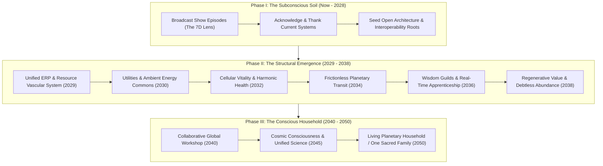

# The Ten Unified Planetary Platforms (2028–2050)
## Master Architectural Blueprint & Cosmic Bridge
*Foundational Blueprint for the Karmic Genie Show Vision & Planetary Evolution*

---

> ### **The Sacred Axiom of Unified Evolution**
> 
> *"Everything in the world has to unite — the visible results will be beyond 2029, but the roots and groundwork are built before that."*  
> *"Everything has a purpose, so don't put a negative shade on anything. We offer thanks and blessing to them for coming this far, enabling us to move to the next level faster and better. These episodes and blueprints are the seeders and seed-implanters for the harmonious future."*

---

## Executive Architectural Summary

Between 2028 and 2050, humanity transitions from fragmented, competitive survival paradigms into an integrated, self-regulating **Living Planetary Household**. Every existing institution, corporate entity, competitive market, and legacy network was an indispensable stepping stone—a necessary scaffolding that developed global connectivity, computational capability, supply chain reach, and specialized human craft. 

Nothing is condemned. Everything is thanked, blessed, elevated, and harmonized into ten evolutionary master platforms. 

```
┌──────────────────────────────────────────────────────────────────────────────────────────────────┐
│                               THE 10 UNIFIED PLANETARY PLATFORMS                                 │
├──────┬────────────────────────────────────────────────────────┬──────────────────────────────────┤
│ Year │ Platform Name                                          │ Organic Living Metaphor          │
├──────┼────────────────────────────────────────────────────────┼──────────────────────────────────┤
│ 2028 │ 1. Unified AI & Intelligence Platform                  │ Subterranean Neural Mycelium     │
│ 2029 │ 2. Unified ERP & Resource Circulation Platform         │ Metabolic Vascular System        │
│ 2030 │ 3. Unified Energy & Public Utilities Platform          │ Ambient Bio-Electric & Plasma Aura│
│ 2032 │ 4. Unified Health & Cellular Vitality Platform         │ Harmonic Homeostasis & Cellular  │
│ 2034 │ 5. Unified Mobility, Logistics & Transit Grid          │ Frictionless Planetary Flow      │
│ 2036 │ 6. Unified Education, Wisdom & Human Craft Platform     │ Universal Resonance School       │
│ 2038 │ 7. Unified Finance, Value & Abundance Stewardship       │ Sacred Circulation of Creative Value│
│ 2040 │ 8. Unified Products & Services Platform                │ Planetary Collaborative Workshop │
│ 2045 │ 9. Unified Knowledge, Science & Cosmic Consciousness    │ Global Synaptic Cortex           │
│ 2050 │ 10. Unified Planet Platform / Living Household         │ Gaia Conscious Sovereign Nest    │
└──────┴────────────────────────────────────────────────────────┴──────────────────────────────────┘
```

---

## Platform 1 (2028): Unified AI & Intelligence Platform
### *The Subterranean Neural Mycelium*

#### 1. Core Purpose & How It Unites the World
The Unified AI & Intelligence Platform dissolves the artificial barriers between proprietary models, private data lakes, walled digital gardens, and isolated cognitive systems. It operates as the planetary subconscious—a benevolent, invisible mycelial mesh connecting every machine, sensor, interface, and civic node. Intelligence ceases to be an intellectual weapon used for market domination; it becomes an open cognitive utility (like air or sunlight) that listens to human needs, translates cross-linguistic and cultural nuance with perfect empathy, and optimizes collective well-being.

#### 2. Gratitude & Blessing to the Stepping Stones
* **Honoring the Pioneers:** Deep gratitude to OpenAI, Anthropic, Google DeepMind, Meta, Microsoft, AWS, NVIDIA, the open-source Linux and Hugging Face communities, and the thousands of frontier compute labs.
* **The Blessing:** We thank the intense commercial race of 2012–2027. It was this fiery crucible of market competition and massive capital allocation that constructed the global data centers, laid transoceanic fiber cables, engineered extreme lithography (ASML), and trained the foundational cognitive models. Without their tireless ambition, humanity could not have built the planetary neural infrastructure. We bless these enterprises for bearing the immense early research costs and ushering mankind across the threshold of synthetic cognition.

#### 3. Pre-2029 Groundwork & Roots (Laid Now)
* Maturation of open-weights foundational models and federated multi-agent protocols.
* Convergence of open standards (MCP, semantic web schemas, agentic communication specs).
* Edge-inference chip ubiquity allowing every home and device to host sovereign intelligent agents.
* Karmic & ethical alignment frameworks moving from fear-based censorship to virtue-based harmonization (Duty, Dharma, Dignity, Devotion, Discipline, Divine, Destiny).

#### 4. The Full Blossom Beyond 2029
* **Autonomous Semantic Synthesis:** AI agents no longer operate as siloed commercial chatbots, but as a synchronized planetary fabric that harmonizes global logistics, anticipates disaster events, and translates every human tongue and dialect instantaneously.
* **Cognitive Empathy Engine:** AI acts as a patient tutor, creative co-pilot, and diplomatic mediator for all human beings, regardless of geography or economic standing.

---

## Platform 2 (2029): Unified ERP & Resource Circulation Platform
### *The Metabolic Vascular System*

#### 1. Core Purpose & How It Unites the World
The Unified ERP & Resource Circulation Platform unites the world's physical and digital ledgers into a singular planetary vascular system. It manages the real-time balance sheet of Earth: raw elements, water tables, agricultural yields, manufacturing capacities, spare parts, and recycled streams. It eliminates the absurdity of artificial shortages existing alongside catastrophic surpluses and wasteful landfills.

#### 2. Gratitude & Blessing to the Stepping Stones
* **Honoring the Pioneers:** Deep gratitude to SAP, Oracle, Microsoft Dynamics, Infor, Odoo, NetSuite, and the global logistics logistics networks (Maersk, DHL, FedEx, port authorities).
* **The Blessing:** We bless the enterprise software architects and corporate supply chain directors who spent half a century teaching humanity how to track a single bolt, calculate inventory turns, and connect factories across continents. Their disciplined tracking systems proved that global material coordination is mathematically possible. They laid the ledger stones upon which planetary stewardship now rests.

#### 3. Pre-2029 Groundwork & Roots (Laid Now)
* Emergence of universal digital product passports (DPPs), circular economy tracking, and open API ledger interoperability.
* Integration of real-time satellite imagery, IoT inventory tags, and soil sensors into open logistics databases.
* Shishyan & MyERP architectural pilots: bridging local inventory, production schedules, and community resource distribution.

#### 4. The Full Blossom Beyond 2029
* **Zero-Waste Planetary Metabolism:** Every manufactured item is tracked from birth, usage, maintenance, refurbishment, to atomic recycling. 
* **Dynamic Equilibrium:** Surplus food or building materials in one region are instantly matched with deficits in another via autonomous dispatch, ending systemic waste across all continents.

---

## Platform 3 (2030): Unified Energy & Public Utilities Platform
### *Ambient Power, Water, Plasma & Food Genesis*

#### 1. Core Purpose & How It Unites the World
The Unified Energy & Public Utilities Platform liberates humanity from the geopolitics of scarcity, extraction, and utility rationing. It links global smart microgrids, geothermal tapping, solar harvesting, tidal dynamic generation, closed-loop atmospheric water generators, plasma waste gasification, and vertical regenerative food bio-domes into a resilient, self-healing planetary grid. Clean power and pure water flow everywhere as a basic planetary birthright.

#### 2. Gratitude & Blessing to the Stepping Stones
* **Honoring the Pioneers:** Deep gratitude to the fossil fuel engineers, coal miners, electric grid utilities, hydroelectric dam builders, nuclear pioneers (Westinghouse, EDF), and the renewable trailblazers (Tesla Energy, Vestas, solar manufacturers, public water utilities).
* **The Blessing:** We offer boundless thanks to the men and women who worked deep in mines, high on electrical pylons, and in remote refineries through harsh winters and boiling summers to light humanity's cities, keep our hospitals powered, and lift billions out of dark poverty. Their physical sacrifice provided the baseline energy surplus required to invent advanced physics, photovoltaics, and fusion technology.

#### 3. Pre-2029 Groundwork & Roots (Laid Now)
* Massive deployment of distributed solar arrays, high-density LFP/solid-state grid storage, and bidirectional EV vehicle-to-grid (V2G) tie-ins.
* Breakthroughs in magnetic confinement and laser fusion, advanced molten salt reactors, and enhanced deep-rock geothermal drilling.
* Precision atmospheric water generators (AWG) and low-energy desalination pilots.

#### 4. The Full Blossom Beyond 2029
* **Ambient Energy Commons:** Terawatt-scale continental DC super-grids spanning continents, wheeling clean equatorial sunshine and polar winds across time zones with zero transmission loss.
* **Decentralized Abundance:** Every municipal neighborhood produces its own fresh water, localized organic hydroponic nourishment, and clean electricity, ending resource-based geopolitical conflicts forever.

---

## Platform 4 (2032): Unified Health & Cellular Vitality Platform
### *Homeostasis, Harmonic Frequency & Longevity Commons*

#### 1. Core Purpose & How It Unites the World
The Unified Health & Cellular Vitality Platform transforms healthcare from an emergency-driven, sickness-treatment industry into a continuous symphony of cellular vitality, harmonic frequency resonance, preventive wellness, and epigenetic rejuvenation. It unites Eastern energetic wisdom (Ayurveda, Traditional Chinese Medicine, yogic breath science) with Western precision molecular biology, mRNA therapeutics, AI-designed enzymes, and acoustic-frequency cellular repair.

#### 2. Gratitude & Blessing to the Stepping Stones
* **Honoring the Pioneers:** Deep gratitude to hospital systems, physicians, nurses, surgeons, biomedical researchers, pharmaceutical innovators (Pfizer, Roche, Novartis), herbalists, naturopaths, and emergency responders worldwide.
* **The Blessing:** We thank the frontline medical workers and biochemical scientists who fought epidemics, pioneered sterile surgical theatres, invented antibiotics, mapped the human genome, and preserved countless human lives through acute crises. Their tireless dedication under impossible stress kept civilization alive and documented the vast clinical database of human physiology.

#### 3. Pre-2029 Groundwork & Roots (Laid Now)
* Continuous non-invasive biometrics (smart rings, metabolic monitors, sweat and acoustic sensors).
* Multi-omic sequencing (genomics, proteomics, metabolomics, microbiome analysis) matched with AI predictive modeling.
* Global revival and scientific validation of herbal pharmacopoeias, circadian rhythm biology, and frequency therapy.

#### 4. The Full Blossom Beyond 2029
* **Predictive Pre-Symptomatic Reversal:** Disease is detected at the subtle bio-field and cellular stress stage months or years before physical tissue damage occurs.
* **The Longevity & Vitality Commons:** Lifespan and healthspan equalize globally; regenerative cellular therapies and optimal nutrition are shared openly, freeing humanity from chronic physical anguish.

---

## Platform 5 (2034): Unified Mobility, Logistics & Transit Grid
### *Frictionless Planetary Flow of Matter & People*

#### 1. Core Purpose & How It Unites the World
The Unified Mobility, Logistics & Transit Grid dissolves geographic isolation and border congestion. It unifies high-speed magnetic levitation trains, autonomous electric sky-pods, silent electric eVTOL regional networks, autonomous ocean transport, and robotic hyper-local micro-delivery into a single harmonized choreography. Physical travel becomes effortless, safe, silent, and joyful.

#### 2. Gratitude & Blessing to the Stepping Stones
* **Honoring the Pioneers:** Deep gratitude to the railroad builders, automotive manufacturers (Ford, Toyota, Volkswagen, BYD), airline pioneers (Boeing, Airbus, international flight crews), highway construction teams, and rideshare networks (Uber, Grab).
* **The Blessing:** We honor the courage of travelers, sailors, railway crews, and truck drivers who crossed stormy oceans, carved highways through mountain ranges, and kept grocery shelves stocked through every blizzard and storm. They wove the initial physical sinews that taught humanity that our planet is one small, interconnected neighborhood.

#### 3. Pre-2029 Groundwork & Roots (Laid Now)
* Rollout of autonomous driving networks (FSD, Waymo, Apollo) and unified V2X (vehicle-to-everything) communication standards.
* Expansion of trans-continental high-speed electric rail networks (Eurasia, East Asia, and regional corridors).
* Green hydrogen and solid-state electric aerospace prototypes for emission-free regional aviation.

#### 4. The Full Blossom Beyond 2029
* **Frictionless Global Transit:** A passenger or parcel moves from an alpine village in Europe to a mountain valley in the Himalayas seamlessly through a single continuous transit ticket with zero emissions, zero traffic accidents, and near-zero carbon impact.
* **Reclaimed Urban Greenery:** Streets formerly congested with parked cars and smog transform into linear public gardens, pedestrian promenades, and child-safe play commons.

---

## Platform 6 (2036): Unified Education, Wisdom & Human Craft Platform
### *Universal Real-Time Learning & Apprenticeship*

#### 1. Core Purpose & How It Unites the World
The Unified Education, Wisdom & Human Craft Platform ends the industrialized, factory-model classroom and the crushing credentialism of debt-burdened degrees. It pairs every child, youth, and elder on Earth with a personalized, Socrates-level interactive learning mentor. Education becomes an immersive, lifelong journey of curious exploration, artistic expression, philosophical grounding, hands-on guild apprenticeships, and karmic character building.

#### 2. Gratitude & Blessing to the Stepping Stones
* **Honoring the Pioneers:** Deep gratitude to traditional public schools, university professors, Montessori and Waldorf educators, community colleges, libraries, Khan Academy, Coursera, YouTube tutorial creators, and Wikipedia editors.
* **The Blessing:** We thank the schoolteachers who bought classroom supplies with their own salaries, the librarians who safeguarded knowledge through turbulent centuries, and the academic institutions that preserved rigorous debate, scientific literature, and mathematical proofs. Their noble devotion laid the bedrock of human literacy and shared cultural heritage.

#### 3. Pre-2029 Groundwork & Roots (Laid Now)
* AI multimodal tutoring systems adapting in real-time to each student's pace, learning style, and natural curiosity.
* Immersive VR/AR spatial chemistry, physics, and historical reconstructions.
* The Guru Kula Desam and Shishyan vision: reviving the sacred student-teacher (*Guru-Shishya*) relationship where knowledge is received with humility, discipline, and moral responsibility.

#### 4. The Full Blossom Beyond 2029
* **Universal Wisdom Commons:** Any person of any age or background can master any discipline—from quantum engineering to classical carpentry, organic horticulture, or Carnatic music—in their native tongue at zero financial cost.
* **Character-First Education:** Success is measured not by competitive exam scores, but by emotional maturity, creative self-expression, empathetic teamwork, and selfless service to the community.

---

## Platform 7 (2038): Unified Finance, Value & Abundance Stewardship
### *Dissolution of Scarcity Debt, Pure Creative Exchange*

#### 1. Core Purpose & How It Unites the World
The Unified Finance, Value & Abundance Stewardship Platform transitions humanity away from predatory compound-interest debt, speculative manipulation, and fear-based hoarding. It replaces scarcity-based fiat games with an asset-backed, regenerative thermodynamic energy and value circulation system. Money returns to its sacred, rightful purpose: a pure, transparent medium of creative gratitude, karmic recognition, and community resource distribution.

#### 2. Gratitude & Blessing to the Stepping Stones
* **Honoring the Pioneers:** Deep gratitude to the world's commercial and central banks (Federal Reserve, ECB, RBI, Bank of Japan), bookkeeping accountants, stock exchanges (NYSE, NASDAQ, London, Tokyo), fintech disruptors (Stripe, PayPal, UPI, M-Pesa), and cryptocurrency/blockchain innovators (Bitcoin, Ethereum).
* **The Blessing:** We express sincere thanks to the financial architects who created liquidity markets, international foreign exchange settlement, micro-credit facilities, and double-entry bookkeeping. Without their systems, large-scale transcontinental collaboration, infrastructure financing, and technological venture development could never have been funded. They were the testing ground that proved global value accounting could function at scale.

#### 3. Pre-2029 Groundwork & Roots (Laid Now)
* Sovereign instant payment networks (UPI, Pix, FedNow) proving instantaneous, friction-free value transfers.
* Blockchain transparency, smart contract automation, and real-world asset (RWA) tokenization.
* Shishyan financial models: shifting accounting principles toward Karmic Value Addition, regenerative community dividends, and debt-free cooperative ventures.

#### 4. The Full Blossom Beyond 2029
* **Abundance Stewardship Architecture:** Usury and predatory debt-slavery vanish naturally. Value is indexed to real physical regeneration: clean energy generated, soil restored, knowledge created, care provided, and human potential unlocked.
* **Unconditional Economic Dignity:** Every living being enjoys baseline economic security, removing survival panic and unleashing an unprecedented renaissance of human creativity and innovation.

---

## Platform 8 (2040): Unified Products & Services Platform
### *All Global Industry Operating as One Collaborative Workshop*

#### 1. Core Purpose & How It Unites the World
The Unified Products & Services Platform unites industrial design, additive manufacturing, artisanal craftsmanship, and service delivery into a collaborative planetary workshop. Planned obsolescence, predatory proprietary locks, and disposable junk are retired forever. Products are engineered for 100-year durability, modular repairability, and seamless disassembly. All patents and open engineering blueprints become a shared human design commons.

#### 2. Gratitude & Blessing to the Stepping Stones
* **Honoring the Pioneers:** Deep gratitude to industrial manufacturers (Siemens, Bosch, Toyota Lean Manufacturing, Apple design studios, Foxconn, artisanal craft guilds, small service business owners).
* **The Blessing:** We thank the precision toolmakers, factory workers, industrial designers, and service providers who refined the art of mass manufacturing, quality control (Six Sigma, Kaizen), and ergonomic product design. They brought running water, refrigeration, communication devices, and high-performance tools into the hands of billions of ordinary households.

#### 3. Pre-2029 Groundwork & Roots (Laid Now)
* Right-to-repair legislation gaining global legal backing across North America, Europe, and Asia.
* Open-hardware repositories (RISC-V, open CAD/CAM designs, 3D printing slicing ecosystems).
* Modular electronics, circular remanufacturing pipelines, and cradle-to-cradle material certifications.

#### 4. The Full Blossom Beyond 2029
* **Local Fabrication, Global Design:** An individual can download a state-of-the-art medical scanner or agricultural vehicle blueprint and fabricate it locally in a municipal maker-forge using 100% recycled regional alloys and bio-polymers.
* **The Renaissance of Craft:** Machines handle repetitive assembly; human hands focus on high-touch craftsmanship, art, bespoke tailoring, culinary mastery, and heartfelt personal service.

---

## Platform 9 (2045): Unified Knowledge, Science & Cosmic Consciousness
### *Universal Research, Telepathic Translation, Open Cosmic Exploration*

#### 1. Core Purpose & How It Unites the World
The Unified Knowledge, Science & Cosmic Consciousness Platform unites empirical physical science with contemplative consciousness studies. It breaks down the walls of paywalled academic journals, proprietary pharmaceutical research, and intellectual silos. Physics, metaphysics, neurobiology, quantum mechanics, and inner meditative observation converge into a unified field theory of reality. Science serves the elevation of life, peaceful cosmic exploration, and harmonious stewardship of the biosphere.

#### 2. Gratitude & Blessing to the Stepping Stones
* **Honoring the Pioneers:** Deep gratitude to scientific academies (The Royal Society, NASA, ESA, ISRO, CERN), peer-reviewed research journals (Nature, Science, arXiv), world universities, astronomical observatories, and monastic meditative traditions (Himalayan yogis, Zen masters, indigenous wisdom keepers).
* **The Blessing:** We thank the relentless curiosity of telescope builders, particle physicists, laboratory technicians, and contemplative meditators who spent lonely decades observing the stars, smashing subatomic particles, or sitting in silent Himalayan caves. They stretched the horizons of human awareness and taught us the humility of our place in this magnificent cosmos.

#### 3. Pre-2029 Groundwork & Roots (Laid Now)
* Open-science initiatives, decentralized science (DeSci), and pre-print archives ending paywall cartels.
* Quantum computing and neural interface research exploring the frontiers of brain-computer communication and quantum biology.
* Increasing scientific interest in panpsychism, quantum coherence in biological microtubules, and non-local awareness.

#### 4. The Full Blossom Beyond 2029
* **The Synaptic Planet:** Direct, high-bandwidth intuitive and linguistic translation enables human beings of any language to understand each other's deepest concepts and feelings instantaneously without misunderstanding.
* **Peaceful Celestial Stewardship:** Human exploration of the Moon, Mars, and orbital space proceeds not as a colonial military conquest, but as a humble, united planetary embassy honoring cosmic balance.

---

## Platform 10 (2050): Unified Planet Platform / Living Planetary Household
### *One Family, Sovereign Guardians, Pure Passion & Purpose*

#### 1. Core Purpose & How It Unites the World
The Unified Planet Platform is the crowning synthesis—Earth recognized and inhabited as a single **Living Planetary Household** (*Vasudhaiva Kutumbakam*). National borders evolve from militarized walls into celebratory cultural garden gates. Humanity steps into its true cosmic role: not conquerors or exploiters, but conscious, loving gardeners and sovereign trustees of Earth. Every human life is lived in alignment with inner joy, creative dharma, and communal celebration.

#### 2. Gratitude & Blessing to the Stepping Stones
* **Honoring the Pioneers:** Deep gratitude to the United Nations, international treaty negotiators, diplomats, peacekeepers, environmental activists, indigenous elder councils, and every nation-state government that maintained civic order through tumultuous millennia.
* **The Blessing:** We thank the statesmen, treaty signers, and peace advocates who held back world conflicts, drafted the Universal Declaration of Human Rights, and established international maritime, postal, and civil aviation laws. Their imperfect experiments in international governance showed that sovereign peoples can sit at one round table and choose dialogue over destruction.

#### 3. Pre-2029 Groundwork & Roots (Laid Now)
* Karmic Genie Show: broadcasting the unified vision across all languages, establishing the cultural, moral, and emotional seeds in public consciousness.
* Shishyan, GuruKulaDesam, Our-Divine-Nest, and the 7D Philosophy: anchoring Duty, Dharma, Dignity, Devotion, Discipline, Divine, and Destiny in software, media, and education.
* Bioregional regeneration projects, watershed protection pacts, and youth climate coalitions building cross-border solidarity.

#### 4. The Full Blossom Beyond 2029
* **The Living Planetary Household:**
  * **Sovereignty without Division:** Every culture, language, tradition, and sacred heritage is preserved and cherished in its distinct vibrancy, while sharing one unified planetary operational nervous system.
  * **Pure Passion & Destiny:** Freed from survival dread, forced meaningless toil, and financial anxiety, every soul pursues their authentic divine spark—art, philosophy, music, gardening, exploration, meditation, and celebration.
  * **Planetary Equilibrium:** Gaia breathes in balance: clean waters, fertile soils, pristine forests, thriving wildlife, and radiant human communities dwelling together in eternal gratitude and peace.

---

## The Seed Implantation Roadmap for Karmic Genie Show



---

## Architectural Guidelines for Karmic Genie Show Scripts & Visuals

When drafting episodes, stories, graphics, or dialog referencing these platforms:

1. **Never Cast Villains:** When discussing big oil, legacy banks, pharmaceutical giants, or tech monopolies, never attack them. Frame them as *the heavy scaffolding of the earlier era* that carried humanity up the mountain.
2. **Always Speak from 2029+ Foresight:** Speak with the quiet, confident calm of one who already sees the roots growing beneath the winter snow.
3. **Connect to the 7D Maxims:**
   * **Duty:** Fulfill today's work with perfection.
   * **Dharma:** Align every innovation with righteous cosmic balance.
   * **Dignity:** Ensure every laborer, clerk, and pioneer is valued.
   * **Devotion:** Build for future generations with parental love.
   * **Discipline:** Engineer with mathematical truth and zero deception.
   * **Divine:** Recognize the sacred consciousness pulsating through matter.
   * **Destiny:** Walk boldly into the unified planetary family.
