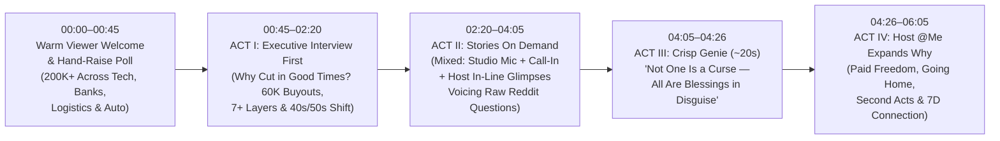

# Karmic Genie Show — S01E01 (`v3.1` Interactive Master Script)
## *"200,000 Cuts, 60,000 Buyouts & Why Every One Is a Blessing in Disguise"*

> [!IMPORTANT]
> **100% Real `2026` Cross-Industry Data + Raw Reddit Voices (Zero Company or Person Names)**
> - **Cross-Sector Scope (`200,000+` in `2026` Alone—During Record Profits, Not a Crash):** Spans **Big Tech & Cloud Software** (`21K–30K`, `16K`, `11K` cuts + **`60,000` offered Voluntary Buyouts**), **Banking & Fintech** (`5,000` & `3,000`-person AI restructurings), **Logistics & Automotive** (`30,000` global cuts including `14,000` managers + tens of thousands in auto automation), and **Gaming, QA, Design & Conversational-AI Customer Support**.
> - **Climbing Up & Across Every Geography:** Targets **middle managers `7+` layers below the CEO**, **workers in their `40s` & `50s`**, **US white-collar HQs**, AND **Offshore Hubs in India (`25,000–35,000` cuts, including `550` let go right after lunch)**.
> - **Show Rules Locked:** Warm interactive viewer welcome → **Executive Interview FIRST** → **Mixed On-Demand Real Voices & In-Line Location Clips** (voicing the exact raw emotional questions from recent Reddit posts) → **Crisp `~20s` Karmic Genie** (*"every single one is a blessing in disguise"*) → **Narrator `@Me` Expands Practically** | `1.0x` brisk TV pace | **Dark-shaded subtitles** ([qa_v2_dark_shade_subtitles.jpg](file:///home/shishyan/.gemini/antigravity/brain/b55fc9ea-1a2e-45b9-8d71-a53ee11caf0c/qa_v2_dark_shade_subtitles.jpg)) | **`UNLISTED`-only** test uploads.

---

## Interactive Episode Blueprint (`~06:00` Brisk Broadcast Pace)

---

## Full Production Screenplay (Zero Company Names • Zero Celebrity/Character Names)

### COLD OPEN & WARM VIEWER CONNECTION (`00:00 – 00:45` | `1.0x` Energetic & Welcoming)

- **`00:00 – 00:10` | Official 7D Theme Sting:** Crisp sweep across the pure-white `v6` padded-logo 7D stage wall and warm stadium audience applauding as Host `@Me` steps forward with an inviting smile.
- **`00:10 – 00:45` | Interactive Studio & Home Viewer Welcome (`2025 → Late 2026`):**
  > **HOST (`@Me` — warm, speaking straight to the viewer at home, then to the live arena):**
  > "Welcome home to *Karmic Genie Show*! Whether you're sitting right here in our circle tonight or watching from your living room after a long day—thank you for joining us. Let's do a quick honest check-in together—raise your hand in the room, and drop your industry in the comments at home, if someone you know was hit by a **layoff**, a **Voluntary Buyout Offer**, or a **relocation mandate** this year."
  >
  > *[Hands go up all across the blue stadium tiers—nods and warm smiles of solidarity.]*
  >
  > **HOST (`@Me`):** "Look at all those hands—you're not imagining it, and it's no longer just software. Over **`200,000` employees** have already been hit in `2026` alone—stretching from **tech and cloud** (`20,000` to `30,000` at single giants, plus **`60,000` just offered voluntary buyouts**) right into **banking and fintech**, **global shipping and automotive**, **gaming, QA, and customer support**. And notice the twist: there is **no economic crash**! Companies are making billions—and cutting human layers to fund massive AI and automation bets. Across from me tonight is a **Chief Executive** who sits inside those exact restructuring decisions. Welcome—we appreciate you talking straight with us."

---

### ACT I — THE INTERVIEW FIRST (`00:45 – 02:20` | `Host @Me ↔ Chief Executive` Live Studio Exchange)

*Conversational, sharp, human-to-human interview across the dormant gold Genie lamp. The Executive speaks candidly and extensively.*

- **Q1 — Why Cut `200,000+` People When Profits Are Booming—And Why `60,000`-Person Voluntary Buyouts Now?**
  > **HOST (`@Me`):** "Let's ask the question every kitchen table is asking tonight: usually layoffs happen when companies are losing money. Today revenues are near record highs—yet one tech giant just put **`60,000` employees** on notice for **Voluntary Buyout Offers**, banks are cutting thousands, and a shipping giant is cutting `30,000`. Why?"
  >
  > **CHIEF EXECUTIVE (candid, leaning forward):** "Because Wall Street changed the scoreboard in `2026`. Every board in tech, banking, logistics, and auto is terrified of falling behind on AI infrastructure and automation. Spending `\$50 billion` a quarter on chips and data centers drains free cash flow—so boards are funding machines out of yesterday's payroll. Offering a **voluntary buyout**—up to nine or twelve months' pay to leave quietly by December—lets us cut **non-AI corporate, sales, QA, and support overhead** fast without six months of messy headlines."

- **Q2 — Climbing the Ladder: Why Target Middle Managers (`7+` Layers Down) and Workers in Their `40s` & `50s`?**
  > **HOST (`@Me`):** "And it's climbing straight up the ladder! One global firm explicitly cut `20%` of everyone sitting **seven or more layers below the CEO**. Logistics cut `14,000` managers. And data shows professionals in their **`40s` and `50s`**—plus **`25,000` to `35,000` workers in offshore hubs in India**—are getting hit simultaneously. Nobody's insulated anymore?"
  >
  > **CHIEF EXECUTIVE:** "Honestly? No. Conversational AI now handles customer support and status coordination that used to require whole towers of middle managers and offshore back-offices. If your role relays updates instead of building core AI or shipping product—or if you sit in a senior `50`-plus compensation band on a traditional stack—boards view a buyout or hub consolidation mandate as permanent margin savings heading into `2027`."

---

### ACT II — STORIES ON DEMAND (`02:20 – 04:05` | Mixed Live Voices + In-Line Clips Voicing Raw Reddit Questions!)

*`@Me` opens the floor on demand—blending **live studio mic questions**, a **live video call-in**, and **Host-narrated in-line location glimpses**, phrasing every emotion as the exact raw questions real workers are asking right now.*

#### 1. Live Studio Floor Mic + `2.5s` Home Glimpse (`Overseas Engineer & 54-Yr-Old Veteran`)
> **HOST (`@Me` — stepping toward the stadium seats):** "Let's hear the exact questions people are lying awake with at `2:00 AM` right now. Row Two—go ahead, friend."
>
> **OVERSEAS ENGINEER (`38`, standing with mic in Row 2, looking straight at the CEO):** "I'm holding that two-week voluntary buyout email right now. I left home twelve years ago promising my parents *'just three years abroad to save in dollars.'* *[Quick `2.5s` warm in-line glimpse: his aging father sitting quietly beside an uncalled phone on an evening veranda in India]* Instead, chained to visa renewals on a non-AI product team, my father grew frail on a phone screen while I became a wire transfer instead of a son. My question is honest: *why did my chest suddenly feel lighter when I opened that buyout email—and why does going home to my parents feel like freedom, even when peers call it 'failing abroad'?*"
>
> **SENIOR ARCHITECT (`54`, rising nearby, silver-templed, composed):** "And I'm `54`—thirty years building the enterprise banking and hardware systems literally paying for your AI budget. Now my whole tier got offered an exit package. *After thirty years of craft, do I swallow my pride begging twenty-something recruiters to ignore my grey hair—or is walking out with twelve months' buyout pay the only dignified move left?*"
>
> **CHIEF EXECUTIVE (visibly moved, answering them directly):** "Hearing both of you say that out loud... on a spreadsheet we call it 'workforce optimization.' We never measure the twelve years you missed with your dad, or thirty years of pride tied up in a badge."

#### 2. Live Home Video Call-In (`Curved Studio Screen` — `Flattened Manager & Working Parent`)
> **HOST (`@Me`):** "Look at our live viewer screen from the UK—a former middle manager seven layers down in financial operations."
>
> **WORKING MUM & FORMER MANAGER (`42`, live on curved glass screen from her home):** "When AI erased our management layer, my ego panicked: *'Without my leadership title, who am I when I walk into my own kitchen?'* *[Quick `3s` in-line glimpse: walking her `9`-year-old son home from school in afternoon daylight]* Then on my first daylight school walk in seven years, my nine-year-old son held my hand and asked: *'Mum, did we finally get you back?'*"

#### 3. Rapid Host-Narrated In-Line Dispatch (`@Me` Over 3 Brisk Real-Life Clips — `Offshore Hub, Midnight Survivor & Young Builder`)
> **HOST (`@Me` — speaking warmly to camera while crisp `3s` real-life clips play inline):**
> - *[In-line clip `3.5s`: Sunlit South Indian hometown courtyard—a `32`-year-old woman smiling at her laptop while her mother pours filter coffee]* "And look across three more windows tonight: in **India**—where `30,000` tech roles vanished and `550` people at an AI-services shop lost access right after lunch—one former metro lead asked herself: *'If big-city hubs have zero loyalty left, why pay half my salary in metro rent and two-hour traffic?'* She moved back to her hometown courtyard debt-free beside her smiling parents."
> - *[In-line clip `3.0s`: A `35`-year-old survivor alone at `11:45 PM` surrounded by 3 empty desks and buzzing phones]* "Meanwhile, a 'lucky survivor' who stayed behind in **Tokyo** wrote last night: *'Did the people who took the buyout actually lose—or are those of us doing four people's jobs at midnight the ones truly trapped?'*"
> - *[In-line clip `3.0s`: A `22`-year-old graduate coding alongside his father's small workshop]* "And a **`22`-year-old graduate** facing a vanished entry-level rung asked: *'Should we stop sending `800` resumes into an AI black hole—and start building directly for ourselves?'*"
>
> **HOST (`@Me` — returning center stage, uniting studio and home viewers):** "Eight honest questions from real living rooms. Let's quiet the hall together and ask: **What does Genie say — the 7D way?**"

---

### ACT III — THE KARMIC GENIE (`04:05 – 04:26` | Crisp `~20s` Answer — ZERO Lecture!)

*Warm golden hush. The cross-legged Celestial Karmic Genie rises serenely above the lamp, smiles gently at the crowd and camera, speaks **3 short, unforgettable sentences**, and bows back into the lamp.*

> **KARMIC GENIE (cross-legged, warm, gentle, crystal-clear — `~19s` spoken):**
> "Namaste, dear friends. Like the ancient two-minute story of the **Single Thunderclap**—worth reading quietly at home tonight—one storm awakens every listener differently.
> Hear this with an open heart: the voluntary buyout, the flattened title, the closed floor—**not one of them is a curse; every single one is a blessing in disguise**, unlocking golden handcuffs while you still have life left to live."
>
> *[Smiling warmly with palms joined in namaste, the cross-legged Genie dissolves swiftly back into the golden lamp (`3s`).]*

---

### ACT IV — NARRATOR (`@Me`) EXPANDS ON THE BLESSING IN DISGUISE (`04:26 – 06:05`)

*Warm applause across the arena. Host `@Me` steps forward with infectious warmth, unpacking the Genie's crisp truth for every viewer watching.*

- **1. Why Voluntary Buyouts & Visa/Offshore Shocks Are Paid Liberation (`04:26 – 05:12`):**
  > **HOST (`@Me` — warm, relatable, direct to camera & room):**
  > "Think about what the Genie just said: **every single one is a blessing in disguise!** Why didn't your chest feel heavier when that buyout email landed—why did part of you feel *lighter*? Because almost nobody has the courage to walk away from golden handcuffs on their own!
  > Millions of people sit oceans away from home—or stuck in suffocating metro traffic—chasing currency and titles while quietly postponing their real **Duty** and **Devotion** as a son, a husband, a sister, a parent. Left alone, 'two more years' steals twenty! When a company hands `60,000` people **nine to twelve months of buyout pay**—or closes a non-AI treadmill—life just handed you paid runway, erased societal guilt, and gave you back your parents' evening veranda and your kid's afternoon walk *while it still counts*!"

- **2. Practical 7D Paths for `40s/50s`, Flattened Managers & Young Grads + Executive's Takeaway (`05:12 – 05:50`):**
  > **HOST (`@Me` — gesturing toward the `v6` 7D Stage Wall):**
  > "And look how the **7D Way** flips every fear we heard tonight:
  > - In your **`40s` or `50s`** with a buyout check? Don't beg a broken recruiter funnel—step forward with **Dignity** and **Dharma**: advise mid-sized businesses hungry for real judgment, consult, or build on your own clock instead of burning out at midnight with five pagers!
  > - Flattened out of **seven layers of middle management**? You didn't lose who you are—you shed a corporate mask!
  > - And at **`22`**? **Discipline** plus AI tools lets two friends build today what used to take a `50`-person department—that's **Destiny**!
  > Turning back to our **Chief Executive**—hearing this room tonight, what stays with you?"
  >
  > **CHIEF EXECUTIVE (sincere, human):** "That a company is a contract, never your family. If we must restructure for AI, the least we owe people is generous, honest runway—so their next chapter genuinely becomes that blessing."

- **3. Warm Viewer Sign-Off (`05:50 – 06:05`):**
  > **HOST (`@Me` — warm eye contact with viewers at home):**
  > "Tell us in the comments tonight: *what quiet dream or family duty has been waiting for you behind those golden handcuffs?* Read the two-minute *Single Thunderclap* story at home, hug the people under your roof, and remember to ask: **What does Genie say — the 7D way?**"

- **`06:00 – 06:12` | Official `Karmic Genie Show` Pure-White Logo Card + 7D Theme Chorus (`12s`).**
