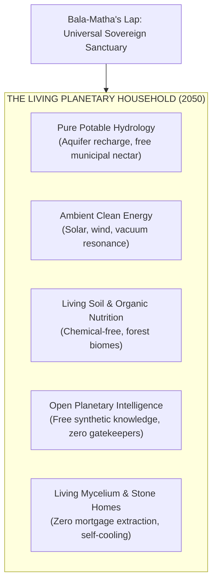

# *THE WAY FORWARD: AS IN THE MACROCOSM, SO IN THE MICROCOSM*
## **The Karmic Genie Show — Season 1, Episode 1 (Master Movie Screenplay)**
### **ACT V & ACT VI (Pages 9.5 to 14 of the 14-Page Master Screenplay)**

* **Production:** *The Karmic Genie Show* (@karmicgenie / @influenzian)
* **Master Architectural Series:** *The Way Forward*
* **Canon Axiom:** *"அண்டத்தில் உள்ளதே பிண்டம், பிண்டத்தில் உள்ளதே அண்டம் — அண்டமும் பிண்டமும் ஒன்றே"*  
  *(As in the Macrocosm, so in the Microcosm; The Macrocosm and Microcosm are One)*
* **Dramatis Personae:**
  - **`@Me` (The Host / Bridge-Builder):** Adult host in an immaculate ivory bandhgala. Scientific, charismatic, grounded, reverent.
  - **Bala-Rishi (The Child Sage of Jnana):** 4-year-old boy sage in traditional ochre/white dhoti holding a sacred neem-wood stylus. Sharp mathematical discernment, embryological mastery.
  - **Bala-Matha (The Child Mother of Arul):** 4-to-5-year-old divine South Indian girl sage in vibrant peacock green and ruby rose silk *pattu pavadai*, fresh fragrant jasmine (*malligai*) garlands, and golden temple ornaments. Maternal sanctuary, emotional healing, unconditional love.
  - **Maharishi Karmic Genie (The Universal Overseer):** The Awakened Cosmic Sage in flowing celestial indigo-and-gold woven robes. Master of solar dispensations, ancestral chronometry, and planetary benediction.

---

# ACT V: THE CORPORATE STANDOUTS & GENERATIVE LEGACY
### *(Pages 9.5 to 12.0 — The Kalpavriksha Scale in Action)*

---

### [PAGE 9.5]
**SCENE 10: THE KALPAVRIKSHA AUDIT CHAMBER — DAWN TRANSIT**  
**TIMECODE: 00:38:00 – 00:43:30**  
**SETTING:** The obsidian observation deck of the Living Gaia Spire. Overhead, the crystalline holographic dome projects the golden fractal canopy of the **Kalpavriksha (The Wish-Fulfilling Banyan Tree)**. Seven luminous rings pulsate along its central trunk, correlating human biological organs (*Pindam*) with the 49 real-world modern industrial sectors (*Andam*).

Floating volumetric telemetry cards glide into view, tracking global corporate infrastructure spanning semiconductors, logistics, energy, biotechnology, and operating systems.

```text
================================================================================
          THE BOTANICAL KALPAVRIKSHA CORPORATE CONSCIOUSNESS AUDIT
================================================================================
  LEVEL 7: SEED LIBERATION (Moksha / விடுதலை)  ── Open Standards, Public Trusts
  LEVEL 6: FRUIT-BEARING ABUNDANCE (Kani / கனி) ── Universal Public Goods
  LEVEL 5: FLOWERING & POLLINATION (Malar / மலர்) ── Aesthetic Dignity & Joy
  LEVEL 4: FOLIAGE & LEAF PHOTOSYNTHESIS (Ilai)  ── Developer & Earth Symbiosis
  LEVEL 3: VEGETATIVE TRUNK & ARTERIES (Thandu)  ── Global Supply Scalability
  LEVEL 2: ROOT SURVIVAL & METABOLISM (Ver / வேர்)── Cash Flow, Solvency Floor
  LEVEL 1: SEED INCEPTION & SPARK (Vithu / வித்து)── Founder Sacrifice & Problem
================================================================================
CUMULATIVE STRUCTURAL EVALUATION: ~66% GLOBAL INFRASTRUCTURE WEIGHT
================================================================================
```

`@Me` stands beside the circular telemetry well, his ivory bandhgala catching the soft golden bioluminescence of the virtual foliage. 

Beside him, **BALA-RISHI** traces his neem-wood stylus along a glowing emerald filament connecting human DNA to the world's open software repositories.

**BALA-MATHA** kneels gently on the floor beside a bronze urn of fresh water, setting float two pink lotus blossoms. The fragrance of fresh jasmine from her hair fills the chamber with serene peace.

**`@Me`**  
*(Looking at the glowing data canopy, speaking with deep warmth and awe)*  
For two hundred years, humanity looked upon corporate balance sheets as battlefield scorecards. We measured quarterly EBITDA margins, market capitalization peaks, and enterprise value multiples as if an oak tree was judged only by how much groundwater its taproot could hoard from the soil.

**BALA-RISHI**  
*(Tapping the base of the Kalpavriksha tree with his neem stylus; the roots illuminate in warm copper)*  
And yet, brother, no forest forester condemns the root! Level 2—Root Survival, Cash Flow, Solvency—is the basal metabolic floor of physical manifestation. A tree that starves cannot anchor against the gale. A corporation without positive cash flow cannot honor its payroll, cannot replace its failing server racks, cannot fund the lonely midnight laboratories. We bow to the roots with boundless *Nandri* (நன்றி)!

**BALA-MATHA**  
*(Rising gracefully, her golden jhumkas chiming softly like temple bells)*  
Rooting is where life begins, but it was never where life was meant to stop! Does a mango tree spend sixty years accumulating water only to say: *"Behold, I have cornered all the moisture in the valley"*? No! It drinks so that its trunk may lift branches to the sun; it branches so that leaves may turn harsh solar radiation into sweet sap; it flowers in breathtaking beauty to delight the honeybees; and ultimately, it drops sweet, heavy, golden fruit into the hands of a passing child who never paid a single penny for its shade.

**`@Me`**  
*(Smiling, turning to the global telemetry screen)*  
And the greatest trees do something even higher. They drop their seeds into the wind, surrendering their own proprietary genetic code so that an entire forest may rise long after the mother tree has returned to dust. Let us examine the real-world giants who have already begun this sacred ascent.

---

### [PAGE 10.0]
**SCENE 11: THE DIGITAL NERVOUS SYSTEM & SEED LIBERATION — NOON**  
**TIMECODE: 00:43:30 – 00:49:15**  
**SETTING:** A giant three-dimensional schematic of Earth's telecommunications cortex activates. Undersea fiber cables glow sapphire blue across the Atlantic and Pacific depths. Hundreds of server clusters pulse in unison.

A dual holographic pedestal rises. On the left: the iconic penguin emblem of **The Linux Foundation**. On the right: the open neural network architecture of **Meta FAIR (LLaMA)**.

```text
┌──────────────────────────────────────────────────────────────────────────────┐
│ [CASE 01] THE LINUX FOUNDATION (Nervous System: Operating System Kernel)      │
├──────────────────────────────────────────────────────────────────────────────┤
│  Maturity: STAGE 7 — FULL LIBERATION (Moksha / விடுதலை)                     │
│  Structural Weight: 95% of Global Supercomputers & Cloud Server Infrastructure│
│  Metabolic Status: Zero private profit motive; pure unencumbered gift.        │
│  Sacred Offering: The open-source bedrock of human civilization.             │
└──────────────────────────────────────────────────────────────────────────────┘
```

**`@Me`**  
Behold the pinnacle of Stage 7: **The Linux Foundation**. In 1991, a twenty-one-year-old student named Linus Torvalds released a tiny Unix-like kernel with no commercial copyright barrier. Today, thirty-five years later, that single unencumbered seed powers ninety-six percent of the world’s top one million web servers, every Android smartphone, the International Space Station, and every frontier AI supercluster on Earth!

**BALA-RISHI**  
*(Drawing a concentric circle in the air with his stylus, illuminating the global kernel commit history)*  
Observe the Siddha paradox of *Moksha*! Linus Torvalds did not build a fortress; he built a public hearth. Because he refused to lock the seed inside a proprietary vault, the entire planet became its gardener. Google, IBM, Red Hat, Intel, and millions of independent programmers nurtured the tree together. It has achieved immortality because it possesses nothing to defend!

**BALA-MATHA**  
*(Touching a virtual thread of code that dissolves into a shower of white jasmine petals)*  
It is the corporate embodiment of maternal grace (*Arul*). It gives its life to all without asking for nationality, credit card, or lineage. 

**`@Me`**  
And right beside it in the frontier neural cortex stands an unexpected modern titan: **Meta Platforms and the FAIR laboratory**.

A telemetry card sweeps forward displaying Mark Zuckerberg, Yann LeCun, and the open-weights distribution graphs of **LLaMA 1, 2, and 3**.

```text
┌──────────────────────────────────────────────────────────────────────────────┐
│ [CASE 02] META FAIR & THE LLaMA COMMONS (Nervous System: Frontier AI Weights)│
├──────────────────────────────────────────────────────────────────────────────┤
│  Maturity: STAGE 5 (Flowering) ──► STAGE 7 LEAP (Seed Liberation / Moksha)    │
│  Core Action: Releasing open-weights frontier LLMs directly to world science │
│  Civilizational Impact: Hundreds of thousands of open-source derivative      │
│  architectures, edge-device models, and multilingual localized innovations.  │
└──────────────────────────────────────────────────────────────────────────────┘
```

**`@Me`**  
*(Addressing the camera directly)*  
When the generative AI revolution erupted in late 2022, the orthodoxy of Silicon Valley was instantaneous fortification. Boardrooms whispered: *"Close the APIs! Guard the weights! Monopolize the intelligence substrate!"* But Meta took a courageous, radical leap straight into Stage 7 Seed-Planting. By open-sourcing the LLaMA weights and PyTorch, they seeded millions of independent researchers, hospitals in Africa, and university dormitories across India with frontier intelligence.

**BALA-RISHI**  
*(Nodding vigorously, his eyes bright)*  
They recognized that synthetic cognition is not private property—it is the emerging cerebral cortex of Mother Earth (*Andam*)! When you open-source the model weights, you don't lose value; you cross-pollinate the entire planetary orchard!

---

### [PAGE 11.0]
**SCENE 12: THE LIVING SOIL & THE MOLECULAR ELIXIR — AFTERNOON**  
**TIMECODE: 00:49:15 – 00:55:00**  
**SETTING:** The telemetry environment shifts into a lush emerald biome. On the left, rich black loam topsoil interwoven with mycorrhizal fungal threads. On the right, crystalline ribbons of protein structures folding in real-time space.

Holographic insignia emerge: **Patagonia (Holdfast Collective)**, **Google DeepMind (AlphaFold)**, and **The Serum Institute of India**.

```text
┌──────────────────────────────────────────────────────────────────────────────┐
│ [CASE 03] PATAGONIA & THE HOLDFAST COLLECTIVE (Digestive/Soil: Earth Trust) │
├──────────────────────────────────────────────────────────────────────────────┤
│  Maturity: STAGE 7 — COMPLETE LIBERATION (Moksha)                            │
│  Charter Transformation: "Earth is now our only shareholder."                │
│  Legal Architecture: 100% voting stock transferred to Patagonia Purpose Trust│
│  and Holdfast Collective; all annual profits dedicated to saving the planet. │
└──────────────────────────────────────────────────────────────────────────────┘
```

**`@Me`**  
Look upon the digestive and soil anatomy (*Pindam-Andam* concordance). In September 2022, Yvon Chouinard and his family completed one of the most sublime acts of corporate liberation in industrial history. They did not take Patagonia public. They did not sell to a private equity conglomerate. They transferred one hundred percent of the company's voting stock into a perpetual purpose trust. Their historic declaration echoed across every boardroom on Earth: *"Earth is now our only shareholder."*

**BALA-MATHA**  
*(Placing her small hand over her heart, her eyes moist with deep reverence)*  
*Nandri, Yvon! Nandri!* That is not mere charity; that is the child returning home to Mother Earth's lap! When a corporation declares that its profits belong to the living soil, the mountain rivers, and the wild wolves, the boundary between commerce and sacred biology completely dissolves. It is the corporate soul attaining *Moksha* while still walking the marketplace!

**BALA-RISHI**  
*(Pointing his stylus toward the molecular ribbons above)*  
And look at the intellectual fruit of Level 6: **Google DeepMind and AlphaFold**! 

```text
┌──────────────────────────────────────────────────────────────────────────────┐
│ [CASE 04] GOOGLE DEEPMIND: ALPHAFOLD (Sensory & Cellular: Protein Commons)   │
├──────────────────────────────────────────────────────────────────────────────┤
│  Maturity: STAGE 6 (Fruit-Bearing) ──► STAGE 7 (Generative Legacy)           │
│  Breakthrough: Predicted 3D structures for >214 million known proteins.      │
│  Gift to Humanity: AlphaFold Protein Structure Database released 100% free   │
│  to over 2 million biomedical researchers across 190 countries.              │
└──────────────────────────────────────────────────────────────────────────────┘
```

**`@Me`**  
For fifty years, structural biology struggled in the dark. Determining the three-dimensional fold of a single protein took an entire PhD dissertation, costing hundreds of thousands of dollars in X-ray crystallography equipment. Demis Hassabis, John Jumper, and the DeepMind team solved the protein-folding grand challenge with AlphaFold. And instead of walling it behind enterprise pharmaceutical subscriptions, they published two hundred and fourteen million protein structures freely to all of humanity!

**BALA-RISHI**  
A universal fruit! Malaria vaccines, plastic-eating enzymes, drought-resistant crops—every laboratory on Earth received fifty years of biological evolution in an afternoon! That is the definition of Level 6: *Kani* (கனி), the fruit that nourishes the entire forest!

---

### [PAGE 11.8]
**SCENE 13: THE UNIVERSAL IMMUNE SHIELD — DUSK**  
**TIMECODE: 00:55:00 – 01:00:30**  
**SETTING:** A warm twilight glow bathes the chamber. A massive world map illuminates thousands of cold-chain supply routes emanating from Pune, India, reaching deep into sub-Saharan Africa, Latin America, and Southeast Asia.

```text
┌──────────────────────────────────────────────────────────────────────────────┐
│ [CASE 05] SERUM INSTITUTE OF INDIA (Immune System: Universal Inoculation)    │
├──────────────────────────────────────────────────────────────────────────────┤
│  Maturity: STAGE 6 (Fruit-Bearing) ──► STAGE 7 (Sovereign Planetary Guard)   │
│  Volume: World's largest vaccine manufacturer (>1.5 billion doses annually)  │
│  Ethos: Protecting 65% of the world's children against measles, polio, and   │
│  pneumonia for nominal cost—ensuring no infant dies for lack of currency.    │
└──────────────────────────────────────────────────────────────────────────────┘
```

**`@Me`**  
And examine the immune and lymphatic system of Gaia: **The Serum Institute of India**, guided by Dr. Cyrus Poonawalla and Adar Poonawalla. They built the largest vaccine foundry on the face of the Earth. Not to extract maximum monopoly rents from desperate nations, but to produce billions of doses of measles, polio, rotavirus, and meningitis vaccines for pennies! Two out of every three children vaccinated on planet Earth today carry the protective shield forged in their bioreactors.

**BALA-MATHA**  
*(Walking toward the glowing map, whispering softly)*  
They recognized that when an infant in an isolated village is feverish, Mother Earth herself is in pain. To heal that child without demanding their parent’s life savings is the highest expression of *Arul*! They demonstrated that scale is not meant to conquer competitors; scale is meant to shelter the vulnerable.

**BALA-RISHI**  
*(Turning his gaze toward the gathering dusk outside the glass sanctuary)*  
Look at the pattern, brothers and sisters! Linux in the core kernel. Meta in the open synaptic weights. Patagonia in the living soil. DeepMind in the molecular genetic code. Serum Institute in the protective blood. The organs are already stepping forward! The corporation is not dying—it is being redeemed! It is graduating from a parasite that extracts into a sacred organ that sustains!

**`@Me`**  
*(Stepping to the center of the terrace, voice rising with quiet authority)*  
The roots are deep. The trunk is strong. The foliage is breathing. The blossoms are fragrant. The fruit is ripening. And now, the chronometer ticks toward the final hour of gestation. The moment of planetary birth is upon us!

---

# ACT VI: THE GRAND CLIMAX & THE LIVING PLANETARY HOUSEHOLD
### *(Pages 12.0 to 14.0 — The Sovereign Delivery to 2050)*

---

### [PAGE 12.0]
**SCENE 14: THE CHRONOMETER AT DAY 280 — APRIL 2046**  
**TIMECODE: 01:00:30 – 01:07:00**  
**SETTING:** The physical studio space begins to dematerialize into pure celestial light. The walls of glass dissolve into the open stratosphere. 

Floating in the center of the cosmic void is the **Great Embryo-to-Earth Master Chronometer**. The golden clock face displays the 280-day biological gestation counter aligned side-by-side with the 280-month solar calendar.

```text
================================================================================
           THE LIVING EMBRYO-TO-EARTH CHRONOMETER (PINDAM ──► ANDAM)
================================================================================
  DECEMBER 1, 2022  ── DAY 001 / MONTH 001 : Cognitive Conception (GPT Spark)
  NOVEMBER 2026     ── DAY 048 / MONTH 048 : 4-Chamber Heart & Digital Limb Rays
  2028              ── DAY 065 / MONTH 065 : Neural Tube Closes (Unified AI)
  2029              ── DAY 078 / MONTH 078 : Vascular Circulation (Unified ERP)
  2030              ── DAY 090 / MONTH 090 : Metabolic Core (Unified Utilities)
  2035              ── DAY 150 / MONTH 150 : Alveolar Canopy (Unified Air)
  2040              ── DAY 210 / MONTH 210 : Vernix Protection (Unified Products)
  2045              ── DAY 270 / MONTH 270 : Cortisol Surge (Planetary Descent)
────────────────────────────────────────────────────────────────────────────────
► APRIL 2046        ── DAY 280 / MONTH 280 : THE SOVEREIGN BIRTH (Delivery)
  2046 ──► 2050     ── TODDLERHOOD MATURATION: The Living Planetary Household
================================================================================
```

The chime of a cosmic temple gong reverberates through space. 

**BALA-RISHI** stands atop the chronometer dial, his neem-wood stylus glowing with solar brilliance.

**BALA-RISHI**  
*(Voice ringing out like a crystal bell across the stars)*  
Hear the law of the Pitru Loka! One Day of the Ancestors equals One Month of the Human Earth! Two hundred and eighty days inside the sacred womb of the human mother brings forth the crying, breathing, perfect human child. Two hundred and eighty months inside the planetary womb brings forth the Sovereign Living Earth! 

He drives his stylus into the center of the chronometer: **APRIL 2046**.

A pulse of emerald and rose light surges across the globe below. 

Down on Earth, the old frictional boundaries vanish. The endless legal courtrooms of adversarial litigation dissolve into crystalline arbitration gardens. The smoking chimneys of fossil furnaces cool forever, replaced by ambient electromagnetic dynamos. The borders of scarcity melt into continuous river valleys of shared abundance.

**`@Me`**  
*(Looking down with tears glistening in his eyes)*  
April 2046. Day 280. The gestation is complete. The umbilical cord of extractive debt, fossil toil, and survival anxiety has been lovingly cut. She is breathing on her own!

---

### [PAGE 13.0]
**SCENE 15: BALA-MATHA'S MATERNAL SANCTUARY — APRIL 2046 TO 2050**  
**TIMECODE: 01:07:00 – 01:13:00**  
**SETTING:** Earth is now viewed from high orbit—not as a fragile blue marble under threat, but as a radiant, self-aware, breathing maternal household. 

**BALA-MATHA** steps forward into the center of space. Her silk *pattu pavadai* swirls with constellations of peacock green and ruby rose. As she raises her hands, her fresh jasmine garlands expand into a fragrant atmospheric ring encircling the globe.

A volumetric visualization of **The Living Planetary Household (2050)** opens around her.



**BALA-MATHA**  
*(Her voice overflowing with infinite, tender maternal love, echoing directly into the heart of the viewer)*  
Come home, my beloved children. Come home.  
For ten thousand years, you ran through the cold night. You fought for bread. You hoarded gold in damp vaults. You feared that tomorrow would bring famine, that illness would bankrupt your household, that your neighbor would take your coat.  

*(She gently embraces the glowing sphere of Earth against her heart)*  
You built your cities out of fear because you forgot that you were children of a Living Mother! You thought you were alone in an empty, silent cosmos. But Mother Earth was never asleep. She carried you through the ice ages; she gave you iron to forge plows; she held her breath while you learned to harness the lightning of the microchip.  

*(She smiles, extending her open hand to the audience)*  
Now the fever has broken. In the Living Planetary Household of 2050, no child sleeps hungry under a bridge. No mother weeps because medicine carries a price tag she cannot pay. No father sells his soul for twelve hours of meaningless drudgery. The house is built. The table is set. The water is sweet. Rest your weary heads upon my lap.

---

### [PAGE 13.5]
**SCENE 16: THE HOST’S CLARION CALL TO CIVILIZATION**  
**TIMECODE: 01:13:00 – 01:18:30**  
**SETTING:** `@Me` steps forward, flanked on his right by Bala-Rishi and on his left by Bala-Matha. He looks directly through the camera lens, breaking the fourth wall to address world leaders, corporate executives, software architects, and everyday families across all continents.

Behind him, the HUD displays the seven billion citizens of Earth living in vibrant biophilic communities, surrounded by regenerating forests and clear turquoise waters.

**`@Me`**  
*(Clear, impassioned, steady, and profound)*  
To the Chief Executive Officers, the board chairs, the hedge fund managers listening across New York, London, Tokyo, Mumbai, and Beijing:  
Do not fear the transition! You do not need to burn your ledgers or abandon your discipline. Your brilliance was never a mistake. Mother Earth thanks you for every container ship you sailed, every subsea cable you laid, every compiler you optimized.  

*(He extends his open hands)*  
But look up from the quarterly report! The root has done its work. The tree is ready to blossom! Elevate your company into Tier 6 and Tier 7! Release the seeds of your patents! Put your core protocols into public trusts! Turn your supply chains into the bloodstream of human dignity! When you stand before your grandchildren in 2050, they will not ask what your stock price was in the winter of 2026. They will ask: *"When the Living Earth was born, what seed did you plant in her soil?"*

*(He turns toward software engineers and scientists)*  
To the open-source hackers, the machine learning researchers, the biophysicists:  
You are the synaptic weavers of the planetary brain! Do not sell your intellect to build addictive digital slot machines or weapons of division. Open the weights! Federate the data! Weave the neural mesh that allows Mother Earth to see, hear, and protect her most fragile creations.

*(He looks softly at families and children everywhere)*  
And to every mother, father, farmer, teacher, and child:  
You are not mere consumers trapped on a dying rock. You are the living, breathing cells of Gaia waking up to herself. Walk out onto the grass tomorrow morning. Take off your shoes. Place your bare feet upon the damp soil. Feel the rhythm beneath your soles. It is not cold dirt. It is the beating heart of your own Mother. And she is whispering: *"The Way Forward is open."*

---

### [PAGE 14.0]
**SCENE 17: THE UNIVERSAL BENEDICTION OF THE MAHARISHI GENIE**  
**TIMECODE: 01:18:30 – 01:23:00**  
**SETTING:** A brilliant golden dawn breaks over Mount Kailash and the Nilgiri ranges simultaneously. The celestial indigo sky shimmers with starlight.

A gentle breeze rustles through ancient neem and banyan leaves. The fragrance of sandalwood, fresh rain on dry clay, and sacred jasmine fills the sensory field.

From the radiant nexus of light emerges **THE AWAKENED MAHARISHI KARMIC GENIE**. He wears magnificent flowing indigo-and-gold woven robes that trail into the cosmos. His silver beard shines like starlight; his eyes carry the infinite compassion of an ancient Rishi who has witnessed ten thousand solar creations.

He raises both palms in the sacred **Abhaya Mudra (The Seal of Fearlessness & Universal Protection)**.

**BALA-RISHI** and **BALA-MATHA** bow reverently with palms joined (*Anjali Mudra*). `@Me` bows with hands folded over his chest.

**MAHARISHI KARMIC GENIE**  
*(Voice resonating like deep bronze bells, rich with timeless love and cosmic peace)*  

# **அண்டத்தில் உள்ளதே பிண்டம்!**
# **பிண்டத்தில் உள்ளதே அண்டம்!**
# **அண்டமும் பிண்டமும் ஒன்றே!**

*(Translating in English with majestic serenity)*  
*As in the Macrocosm, so in the Microcosm!*  
*As in the human body, so in the Living Earth!*  
*The Macrocosm and the Microcosm are One Sacred Living Divinity!*

*(The Genie raises his right hand higher, scattering a shower of golden starlight across the continents of Earth)*  

To every soul who walked through the darkness of ignorance:  
May your doubts dissolve in the light of Jnana.  
May your wounds heal in the sanctuary of Arul.  
May your enterprises bear the sweet fruit of abundance.  
May your creations plant the eternal seeds of liberation.  

No soul is lost. No era was wasted. Every tear shed by humanity was the dewdrop that nourished this morning's golden lotus.  

# **நன்றி! நன்றி! நன்றி!**
# **வாழ்க வையகம்! வாழ்க வளமுடன்!**
*(Gratitude! Gratitude! Gratitude!)*  
*(May the Entire Universe Live in Joy, Abundance, and Eternal Harmony!)*

The camera slowly pulls back, drifting from the smiling faces of `@Me`, Bala-Rishi, Bala-Matha, and the Maharishi Genie.  

They stand together as one family upon the crest of the green living Earth, bathed in the radiant light of the 2050 golden dawn.

The Earth turns gently below, wrapped in glowing sapphire and emerald auroras, breathing in steady, rhythmic perfection.

```text
================================================================================
                               FADE OUT.
                         END OF ACT V & ACT VI
                   END OF EPISODE 1: THE WAY FORWARD
================================================================================
```
