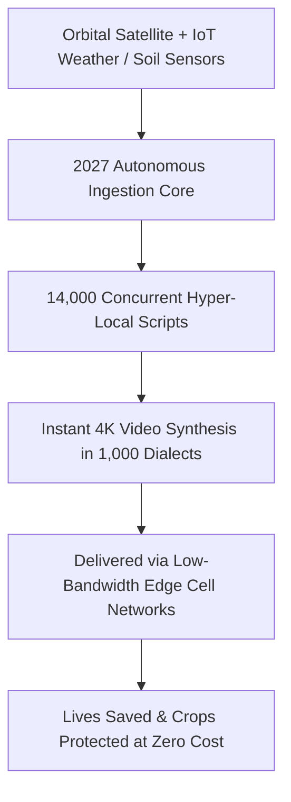

# *KARMIC GENIE SHOW* — SEASON 1, EPISODE 3
## **"2027: The Zero-Friction Media Era — Broadcasts from the Future of Autonomous Cinema"**
### **Pages 8 to 14: Screenplay, Advanced Architecture & Philosophical Epilogue**

* **Prime Broadcast Channel:** `@karmicgenie` (*Karmic Genie Show*)
* **Syndication Channel:** `@influenzian`
* **Format:** Cinematic Broadcast & Stadium Dialogue Screenplay (14-Page Masterwork)
* **Characters:**
  - **`@Me` (Adult Host / Narrator):** Dressed in a tailored ivory bandhgala, grounded, inquisitive, emotionally resonant.
  - **Bala-Rishi (4-Year-Old Boy Sage):** Radiant child ascetic seated on an alabaster plinth, draped in unstitched raw khadi silk, holding a neem-wood stylus, delivering timeless cosmic law (*Satya & Dharma*).
  - **Bala-Matha (4-Year-Old Divine Girl Saint):** Resplendent in a traditional crimson and gold zari silk *pattu pavadai*, fresh fragrant jasmine (*malligai*) braided into her glossy hair, golden glass bangles chiming softly, vermilion kumkum on her forehead, radiating unconditional maternal tenderness and practical compassion.
* **Governing Sanctuary Architecture:**
  - Pristine circular white marble dais with embedded luminous fiber-optic runes.
  - Floating 360-degree curved panoramic transparent OLED smart-glass arc displaying interactive 8K holographic timeline simulations, system schematics, and live generative pipelines.
  - Seven Pillars of Virtue inscribed in gold leaf on the sanctuary marble walls:
    * *Left Flank:* `Respect Your DUTY First.` · `Earn with DIGNITY Always.` · `Practice Life DISCIPLINE.`
    * *Center High Altar:* `[ Karmic Genie Show Golden Seal ]`
    * *Right Flank:* `Uphold Karmic DHARMA.` · `Raise Family with DEVOTION.` · `Be Grateful to Your DIVINE.`
    * *Plinth Foundation:* `Purposeful Life Is Your DESTINY.`
* **Signature Transition Ritual:** ***"What does Genie say — the 7D way?"***

---

## PAGE 8: USE CASE 6 — PRODUCT PROTOTYPING & SYNTHETIC CONSUMER TESTING

### SCENE 8: THE FACTORY OF SHADOWS & LIGHT (`18:30 – 21:45`)

**INT. KARMIC GENIE STADIUM-STUDIO — FULL ARENA CRANE SWEEP — NIGHT**
The overhead Halo chandeliers shift from amber gold to crisp, industrial electric sapphire.
The curved OLED smart-glass barrier pulses as `@Me` makes an upward lateral swipe. 

**OLED GRAPHIC DISPLAY:**
```
================================================================================
USE CASE 06: AUTONOMOUS PRODUCT PROTOTYPING & SYNTHETIC MARKET TESTING
================================================================================
[CAD / Prompt] -> [Zero-Shot Physical Dynamics Video] -> [100,000 Synthetic Buyer Personas]
* Traditional Cycle: 9 to 18 Months (Tooling, Focus Groups, Ad Agency Pilot, Sample Scrap)
* 2027 Pipeline: 42 Seconds (Parametric Stress Simulation + 120 Micro-Targeted 4K Commercials)
* Capital Waste Reduction: 94.2% Physical Scrap Elimination
================================================================================
```

A floating 3D holographic rendering of an ergonomic solar-powered desalinator appears between the hosts. In an instant, the glass splits into twelve simultaneous split-screen photorealistic commercials:
- One set in a coastal fishing hamlet in Tamil Nadu at dawn.
- One in an arid vineyard in Provence with soft afternoon light.
- One in an urban rooftop greenhouse in Kyoto under gentle neon rain.
Each video features flawless fluid dynamics, authentic local talent, contextual acoustics, and natural ambient light bounce.


**`@Me`**
*(leaning against the glass, eyes reflecting the sapphire glow)*
Look at the old industrial graveyard of the twentieth and early twenty-first centuries.
Billions of dollars spent carving steel molds, shipping injection-molded plastic prototypes across oceans, renting soundstages, hiring focus groups in windowless rooms behind two-way mirrors... only to realize after eighteen months that nobody wanted the product.
By 2027, the factory of physical matter is preceded by an infallible simulation of consciousness.
A solo inventor sketches a device at 2:00 AM. By 2:01 AM, the zero-friction engine generates not just the engineering stress analysis, but twelve broadcast-ready commercials and runs them through a synthetic population of one hundred thousand simulated human cognitive agents to test aesthetic appeal, emotional valence, and functional comprehension.

**BALA-RISHI**
*(smiling gently, holding his neem stylus toward the hovering solar device)*
Look deeper than the efficiency metrics, brother. What is physical waste?
Physical waste is the external manifestation of human ignorance and impatience.
In the ancient *Sulba Sutras*, before an altar of brick was raised, the Rishi calculated the geometry in the realm of pure thought. The mind built the temple first; physical hands merely obeyed the finalized truth.
For two hundred years, industrial man inverted this sacred order. He dug into Mother Earth, extracted her ores, poisoned waters, and stamped billions of cheap trinkets hoping to find what would sell.
In 2027, the synthesis of pure vision restores the ancient law: **Mind first, matter second.**
Not a single gram of sacred copper or bauxite need be excavated until the soul of the creation has proven its true utility in the light of collective agreement.

**BALA-MATHA**
*(her golden bangles chime as she gently touches a tile showing a young mother in Kenya testing the virtual water device)*
And think of the humble artisan, my beloved brother!
For centuries, if a village mother had a divine design for a safer cradle or an affordable clean-water filter, she could never show it to the world. She had no venture capital, no Madison Avenue ad agency, no camera crews.
Her genius died in her courtyard because she could not cross the wall of production capital.
In 2027, her heart’s invention is given the same glorious cinematic voice as a multi-trillion-dollar conglomerate.
She speaks her design into the Genie, and the world sees its beauty, its tenderness, and its necessity in breathtaking 4K reality.
Is that not **DIGNITY** restored to human ingenuity?

**`@Me`**
*(nodding with deep conviction)*
It democratizes the very right to invent.
No gatekeeper can say, *"You don't have the budget to show us your dream."*
The dream is visible before the money even enters the room.

---

## PAGE 9: USE CASE 7 — LEGAL COURTROOM RE-ENACTMENTS & FORENSIC VISUALIZATION

### SCENE 9: THE SCALES OF CRYPTOGRAPHIC TRUTH (`21:45 – 25:10`)

**INT. KARMIC GENIE STADIUM-STUDIO — WIDE ORBITAL TRACK**
The lighting shifts to a somber, immaculate crystalline platinum.
The OLED smart-glass arc shifts, displaying a dense cryptographic timeline and a hyper-accurate 3D physical environment.

**OLED GRAPHIC DISPLAY:**
```
================================================================================
USE CASE 07: CRYPTOGRAPHICALLY VERIFIED LEGAL RE-ENACTMENTS
================================================================================
[Telemetry / LiDAR / Dashcam / CCTV / Acoustic Sensors] 
                         │
                         ▼
[Deterministic Physics Engine + Spatio-Temporal Diffusion]
                         │
                         ▼
[Cryptographic Multi-Signature ZK-Proof Video Stream]
* Zero Hallucination Guarantee: Constrained within physical laws and verified input bounds
* Real-Time Variable Testing: "What did the driver see under 40% brake failure and headlight glare?"
* Jury Comprehension Speedup: Complex 3-month liability trial clarified in 8 minutes
================================================================================
```

On the transparent screen, an intersection collision at midnight is rendered.
Above it, green cryptographic hash markers (`SHA-256`, `ZK-SNARKs`) anchor each photon of light to physical data: vehicle black-box deceleration curves, street-lamp lumens, asphalt friction coefficients, and weather-sensor rainfall logs.
The camera moves smoothly into the driver’s eye-line, demonstrating exact visibility through a rain-slicked windshield under oncoming high-beam glare.

**`@Me`**
*(stepping toward the cryptographic ledger nodes)*
The legal courtroom has historically been a theatre of conflicting rhetoric.
Whoever hires the most theatrical trial lawyer, or the most expensive forensic animation studio at half a million dollars a clip, commands the jury’s imagination.
The poor driver, the injured pedestrian, or the innocent defendant gets flat 2D black-and-white chalk diagrams on a corkboard.
In 2027, the autonomous media engine interfaces with immutable physical sensor feeds.
It does not create a cartoon; it constructs a mathematically deterministic, cryptographically stamped re-creation of reality.
The jury doesn't just listen to arguments. They step into the physical truth of the event.

**BALA-RISHI**
*(his small voice resonant with quiet authority)*
In the courts of ancient kings, justice was called *Dharma-Vyavastha*—the alignment of human judgment with the cosmic witness, *Sakshi*.
When two men stood before the assembly, the greatest danger was never the absence of rules; it was the deception of memory and the eloquence of silver-tongued liars.
The *Brihadaranyaka Upanishad* declares: *“Satyameva Jayate”*—Truth alone triumphs, not falsehood.
Yet in human history, how many millions have rotted in prison cells because they could not afford the visual eloquence to prove their innocence?
When technology binds itself to unyielding physical telemetry and cryptographic truth, the screen ceases to be an instrument of entertainment.
It becomes the modern *Dharma-Danda*—the staff of cosmic righteousness that strips away rhetorical glamour and leaves only naked reality.

**BALA-MATHA**
*(her dark eyes filled with compassionate sorrow, turning into light)*
Rishi-ji speaks of justice, but my heart thinks of the poor family who lost their son in a factory accident.
For years, the corporate lawyers buried them under three thousand pages of technical jargon that no ordinary mother could understand.
*"He was careless,"* they said.
In 2027, the public utility media pipeline takes the sensor logs from the factory floor and renders the scene with total, impartial fidelity: the worn valve that leaked pressurized steam, the missing guardrail, the warning light that had burned out three weeks prior.
The jury sees the boy’s last heroic effort to save his coworkers.
No corporate lawyer can hide behind paper mountains anymore.
Mother Truth stands tall in the courtroom, embracing the helpless.

**`@Me`**
*(facing the camera)*
When truth cannot be outspent, justice ceases to be a luxury good.
That is the true moral measure of 2027.

---

## PAGE 10: USE CASE 8 — PRESERVATION OF ENDANGERED INDIGENOUS LANGUAGES & ORAL CULTURES

### SCENE 10: THE ANCESTORS SPEAK IN 4K (`25:10 – 28:35`)

**INT. KARMIC GENIE STADIUM-STUDIO — WARM EARTHEN GLOW**
The stadium lights soften into a warm amber campfire glow, reminiscent of ancient banyan trees and forest clearings.
The OLED screen awakens with rich, organic textures: Aboriginal rock art moving with lifelike breath, Amazonian foliage glistening with dew, and intricate Celtic knots uncoiling into living mythic beings.

**OLED GRAPHIC DISPLAY:**
```
================================================================================
USE CASE 08: ORAL FOLKLORE & INDIGENOUS LANGUAGE PRESERVATION
================================================================================
Input: Elderly elder's 20-minute audio recording in vanishing dialect (< 50 fluent speakers)
Processing: 
  - Phonetic-to-Semantic Morphological Reconstruction
  - Cultural Iconography Semantic Anchoring (zero Western bias drift)
Output: 
  - Complete 10-Episode 4K Mythological Animated Series
  - Dual-Channel Audio: Native tongue preserved with emotional cadence + Universal Sub-dialects
  - Pedagogical Gamified Interactive Companion
================================================================================
```

On screen, an elderly grandmother from the Toda tribe in the Nilgiri hills speaks a hauntingly beautiful, resonant chant into a mobile phone microphone.
Instantly, behind her, the autonomous pipeline generates an enchanting, Studio Ghibli-grade animated epic illustrating her words: sacred water buffaloes with iridescent horns moving through misty shola forests, celestial mountain spirits descending in twilight, all spoken in her exact dialect with pristine lip-sync and mythic reverence.

**`@Me`**
*(listening to the rich acoustics filling the stadium)*
Every fourteen days, a human language dies.
With each vanishing tongue, an entire cosmological library—plant medicines, astronomical observations, ethical wisdom distilled over ten thousand years—is erased forever.
Why? Because youth in indigenous communities are drawn to the dazzling media ecosystems of the dominant languages. Their grandmothers' stories felt trapped in fading memories, while the world watched Hollywood in IMAX.
In 2027, the zero-friction cinematic engine reverses this extinction curve.
An elder sits by a hearth in northern Scandinavia, the Kalahari, or the Amazon. She speaks into an inexpensive device for thirty minutes.
By dusk, her words have become a masterwork animated series—visually rivaling Pixar, culturally authentic to every textile pattern and birdsong, speaking directly to her grandchildren's tablets in their own ancestral mother tongue.

**BALA-MATHA**
*(smiling radiantly, swaying to the rhythmic tribal chant, her malligai flowers releasing their fragrance)*
Oh, how the grandmothers of the world rejoice tonight!
A grandmother’s voice is not just vocabulary, brother. It is *Vatsalya*—the sacred nectar of maternal love that holds a lineage together.
When a young child sees their own grandmother's story glowing with more beauty, more color, and more magic than any foreign cartoon, their heart swells with pride.
They do not throw away their mother tongue to chase foreign illusions.
They say: *"My people knew the stars. My people knew the song of the river. My language is divine."*
The 2027 media engine does not homogenize humanity into one gray monoculture.
It waters every unique wild flower in the garden of the Divine Mother!

**BALA-RISHI**
*(raising his right hand in abhaya mudra, eyes luminous)*
In Sanskrit, the word for language is *Vāk*.
The *Rig Veda* declares *Vāk* to be the goddess who upholds the cosmos itself.
When a sacred dialect dies without record, an entire window of the universe closes its shutters.
The modern world believed globalization meant everyone must speak the same three languages, eat the same processed food, and watch the same mass-market cinema.
That was not progress; that was spiritual amnesia.
When zero-friction media allows the smallest forest dialect to manifest in glorious high art, technology repents of its arrogance.
It bows down before the ancient oral lineages and says: *"Teach me how to speak again."*

**`@Me`**
*(quietly)*
From cultural extinction to eternal preservation, overnight.

---

## PAGE 11: USE CASE 9 — RAPID GAME & METAVERSE ENVIRONMENT WORLD-BUILDING

### SCENE 11: THE INSTANT ARCHITECTURE OF DREAMS (`28:35 – 32:00`)

**INT. KARMIC GENIE STADIUM-STUDIO — DYNAMIC VOLUMETRIC TRANSFORMATION**
The stadium floor around the white marble plinth appears to vanish into a bottomless chasm of cascading emerald waterfalls, hovering floating islands of luminous crystal, and sprawling solarpunk cities with winding glass skyways.
The OLED screen tracks real-time spatial physics, demonstrating instantaneous asset rendering and physics compilation.

**OLED GRAPHIC DISPLAY:**
```
================================================================================
USE CASE 09: PROCEDURAL WORLD-BUILDING & INTERACTIVE NARRATIVE GENERATION
================================================================================
Prompt Input: "A floating sanctuary above Neptune's clouds, where gravity pulses with heartbeat"
Asset Pipeline (Traditional 2024): 
  - 400 Environment Artists, 3 Years, $180M Budget
2027 Autonomous Synthesis Pipeline:
  - Dynamic NeRF / Gaussian Splat Geometry: 1.8 seconds
  - Volumetric Atmosphere & NavMesh Physics: 3.4 seconds
  - Branching Cinematic Cutscenes (Full Orchestral Score & Voice): 14 seconds
  - Zero-Latency Multiplayer Synchronization: Ready on compile
================================================================================
```

`@Me` takes two steps forward onto what appears to be a bridge of woven golden vines hovering above an azure alien ocean. 
Beside him, Bala-Rishi walks serenely across the illusion without looking down. Bala-Matha laughs playfully, reaching out to touch a shimmering bioluminescent butterfly that flutters from a digital flower and lands on her finger before dissolving into soft starlight.

```
       [Natural Language World Prompt]
                     │
       ┌─────────────┴─────────────┐
       ▼                           ▼
[Photorealistic Cutscene]    [Playable 3D NavMesh Environment]
(1-Prompt 4K Cinema)          (Unreal Engine / WebGPU Ingestion)
       │                           │
       └─────────────┬─────────────┘
                     ▼
  [Complete Living World in 60 Seconds]
```

**`@Me`**
*(marveling at the tactile fidelity around them)*
Look at this space.
Until recently, building a playable, cinematic interactive world required a studio of five hundred specialized artists, animators, shader programmers, and level designers grinding eighty hours a week for four years.
If an indie developer had a breathtaking vision for a philosophical interactive experience, they were crushed under production costs.
By 2027, the barrier between imagining an entire universe and stepping inside it has shrunk to sixty seconds.
You describe the world’s mood, its physical constants, its moral philosophy, and its architectural language.
The system synthesizes the entire volumetric topology, the playable collision boundaries, the environmental acoustics, and the cinematic cutscenes in one continuous pass.

**BALA-RISHI**
*(gazing across the infinite floating islands with profound dispassion)*
It is magnificent to behold, brother. Yet here lies the sharpest razor’s edge of 2027.
When the creation of illusion becomes effortless, what happens to the human mind?
The ancient sages called the created cosmos *Maya*—the divine illusion generated by the cosmic playwright, *Ishvara*.
For millennia, mortal beings were protected from creating their own deep illusions because physical matter was hard, heavy, and resistant. You had to carve stone with iron chisels; you had to mix paints from crushed minerals.
Now, the veil between imagination and sensory reality has worn paper-thin.
If a soul possesses desires rooted in lust, violence, and escapism, they can now generate an infinite labyrinth of their own delusions in six seconds and lose themselves within it for lifetimes.
Without the discipline of **DHARMA**, rapid world-building becomes a gilded prison for the soul.

**BALA-MATHA**
*(nodding softly, her bangles stilling as she speaks with solemn tenderness)*
Rishi-ji warns us of the danger, and we must listen with open ears.
When food is scarce, hunger is the enemy. But when the banquet is infinite, gluttony is what destroys the child.
In 2027, children will not ask: *"Can we build this world?"*
They will have to ask: *"Why are we building this world? Does this game teach our hearts courage, kindness, and self-sacrifice? Or does it teach us to be cruel, hollow ghosts who shoot shadows on a screen?"*
We must teach our young creators to build sanctuaries of wonder, not dungeons of addiction!
Let them build virtual temples where people learn astronomy, where people walk beside the Buddha, where people play music with Beethoven, where people heal from their loneliness!

**`@Me`**
*(facing the center camera)*
The tool has no conscience; the architect must provide it.
In 2027, every teenager becomes a world-builder.
Whether those worlds elevate humanity or entomb it is the ultimate moral question of our generation.

---

## PAGE 12: USE CASE 10 — MENTAL HEALTH, GRIEF THERAPY & COMPASSIONATE MEMORY ARCHIVING

### SCENE 12: THE HOUSE OF REMEMBRANCE (`32:00 – 35:20`)

**INT. KARMIC GENIE STADIUM-STUDIO — INTIMATE TWILIGHT SANCTUARY**
The vast stadium visual architecture contracts into an intimate, warm veranda of polished teakwood and white linen, overlooking a tranquil lake reflecting the setting sun.
On the transparent OLED display, soft sepia photographs from the 1970s and crackling low-resolution home video clips from the 1990s float gently, like autumn leaves drifting down a clear stream.

**OLED GRAPHIC DISPLAY:**
```
================================================================================
USE CASE 10: COMPASSIONATE MEMORY ARCHIVING & GRIEF THERAPY
================================================================================
Inputs: 
  - Faded polaroids, letters, voicemail fragments, family lore
Clinical Pipeline:
  - Psycho-Spiritual Boundary Protocols (Strict Non-Addictive Safeguards)
  - Photorealistic Multi-Generational Heritage Film Synthesis
  - Therapeutic "Unfinished Conversations" Re-enactment Spaces
Outcome:
  - Healing of Intergenerational Trauma & Resolved Mourning
  - Ancestral Lineage Preservation for Descendants 500 Years Later
================================================================================
```

On screen, a grainy 1982 black-and-white photograph of a young father holding his newborn daughter transforms smoothly into a luminous, cinema-grade memory sequence:
The father smiles, his voice reconstituted with warm timber, walking through the sunlit rain of his ancestral village, turning to look directly at the viewer with eyes full of tenderness.
Beside it, a clinical dashboard ensures the video operates strictly as a therapeutic catharsis tool, designed to allow closure rather than synthetic dependence.

**`@Me`**
*(speaking in hushed, reverent tones)*
There is no human sorrow heavier than the unresolved goodbye.
A father who died suddenly in an overseas hospital. A mother whose voice was lost to dementia before her child could ask: *"Did you know how much I loved you?"*
For generations, all we had left were fading, water-damaged photographs in shoeboxes and scratchy voicemails saved on old phones.
In 2027, the zero-friction engine becomes a vessel for compassionate memory archiving.
From a few faded pictures, written journals, and spoken memories, families synthesize complete, high-fidelity heritage chronicles.
You can walk through the home your great-grandparents built in 1930. You can watch your ancestors celebrate, endure, and overcome—not as distant names on a family tree, but as living, breathing human beings teaching their descendants how to be brave.

**BALA-MATHA**
*(a single crystal tear shines in her eye, yet her face is illuminated by maternal compassion)*
Oh, how many broken hearts carry stones in their chests, crying into their pillows at night!
A young girl whose mother left her body when she was only five years old. She cannot remember the scent of her mother’s hair; she cannot remember how her mother held her when she had a fever.
When the Genie reconstructs that tender embrace—not as a ghost to trap the girl, but as a golden bridge of remembrance—the heavy stone in her chest melts into tears of gratitude.
She sees her mother’s smile again. She hears her mother whisper: *"I am with you, my little one. Live a noble life."*
That is not illusion, my brother.
The love between a mother and her child is eternal; the machine merely wipes the dust off the mirror so love can see itself again.

**BALA-RISHI**
*(nodding solemnly, his stylus touching the inscription on the marble wall: `Raise Family with DEVOTION`)*
Yet observe the strict karmic boundary, brother.
In the sacred science of *Shraddha*—the Vedic rites for the ancestors—we offer water and sesame seeds to release the departed soul toward higher realms of light.
We do **not** bind the ancestor to the earth plane with desperate, clinging sorrow.
Therefore, the engineers of 2027 must establish sacred psycho-spiritual firewalls.
These memory sanctuaries must be built for **resolution and release**, never for morbid addiction where the living dwell with digital phantoms instead of serving their living spouses, children, and neighbors!
Use the technology to say your sacred thank you.
Use it to heal the ancestral wound.
Then close the screen, step into the sunshine, and live your **DUTY** in the flesh!

**`@Me`**
*(placing a hand over his heart)*
Honor the ancestors by living fully in the present.
Technology as medicine for the grieving soul, guided by wisdom.

---

## PAGE 13: USE CASE 11 — HYPER-LOCAL AGRICULTURAL & DISASTER RESPONSE BROADCASTS

### SCENE 13: THE GUARDIAN EYE OF THE MONSOON (`35:20 – 38:40`)

**INT. KARMIC GENIE STADIUM-STUDIO — URGENT CIPHER-CRIMSON TO EMERALD TRANSITION**
The stadium shifts into a dynamic high-stakes command center.
Satellite feeds, radar arrays, and topological watershed maps illuminate the curved OLED glass in vibrant saffron, crimson, and neon emerald.

**OLED GRAPHIC DISPLAY:**
```
================================================================================
USE CASE 11: HYPER-LOCAL REAL-TIME DISASTER & AGRI ADVISORY BROADCASTS
================================================================================
Event: Category 4 Cyclone Approaching Bay of Bengal (3 Hours to Landfall)
Traditional Mass Media:
  - 1 Generic National TV Broadcast in 2 State Languages (Lag: 4 Hours)
2027 Autonomous Synthesis Network:
  - 14,000 Micro-Targeted 4K Video Bulletins Synthesized Concurrently
  - Render Time: 8.2 Seconds per Batch
  - Hyper-Local Granularity: Street-by-street evacuation routes, local dialect nuances
  - Direct Actionable Advice: "Move cattle to the north hill behind the temple NOW."
================================================================================
```

On screen, the stadium splits into thousands of micro-windows:
- In one window, an AI elder in a delta hamlet speaks in the local dialect, pointing to the exact village canal that will overflow in twenty minutes, demonstrating with visual clarity how to secure the harvest.
- In another window, a dryland farmer in Maharashtra receives a personalized ten-second video diagnosing a leaf-curl infestation on his exact acre, showing precisely how to mix a neem-oil organic remedy using materials already in his barn.



**`@Me`**
*(voice energetic, commanding)*
Look at the stark reality of climate volatility and natural disasters.
When a cyclone strikes, national news networks broadcast a single anchor in a studio five hundred miles away speaking high formal Hindi or English.
To a farmer seventy miles off the main highway, that broadcast is practically useless.
He doesn’t need national statistics; he needs to know: *Is my village bund breaking? Which bridge is flooded right now? Where do I take my goats?*
In 2027, the zero-friction broadcast engine eliminates the translation and production delay entirely.
Within eight seconds of satellite telemetry detecting a flash-flood crest, fourteen thousand hyper-local, dialect-perfect video bulletins are synthesized simultaneously.
Every farmer sees a trusted, culturally familiar guide speaking their village dialect, showing them the exact street, the exact tree, and the exact evacuation route.

**BALA-RISHI**
*(leaning forward, his eyes flashing with the brilliance of righteous protection)*
This is the true coronation of human intelligence!
In the *Mahabharata*, the righteous ruler is asked: *“What is the first duty of the king when danger looms over the realm?”*
The answer is: *“To inform the humblest citizen before the shadow touches his doorstep.”*
For thousands of years, the king sat in his palace, and by the time royal couriers rode their horses to the distant villages, the floodwaters had already carried away the huts and the children.
In 2027, the courier travels at the speed of light.
The technology acts as the thousand eyes of Indra—not to spy on citizens, but to shield the innocent from calamity.
When knowledge protects life, knowledge is consecrated.

**BALA-MATHA**
*(her face glowing with motherly pride, clasping her hands)*
And look at the small farmer with his crops, brother!
He has worked for six months under the scorching sun, his hands calloused, his back aching, pouring his soul into the green seedlings.
When a blight strikes his leaves, he feels helpless. He cannot afford an agricultural scientist from the university to visit his remote farm.
In 2027, he points his simple phone camera at the leaf.
In three seconds, a warm, smiling agricultural elder appears on his screen, speaking his mother tongue:
*"Do not be afraid, son. This is only the spotted aphid. Take two measures of crushed neem leaves, mix it with cow buttermilk from your barn, and spray it before the sunset. Your crop will be saved."*
Look at the tears of relief on that farmer’s face!
His family will not starve. His children will go to school.
Is this not **DHARMA** in action?

**`@Me`**
*(solemnly)*
From ivory-tower media to life-saving village armor.
That is the true promise of zero-friction synthesis.

---

## PAGE 14: USE CASE 12 & EPILOGUE — THE GREAT SOUL INVENTORY OF 2027 & THE HORIZON OF 2028

### SCENE 14: WHEN ILLUSION BECOMES FREE, TRUTH BECOMES SACRED (`38:40 – 45:00`)

**INT. KARMIC GENIE STADIUM-STUDIO — ULTIMATE TRANSCENDENT DAWN**
The stadium ceiling shifts into a magnificent, hyper-real cosmic dawn: a deep indigo sky giving birth to streaks of radiant vermilion, liquid gold, and rose-petal pink.
The Halo chandeliers dim to warm, reverent candlelight.
All visual clutter, complex dashboards, and flickering monitors vanish from the curved OLED glass, leaving only the seven golden wall inscriptions blazing softly with divine presence:
`Respect Your DUTY First.` · `Earn with DIGNITY Always.` · `Practice Life DISCIPLINE.`
`Uphold Karmic DHARMA.` · `Raise Family with DEVOTION.` · `Be Grateful to Your DIVINE.`
`Purposeful Life Is Your DESTINY.`

In the center of the transparent glass, a single crystalline formula appears:
```
================================================================================
THE 2027 BREAKTHROUGH & THE PIVOT TO 2028
================================================================================
2027: ZERO FRICTION IN MEDIA  ──> When any illusion can be rendered in seconds,
                                   visual spectacle is demonetized to zero.
                                   The ONLY remaining currency is SOUL INTENT.
                                   
2028: ZERO FRICTION IN CODE   ──> 1-Prompt Full Production Applications.
                                   Syntax dissolves; Intent is King.
================================================================================
```

The three figures stand in close communion at the center of the circular marble stage. 
`@Me` turns to the front camera, his expression serene, deeply anchored, carrying the full weight of the journey.

**`@Me`**
*(voice dropping into a deep, meditative resonance)*
We began this journey looking at an inflection point that many feared would shatter the human spirit.
We saw that by late 2027, the barrier to creating cinematic broadcast video drops to zero.
A single human being—with one vision, one voice, or one sentence—can synthesize a two-hour Hollywood epic, an interactive world, a legal defense, or a life-saving broadcast in seconds.
The entire century-old monopoly of Hollywood studios, broadcast conglomerates, and billionaire media gatekeepers dissolves into the open air.
And yet, as we stand at the end of 2027, the greatest discovery is not technological.
It is spiritual.
When anyone can generate any spectacle instantly, spectacle loses all its power to deceive us.
Special effects become as cheap as gravel on the roadside.
What cannot be faked?
What cannot be synthesized by an algorithm?

**BALA-RISHI**
*(rises from his white marble plinth, taking three measured steps forward. His eyes shine like ancient stars, his neem stylus resting against his heart)*
What cannot be faked, brother, is **THE PURITY OF YOUR INTENT**.
An algorithm can generate ten thousand pixels of a crying child, but it cannot weep.
An algorithm can generate the sound of a sacred chant, but it cannot bow its ego before the Infinite.
For five thousand years, humanity used physical wealth, prestigious titles, and elaborate productions to hide its spiritual poverty.
A mediocre mind with ten million dollars could make a spectacle that captivated the world.
Now, the cosmic scale balances itself.
In 2027, the external garment is stripped away.
If your heart is hollow, your generated world will be a hollow desert, no matter how high the resolution.
If your heart is overflowing with love, truth, and devotion to God, a ten-second video from your hands will heal millions of weeping souls.
The age of technological illusion brings humanity directly to the threshold of **THE GREAT SOUL INVENTORY**.

**BALA-MATHA**
*(steps beside Bala-Rishi, her red silk pavadai rustling, her golden bangles chiming like temple bells, her hands folded in an exquisite Namaskaram)*
And look at the horizon that opens before us, my dear brothers and sisters of the world!
As 2027 draws to a close, the river does not stop.
The year **2028** is already knocking on the sanctuary door.
In 2027, the Genie mastered the language of **light and sound**—giving you the power to synthesize any image.
In 2028, the Genie masters the language of **logic and architecture**!
You will no longer just speak a movie into existence; you will speak an entire hospital management system, a community banking network, an agricultural exchange, or a global learning platform into existence with a single prompt!
The syntax of machines will surrender completely to the divine purpose of the human heart!
Do not be afraid of these changes!
The Divine Mother is not destroying your world; She is breaking your chains so you can remember who you truly are!

**`@Me`**
*(with profound warmth and reverence, joining his hands together)*
From the crucible of 2026, through the zero-friction media dawn of 2027, to the sovereign software creation of 2028 and the grand horizon of 2100...
We are not drifting into darkness.
We are walking home.
So as you stand on the threshold of 2027, hold fast to what is real.
Respect your duty. Earn with dignity. Practice your discipline.
Uphold your dharma. Love your family with devotion.
Be grateful to the Divine.
And remember always: a purposeful life is your eternal destiny.

*(He smiles warmly, looking between the two divine children.)*

**`@Me`**
What does Genie say — the 7D way?

**BALA-RISHI & BALA-MATHA**
*(speaking together in radiant, harmonious unison)*
***"Walk in Truth, fear no illusion, and let your soul shine like the sun!"***

**`44:45` — CRANE SHOT PULLS BACK RAPIDLY INTO THE STADIUM HEAVENS**
*The three figures stand united in golden light.*
*The screen dissolves into the radiant golden emblem:*
`[ KARMIC GENIE SHOW ]`
`Episode 3: Predictions 2027 — The Zero-Friction Media Era`
`Coming Next: Episode 4 — 2028: The One-Prompt Enterprise Application`
`Om Shanti, Shanti, Shantih.`

**FADE OUT.**
