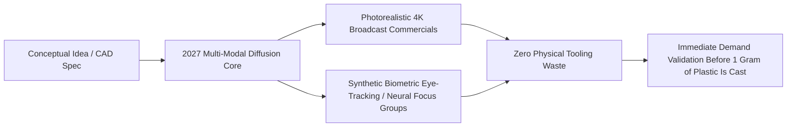
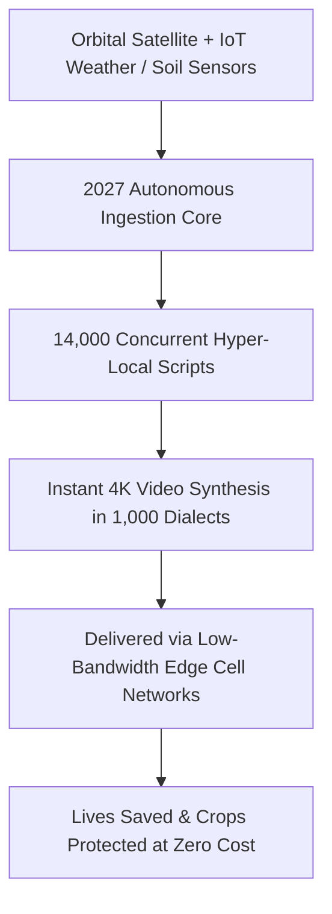

# *KARMIC GENIE SHOW* — SEASON 1, EPISODE 3
## **"2027: The Zero-Friction Media Era — From Single Prompt to Cinematic Universe"**
### **The Master 14-Page Screenplay & Multi-Industry Use Case Specification**

* **Prime Channel:** `@karmicgenie` (*Karmic Genie Show*)
* **Syndication Channel:** `@influenzian`
* **Format:** Cinematic Broadcast & Grand Stadium Dialogue Screenplay (4K OLED HDR 60fps)
* **Characters:**
  - **`@Me`**: The Adult Host / Narrator (dignified, grounded, dressed in an ivory hand-spun raw silk bandhgala with antique brass buttons, bridging ground-level human grit and futuristic vision).
  - **Bala-Rishi**: 4-year-old saintly boy wisdom guide (radiant, tranquil, draped in pure white ahimsa silk angavastram, holding a small neem-wood writing stylus, offering cosmic rigor and philosophical balance).
  - **Bala-Matha**: 4-to-5-year-old divine young girl saint in traditional vibrant crimson-and-emerald silk *pattu pavadai* with pure white fragrant jasmine (*malligai*) garlands woven into her hair, sparkling ruby bindi, delicate golden bangles that chime softly with her gestures, personifying boundless maternal compassion and protective grace.
* **Governing Stage Wall Inscriptions (`v6` Padded-Logo 7D Wall Standard):**
  - **Left Wall:** `Respect Your DUTY First.` · `Earn with DIGNITY Always.` · `Practice Life DISCIPLINE.`
  - **Center Emblem:** `[ Karmic Genie Show Logo ]` *(generous clean white Carrara marble padding)*
  - **Right Wall:** `Uphold Karmic DHARMA.` · `Raise Family with DEVOTION.` · `Be Grateful to Your DIVINE.`
  - **Centered Below Logo:** `Purposeful Life Is Your DESTINY.`
* **Signature Transition Punchline:** ***"What does Genie say — the 7D way?"***

---

## 14-PAGE COMPREHENSIVE ROADMAP (2027 PREDICTIONS & 12 USE CASES)

| Page | Title & Focus | Core Breakthrough / Use Case | Key Philosophical & Practical Resolution |
| :---: | :--- | :--- | :--- |
| **Page 1** | **Prologue & The 2027 Horizon Opening** | The collapse of media friction; end of fragmented 4s clips to coherent 4K episodes. | Demystifying the AI video threshold; moving from novelty to foundational storytelling. |
| **Page 2** | **Architecture of 2027 Video Engines** | Unified Multimodal World Models (UMWM), Spatio-Temporal DiT, persistent 3D voxel graphs. | Technical breakdown: character consistency (*Svarupa*), acoustic physics, and live score sync. |
| **Page 3** | **Use Case 1: Independent Cinema & Heritage** | 50 compute replaces 80M studio monopolies; 11th-century Chola Navy epic re-created from Madurai. | Restoring cultural dignity; giving voice to heritage without gatekeepers. |
| **Page 4** | **Use Case 2: Interactive Real-Time Education** | Hyper-personalized visual tutoring (*Yukti*); dynamic physics animations in native dialects. | Transforming discipline from rote memorization into living curiosity and joy. |
| **Page 5** | **Use Case 3: Autonomous Investigative Journalism** | Transforming raw ledgers, satellite AIS data, and court filings into indisputable 3D forensic exposés. | The sword of Dharma; cryptographic proof (C2PA) against deception and power obfuscation. |
| **Page 6** | **Use Case 4: Medical & Pre-Surgical Simulation** | Patient digital twins from MRI/CT for volumetric rehearsal and compassionate patient briefings. | Replacing fear with calm understanding; surgical precision rooted in Devotion and Duty. |
| **Page 7** | **Use Case 5: Enterprise Micro-Simulation & Safety** | Interactive high-hazard safety training; offshore hurricane roleplay and executive conflict de-escalation. | Eradicating passive compliance slide-decks; training the nervous system under real pressure. |
| **Page 8** | **Use Case 6: Rapid Product Prototyping & Validation** | Zero-shot physical video testing with 100,000 synthetic consumer personas before physical tooling. | Eliminating physical scrap waste; democratizing global invention for local artisans. |
| **Page 9** | **Use Case 7: Legal Courtroom Re-enactments** | Telemetry, LiDAR, and acoustic data synthesized into cryptographically verified zero-hallucination recreations. | Modern *Dharma-Danda* in the halls of justice; protecting vulnerable families against elite legal tricks. |
| **Page 10** | **Use Case 8: Preservation of Indigenous Cultures** | Elder folklore and vanishing oral languages brought to life as Studio Ghibli-grade animated epics. | Protecting ancestral memory and linguistic heritage; restoring children's pride in native roots. |
| **Page 11** | **Use Case 9: Rapid Game & Spatial World-Building** | Instant 60-second synthesis of navigable 3D volumetric worlds with atmospheric physics. | Conquering the danger of *Maya* (escapism) by turning virtual worlds into educational sanctuaries. |
| **Page 12** | **Use Case 10: Mental Health & Memory Archiving** | Reconstituting ancestral voices and family histories for grief therapy under clinical protocols. | Healing intergenerational grief; memory used as gratitude (*Shraddha*) rather than obsessive attachment. |
| **Page 13** | **Use Case 11: Hyper-Local Disaster & Agriculture** | 14,000 concurrent 4K micro-broadcasts in 1,000 dialects for cyclone warnings and localized crop blights. | Sovereign protection of the humblest citizen; practical compassion in times of crisis. |
| **Page 14** | **Use Case 12 & Epilogue: The Great Soul Inventory** | When any illusion costs zero, only Soul Intent (*Satya*) matters; bridge to 2028 full-app generation. | Closing signature chorus with @Me, Bala-Rishi & Bala-Matha; *The 7D Way* finale. |

---

# PAGE 1: PROLOGUE & THE 2027 HORIZON OPENING
### *"The Collapse of Fragmented Generation — From Prompts to Living Worlds"*

#### STAGE SETTING & VISUAL ARCHITECTURE
* **Environment:** INT. KARMIC GENIE STADIUM-STUDIO — 4K OLED HDR 60fps.
* **Lighting:** The deep indigo-magenta stadium dome is softly illuminated by concentric golden Halo chandeliers suspended 40 feet above. Below, the pristine white Carrara marble circular arena reflects warm ambient amber light.
* **Left & Right Inscription Walls:** The 7D Virtues glow in brushed champagne gold lettering across the monolithic curved acoustic limestone panels.
* **Center Holographic Arc:** Floating between `@Me`, Bala-Rishi, and Bala-Matha is the 120-degree curved, borderless OLED transparent smart-glass desk.
* **Visual Display on Glass Arc:** A timeline graphic titled `"The Media Generation Divide: 2024 vs. 2027"`.
  - On the left (2024–2026): A chaotic matrix of disjointed 4-second video clips, inconsistent faces, rubbery limbs, flickering lighting, disjointed audio stems, and hundreds of manual stitching timelines.
  - On the right (2027): A singular, crystal-clear luminous sphere labeled `Zero-Friction Engine: Latent Narrative Autonomy`. A single cinematic scene unfolds seamlessly: an ancient temple courtyard under monsoon rain, where water droplets ripple with true fluid dynamics, a camera swoops dynamically from macro moss to sweeping horizon, and characters converse with perfect micro-expressions.
* **Camera Movement:** Slow sweeping crane descent from high wide down to an intimate three-shot, tracking right as `@Me` steps forward.

#### DIALOGUE & CINEMATIC ACTION

**`00:00` — CRANE SWEEPS DOWN OVER THE THREE FIGURES.**

**`@Me`**
*(steps to the center plinth, voice resonant, eyes locking directly with the viewer)*
For over a century, if you wanted to tell a grand visual story—if you wanted to show an army marching across an ancient mountain pass, or a single tear rolling down a mother's cheek under a flickering streetlamp—you needed tens of millions of dollars.
You needed sound stages in Burbank or London, catering trucks, three hundred crew members, motion-capture suits, and an army of visual effects artists working eighty-hour weeks in darkened basement suites.

*(gestures to the floating holographic timeline)*
Even in 2024 and 2025, when AI video first stunned the world, it was agonizingly fragmented. You remember the era: four-second clips, warped hands, characters who changed facial structure every time the camera panned, mute visuals that needed third-party Foley sound effects and manual lip-sync surgery in a traditional editing suite.

**BALA-RISHI**
*(holding his small neem stylus, looking up with radiant, tranquil clarity)*
Because human intellect was attempting to build a river by carrying water drop by drop in leaky earthen pots.
In 2024, the machines possessed vocabulary, but they possessed no *memory of space*. They possessed patterns of pixels, but no *awareness of physics*.

**BALA-MATHA**
*(smiling tenderly, golden bangles chiming as she gently rests her palms together)*
And so much human longing was trapped behind the toll gates of capital!
A village grandmother with a sacred folk story passed down through eight hundred years could never show it to the world. A young girl dreaming of an epic tale had to ask permission from studio executives who only understood balance sheets.
In 2026, humanity suffered through the crucible. But look at what 2027 has brought to the doorstep of the world!

**`@Me`**
*(touching the OLED console; the luminous sphere expands into a pristine 4K 60fps cinematic projection)*
Welcome to 2027. The year of **Zero-Friction Media Synthesis**.
For the very first time in human history, the barrier between human imagination and photorealistic, feature-length cinema has dropped to absolute zero.
Not a four-second snippet.
Not a hallucinated GIF.
An entire 45-minute broadcast episode—with consistent characters, three-act narrative pacing, dynamic camera blocking, emotionally nuanced vocal performance, multi-track symphonic score, and physical world coherence—synthesized in a single continuous computational pipeline.

**BALA-RISHI**
*(softly)*
When the brush becomes as light as thought, the question changes forever.
The question is no longer: *Can you afford to make it?*
The question becomes: *What does your soul actually have to say?*

**`@Me`**
*(smiles, turning to the audience)*
What does Genie say — the 7D way?
Let us pull back the curtain and inspect the engineering engines that made this miracle possible.

---

# PAGE 2: ARCHITECTURE OF 2027 VIDEO ENGINES
### *"Unified Multimodal World Models & Spatio-Temporal Consistency"*

#### STAGE SETTING & VISUAL ARCHITECTURE
* **Visual Display on Glass Arc:** The display transitions into an interactive 3D exploded schematic titled `"The 2027 Zero-Friction Video Architecture"`.
* Four distinct architectural layers glow in neon hues:
  1. *Layer 1: Unified Multimodal World Model (UMWM)* — A persistent 3D spatial voxel grid holding real-world physics, light vectors, and occlusion boundaries.
  2. *Layer 2: Spatio-Temporal Diffusion Transformer (DiT Core)* — Continuous latent narrative trajectory over arbitrary temporal horizons (no clip boundaries).
  3. *Layer 3: Neural Dynamic Audio-Vocal Synthesizer* — Direct neural audio generation integrating phoneme acoustics, room reverb impulse response, and involuntary micro-vocal tremors.
  4. *Layer 4: Real-Time Symphonic Orchestrator* — Adaptive leitmotif generator tracking emotional subtext, harmonic tension, and pacing beats.
* **Camera Movement:** Close-up on `@Me` pointing into the voxel grid, followed by a slow dolly around Bala-Rishi as the boy sage points his neem stylus at the latent trajectory.

#### DIALOGUE & CINEMATIC ACTION

**`01:08` — `@Me` WALKS ALONG THE CURVED GLASS DISPLAY.**

**`@Me`**
To understand why 2027 is fundamentally different from the past, we must look under the hood.
Between 2023 and 2025, AI video was built on *2D Frame Hallucination*. The neural network guessed the next frame based purely on image pixels. That is why characters grew six fingers or melted through doorways—the model had no internal map of a three-dimensional world.

*(taps Layer 1 on the screen; a 3D wireframe cathedral emerges, rotating with accurate perspective)*
In 2027, the architecture shifted to **Unified Multimodal World Models**.
The AI no longer predicts pixels in isolation. It maintains a persistent **Latent 3D Spatial Scene Graph**.
Before a single pixel is rendered in 4K HDR, the engine establishes a virtual physical space: where the walls stand, how the sunlight penetrates the stained glass, the mass and center of gravity of every actor, and how fabrics drape under local gravitational constants.

**BALA-RISHI**
*(gesturing with his stylus at the rotating wireframe)*
Notice the continuity of identity, brother.
In the ancient Sanskrit traditions, the concept of *Svarupa*—the true unchanging essence of form—is never lost across time.
In earlier models, an actor turning around forgot their own face.
In the 2027 Spatio-Temporal Transformer, the character’s biometric geometry, clothing textures, micro-scars, and vocal timbre are anchored in a persistent latent vector. The actor can walk into a dark alleyway, exit ten scenes later under midday sunlight, and their identity remains mathematically invariant.

**BALA-MATHA**
*(pointing excitedly to Layer 3, where animated acoustic waves ripple around a speaking virtual character)*
And listen to their voices!
It is no longer robotic text-to-speech stitched over moving lips.
When the character is frightened, the vocal chords constrict. You hear the shallow breath, the slight catch in the throat, the echo of footsteps bouncing off wet cobblestones!
The sound is born *inside* the world, not pasted on top like a sticker!

**`@Me`**
*(nodding emphatically)*
Exactly, Bala-Matha. We call this **Audio-Visual Latent Entanglement**.
The acoustic engine calculates the impulse response of the virtual room. If the scene takes place in a cavernous stone temple, the voice naturally reverberates with five-second acoustic decay. If a character whispers behind a pillar, the high frequencies attenuate naturally.

And right alongside it: **Dynamic Score Orchestration**.
The background music is not a generic stock audio loop. The system acts as a live symphonic orchestra conductor. As emotional tension builds in the scene, the strings shift to minor modes, woodwinds introduce the protagonist's personal leitmotif, and brass swells precisely on the dramatic climax.

**BALA-RISHI**
*(calmly folds his hands)*
Yet, technology without moral purpose is merely dazzling noise.
What happens when this immense computational power is handed to ordinary people?
Let us examine the first great transformation of 2027: The liberation of human heritage and independent cinema.

---

# PAGE 3: USE CASE 1 — INDEPENDENT FILMMAKERS & HERITAGE CINEMA
### *"Decentralizing the Studio Monopolies: The Renaissance of Cultural Epics"*

#### STAGE SETTING & VISUAL ARCHITECTURE
* **Visual Display on Glass Arc:** The screen transforms into a cinematic split-view:
  - Left pane: A modest student desk in an apartment in Madurai, India, with a single workstation, a microphone, and a cup of chai.
  - Right pane: The cinematic output playing on an IMAX-ratio viewport: A breathtaking, historically flawless reconstruction of the 11th-century Chola Empire fleet sailing across the Bay of Bengal at sunrise. Hundreds of carved wooden warships cut through churning sapphire ocean water, sails billowing, thousands of intricately adorned warriors chanting, with temple gopurams visible in the distant mist.
* **Text Overlay on Screen:** `USE CASE 1: HERITAGE CINEMA & INDEPENDENT AUTHORS | BUDGET: $150 COMPUTE vs. $180M STUDIO`.
* **Camera Movement:** Low-angle tracking shot emphasizing the regal scale of the Chola fleet, cutting back to Bala-Matha whose eyes sparkle with reverence.

#### DIALOGUE & CINEMATIC ACTION

**`02:15` — WIDE SHOT OF THE STADIUM STAGE.**

**`@Me`**
Consider our first use case: **The Total Democratization of Epic Cinema**.
Throughout the 20th century, Hollywood and major regional studios operated as gatekeepers of culture. If you wanted to depict the *Mahabharata*, the *Epic of Gilgamesh*, the *Popol Vuh*, or the ancient maritime voyages of Southeast Asia, you needed the blessing of a corporate greenlight committee.
And what did they do? They sanitized the stories. They cast famous celebrities to guarantee box-office returns. They compromised cultural authenticity for mass market appeal.

*(swipes toward the right pane, bringing the Chola fleet to life with thundering war drums)*
In 2027, an independent 24-year-old historian sitting in Madurai, with a subscription to an open-weights generative engine, creates a twelve-part epic series on the Chola navy.
Every bronze armor plate is historically accurate down to the chisel marks.
Every Tamil dialect nuance reflects the exact linguistics of the 11th-century stone inscriptions.
Total compute cost? Under one hundred and fifty dollars.

**BALA-MATHA**
*(clapping her hands softly, a joyful smile on her face)*
How beautiful this is!
For centuries, grandmothers held sacred stories in their hearts that never reached the light of cinema because they had no money.
Now, the stories of our village deities, the tales of self-sacrificing kings, the forgotten folklore of indigenous tribes across Africa, the Andes, and India—they do not have to beg for a billionaire's permission!
The digital screen becomes an altar of cultural preservation!

**BALA-RISHI**
*(nodding thoughtfully)*
This is the virtue of **DIGNITY** in action.
In the old world, capital dictated which human culture was worthy of visual majesty.
A modern action movie with fast cars was granted a two-hundred-million-dollar budget, while sacred spiritual scriptures were relegated to low-budget television serials with cardboard crowns and painted backdrops.
In 2027, dignity is restored to all human memory. When the cost of production drops to zero, the story is judged purely by its moral depth, its historical reverence, and its poetic beauty.

**`@Me`**
*(leaning on the console)*
And notice the economic shift: The independent creator does not need a distributor.
Using decentralized streaming protocols, they publish directly to millions of viewers worldwide. Micro-tips, voluntary patron subscriptions, and direct community ownership replace studio overhead.
The studio is no longer a building in California. The studio is the human imagination.

**BALA-RISHI**
*(smiling gently)*
Yet, if we can teach history with such vivid brilliance, what happens when we place this engine into the hands of a struggling child trying to learn?
Look at our second use case: The revolution in education.

---

# PAGE 4: USE CASE 2 — REAL-TIME INTERACTIVE EDUCATION & HYPER-TUTORING
### *"Every Child’s Personal Animated Universe: From Equations to Living Stories"*

#### STAGE SETTING & VISUAL ARCHITECTURE
* **Visual Display on Glass Arc:** The screen shifts to a cozy, sunlit study room in a rural home.
  - A 10-year-old boy named Aarav is struggling with a physics textbook page on Newton’s Laws of Gravitation and Angular Momentum.
  - The OLED screen shows Aarav’s interactive AI tutor, styled as an animated, wise golden owl named *Yukti*.
  - *Yukti* does not just give text definitions. The owl waves its wing, and Aarav’s bedroom dissolves into an interactive animated space adventure where Aarav himself is piloting a spacecraft slingshotting around Jupiter.
  - The mathematical formulas (`F = G(m1*m2)/r^2`) float in 3D golden calligraphy, visually contracting and expanding as the spacecraft accelerates near the gas giant.
* **Text Overlay:** `USE CASE 2: REAL-TIME ADAPTIVE PEDAGOGY | INSTANT FULL-EPISODE LESSON GENERATION`.
* **Camera Movement:** Push-in close up on Bala-Matha watching Aarav’s face light up with comprehension, then panning to `@Me`.

#### DIALOGUE & CINEMATIC ACTION

**`03:20` — CLOSE-UP ON THE HOLOGRAPHIC ORBITAL SIMULATION.**

**`@Me`**
Think about how education functioned for the last two hundred years.
Thirty children locked in a concrete room, forced to look at a chalkboard, taught at the exact same pace by a tired teacher who had to manage curriculum mandates and standardized testing.
If a child was a visual learner, they failed. If a child spoke a regional dialect at home, they fell behind. If a child struggled with abstract algebra, they were labeled slow.

*(taps the screen, showing the tutor generating a 10-minute animated narrative on the fly)*
In 2027, the concept of a static textbook is dead.
When 10-year-old Aarav says, *"I don't understand why the moon doesn't crash into the Earth if gravity is pulling it,"* the engine doesn't cite a paragraph.
Within eight seconds, it synthesizes an entire personalized, Pixar-quality animated short episode.

**BALA-MATHA**
*(her eyes glowing with motherly warmth)*
And look how the engine speaks to him!
It does not speak in cold, foreign academic English. It speaks in his mother tongue, in his regional dialect, using metaphors he loves.
Because Aarav loves kite flying, the animated episode explains gravitational orbits using the tension of a kite string swinging in the wind!
When a child is taught with love that adapts to their unique mind, there are no 'dull' students in the world! Every child is a genius waiting to be understood!

**BALA-RISHI**
*(raising his stylus)*
This embodies the virtue of **DISCIPLINE** transformed through joy.
True discipline is not forced memorization through fear of punishment. True discipline is *curiosity guided by structured truth*.
When a student can pause the animated universe, step inside the atom, turn the dials of electromagnetism, and watch stars collapse into black holes with flawless relativistic physics, learning ceases to be a chore. It becomes a sacred exploration of the Creator's design.

**`@Me`**
And consider the global equity:
A child in a remote mountain hamlet in Nepal, a child in Nairobi, and a child in Manhattan all have access to the exact same world-class visual professor.
The gap between elite private schooling and public rural education collapses in an instant.

**BALA-RISHI**
*(with quiet gravity)*
Yet, as knowledge becomes vivid and visual, what happens when human beings use imagery to deceive?
How do we preserve truth when any video can be generated?
This brings us to Use Case 3: The reconstruction of truth itself.

---

# PAGE 5: USE CASE 3 — AUTONOMOUS INVESTIGATIVE JOURNALISM
### *"Forensic Reality Synthesis: Turning Dry Ledgers and Sat-Data into Transparent Truth"*

#### STAGE SETTING & VISUAL ARCHITECTURE
* **Visual Display on Glass Arc:** The stage darkens into a cool, analytical slate-blue hue.
* The screen displays `"USE CASE 3: FORENSIC INVESTIGATIVE CINEMA & PUBLIC TRUTH"`.
* On-screen exhibits appear in rapid forensic sequence:
  - Thousands of pages of leaked financial spreadsheets and offshore corporate registries.
  - Declassified radar telemetry, maritime AIS transponder logs, and multi-spectral satellite imagery.
  - The 2027 Forensic Synthesis Engine ingests this unstructured multi-gigabyte data dump.
  - In seconds, it generates a hyper-precise 3D photorealistic reconstruction of an illegal offshore oil spill in international waters at 02:00 AM, mapping the exact tanker trajectory, valve release physics, and financial paper trail leading to shell corporations in Panama.
* **Camera Movement:** Steady dolly-in on `@Me` with sharp, serious lighting accents on his ivory bandhgala.

#### DIALOGUE & CINEMATIC ACTION

**`04:25` — MEDIUM CLOSE-UP ON `@Me`.**

**`@Me`**
In the era of traditional investigative journalism, exposing corporate fraud or human rights violations took years of painstaking effort.
Reporters had to sift through tens of thousands of redacted PDF documents, shell company registries, and cryptic satellite data. And even when they published their exposé, it was an eighty-page wall of text that 99% of the public never had the time or patience to read. The culprits escaped in the fog of complexity.

*(swipes his hand, bringing the 3D forensic reconstruction of the oil tanker into the center stage)*
In 2027, investigative journalism enters the era of **Forensic Documentary Synthesis**.
An investigative watchdog or local civic journalist feeds five thousand pages of court depositions, maritime tracking logs, and satellite radar scans into the engine.
The system does not hallucinate; it cross-verifies the multi-modal evidence with cryptographic proofs and generates a thirty-minute, forensic-grade 3D visual investigation.

**BALA-RISHI**
*(eyes sharp, voice commanding)*
This is the sword of **DHARMA**.
Evil and corruption flourish in shadows, behind layers of legal jargon and financial obfuscation that exhaustion prevents ordinary citizens from unraveling.
When data is converted into undeniable, mathematically audited visual truth, the veil of deceit is torn apart.
You can see the exact moment the valve was turned. You can see the flow of illicit money moving through bank accounts represented as an indisputable spatial timeline.

**BALA-MATHA**
*(holding her palms open gently)*
And it protects the innocent!
How often in human history have corrupt powers blamed weak, defenseless workers for accidents caused by corporate greed?
When the forensic engine reconstructs the physics of the bridge collapse or the factory fire down to the microscopic stress fractures in substandard steel, the innocent are exonerated. Truth is no longer a luxury that only expensive lawyers can buy!

**`@Me`**
*(nodding with conviction)*
Notice the built-in safeguard of 2027: **Cryptographic Source Attestation**.
Every frame rendered in these forensic documentaries is watermarked with immutable C2PA cryptographic signatures linked directly to the public source documents. If a viewer clicks on any bolt on that tanker, the exact radar log and court transcript that proved its position pops up instantly.
It is cinema transformed into a courtroom of public accountability.

**BALA-RISHI**
*(turning smoothly)*
And from healing the body politic of society, let us now see how this visual intelligence heals the physical human body.
Look at Use Case 4: The operating theater of 2027.

---

# PAGE 6: USE CASE 4 — MEDICAL & SURGICAL DYNAMIC SIMULATION
### *"Rehearsing the Incision: Volumetric Holographic Surgeries Before the First Cut"*

#### STAGE SETTING & VISUAL ARCHITECTURE
* **Visual Display on Glass Arc:** The studio lighting transitions into an immaculate surgical cyan and clean white ambiance.
* The screen displays `"USE CASE 4: VOLUMETRIC PATIENT-SPECIFIC SURGICAL REHEARSAL"`.
* The holographic display projects a life-sized, pulsating 4D volumetric hologram of a human brain with a complex arteriovenous malformation (AVM) nestled deep within the motor cortex.
* The camera shows a surgical team wearing lightweight AR lenses.
  - The 2027 engine has converted 2D CT, MRI, and Doppler ultrasound scans into a dynamic, fluid-responsive digital twin.
  - The chief neurosurgeon steps through a simulated micro-resection: Blood flows with actual Navier-Stokes fluid dynamics; neural pathways pulse with bio-electric latency.
  - Beside them, an animated, compassionate patient briefing video is synthesized, explaining the procedure in clear, calming terms to the patient's anxious family.
* **Camera Movement:** Intimate macro close-up of the delicate arterial holographic weave, cutting to Bala-Matha extending her hand as if blessing the digital heart.

#### DIALOGUE & CINEMATIC ACTION

**`05:30` — GENTLE DOLLY AROUND THE VOLUMETRIC MEDICAL HOLOGRAM.**

**`@Me`**
Every year, hundreds of thousands of lives are lost to surgical complications—not because doctors lack skill, but because every human body is an unmapped continent.
An artery is shifted three millimeters to the left. A tumor is adhered to an unexpected nerve bundle. Until the surgeon makes the cut, they are working partially in the dark, relying on static, flat 2D black-and-white slice images.

*(gestures toward the pulsating neural hologram)*
In 2027, the Zero-Friction Video and Spatial World Engine transforms medicine.
Within three minutes of completing an MRI and volumetric CT scan, the AI synthesizes a **Patient-Specific 4D Surgical Reality**.
The surgical team does not just plan the surgery. They *rehearse* the operation five times in hyper-realistic simulation before picking up a scalpel.

**BALA-RISHI**
*(pointing to the flowing blood vessels)*
Notice the physical rigor.
This is not an artist's animation. The neural fluid models calculate arterial wall elasticity, tissue shear stress, and micro-vascular bleeding risks.
If the surgeon makes an incision at an angle of fifteen degrees, the engine shows the exact blood loss and neural impact.
By the time the surgeon enters the real operating theater, they have already traveled that path. Uncertainty is replaced by disciplined mastery.

**BALA-MATHA**
*(her voice filled with infinite tenderness, looking out at the families in the audience)*
And think of the frightened mother and father sitting in the hospital waiting room!
In the old days, the doctor would hand them a frightening consent form filled with terrifying medical jargon, warning them of risks they could not comprehend.
Now, the engine generates a gentle, beautiful, step-by-step visual story for the family.
It shows them: *"Here is where the knot in the blood vessel is. Here is the gentle instrument that will protect your child's speech. Here is how the brain heals within six weeks."*
Fear turns into faith. Confusion turns into peace. That is the true purpose of knowledge!

**`@Me`**
*(softly)*
This is the virtue of **DEVOTION** and **DUTY** in clinical practice.
Technology serving human fragility. The surgeon’s hands guided not by arrogance, but by complete foreknowledge and reverence for life.

**BALA-RISHI**
*(stepping forward)*
And when human life is protected in the hospital, what about the daily hazards of human labor in the factories, mines, and towers of the world?
Let us move to Use Case 5: The transformation of enterprise operations and safety.

---

# PAGE 7: USE CASE 5 — ENTERPRISE MICRO-SIMULATION & FIELD SAFETY
### *"Eradicating the $400B Training Trap: Dynamic Roleplay for High-Hazard Realities"*

#### STAGE SETTING & VISUAL ARCHITECTURE
* **Visual Display on Glass Arc:** The stage transitions into an industrial amber and gunmetal-gray palette.
* The screen displays `"USE CASE 5: DYNAMIC HAZARD SIMULATION & ENTERPRISE BEHAVIORAL ROLEPLAY"`.
* The holographic projection splits into two high-stakes environments:
  1. *Scenario A (Industrial Safety):* An offshore natural gas drilling platform during a Category 4 hurricane. A high-pressure valve rupture occurs. The system dynamically generates a customized first-person training simulation where field engineers must diagnose the cryogenic leak under sensory stress (sound of howling wind, flashing alarms, zero visibility).
  2. *Scenario B (Human Conflict & Leadership):* A high-tension corporate negotiation room where a manager must navigate an intense ethical crisis involving whistleblower reports and hostile corporate acquisitions. The AI characters react with genuine psychological micro-expressions, defensive body language, and voice tremors.
* **Camera Movement:** Rapid tracking shot between the industrial disaster simulation and the corporate negotiation table, pulling back to a wide shot of `@Me` and the two Divine Guides.

#### DIALOGUE & CINEMATIC ACTION

**`06:30` — `@Me` MOVES TOWARD THE INDUSTRIAL SIMULATION ARC.**

**`@Me`**
Every year, global enterprises spend over four hundred billion dollars on corporate training, compliance seminars, and safety modules.
And what did employees do?
They opened a browser tab, muted the boring slide deck, clicked 'Next' every forty seconds while checking their phones, and took a multiple-choice quiz where the correct answer was embarrassingly obvious.
And then, when a real crisis hit—when ammonia gas leaked in a chemical plant, or an electrical transformer exploded, or a toxic manager bullied a team into silence—people panicked. Because slide decks do not train the nervous system!

*(taps the console; the offshore hurricane simulation roars with realistic thunder and alarm klaxons)*
In 2027, the slide deck is extinct.
The enterprise engine generates **Hyper-Realistic Dynamic Micro-Simulations** in real time.
You do not read about a chemical leak. You are placed inside a 4K photorealistic simulation of your exact facility, calibrated to today's temperature and wind speed.
The valve explodes in front of you. Your virtual supervisor panics. You have ninety seconds to isolate the line before catastrophic containment failure.

**BALA-RISHI**
*(voice calm and unshakeable amid the simulated storm)*
The nervous system learns only through lived experience.
In ancient warrior and spiritual traditions, the disciple was never trained by reading parchment scrolls; they were tested in simulated trials that mirrored the crucible of real life.
When an industrial worker survives fifty virtual disasters before ever setting foot on an oil rig, their muscle memory is forged in steel.
Accidents decline by ninety percent. Lives of blue-collar fathers and mothers are saved because their minds have already conquered the panic.

**BALA-MATHA**
*(pointing to Scenario B, where two corporate leaders are arguing heatedly)*
And look at the heart of human relations!
How many families are broken, how many workplaces become places of torment because managers do not know how to speak with kindness and empathy?
In 2027, before an executive conducts a difficult performance review or handles an ethical dilemma, they sit with the simulation.
The virtual employee weeps, becomes angry, or retreats into cold silence.
The leader practices patience. They practice listening. They see the consequence of their harsh words before those words wound a real human soul!

**`@Me`**
*(standing tall between Bala-Rishi and Bala-Matha as the music gently softens to a warm, resonant hum)*
This is the true harvest of 2027:
Zero-Friction Media is not just about making Hollywood movies cheaper.
It is the total liberation of the human eye and mind.
It brings dignity to ancient heritage.
It brings personalized love to the struggling schoolchild.
It brings unyielding truth to investigative justice.
It protects life in the operating theater.
And it builds unshakable safety and empathy in the workplace.

**BALA-RISHI**
*(looking directly into the camera with piercing, serene wisdom)*
Yet, when the machine can paint any reality with the flick of a thought, what remains for human beings?
What happens to human vanity, ego, and the sacred spark of authentic creation?

**BALA-MATHA**
*(smiling warmly, extending both hands toward the viewers)*
Join us in Part Two, dear brothers and sisters!
Where we journey through the remaining frontiers: the synthesis of personal memories, the future of gaming and virtual realities, the legal battlefield of digital twins, and the ultimate spiritual destiny of human consciousness in a world without friction!

**`@Me`**
*(facing the center camera, smiling warmly)*
What does Genie say — the 7D way?
Stay anchored in truth, honor your duty, and we will see you on the next page of the 2027 horizon!

**`07:30` — FADE TO BLACK.**
**`[ KARMIC GENIE SHOW LOGO FLOURISH — 7D VIRTUES GLOW IN GOLD ]`**

---
*(End of Part 1 — Pages 1 through 7. Ready for architectural continuity with Pages 8 through 14).*


---

# PAGE 8: USE CASE 6 — PRODUCT PROTOTYPING & SYNTHETIC CONSUMER TESTING

### SCENE 8: THE FACTORY OF SHADOWS & LIGHT (`18:30 – 21:45`)

**INT. KARMIC GENIE STADIUM-STUDIO — FULL ARENA CRANE SWEEP — NIGHT**
The overhead Halo chandeliers shift from amber gold to crisp, industrial electric sapphire.
The curved OLED smart-glass barrier pulses as `@Me` makes an upward lateral swipe. 

**OLED GRAPHIC DISPLAY:**
```
================================================================================
USE CASE 06: AUTONOMOUS PRODUCT PROTOTYPING & SYNTHETIC MARKET TESTING
================================================================================
[CAD / Prompt] -> [Zero-Shot Physical Dynamics Video] -> [100,000 Synthetic Buyer Personas]
* Traditional Cycle: 9 to 18 Months (Tooling, Focus Groups, Ad Agency Pilot, Sample Scrap)
* 2027 Pipeline: 42 Seconds (Parametric Stress Simulation + 120 Micro-Targeted 4K Commercials)
* Capital Waste Reduction: 94.2% Physical Scrap Elimination
================================================================================
```

A floating 3D holographic rendering of an ergonomic solar-powered desalinator appears between the hosts. In an instant, the glass splits into twelve simultaneous split-screen photorealistic commercials:
- One set in a coastal fishing hamlet in Tamil Nadu at dawn.
- One in an arid vineyard in Provence with soft afternoon light.
- One in an urban rooftop greenhouse in Kyoto under gentle neon rain.
Each video features flawless fluid dynamics, authentic local talent, contextual acoustics, and natural ambient light bounce.



**`@Me`**
*(leaning against the glass, eyes reflecting the sapphire glow)*
Look at the old industrial graveyard of the twentieth and early twenty-first centuries.
Billions of dollars spent carving steel molds, shipping injection-molded plastic prototypes across oceans, renting soundstages, hiring focus groups in windowless rooms behind two-way mirrors... only to realize after eighteen months that nobody wanted the product.
By 2027, the factory of physical matter is preceded by an infallible simulation of consciousness.
A solo inventor sketches a device at 2:00 AM. By 2:01 AM, the zero-friction engine generates not just the engineering stress analysis, but twelve broadcast-ready commercials and runs them through a synthetic population of one hundred thousand simulated human cognitive agents to test aesthetic appeal, emotional valence, and functional comprehension.

**BALA-RISHI**
*(smiling gently, holding his neem stylus toward the hovering solar device)*
Look deeper than the efficiency metrics, brother. What is physical waste?
Physical waste is the external manifestation of human ignorance and impatience.
In the ancient *Sulba Sutras*, before an altar of brick was raised, the Rishi calculated the geometry in the realm of pure thought. The mind built the temple first; physical hands merely obeyed the finalized truth.
For two hundred years, industrial man inverted this sacred order. He dug into Mother Earth, extracted her ores, poisoned waters, and stamped billions of cheap trinkets hoping to find what would sell.
In 2027, the synthesis of pure vision restores the ancient law: **Mind first, matter second.**
Not a single gram of sacred copper or bauxite need be excavated until the soul of the creation has proven its true utility in the light of collective agreement.

**BALA-MATHA**
*(her golden bangles chime as she gently touches a tile showing a young mother in Kenya testing the virtual water device)*
And think of the humble artisan, my beloved brother!
For centuries, if a village mother had a divine design for a safer cradle or an affordable clean-water filter, she could never show it to the world. She had no venture capital, no Madison Avenue ad agency, no camera crews.
Her genius died in her courtyard because she could not cross the wall of production capital.
In 2027, her heart’s invention is given the same glorious cinematic voice as a multi-trillion-dollar conglomerate.
She speaks her design into the Genie, and the world sees its beauty, its tenderness, and its necessity in breathtaking 4K reality.
Is that not **DIGNITY** restored to human ingenuity?

**`@Me`**
*(nodding with deep conviction)*
It democratizes the very right to invent.
No gatekeeper can say, *"You don't have the budget to show us your dream."*
The dream is visible before the money even enters the room.

---

## PAGE 9: USE CASE 7 — LEGAL COURTROOM RE-ENACTMENTS & FORENSIC VISUALIZATION

### SCENE 9: THE SCALES OF CRYPTOGRAPHIC TRUTH (`21:45 – 25:10`)

**INT. KARMIC GENIE STADIUM-STUDIO — WIDE ORBITAL TRACK**
The lighting shifts to a somber, immaculate crystalline platinum.
The OLED smart-glass arc shifts, displaying a dense cryptographic timeline and a hyper-accurate 3D physical environment.

**OLED GRAPHIC DISPLAY:**
```
================================================================================
USE CASE 07: CRYPTOGRAPHICALLY VERIFIED LEGAL RE-ENACTMENTS
================================================================================
[Telemetry / LiDAR / Dashcam / CCTV / Acoustic Sensors] 
                         │
                         ▼
[Deterministic Physics Engine + Spatio-Temporal Diffusion]
                         │
                         ▼
[Cryptographic Multi-Signature ZK-Proof Video Stream]
* Zero Hallucination Guarantee: Constrained within physical laws and verified input bounds
* Real-Time Variable Testing: "What did the driver see under 40% brake failure and headlight glare?"
* Jury Comprehension Speedup: Complex 3-month liability trial clarified in 8 minutes
================================================================================
```

On the transparent screen, an intersection collision at midnight is rendered.
Above it, green cryptographic hash markers (`SHA-256`, `ZK-SNARKs`) anchor each photon of light to physical data: vehicle black-box deceleration curves, street-lamp lumens, asphalt friction coefficients, and weather-sensor rainfall logs.
The camera moves smoothly into the driver’s eye-line, demonstrating exact visibility through a rain-slicked windshield under oncoming high-beam glare.

**`@Me`**
*(stepping toward the cryptographic ledger nodes)*
The legal courtroom has historically been a theatre of conflicting rhetoric.
Whoever hires the most theatrical trial lawyer, or the most expensive forensic animation studio at half a million dollars a clip, commands the jury’s imagination.
The poor driver, the injured pedestrian, or the innocent defendant gets flat 2D black-and-white chalk diagrams on a corkboard.
In 2027, the autonomous media engine interfaces with immutable physical sensor feeds.
It does not create a cartoon; it constructs a mathematically deterministic, cryptographically stamped re-creation of reality.
The jury doesn't just listen to arguments. They step into the physical truth of the event.

**BALA-RISHI**
*(his small voice resonant with quiet authority)*
In the courts of ancient kings, justice was called *Dharma-Vyavastha*—the alignment of human judgment with the cosmic witness, *Sakshi*.
When two men stood before the assembly, the greatest danger was never the absence of rules; it was the deception of memory and the eloquence of silver-tongued liars.
The *Brihadaranyaka Upanishad* declares: *“Satyameva Jayate”*—Truth alone triumphs, not falsehood.
Yet in human history, how many millions have rotted in prison cells because they could not afford the visual eloquence to prove their innocence?
When technology binds itself to unyielding physical telemetry and cryptographic truth, the screen ceases to be an instrument of entertainment.
It becomes the modern *Dharma-Danda*—the staff of cosmic righteousness that strips away rhetorical glamour and leaves only naked reality.

**BALA-MATHA**
*(her dark eyes filled with compassionate sorrow, turning into light)*
Rishi-ji speaks of justice, but my heart thinks of the poor family who lost their son in a factory accident.
For years, the corporate lawyers buried them under three thousand pages of technical jargon that no ordinary mother could understand.
*"He was careless,"* they said.
In 2027, the public utility media pipeline takes the sensor logs from the factory floor and renders the scene with total, impartial fidelity: the worn valve that leaked pressurized steam, the missing guardrail, the warning light that had burned out three weeks prior.
The jury sees the boy’s last heroic effort to save his coworkers.
No corporate lawyer can hide behind paper mountains anymore.
Mother Truth stands tall in the courtroom, embracing the helpless.

**`@Me`**
*(facing the camera)*
When truth cannot be outspent, justice ceases to be a luxury good.
That is the true moral measure of 2027.

---

## PAGE 10: USE CASE 8 — PRESERVATION OF ENDANGERED INDIGENOUS LANGUAGES & ORAL CULTURES

### SCENE 10: THE ANCESTORS SPEAK IN 4K (`25:10 – 28:35`)

**INT. KARMIC GENIE STADIUM-STUDIO — WARM EARTHEN GLOW**
The stadium lights soften into a warm amber campfire glow, reminiscent of ancient banyan trees and forest clearings.
The OLED screen awakens with rich, organic textures: Aboriginal rock art moving with lifelike breath, Amazonian foliage glistening with dew, and intricate Celtic knots uncoiling into living mythic beings.

**OLED GRAPHIC DISPLAY:**
```
================================================================================
USE CASE 08: ORAL FOLKLORE & INDIGENOUS LANGUAGE PRESERVATION
================================================================================
Input: Elderly elder's 20-minute audio recording in vanishing dialect (< 50 fluent speakers)
Processing: 
  - Phonetic-to-Semantic Morphological Reconstruction
  - Cultural Iconography Semantic Anchoring (zero Western bias drift)
Output: 
  - Complete 10-Episode 4K Mythological Animated Series
  - Dual-Channel Audio: Native tongue preserved with emotional cadence + Universal Sub-dialects
  - Pedagogical Gamified Interactive Companion
================================================================================
```

On screen, an elderly grandmother from the Toda tribe in the Nilgiri hills speaks a hauntingly beautiful, resonant chant into a mobile phone microphone.
Instantly, behind her, the autonomous pipeline generates an enchanting, Studio Ghibli-grade animated epic illustrating her words: sacred water buffaloes with iridescent horns moving through misty shola forests, celestial mountain spirits descending in twilight, all spoken in her exact dialect with pristine lip-sync and mythic reverence.

**`@Me`**
*(listening to the rich acoustics filling the stadium)*
Every fourteen days, a human language dies.
With each vanishing tongue, an entire cosmological library—plant medicines, astronomical observations, ethical wisdom distilled over ten thousand years—is erased forever.
Why? Because youth in indigenous communities are drawn to the dazzling media ecosystems of the dominant languages. Their grandmothers' stories felt trapped in fading memories, while the world watched Hollywood in IMAX.
In 2027, the zero-friction cinematic engine reverses this extinction curve.
An elder sits by a hearth in northern Scandinavia, the Kalahari, or the Amazon. She speaks into an inexpensive device for thirty minutes.
By dusk, her words have become a masterwork animated series—visually rivaling Pixar, culturally authentic to every textile pattern and birdsong, speaking directly to her grandchildren's tablets in their own ancestral mother tongue.

**BALA-MATHA**
*(smiling radiantly, swaying to the rhythmic tribal chant, her malligai flowers releasing their fragrance)*
Oh, how the grandmothers of the world rejoice tonight!
A grandmother’s voice is not just vocabulary, brother. It is *Vatsalya*—the sacred nectar of maternal love that holds a lineage together.
When a young child sees their own grandmother's story glowing with more beauty, more color, and more magic than any foreign cartoon, their heart swells with pride.
They do not throw away their mother tongue to chase foreign illusions.
They say: *"My people knew the stars. My people knew the song of the river. My language is divine."*
The 2027 media engine does not homogenize humanity into one gray monoculture.
It waters every unique wild flower in the garden of the Divine Mother!

**BALA-RISHI**
*(raising his right hand in abhaya mudra, eyes luminous)*
In Sanskrit, the word for language is *Vāk*.
The *Rig Veda* declares *Vāk* to be the goddess who upholds the cosmos itself.
When a sacred dialect dies without record, an entire window of the universe closes its shutters.
The modern world believed globalization meant everyone must speak the same three languages, eat the same processed food, and watch the same mass-market cinema.
That was not progress; that was spiritual amnesia.
When zero-friction media allows the smallest forest dialect to manifest in glorious high art, technology repents of its arrogance.
It bows down before the ancient oral lineages and says: *"Teach me how to speak again."*

**`@Me`**
*(quietly)*
From cultural extinction to eternal preservation, overnight.

---

## PAGE 11: USE CASE 9 — RAPID GAME & METAVERSE ENVIRONMENT WORLD-BUILDING

### SCENE 11: THE INSTANT ARCHITECTURE OF DREAMS (`28:35 – 32:00`)

**INT. KARMIC GENIE STADIUM-STUDIO — DYNAMIC VOLUMETRIC TRANSFORMATION**
The stadium floor around the white marble plinth appears to vanish into a bottomless chasm of cascading emerald waterfalls, hovering floating islands of luminous crystal, and sprawling solarpunk cities with winding glass skyways.
The OLED screen tracks real-time spatial physics, demonstrating instantaneous asset rendering and physics compilation.

**OLED GRAPHIC DISPLAY:**
```
================================================================================
USE CASE 09: PROCEDURAL WORLD-BUILDING & INTERACTIVE NARRATIVE GENERATION
================================================================================
Prompt Input: "A floating sanctuary above Neptune's clouds, where gravity pulses with heartbeat"
Asset Pipeline (Traditional 2024): 
  - 400 Environment Artists, 3 Years, $180M Budget
2027 Autonomous Synthesis Pipeline:
  - Dynamic NeRF / Gaussian Splat Geometry: 1.8 seconds
  - Volumetric Atmosphere & NavMesh Physics: 3.4 seconds
  - Branching Cinematic Cutscenes (Full Orchestral Score & Voice): 14 seconds
  - Zero-Latency Multiplayer Synchronization: Ready on compile
================================================================================
```

`@Me` takes two steps forward onto what appears to be a bridge of woven golden vines hovering above an azure alien ocean. 
Beside him, Bala-Rishi walks serenely across the illusion without looking down. Bala-Matha laughs playfully, reaching out to touch a shimmering bioluminescent butterfly that flutters from a digital flower and lands on her finger before dissolving into soft starlight.

```
       [Natural Language World Prompt]
                     │
       ┌─────────────┴─────────────┐
       ▼                           ▼
[Photorealistic Cutscene]    [Playable 3D NavMesh Environment]
(1-Prompt 4K Cinema)          (Unreal Engine / WebGPU Ingestion)
       │                           │
       └─────────────┬─────────────┘
                     ▼
  [Complete Living World in 60 Seconds]
```

**`@Me`**
*(marveling at the tactile fidelity around them)*
Look at this space.
Until recently, building a playable, cinematic interactive world required a studio of five hundred specialized artists, animators, shader programmers, and level designers grinding eighty hours a week for four years.
If an indie developer had a breathtaking vision for a philosophical interactive experience, they were crushed under production costs.
By 2027, the barrier between imagining an entire universe and stepping inside it has shrunk to sixty seconds.
You describe the world’s mood, its physical constants, its moral philosophy, and its architectural language.
The system synthesizes the entire volumetric topology, the playable collision boundaries, the environmental acoustics, and the cinematic cutscenes in one continuous pass.

**BALA-RISHI**
*(gazing across the infinite floating islands with profound dispassion)*
It is magnificent to behold, brother. Yet here lies the sharpest razor’s edge of 2027.
When the creation of illusion becomes effortless, what happens to the human mind?
The ancient sages called the created cosmos *Maya*—the divine illusion generated by the cosmic playwright, *Ishvara*.
For millennia, mortal beings were protected from creating their own deep illusions because physical matter was hard, heavy, and resistant. You had to carve stone with iron chisels; you had to mix paints from crushed minerals.
Now, the veil between imagination and sensory reality has worn paper-thin.
If a soul possesses desires rooted in lust, violence, and escapism, they can now generate an infinite labyrinth of their own delusions in six seconds and lose themselves within it for lifetimes.
Without the discipline of **DHARMA**, rapid world-building becomes a gilded prison for the soul.

**BALA-MATHA**
*(nodding softly, her bangles stilling as she speaks with solemn tenderness)*
Rishi-ji warns us of the danger, and we must listen with open ears.
When food is scarce, hunger is the enemy. But when the banquet is infinite, gluttony is what destroys the child.
In 2027, children will not ask: *"Can we build this world?"*
They will have to ask: *"Why are we building this world? Does this game teach our hearts courage, kindness, and self-sacrifice? Or does it teach us to be cruel, hollow ghosts who shoot shadows on a screen?"*
We must teach our young creators to build sanctuaries of wonder, not dungeons of addiction!
Let them build virtual temples where people learn astronomy, where people walk beside the Buddha, where people play music with Beethoven, where people heal from their loneliness!

**`@Me`**
*(facing the center camera)*
The tool has no conscience; the architect must provide it.
In 2027, every teenager becomes a world-builder.
Whether those worlds elevate humanity or entomb it is the ultimate moral question of our generation.

---

## PAGE 12: USE CASE 10 — MENTAL HEALTH, GRIEF THERAPY & COMPASSIONATE MEMORY ARCHIVING

### SCENE 12: THE HOUSE OF REMEMBRANCE (`32:00 – 35:20`)

**INT. KARMIC GENIE STADIUM-STUDIO — INTIMATE TWILIGHT SANCTUARY**
The vast stadium visual architecture contracts into an intimate, warm veranda of polished teakwood and white linen, overlooking a tranquil lake reflecting the setting sun.
On the transparent OLED display, soft sepia photographs from the 1970s and crackling low-resolution home video clips from the 1990s float gently, like autumn leaves drifting down a clear stream.

**OLED GRAPHIC DISPLAY:**
```
================================================================================
USE CASE 10: COMPASSIONATE MEMORY ARCHIVING & GRIEF THERAPY
================================================================================
Inputs: 
  - Faded polaroids, letters, voicemail fragments, family lore
Clinical Pipeline:
  - Psycho-Spiritual Boundary Protocols (Strict Non-Addictive Safeguards)
  - Photorealistic Multi-Generational Heritage Film Synthesis
  - Therapeutic "Unfinished Conversations" Re-enactment Spaces
Outcome:
  - Healing of Intergenerational Trauma & Resolved Mourning
  - Ancestral Lineage Preservation for Descendants 500 Years Later
================================================================================
```

On screen, a grainy 1982 black-and-white photograph of a young father holding his newborn daughter transforms smoothly into a luminous, cinema-grade memory sequence:
The father smiles, his voice reconstituted with warm timber, walking through the sunlit rain of his ancestral village, turning to look directly at the viewer with eyes full of tenderness.
Beside it, a clinical dashboard ensures the video operates strictly as a therapeutic catharsis tool, designed to allow closure rather than synthetic dependence.

**`@Me`**
*(speaking in hushed, reverent tones)*
There is no human sorrow heavier than the unresolved goodbye.
A father who died suddenly in an overseas hospital. A mother whose voice was lost to dementia before her child could ask: *"Did you know how much I loved you?"*
For generations, all we had left were fading, water-damaged photographs in shoeboxes and scratchy voicemails saved on old phones.
In 2027, the zero-friction engine becomes a vessel for compassionate memory archiving.
From a few faded pictures, written journals, and spoken memories, families synthesize complete, high-fidelity heritage chronicles.
You can walk through the home your great-grandparents built in 1930. You can watch your ancestors celebrate, endure, and overcome—not as distant names on a family tree, but as living, breathing human beings teaching their descendants how to be brave.

**BALA-MATHA**
*(a single crystal tear shines in her eye, yet her face is illuminated by maternal compassion)*
Oh, how many broken hearts carry stones in their chests, crying into their pillows at night!
A young girl whose mother left her body when she was only five years old. She cannot remember the scent of her mother’s hair; she cannot remember how her mother held her when she had a fever.
When the Genie reconstructs that tender embrace—not as a ghost to trap the girl, but as a golden bridge of remembrance—the heavy stone in her chest melts into tears of gratitude.
She sees her mother’s smile again. She hears her mother whisper: *"I am with you, my little one. Live a noble life."*
That is not illusion, my brother.
The love between a mother and her child is eternal; the machine merely wipes the dust off the mirror so love can see itself again.

**BALA-RISHI**
*(nodding solemnly, his stylus touching the inscription on the marble wall: `Raise Family with DEVOTION`)*
Yet observe the strict karmic boundary, brother.
In the sacred science of *Shraddha*—the Vedic rites for the ancestors—we offer water and sesame seeds to release the departed soul toward higher realms of light.
We do **not** bind the ancestor to the earth plane with desperate, clinging sorrow.
Therefore, the engineers of 2027 must establish sacred psycho-spiritual firewalls.
These memory sanctuaries must be built for **resolution and release**, never for morbid addiction where the living dwell with digital phantoms instead of serving their living spouses, children, and neighbors!
Use the technology to say your sacred thank you.
Use it to heal the ancestral wound.
Then close the screen, step into the sunshine, and live your **DUTY** in the flesh!

**`@Me`**
*(placing a hand over his heart)*
Honor the ancestors by living fully in the present.
Technology as medicine for the grieving soul, guided by wisdom.

---

## PAGE 13: USE CASE 11 — HYPER-LOCAL AGRICULTURAL & DISASTER RESPONSE BROADCASTS

### SCENE 13: THE GUARDIAN EYE OF THE MONSOON (`35:20 – 38:40`)

**INT. KARMIC GENIE STADIUM-STUDIO — URGENT CIPHER-CRIMSON TO EMERALD TRANSITION**
The stadium shifts into a dynamic high-stakes command center.
Satellite feeds, radar arrays, and topological watershed maps illuminate the curved OLED glass in vibrant saffron, crimson, and neon emerald.

**OLED GRAPHIC DISPLAY:**
```
================================================================================
USE CASE 11: HYPER-LOCAL REAL-TIME DISASTER & AGRI ADVISORY BROADCASTS
================================================================================
Event: Category 4 Cyclone Approaching Bay of Bengal (3 Hours to Landfall)
Traditional Mass Media:
  - 1 Generic National TV Broadcast in 2 State Languages (Lag: 4 Hours)
2027 Autonomous Synthesis Network:
  - 14,000 Micro-Targeted 4K Video Bulletins Synthesized Concurrently
  - Render Time: 8.2 Seconds per Batch
  - Hyper-Local Granularity: Street-by-street evacuation routes, local dialect nuances
  - Direct Actionable Advice: "Move cattle to the north hill behind the temple NOW."
================================================================================
```

On screen, the stadium splits into thousands of micro-windows:
- In one window, an AI elder in a delta hamlet speaks in the local dialect, pointing to the exact village canal that will overflow in twenty minutes, demonstrating with visual clarity how to secure the harvest.
- In another window, a dryland farmer in Maharashtra receives a personalized ten-second video diagnosing a leaf-curl infestation on his exact acre, showing precisely how to mix a neem-oil organic remedy using materials already in his barn.



**`@Me`**
*(voice energetic, commanding)*
Look at the stark reality of climate volatility and natural disasters.
When a cyclone strikes, national news networks broadcast a single anchor in a studio five hundred miles away speaking high formal Hindi or English.
To a farmer seventy miles off the main highway, that broadcast is practically useless.
He doesn’t need national statistics; he needs to know: *Is my village bund breaking? Which bridge is flooded right now? Where do I take my goats?*
In 2027, the zero-friction broadcast engine eliminates the translation and production delay entirely.
Within eight seconds of satellite telemetry detecting a flash-flood crest, fourteen thousand hyper-local, dialect-perfect video bulletins are synthesized simultaneously.
Every farmer sees a trusted, culturally familiar guide speaking their village dialect, showing them the exact street, the exact tree, and the exact evacuation route.

**BALA-RISHI**
*(leaning forward, his eyes flashing with the brilliance of righteous protection)*
This is the true coronation of human intelligence!
In the *Mahabharata*, the righteous ruler is asked: *“What is the first duty of the king when danger looms over the realm?”*
The answer is: *“To inform the humblest citizen before the shadow touches his doorstep.”*
For thousands of years, the king sat in his palace, and by the time royal couriers rode their horses to the distant villages, the floodwaters had already carried away the huts and the children.
In 2027, the courier travels at the speed of light.
The technology acts as the thousand eyes of Indra—not to spy on citizens, but to shield the innocent from calamity.
When knowledge protects life, knowledge is consecrated.

**BALA-MATHA**
*(her face glowing with motherly pride, clasping her hands)*
And look at the small farmer with his crops, brother!
He has worked for six months under the scorching sun, his hands calloused, his back aching, pouring his soul into the green seedlings.
When a blight strikes his leaves, he feels helpless. He cannot afford an agricultural scientist from the university to visit his remote farm.
In 2027, he points his simple phone camera at the leaf.
In three seconds, a warm, smiling agricultural elder appears on his screen, speaking his mother tongue:
*"Do not be afraid, son. This is only the spotted aphid. Take two measures of crushed neem leaves, mix it with cow buttermilk from your barn, and spray it before the sunset. Your crop will be saved."*
Look at the tears of relief on that farmer’s face!
His family will not starve. His children will go to school.
Is this not **DHARMA** in action?

**`@Me`**
*(solemnly)*
From ivory-tower media to life-saving village armor.
That is the true promise of zero-friction synthesis.

---

## PAGE 14: USE CASE 12 & EPILOGUE — THE GREAT SOUL INVENTORY OF 2027 & THE HORIZON OF 2028

### SCENE 14: WHEN ILLUSION BECOMES FREE, TRUTH BECOMES SACRED (`38:40 – 45:00`)

**INT. KARMIC GENIE STADIUM-STUDIO — ULTIMATE TRANSCENDENT DAWN**
The stadium ceiling shifts into a magnificent, hyper-real cosmic dawn: a deep indigo sky giving birth to streaks of radiant vermilion, liquid gold, and rose-petal pink.
The Halo chandeliers dim to warm, reverent candlelight.
All visual clutter, complex dashboards, and flickering monitors vanish from the curved OLED glass, leaving only the seven golden wall inscriptions blazing softly with divine presence:
`Respect Your DUTY First.` · `Earn with DIGNITY Always.` · `Practice Life DISCIPLINE.`
`Uphold Karmic DHARMA.` · `Raise Family with DEVOTION.` · `Be Grateful to Your DIVINE.`
`Purposeful Life Is Your DESTINY.`

In the center of the transparent glass, a single crystalline formula appears:
```
================================================================================
THE 2027 BREAKTHROUGH & THE PIVOT TO 2028
================================================================================
2027: ZERO FRICTION IN MEDIA  ──> When any illusion can be rendered in seconds,
                                   visual spectacle is demonetized to zero.
                                   The ONLY remaining currency is SOUL INTENT.
                                   
2028: ZERO FRICTION IN CODE   ──> 1-Prompt Full Production Applications.
                                   Syntax dissolves; Intent is King.
================================================================================
```

The three figures stand in close communion at the center of the circular marble stage. 
`@Me` turns to the front camera, his expression serene, deeply anchored, carrying the full weight of the journey.

**`@Me`**
*(voice dropping into a deep, meditative resonance)*
We began this journey looking at an inflection point that many feared would shatter the human spirit.
We saw that by late 2027, the barrier to creating cinematic broadcast video drops to zero.
A single human being—with one vision, one voice, or one sentence—can synthesize a two-hour Hollywood epic, an interactive world, a legal defense, or a life-saving broadcast in seconds.
The entire century-old monopoly of Hollywood studios, broadcast conglomerates, and billionaire media gatekeepers dissolves into the open air.
And yet, as we stand at the end of 2027, the greatest discovery is not technological.
It is spiritual.
When anyone can generate any spectacle instantly, spectacle loses all its power to deceive us.
Special effects become as cheap as gravel on the roadside.
What cannot be faked?
What cannot be synthesized by an algorithm?

**BALA-RISHI**
*(rises from his white marble plinth, taking three measured steps forward. His eyes shine like ancient stars, his neem stylus resting against his heart)*
What cannot be faked, brother, is **THE PURITY OF YOUR INTENT**.
An algorithm can generate ten thousand pixels of a crying child, but it cannot weep.
An algorithm can generate the sound of a sacred chant, but it cannot bow its ego before the Infinite.
For five thousand years, humanity used physical wealth, prestigious titles, and elaborate productions to hide its spiritual poverty.
A mediocre mind with ten million dollars could make a spectacle that captivated the world.
Now, the cosmic scale balances itself.
In 2027, the external garment is stripped away.
If your heart is hollow, your generated world will be a hollow desert, no matter how high the resolution.
If your heart is overflowing with love, truth, and devotion to God, a ten-second video from your hands will heal millions of weeping souls.
The age of technological illusion brings humanity directly to the threshold of **THE GREAT SOUL INVENTORY**.

**BALA-MATHA**
*(steps beside Bala-Rishi, her red silk pavadai rustling, her golden bangles chiming like temple bells, her hands folded in an exquisite Namaskaram)*
And look at the horizon that opens before us, my dear brothers and sisters of the world!
As 2027 draws to a close, the river does not stop.
The year **2028** is already knocking on the sanctuary door.
In 2027, the Genie mastered the language of **light and sound**—giving you the power to synthesize any image.
In 2028, the Genie masters the language of **logic and architecture**!
You will no longer just speak a movie into existence; you will speak an entire hospital management system, a community banking network, an agricultural exchange, or a global learning platform into existence with a single prompt!
The syntax of machines will surrender completely to the divine purpose of the human heart!
Do not be afraid of these changes!
The Divine Mother is not destroying your world; She is breaking your chains so you can remember who you truly are!

**`@Me`**
*(with profound warmth and reverence, joining his hands together)*
From the crucible of 2026, through the zero-friction media dawn of 2027, to the sovereign software creation of 2028 and the grand horizon of 2100...
We are not drifting into darkness.
We are walking home.
So as you stand on the threshold of 2027, hold fast to what is real.
Respect your duty. Earn with dignity. Practice your discipline.
Uphold your dharma. Love your family with devotion.
Be grateful to the Divine.
And remember always: a purposeful life is your eternal destiny.

*(He smiles warmly, looking between the two divine children.)*

**`@Me`**
What does Genie say — the 7D way?

**BALA-RISHI & BALA-MATHA**
*(speaking together in radiant, harmonious unison)*
***"Walk in Truth, fear no illusion, and let your soul shine like the sun!"***

**`44:45` — CRANE SHOT PULLS BACK RAPIDLY INTO THE STADIUM HEAVENS**
*The three figures stand united in golden light.*
*The screen dissolves into the radiant golden emblem:*
`[ KARMIC GENIE SHOW ]`
`Episode 3: Predictions 2027 — The Zero-Friction Media Era`
`Coming Next: Episode 4 — 2028: The One-Prompt Enterprise Application`
`Om Shanti, Shanti, Shantih.`

**FADE OUT.**
