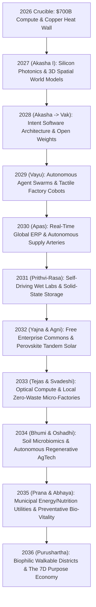

# The Singularity Annual Chronicles (2027–2036)
## Deep Industrial Research, Vedic Causal Framework & Finalized 10-Episode Movie Scripts (`@karmicgenie`)

> [!IMPORTANT]
> **Production Standard Locked Across All 10 Annual Movies**:
> - **Voice**: Strictly `ShishyanEN` (`Nk3ySQLp8D2ib5z5sqpT`, `eleven_v4`) with the **Ultra-Crisp Studio Condenser Chain** (`105 Hz` HPF, `-4.5 dB @ 220 Hz`, `+3.8/+5.0/+4.5 dB` presence & air).
> - **Movie Soundscape**: `@guru-kula-desam` தல வரலாறு stems — `Intro.wav` (`10.5s` theatrical opening), 3 unspoken `7.8s` `Interlude.wav` act-break swells, vocal-pocket-carved `Background.wav`, and `13.5s` instrumental `Outro.wav` resolution (`~5:45–6:15` total runtime per episode).
> - **Visuals & Subtitles**: 100% photorealistic **Business & World Industrial Revolution** widescreen cinematography, fixed single-region subtitles (`top: 84%`), zero borders, zero brand/company names, and strict Zero-CTA.

---

## Part I: Deep Research & Wise Vedic Thought Process — *Why Human Innovation Moves in Sudden Annual Obsessions*

When historians look back at industrial revolutions—steam, railways, electricity, semiconductors, the internet, and now AI—they notice a mysterious pattern: **for decades an idea sits quietly in academic papers, and then suddenly, within a single 12-month window, thousands of laboratories, trillions in capital, and millions of brilliant minds become magnetized by the exact same problem simultaneously.**

Grounded in both **2026–2036 industrial R&D physics** and **Vedic philosophy**, four timeless causal laws explain *why* each year's breakthrough happens in an exact, natural sequence:

### 1. `Satkāryavāda` & `Kāla-Pāka` (*Sānkhya Kārikā* 9 — The Ripened Bottleneck Law)
In Vedic causality (*Satkāryavāda*), an effect never arises out of nothing; it pre-exists latently inside its material cause and manifests only when *Kāla-Pāka* (the ripening of time and pressure) removes the barrier. Industrially, **every year's triumph creates the exact physical bottleneck that forces the next year's invention**:
- Scaling 2026 AI clusters melts copper interconnects with heat $\rightarrow$ forces **2027 Silicon Photonics & 3D World Models**.
- Instant visual/model proliferation creates fragmented API chaos $\rightarrow$ forces **2028 Intent Software & Unified Open Protocols**.
- Instant software exposes slow human bureaucratic handoffs & aging factory labor $\rightarrow$ forces **2029 Agentic Operations & Tactile Factory Cobots**.
- Machine-speed factories crash into 60-year-old ledgers, customs delays, and port clots $\rightarrow$ forces **2030 Real-Time Global ERP & Autonomous Ports**.
- Massive electrification + robotics hit lithium/rare-earth mineral walls $\rightarrow$ forces **2031 Self-Driving Materials Labs & Solid-State / Iron-Air Storage**.

### 2. `Prāṇa-Pravāha` & *Garbha Upaniṣad* (Why "Sudden Interest" Strikes Collective Consciousness)
Why do venture markets, engineers, and students all catch fire with sudden curiosity (*Jijñāsā*) for the same field at the same moment? The *Garbha Upaniṣad* teaches that as a living embryo matures, **vital life-current (`Prāṇa`) does not spread thinly everywhere at once—it floods intensely into whichever organ must form in that specific month** (first neural plate, then heart, then vascular vessels, then lungs, then digestive tract). What financial markets call a *"sector craze"* or *"sudden gold rush"* is **`Prāṇa-Ākarṣaṇa`**: Macrocosmic Intelligence (*Virāṭ-Puruṣa*, *Rig Veda* 10.90) temporarily magnetizing human ambition (*Artha*) and fascination (*Kāma*) onto one missing organ until it is built, then immediately shifting that collective fascination to the next bottleneck.

### 3. *Taittirīya Upaniṣad* (2.1.1) — The `Pañca-Mahābhūta` Subtle-to-Gross Descent
*Taittirīya Upaniṣad* reveals the exact cascade by which consciousness shapes matter:
$$\text{Ākāśa (Space/Ether)} \rightarrow \text{Vāyu (Air/Kinetic Motion)} \rightarrow \text{Agni/Tejas (Light/Energy)} \rightarrow \text{Āpas (Fluid Circulation)} \rightarrow \text{Pṛthivī (Earth/Matter)} \rightarrow \text{Oṣadhi \& Annam (Living Soil, Food \& Vitality)}$$
Remarkably, the **2027–2036 Industrial Revolution** follows this exact five-element progression from pure digital thought down into physical matter, clean energy, living soil, and human flourishing:

### 4. Master 10-Episode Causal & Vedic Matrix (`2027–2036`)

| Ep | Year | Prior Bottleneck | Sudden Collective Obsession | Major Business & Industrial Shift | Vedic Principle & 7D Pillar |
| :-: | :-: | :--- | :--- | :--- | :--- |
| **01** | **2027** | Copper heat wall in GPU clusters; 2D AI lacks 3D physics | **Co-Packaged Silicon Photonics & 3D World Models** | Industrial digital twins cut factory downtime 40%; zero-friction visual prototyping & cinema | `Ākāśa-Tattva` & `Svarūpa` · **DIGNITY** |
| **02** | **2028** | Fragmented multi-API chaos & multi-month coding backlogs | **Intent-Driven Software & Open Weight Protocols** | End of manual boilerplate syntax; 5-person teams build enterprise platforms from pure domain intent | `Sankalpa` & `Parā-Vāk` · **DISCIPLINE** |
| **03** | **2029** | Instant software stalls on slow human handoffs & labor gaps | **Agentic Enterprise Swarms & Tactile Factory Cobots** | Self-coordinating procurement/ops; humanoid & AMR cobots handle hazardous/repetitive floor work | `Pañca-Prāṇa` (Vital Winds) · **DHARMA** |
| **04** | **2030** | Fast autonomous factories hit slow ports, customs & ERP silos | **Zero-Click Global ERP & Autonomous Maritime Corridors** | Real-time trade settlement & automated berths; small regional makers export worldwide frictionlessly | `Āpas` (Unblocked Flow) · **DEVOTION** |
| **05** | **2031** | Rare-earth mineral bottlenecks & 4-hour battery limits | **Autonomous "AI-for-Science" Wet Labs (`Materials 4.0`)** | Earth-abundant True Solid-State, Sodium-Ion & 100-hr Iron-Air batteries synthesized in weeks | `Satkāryavāda` & `Rasa` · **DUTY** |
| **06** | **2032** | SaaS rent collapse + summer thermal grid peak overload | **Open Free Enterprise Commons & Roll-to-Roll Perovskite Solar** | Core enterprise software becomes free public air; >32% tandem solar skins turn roofs into power plants | `Yajña` (Sacred Commons) · **DIVINE** |
| **07** | **2033** | 1nm silicon transistor limits + wasteful 10,000-mile shipping | **Optical Matrix Coprocessors & Local Micro-Factories** | Computing with light slashes data-center power; cities print/assemble precision goods on demand | `Tejas` & `Svadeśī` · **DISCIPLINE** |
| **08** | **2034** | Cheap goods/power expose depleted topsoil & crop stress | **Soil Microbiome Engineering & Solar Field Robotics** | Restoring 10B microbes/gram in living humus; chemical runoff plunges while nutrient density rises | `Bhūmi-Sūkta` & `Annam` · **DEVOTION** |
| **09** | **2035** | Near-zero energy/food cost collides with survival billing & stress | **Baseline Utility Dividends & Preventative Bio-Vitality** | Unmetered municipal clean power & staple nutrition; continuous pre-symptom cellular health care | `Abhaya-Dāna` & `Āyurveda` · **DUTY** |
| **10** | **2036** | Post-scarcity productivity asks: *What are humans for now?* | **Biophilic Mass-Timber Cities & 7D Mentorship Economy** | Commuter sprawl shifts to walkable garden districts; elders mentor youth; work = chosen *Svadharma* | `Catur-Puruṣārtha` · **DESTINY** |

---

## Part II: Finalized Word-for-Word Movie Scripts (`2027` – `2036`)

> [!TIP]
> Each script below is finalized for `ShishyanEN` (`~3,500–3,750` characters per episode, strictly Zero-CTA, zero company names) with `@guru-kula-desam` தல வரலாறு `Intro.wav`, `3 × Interlude.wav`, `Background.wav`, and `Outro.wav` cues built directly into the structure.

---

### EPISODE 01 — YEAR 2027: *When Light Replaces Copper & Machines Learn Space*
- **Slug**: `KG_Year_2027_Light_And_Spatial_World`
- **Poster Title**: `YEAR 2027 • THE SPATIAL SHIFT`
- **Industrial Visual Palette**: Co-packaged silicon photonics wafers pulsing with laser light, high-bay industrial digital-twin turbine factories, automotive & architectural holographic simulation halls, regional film & engineering studios.

#### `[00:00 – 00:10.5] CINEMATIC PRELUDE — Intro.wav (10.5s)`
- *Visuals*: Macro shot of glowing copper server cables shimmering with heat inside a hyperscale hall, dissolving into a cool crystalline silicon-photonics wafer carrying beams of pure golden-cyan laser light.
- *Upper-Left Tag*: `SINGULARITY ANNUAL SERIES • YEAR 2027`

#### `[ACT I — THE 2026 BOTTLENECK & THE SUDDEN OBSESSION]`
- **B01**: At the close of twenty twenty-six, the global artificial intelligence boom slammed into two invisible walls of physics at the exact same moment. Inside hyperscale data centers, copper wires carrying trillions of electrical signals began choking on their own thermal heat. And on screen, text and flat video models could write poetry, yet still could not understand basic three-dimensional gravity, torque, or permanent physical space.
- **B02**: Welcome to The Karmic Genie Show, and Episode One of our Annual Industrial Singularity Chronicle: The Year Twenty Twenty-Seven. Notice how human progress never leaps at random. Suddenly, across every semiconductor cleanroom, venture boardroom, and engineering campus on Earth, collective curiosity locked onto two breakthroughs at once: Silicon Photonics—moving data with pure laser light instead of hot copper—and Unified Three-Dimensional World Models.

#### `[MUSICAL BRIDGE 1 — Interlude.wav (7.8s)]`
- *Upper-Left Tag*: `ACT I • AKASHA TATTVA: TEACHING MACHINES PHYSICAL SPACE`
- *Visuals*: Cleanroom engineers inspecting co-packaged optical chips; jet-engine factory running a live 3D holographic twin.

#### `[ACT II — THE VEDIC LAW OF AKASHA & INDUSTRIAL DIGITAL TWINS]`
- **B03**: Why did millions of minds suddenly obsess over spatial physics in twenty twenty-seven? In Vedic science, the very first element to emerge in creation is Akasha—intelligent space, the container that holds every form without losing its memory. You cannot build a physical industrial revolution with a machine that forgets where a bolt or a beam was three seconds ago!
- **B04**: The moment co-packaged optical interconnects broke the data-center bandwidth wall, Unified World Models came online across heavy industry. Manufacturing plants from precision aerospace to power turbines began running living, millimeter-accurate digital twins—predicting bearing fatigue weeks before failure, cutting unplanned factory downtime by forty percent, and letting small hardware teams test ten thousand physical prototypes in software before cutting a single gram of steel!

#### `[MUSICAL BRIDGE 2 — Interlude.wav (7.8s)]`
- *Upper-Left Tag*: `ACT II • ZERO-FRICTION DESIGN & CULTURAL DIGNITY`
- *Visuals*: Independent industrial designer and regional heritage filmmaker directing photorealistic worlds on glass walls.

#### `[ACT III — DEMOCRATIZING VISION & ENTERPRISE TRAINING]`
- **B05**: Simultaneously, twenty twenty-seven shattered the eighty-million-dollar gatekeeper monopoly in visual media, product design, and high-hazard training. Surgical teams began rehearsing complex operations inside patient-specific volumetric twins, offshore grid technicians trained inside lifelike storm simulations, and independent storytellers in small towns brought centuries of regional history to the screen with full cinematic coherence.

#### `[MUSICAL BRIDGE 3 — Interlude.wav (7.8s)]`
- *Upper-Left Tag*: `ACT III • THE 7D COMPASS: DIGNITY OVER ILLUSION`
- *Visuals*: Craftsman and architect reviewing real bridge blueprints at sunrise.

#### `[ACT IV — THE KARMIC LESSON & BRIDGE TO 2028]`
- **B06**: Here is the timeless Seven D law of Dignity that twenty twenty-seven reveals: when visualizing any idea drops toward zero cost, spectacle alone loses its vanity. Only honest engineering, lived truth, and genuine human purpose retain value.
- **B07**: Yet solving spatial memory in twenty twenty-seven immediately exposed the next painful bottleneck for twenty twenty-eight: thousands of incompatible software tools and millions of lines of brittle code slowing every business down. Next, we step into twenty twenty-eight—when human intent replaces programming syntax. Walk the Seven D Way in clarity.

#### `[FINALE — Outro.wav (13.5s)]`
- *Visuals*: Aerial sunrise pullback over semiconductor fab, optical fiber harbor, and `@karmicgenie` finale card.

---

### EPISODE 02 — YEAR 2028: *The End of Syntax & The Unified Intelligence Protocol*
- **Slug**: `KG_Year_2028_Intent_And_Unified_AI`
- **Poster Title**: `YEAR 2028 • INTENT IS CODE`

#### `[00:00 – 00:10.5] CINEMATIC PRELUDE — Intro.wav (10.5s)`
- *Upper-Left Tag*: `SINGULARITY ANNUAL SERIES • YEAR 2028`

#### `[ACT I — THE API TOWER OF BABEL]`
- **B01**: By January twenty twenty-eight, almost every enterprise on Earth was drowning in its own digital success. Companies had adopted dozens of isolated artificial intelligence models, fragile software wrappers, and incompatible cloud dashboards that refused to speak to one another—turning modern IT departments into an exhausting Tower of Babel.
- **B02**: Welcome back to The Karmic Genie Show and Year Twenty Twenty-Eight of our Annual Singularity Series. Right on cue, that exact integration pain ignited a sudden, worldwide obsession across technology and business: Intent-Driven Software Architecture, paired with Open Interoperable Intelligence Protocols.

#### `[MUSICAL BRIDGE 1 — Interlude.wav (7.8s)]`
- *Upper-Left Tag*: `ACT I • SANKALPA & VAK: FROM SYNTAX TO PURE INTENT`

#### `[ACT II — WHEN CLEAR THOUGHT BECOMES WORKING ARCHITECTURE]`
- **B03**: Look at this shift through the Vedic science of Vak—the four stages by which inner intention condenses into outer reality: Para, Pashyanti, Madhyama, and Vaikhari. For seventy years, human builders were trapped in the lowest mechanical layer—typing millions of semicolons and syntax rules just to translate a simple business workflow into machine instructions.
- **B04**: In twenty twenty-eight, formal verification engines and unified open model standards closed that gap. Instead of eighteen-month software backlogs, a domain expert—a hospital director, a mechanical engineer, or a logistics planner—could specify exact operational rules, security constraints, and audit invariants in plain structured language, generating a complete, verified production application in hours.

#### `[MUSICAL BRIDGE 2 — Interlude.wav (7.8s)]`
- *Upper-Left Tag*: `ACT II • THE GREAT ENTERPRISE SAAS RECKONING`

#### `[ACT III — SMALL TEAMS, SOVEREIGN INFRASTRUCTURE]`
- **B05**: Across global business, per-seat software rent began cracking overnight. Why pay millions for rigid legacy software licenses when a disciplined five-person team can synthesize custom enterprise workflows tailored to their exact factory floor? Just as open internet protocols united isolated computer networks in the nineteen-nineties, open weight-exchange protocols turned fragmented models into one shared cognitive backbone.

#### `[MUSICAL BRIDGE 3 — Interlude.wav (7.8s)]`
- *Upper-Left Tag*: `ACT III • THE 7D COMPASS: DISCIPLINE OF MIND`

#### `[ACT IV — DISCIPLINE OF THOUGHT & BRIDGE TO 2029]`
- **B06**: Notice the Vedic warning hidden inside instant software: when a machine builds whatever you ask in ten minutes, sloppy thinking builds chaos ten times faster! Twenty twenty-eight elevated the Seven D pillar of Discipline—rewarding calm, ethical architects who deeply understand real-world systems over surface copycats.
- **B07**: And the moment software generation became instantaneous in twenty twenty-eight, the spotlight swung immediately onto the next bottleneck of twenty twenty-nine: who executes the physical tasks and cross-company operations in the real world? Next, we enter twenty twenty-nine—the rise of autonomous agents and factory robotics. Walk the Seven D Way.

#### `[FINALE — Outro.wav (13.5s)]`

---

### EPISODE 03 — YEAR 2029: *Autonomous Enterprise Agents & Tactile Factory Robotics*
- **Slug**: `KG_Year_2029_Agents_And_Factory_Robotics`
- **Poster Title**: `YEAR 2029 • PHYSICAL AI`

#### `[00:00 – 00:10.5] CINEMATIC PRELUDE — Intro.wav (10.5s)`
- *Upper-Left Tag*: `SINGULARITY ANNUAL SERIES • YEAR 2029`

#### `[ACT I — WHEN INSTANT SOFTWARE MEETS PHYSICAL FRICTION]`
- **B01**: Entering twenty twenty-nine, global industry faced a striking contradiction. Inside glass offices, software and designs could now be generated in minutes. Yet out on warehouse floors, chemical plants, and cross-border procurement desks, aging workforces, hazardous manual labor, and endless email approval chains kept the physical economy moving at a crawl.
- **B02**: Welcome to The Karmic Genie Show and Year Twenty Twenty-Nine. Driven by demographic labor shortages and operational bottlenecks, global capital and engineering genius pivoted with sudden intensity toward two twin frontiers: Multi-Agent Enterprise Orchestration and Tactile Embodied Factory Robotics.

#### `[MUSICAL BRIDGE 1 — Interlude.wav (7.8s)]`
- *Upper-Left Tag*: `ACT I • PRANA-VAYU: AUTONOMOUS COORDINATION IN NATURE`

#### `[ACT II — MULTI-AGENT OPERATIONS & END OF BUREAUCRACY]`
- **B03**: Consider how the human body stays alive according to Vedic physiology. You do not hold a morning committee meeting to remind your lungs to inhale, your liver to filter, or your white blood cells to repair a cut! The five Prana-Vayus—the autonomous vital currents of life—coordinate trillions of cellular operations silently so your conscious mind is free to think, love, and create.
- **B04**: In twenty twenty-nine, businesses adopted that exact biological design. Networks of specialized operational agents began autonomously balancing inventory, verifying supplier compliance, scheduling predictive maintenance, and rerouting freight around weather disruptions in seconds—dissolving layers of repetitive status-reporting bureaucracy.

#### `[MUSICAL BRIDGE 2 — Interlude.wav (7.8s)]`
- *Upper-Left Tag*: `ACT II • TACTILE COBOTS ON THE INDUSTRIAL FLOOR`

#### `[ACT III — ROBOTS WITH A SENSE OF TOUCH]`
- **B05**: At the same time, edge-native Physical AI gave industrial robots something they never possessed before: fine tactile force-sensing and zero-shot spatial adaptation. Instead of rigid cages bolted to one spot, mobile collaborative robots began working safely shoulder-to-shoulder with human machinists—lifting heavy castings, handling toxic solvents, and assembling variable components without re-programming.

#### `[MUSICAL BRIDGE 3 — Interlude.wav (7.8s)]`
- *Upper-Left Tag*: `ACT III • THE 7D COMPASS: RIGHTEOUS STEWARDSHIP`

#### `[ACT IV — HUMAN DHARMA & BRIDGE TO 2030]`
- **B06**: Far from erasing human worth, twenty twenty-nine restored the Seven D law of Dharma: human beings were never born to act like mechanical gears on a twelve-hour shift or human routers forwarding spreadsheets. Freeing workers from repetitive strain elevated skilled technicians into plant stewards and system mentors.
- **B07**: Yet as factories and enterprise agents accelerated to machine speed, they slammed straight into a sixty-year-old wall in twenty thirty: archaic banking settlement delays, customs bottlenecks, and disconnected supply-chain ledgers. Join us next in twenty thirty as global trade arteries unite. Walk the Seven D Way.

#### `[FINALE — Outro.wav (13.5s)]`

---

### EPISODE 04 — YEAR 2030: *Instant Global Supply Chains & The Unified ERP Arteries*
- **Slug**: `KG_Year_2030_Unified_Global_Supply_Chain`
- **Poster Title**: `YEAR 2030 • FRICTIONLESS TRADE`

#### `[00:00 – 00:10.5] CINEMATIC PRELUDE — Intro.wav (10.5s)`
- *Upper-Left Tag*: `SINGULARITY ANNUAL SERIES • YEAR 2030`

#### `[ACT I — FAST FACTORIES, FROZEN PORTS]`
- **B01**: Imagine an ultra-modern robotic factory in twenty thirty assembling life-saving medical equipment in four hours—only for that container to sit paralyzed at a seaport for fourteen days because three incompatible corporate ledgers, customs forms, and letters of trade credit failed to reconcile a two-cent currency rounding difference!
- **B02**: Welcome back to The Karmic Genie Show and Year Twenty Thirty. That exact bottleneck between fast autonomous production and slow twentieth-century trade plumbing sparked a sudden global movement across maritime shipping, manufacturing, and trade finance: Zero-Click Unified Resource Protocols and Autonomous Port Corridors.

#### `[MUSICAL BRIDGE 1 — Interlude.wav (7.8s)]`
- *Upper-Left Tag*: `ACT I • APAS TATTVA: CIRCULATION CREATES PROSPERITY`

#### `[ACT II — HEALING THE ARTERIES OF COMMERCE]`
- **B03**: In Vedic wisdom and Ayurveda, Apas—the water principle governing blood and lymph—teaches an unbreakable economic truth: nourishment only sustains life when it circulates freely. Whenever blood clots in one vessel out of fear or friction, the entire body weakens; when circulation is clean and continuous, every cell thrives.
- **B04**: First honor the pioneers who built double-entry accounting and early enterprise resource planning systems over the past sixty years—they gave global strangers a mathematical language of trust. In twenty thirty, that legacy matured into real-time cryptographic state synchronization: the instant an electric gantry crane lifts a verified container, customs clearance, cold-chain telemetry, insurance, and supplier working capital settle simultaneously in one breath!

#### `[MUSICAL BRIDGE 2 — Interlude.wav (7.8s)]`
- *Upper-Left Tag*: `ACT II • THE HOMETOWN COOPERATIVE UNLEASHED`

#### `[ACT III — DIRECT WORLD MARKETS FOR REGIONAL BUILDERS]`
- **B05**: The biggest winners of twenty thirty were not monolithic conglomerates—they were hometown manufacturers, precision machine shops, and rural agricultural cooperatives. Without needing million-dollar enterprise consulting armies or middleman brokers, a thirty-person solar-pump workshop in South India or a precision toolmaker in Central Europe could plug directly into global demand with transparent trust.

#### `[MUSICAL BRIDGE 3 — Interlude.wav (7.8s)]`
- *Upper-Left Tag*: `ACT III • THE 7D COMPASS: COMMERCE AS DEVOTION`

#### `[ACT IV — COMMERCE AS SERVICE & BRIDGE TO 2031]`
- **B06**: When hidden middleman friction melts away, business returns to the Seven D pillar of Devotion—delivering honest, nourishing goods from the hands that build them straight to the families who need them.
- **B07**: But as global trade, electric shipping, robotics, and compute surged together at the end of twenty thirty, humanity collided headfirst with a hard geological ceiling: critical mineral shortages and battery storage limits. Next, we step into twenty thirty-one—the year autonomous chemistry labs rewrote material science. Walk the Seven D Way.

#### `[FINALE — Outro.wav (13.5s)]`

---

### EPISODE 05 — YEAR 2031: *Self-Driving Materials Labs & The Solid-State Storage Leap*
- **Slug**: `KG_Year_2031_Materials_And_Solid_State`
- **Poster Title**: `YEAR 2031 • ATOMIC ALCHEMY`

#### `[00:00 – 00:10.5] CINEMATIC PRELUDE — Intro.wav (10.5s)`
- *Upper-Left Tag*: `SINGULARITY ANNUAL SERIES • YEAR 2031`

#### `[ACT I — THE MINERAL & BATTERY WALL]`
- **B01**: By early twenty thirty-one, every boardroom in energy, aviation, robotics, and cloud computing stared at the same urgent chart: you cannot electrify eight billion lives, millions of autonomous trucks, and gigawatt data centers by digging ever-deeper scars into the earth for scarce lithium, cobalt, and rare-earth metals—nor run an industrial grid on batteries that fade after four hours!
- **B02**: Welcome to The Karmic Genie Show and Year Twenty Thirty-One. Out of that acute resource squeeze erupted one of the most thrilling scientific obsessions of the century: Autonomous Self-Driving Wet Laboratories—known across industry as Materials Four Point Zero.

#### `[MUSICAL BRIDGE 1 — Interlude.wav (7.8s)]`
- *Upper-Left Tag*: `ACT I • SATKARYAVADA: WEALTH HIDDEN IN COMMON EARTH`

#### `[ACT II — COMPRESSING TWENTY YEARS OF CHEMISTRY INTO WEEKS]`
- **B03**: Vedic Rasa-Shastra and Satkaryavada teach that Mother Earth never hid human prosperity inside rare, conflict-ridden minerals alone; extraordinary conductivity, strength, and energy density already sleep inside abundant everyday elements—iron, sodium, silicon, sulfur, and carbon—waiting for human discernment to arrange their crystal lattices accurately.
- **B04**: For a century, discovering one new battery electrolyte or industrial catalyst took twenty years of manual trial and error. In twenty thirty-one, quantum-chemical simulation models teamed up with twenty-four-seven robotic wet-labs—synthesizing, baking, X-ray testing, and refining ten thousand novel compounds a week!

#### `[MUSICAL BRIDGE 2 — Interlude.wav (7.8s)]`
- *Upper-Left Tag*: `ACT II • TRUE SOLID-STATE & 100-HOUR IRON-AIR GRIDS`

#### `[ACT III — BREAKING THE STORAGE BOTTLENECK]`
- **B05**: Within months, dry-coated True Solid-State Batteries crossed commercial manufacturing scale for heavy transport and robotics—doubling energy density while eliminating thermal fire risk. Even more decisively for world industry, ultra-low-cost Sodium-Ion and hundred-hour Iron-Air stationary storage blocks reached cost parity with fossil peaker plants, proving clean grids could stay rock-solid through windless nights and winter storms!

#### `[MUSICAL BRIDGE 3 — Interlude.wav (7.8s)]`
- *Upper-Left Tag*: `ACT III • THE 7D COMPASS: ECOLOGICAL DUTY`

#### `[ACT IV — HEALING EXTRACTION KARMA & BRIDGE TO 2032]`
- **B06**: Twenty thirty-one fulfilled a profound Seven D Duty to our planet: replacing brute-force mining scarcity with atomic intelligence and circular, earth-abundant chemistry.
- **B07**: And once hundred-hour grid storage unlocked in twenty thirty-one, the stage was primed for the historic twin eruption of twenty thirty-two: ultra-cheap tandem solar generation and the opening of the Free Global Enterprise Commons. Join us next in twenty thirty-two. Walk the Seven D Way.

#### `[FINALE — Outro.wav (13.5s)]`

---

### EPISODE 06 — YEAR 2032: *The Free Enterprise Commons & The Tandem Solar Surge*
- **Slug**: `KG_Year_2032_Open_Commons_And_Solar_Surge`
- **Poster Title**: `YEAR 2032 • THE GREAT OPENING`

#### `[00:00 – 00:10.5] CINEMATIC PRELUDE — Intro.wav (10.5s)`
- *Upper-Left Tag*: `SINGULARITY ANNUAL SERIES • YEAR 2032`

#### `[ACT I — TWO HISTORIC INFLECTION POINTS COLLIDE]`
- **B01**: Twenty thirty-two will be remembered by future economists as the year two twenty-first-century curves crossed simultaneously. In digital commerce, synthesizing custom software had become so effortless that locking foundational business tools behind expensive paywalls collapsed under its own weight. And on power grids, scorching summer demand pushed aging coal boilers to their physical limit just as next-generation solar chemistry stood ready to scale.
- **B02**: Welcome back to The Karmic Genie Show and Year Twenty Thirty-Two. Watch how collective interest surged into two world-changing breakthroughs at once: The Universal Free Enterprise Commons, and Roll-to-Roll Perovskite-Silicon Tandem Solar.

#### `[MUSICAL BRIDGE 1 — Interlude.wav (7.8s)]`
- *Upper-Left Tag*: `ACT I • YAJNA: FROM ZERO-SUM TOLLBOOTHS TO SACRED COMMONS`

#### `[ACT II — THE UNIVERSAL GMAIL MOMENT OF WORLD BUSINESS]`
- **B03**: In the Third Chapter of the Bhagavad Gita, the principle of Yajna—sacred mutual offering—teaches that prosperity multiplies when foundational gifts circulate freely, and stagnates when hoarded behind tollbooths. Remember how email once cost per-message fees until free webmail turned communication into universal public air?
- **B04**: In twenty thirty-two, global industry consortiums reached that exact milestone for all foundational digital infrastructure. Core accounting, supply-chain routing, compliance verification, and workplace intelligence opened as a zero-cost public utility commons—lifting the digital tax off millions of family shops, clinics, schools, and young founders worldwide!

#### `[MUSICAL BRIDGE 2 — Interlude.wav (7.8s)]`
- *Upper-Left Tag*: `ACT II • 33% PEROVSKITE SOLAR GLASS & INDUSTRIAL ROOFS`

#### `[ACT III — EVERY WAREHOUSE AND TOWER BECOMES A POWER PLANT]`
- **B05**: Meanwhile, armed with the durable crystal coatings discovered in twenty thirty-one, high-speed roll-to-roll printing presses began turning out Perovskite-Silicon Tandem Solar modules surpassing thirty-two percent efficiency—alongside translucent solar window glass! Paired with solid-state and iron-air batteries, factories, cold-storage hubs, and office towers began generating and storing electricity cheaper than simply fueling an old thermal plant.

#### `[MUSICAL BRIDGE 3 — Interlude.wav (7.8s)]`
- *Upper-Left Tag*: `ACT III • THE 7D COMPASS: GRATITUDE TO ANCESTRAL BUILDERS`

#### `[ACT IV — HONORING THE PAST & BRIDGE TO 2033]`
- **B06**: Notice the Seven D spirit of Gratitude: humanity did not curse the coal miners or legacy software engineers who carried civilization across the previous century—we honored their sacrifice as the temporary umbilical cord that kept us warm until Earth's clean solar lungs could open!
- **B07**: With software free and solar power plummeting in cost, twenty thirty-three turned its eyes toward computing with pure light and bringing manufacturing right back home to local communities. Join us next in twenty thirty-three. Walk the Seven D Way.

#### `[FINALE — Outro.wav (13.5s)]`

---

### EPISODE 07 — YEAR 2033: *Optical Computing & Local Zero-Waste Micro-Factories*
- **Slug**: `KG_Year_2033_Optical_Compute_Microfactories`
- **Poster Title**: `YEAR 2033 • LOCAL RENAISSANCE`

#### `[00:00 – 00:10.5] CINEMATIC PRELUDE — Intro.wav (10.5s)`
- *Upper-Left Tag*: `SINGULARITY ANNUAL SERIES • YEAR 2033`

#### `[ACT I — ATOMIC LIMITS & TEN-THOUSAND-MILE WASTE]`
- **B01**: By twenty thirty-three, two quiet inefficiencies stood out across the global economy. Inside silicon chips, transistors had shrunk down to single-nanometer atomic walls where electrons tunnel and leak heat. And across oceans, ships were still burning energy hauling simple replacement gears, furniture, and medical housings ten thousand miles when local solar power was now abundant in every town!
- **B02**: Welcome to The Karmic Genie Show and Year Twenty Thirty-Three. That twin realization sparked a sudden engineering passion across hardware labs and municipal economies: Photonic Optical Computing Coprocessors and Autonomous Zero-Waste Local Micro-Factories.

#### `[MUSICAL BRIDGE 1 — Interlude.wav (7.8s)]`
- *Upper-Left Tag*: `ACT I • TEJAS & SVADESHI: FRICTIONLESS LIGHT, LOCAL STRENGTH`

#### `[ACT II — MATRIX MATH AT THE SPEED OF LIGHT]`
- **B03**: In twenty twenty-seven, light replaced copper wires *between* chips; in twenty thirty-three, Photonic Coprocessors brought laser interference *inside* the calculation itself—performing massive neural matrix multiplications with beams of light at a fraction of electronic heat! Intelligence no longer needed gigantic cooling rivers; compact, whisper-quiet edge supercomputers could now sit cleanly inside any hospital, farm, or neighborhood workshop.

#### `[MUSICAL BRIDGE 2 — Interlude.wav (7.8s)]`
- *Upper-Left Tag*: `ACT II • THE HOMETOWN AUTONOMOUS MICRO-FACTORY`

#### `[ACT III — ON-DEMAND MANUFACTURING & CIRCULAR RECYCLING]`
- **B04**: Powered by local solar microgrids and guided by photonic edge intelligence, modular container-sized Micro-Factories blossomed across regional towns in twenty thirty-three. Combining multi-metal additive laser sintering, precision CNC, robotic assembly, and closed-loop material recycling, communities began manufacturing custom agricultural parts, water turbines, orthopedic implants, and modular housing beams right where they were needed—with zero overproduction scrap!
- **B05**: In Vedic economics, this revives the noble ideal of Svadeshi and Prakriti-Samrakshana: in a living forest, zero leaves go to a landfill, and every valley sustains its own resilience while sharing knowledge globally.

#### `[MUSICAL BRIDGE 3 — Interlude.wav (7.8s)]`
- *Upper-Left Tag*: `ACT III • THE 7D COMPASS: CRAFTSMANSHIP & PRECISION`

#### `[ACT IV — REGIONAL PRIDE & BRIDGE TO 2034]`
- **B06**: Twenty thirty-three restored industrial Dignity to small towns that globalization had hollowed out decades earlier—turning young local technicians into sovereign makers.
- **B07**: And once energy, intelligence, and clean local manufacturing stood secure, humanity finally looked down beneath its feet in twenty thirty-four—at the exhausted soil feeding eight billion lives. Next, we enter twenty thirty-four: the Living Soil and Agricultural Revolution. Walk the Seven D Way.

#### `[FINALE — Outro.wav (13.5s)]`

---

### EPISODE 08 — YEAR 2034: *Soil Microbiomics, Solar AgTech & The Living Earth Revival*
- **Slug**: `KG_Year_2034_Living_Soil_And_Precision_AgTech`
- **Poster Title**: `YEAR 2034 • LIVING SOIL`

#### `[00:00 – 00:10.5] CINEMATIC PRELUDE — Intro.wav (10.5s)`
- *Upper-Left Tag*: `SINGULARITY ANNUAL SERIES • YEAR 2034`

#### `[ACT I — HIGH-TECH CITIES, EXHAUSTED TOPSOIL]`
- **B01**: Look at the striking contrast at the dawn of twenty thirty-four: humanity had mastered optical supercomputers, solid-state batteries, and robotic micro-factories—yet across major agricultural belts, a century of heavy chemical salts and monoculture tillage had stripped precious topsoil of organic carbon and micronutrients, leaving farmers vulnerable to erratic droughts and storms.
- **B02**: Welcome back to The Karmic Genie Show and Year Twenty Thirty-Four. With industrial hardware and clean power now abundant, global science, capital, and youth turned with sudden, heartfelt devotion toward Earth's oldest industry: Soil Microbiomics, Biological Nitrogen Fixation, and Solar Precision AgTech.

#### `[MUSICAL BRIDGE 1 — Interlude.wav (7.8s)]`
- *Upper-Left Tag*: `ACT I • BHUMI SUKTA & ANNAM BRAHMA: REVERENCE FOR SOIL`

#### `[ACT II — TEN BILLION MICROBES IN EVERY GRAM OF EARTH]`
- **B03**: Both the Atharva Veda's Bhumi Sukta and the Taittiriya Upanishad's declaration—Annam Brahma, food is sacred consciousness—teach that soil was never lifeless dirt. Healthy dark humus is a living subterranean metropolis holding ten billion beneficial bacteria and mycorrhizal fungi in a single gram, trading trace minerals directly with plant roots!
- **B04**: In twenty thirty-four, genomic soil sensors, AI-formulated microbial bio-inoculants, and lightweight solar-powered field rovers replaced blanket chemical spraying. Instead of drowning whole fields in synthetic runoff, feather-light autonomous rovers tended individual plants millimeter by millimeter—weeding mechanically with harmless light pulses, seeding diverse cover crops, and rebuilding deep, sponge-like living humus that holds rainwater through dry spells.

#### `[MUSICAL BRIDGE 2 — Interlude.wav (7.8s)]`
- *Upper-Left Tag*: `ACT II • URBAN GLASS VERTICAL FARMS & RURAL PROSPERITY`

#### `[ACT III — CLIMATE-PROOF HARVESTS & FARMER HONOR]`
- **B05**: Alongside regenerated open farmlands, solar-powered glass vertical hydro-farms on city edges began supplying crisp, pesticide-free leafy greens and berries within ten miles of every kitchen—slashing water usage by ninety percent. Most importantly, farming transformed from debt-burdened struggle into one of civilization's highest-paid, most respected ecological sciences!

#### `[MUSICAL BRIDGE 3 — Interlude.wav (7.8s)]`
- *Upper-Left Tag*: `ACT III • THE 7D COMPASS: NURTURING LIFE`

#### `[ACT IV — GRATITUDE TO SEED GUARDIANS & BRIDGE TO 2035]`
- **B06**: Twenty thirty-four embodied the Seven D virtue of Devotion—honoring the generational farmers and seed guardians who kept heirloom biodiversity alive until science grew wise enough to heal the land.
- **B07**: And when clean electricity and nutrient-dense harvests both crossed super-abundance at the close of twenty thirty-four, society arrived at the life-changing threshold of twenty thirty-five: lifting survival panic and transforming human healthcare forever. Join us next in twenty thirty-five. Walk the Seven D Way.

#### `[FINALE — Outro.wav (13.5s)]`

---

### EPISODE 09 — YEAR 2035: *Universal Energy & Nutrition Utilities + Preventative Bio-Vitality*
- **Slug**: `KG_Year_2035_Abundance_Utilities_And_BioVitality`
- **Poster Title**: `YEAR 2035 • END OF SCARCITY`

#### `[00:00 – 00:10.5] CINEMATIC PRELUDE — Intro.wav (10.5s)`
- *Upper-Left Tag*: `SINGULARITY ANNUAL SERIES • YEAR 2035`

#### `[ACT I — WHEN MARGINAL COST TOUCHES ZERO]`
- **B01**: By twenty thirty-five, a quiet mathematical revolution arrived on municipal balance sheets around the world. Once solar roofs, hundred-hour batteries, automated logistics, and precision harvests paid off their initial capital, the marginal cost of generating an extra kilowatt-hour of clean electricity or growing staple family nutrition dropped close to zero!
- **B02**: Welcome to The Karmic Genie Show and Year Twenty Thirty-Five. That economic reality triggered a sudden civic and business transformation across continents: Universal Municipal Energy and Nutrition Baselines, paired with Preventative Cellular Bio-Vitality.

#### `[MUSICAL BRIDGE 1 — Interlude.wav (7.8s)]`
- *Upper-Left Tag*: `ACT I • ABHAYA-DANA: LIFTING BIOLOGICAL SURVIVAL TERROR`

#### `[ACT II — CALMING THE HUMAN NERVOUS SYSTEM]`
- **B03**: In the Vedic tradition, the highest of all gifts is Abhaya-Dana—the gift of fearlessness. Think about what millennia of survival terror—'Will the power be shut off? Will my children go hungry if my job changes?'—did to the human nervous system! Chronic cortisol locked billions of gifted minds inside fight-or-flight mode.
- **B04**: In twenty thirty-five, forward-looking cities and cooperative utilities realized that guaranteeing every household a debt-free baseline of clean solar power, pure water, and wholesome staple nutrition cost less than administering poverty bureaucracy—unlocking an unprecedented wave of entrepreneurship, family stability, and creative courage!

#### `[MUSICAL BRIDGE 2 — Interlude.wav (7.8s)]`
- *Upper-Left Tag*: `ACT II • AYURVEDA MEETS CONTINUOUS CELLULAR DIAGNOSTICS`

#### `[ACT III — FROM LATE SICK-CARE TO LIFELONG VITALITY]`
- **B05**: At the exact same moment, healthcare flipped its economic model upside down—returning to Ayurveda's foundational axiom: Swasthasya Swasthya Rakshanam, protecting the health of the healthy before illness ever takes root! Non-invasive optical wearables, microbiome profiling, and AI-designed precision biologics began catching metabolic, cardiovascular, and cellular inflammation years before symptoms appeared—allowing elders in their seventies to live with vibrant physical energy.

#### `[MUSICAL BRIDGE 3 — Interlude.wav (7.8s)]`
- *Upper-Left Tag*: `ACT III • THE 7D COMPASS: PROTECTING EVERY HOUSEHOLD`

#### `[ACT IV — THE GREAT BREATH OF RELIEF & BRIDGE TO 2036]`
- **B06**: Twenty thirty-five united Duty and Divine Grace in practical economics: proving that an advanced industrial civilization is measured not by how desperately its citizens fear tomorrow, but by how securely every child and elder sleeps tonight.
- **B07**: And with survival terror finally receding in twenty thirty-five, humanity stepped into the grand civilizational question of twenty thirty-six: When machines handle drudgery and survival is secure, how do we redesign our cities, our companies, and our lives around pure human purpose? Join us in our finale for twenty thirty-six. Walk the Seven D Way.

#### `[FINALE — Outro.wav (13.5s)]`

---

### EPISODE 10 — YEAR 2036: *Biophilic Cities, Mentorship Enterprises & The 7D Purpose Economy*
- **Slug**: `KG_Year_2036_Biophilic_Cities_Purpose_Economy`
- **Poster Title**: `YEAR 2036 • THE PURPOSE ERA`

#### `[00:00 – 00:10.5] CINEMATIC PRELUDE — Intro.wav (10.5s)`
- *Upper-Left Tag*: `SINGULARITY ANNUAL SERIES • YEAR 2036`

#### `[ACT I — AFTER THE TEN-YEAR INDUSTRIAL METAMORPHOSIS]`
- **B01**: Stand back and look at the breathtaking ten-year arc from twenty twenty-six to twenty thirty-six. Ten years earlier, exhausted commuters sat in gridlocked traffic staring at spreadsheets, terrified that artificial intelligence would make human beings obsolete. Now, in twenty thirty-six, optical compute, autonomous logistics, clean solar grids, local micro-factories, and living soil run the heavy machinery of Earth effortlessly.
- **B02**: Welcome back to The Karmic Genie Show and Episode Ten of our Annual Singularity Chronicle: Year Twenty Thirty-Six. With basic survival secure and four-day creative workweeks becoming standard, humanity's sudden collective passion turned toward the highest art of all: Biophilic Walkable Cities, Multi-Generational Mentorship, and the Seven D Purpose Economy.

#### `[MUSICAL BRIDGE 1 — Interlude.wav (7.8s)]`
- *Upper-Left Tag*: `ACT I • CATUR-PURUSHARTHA: WEALTH GOVERNED BY DHARMA`

#### `[ACT II — REDESIGNING CITIES FOR FAMILIES, NOT COMMUTES]`
- **B03**: Look at how twentieth-century cities were shaped around industrial compulsion: concrete commuter highways separating parents from their children and aging elders for twelve hours a day! In twenty thirty-six, vacant glass office blocks and grey asphalt corridors began transforming into sunlit, mass-timber biophilic neighborhoods—walkable hexagonal garden districts where clean electric shuttles, quiet workshops, parks, and multi-generational family homes sit five minutes apart.

#### `[MUSICAL BRIDGE 2 — Interlude.wav (7.8s)]`
- *Upper-Left Tag*: `ACT II • THE GURUKULAM RENAISSANCE & PURPOSE ENTERPRISE`

#### `[ACT III — WHEN HUMANS WORK OUT OF LOVE, NOT FEAR]`
- **B04**: Education and business underwent an equally profound awakening. Rote exam factories gave way to living Gurukulam-style studios where seasoned sixty- and seventy-year-old engineers, artisans, and scientists mentored young builders hands-on in ethics, systems thinking, music, and craft.
- **B05**: And inside boardrooms, the Vedic Catur-Purushartha—where Artha (wealth) and Kama (innovation) are guided by Dharma toward inner freedom—became the new measure of enterprise greatness. Companies competed not by squeezing human hours, but by solving deep scientific mysteries, ecological restoration, space exploration, and genuine human connection!

#### `[MUSICAL BRIDGE 3 — Interlude.wav (7.8s)]`
- *Upper-Left Tag*: `ACT III • MUNDAKA UPANISHAD: THE TWO BIRDS TURN IN PEACE`

#### `[ACT IV — YOUR ROLE TODAY IN 2026 & GRAND BENEDICTION]`
- **B06**: Remember the Two Birds of the Mundaka Upanishad perched on the same branch of life: when the frantic struggle for survival berries finally quiets down, the human actor turns around and recognizes the serene Witness within.
- **B07**: Every step of this ten-year miracle—from twenty twenty-seven to twenty thirty-six—is being built right now by honest engineers, teachers, farmers, and parents keeping their conscience clean in twenty twenty-six. Fulfill your Duty, earn with Dignity, practice Discipline, uphold Dharma, cherish your family with Devotion, stay Grateful to the Divine, and claim your purposeful Destiny. Thank you for journeying year by year on The Karmic Genie Show—walk the Seven D Way!

#### `[FINALE — Outro.wav (13.5s)]`
