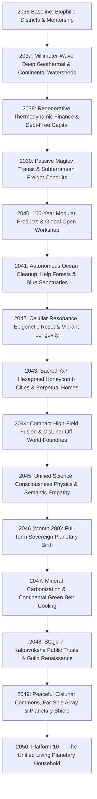

# The Singularity Annual Chronicles — Part II (2037–2050)
## Deep Industrial Research, Vedic Embryogenesis & Finalized 14-Episode Movie Scripts (`@karmicgenie`)

> [!IMPORTANT]
> **Production Standard Locked Across All 14 Annual Movies (`Ep 11` – `Ep 24`, Years `2037` – `2050`)**:
> - **Voice**: Strictly `ShishyanEN` (`eleven_v4` Studio Condenser EQ: `105 Hz` HPF, `-4.5 dB @ 220 Hz`, `+3.8/+5.0/+4.5 dB` presence & air; `105,980` characters ready in the `ShishyanEN` pool).
> - **Movie Soundscape**: `@guru-kula-desam` தல வரலாறு stems — `Intro.wav` (`10.5s` theatrical opening), 3 unspoken `7.8s` `Interlude.wav` act-break bridges, vocal-pocket-carved `Background.wav`, and pure instrumental sitar/guitar `Outro.wav` (`90.0s–108.3s` trim).
> - **Visuals & Subtitles**: 100% photorealistic **Business & World Industrial Revolution** widescreen cinematography (`gflow-headless` `nano-pro`), fixed lower-center subtitles (`top: 84%`), custom 50/50 3D solid-gold movie posters, `#viral` SEO tags/chapters, gratitude toward legacy industrial pioneers (zero villainizing, zero brand names), and strict Zero-CTA.

---

## Part I: Deep Research & Wise Vedic Thought Process (`2037` – `2050`)

In Decade I (`2027–2036`), human civilization descended from pure digital space (`Ākāśa`) into physical factories, autonomous supply arteries, earth-abundant batteries, tandem solar skins, local micro-factories, living soil, baseline municipal utilities, and walkable biophilic districts.

Yet **2036 does not end history—it triggers the deeper second half of the World Industrial Revolution (`2037–2050`)**. Once basic survival scarcity dissolves in advanced corridors, four profound Vedic and scientific laws govern the next 14 annual breakthroughs:

### 1. `Piṇḍāṇḍa–Brahmāṇḍa` & *Garbha Upaniṣad* (`280 Embryo Days = 280 Earth Months`)
In Vedic embryology (*Garbha Upaniṣad* & Siddha *Aṇḍam–Piṇḍam* correspondence), a human child matures in the womb across **280 gestational days (40 weeks)** before taking its first independent breath. Mapped onto the macrocosmic gestation that began in **December 2022 (`Month 1`)**:
- **Months 173–268 (`2037` – `2045`)** correspond to **organ-system integration, endocrine homeostasis, dermal resilience, deep cortical folding (`Vijñāna`), and lung surfactant preparation**.
- **Month 280 (`April 2046`)** marks **Full-Term Planetary Delivery**—the exact threshold where self-regulating global energy, water, food, trade, and ecological networks breathe independently without coercive scarcity or resource war.
- **Years 1–4 Post-Natal (`2047` – `2050`)** mark **Planetary Early Childhood**—healing pre-industrial climate inertia (`2047`), maturing corporations into public-trust *Kalpavṛkṣa* trees (`2048`), stepping peacefully into cislunar space (`2049`), and standing upright as **One Living Planetary Household (`2050`)**.

### 2. Upanishadic `Pañca-Kośa` Ascent (*Taittirīya Upaniṣad* 2.2–2.5)
While `2027–2036` stabilized the physical & vital sheaths (`Annamaya` & `Prāṇamaya`), `2037–2050` ascends systematically through all five sheaths of civilization:
$$\text{Annamaya (Crust, Water \& Ocean: 2037, 2040, 2041)} \rightarrow \text{Prāṇamaya (Debt-Free Flow, Maglev \& Longevity: 2038, 2039, 2042)} \rightarrow \text{Manomaya (Honeycomb Cities: 2043)} \rightarrow \text{Vijñānamaya (Fusion, Orbit \& Unified Science: 2044, 2045)} \rightarrow \text{Ānandamaya (Sovereign Birth to Unified Planet: 2046–2050)}$$

### 3. The 7 Botanical Stages of Corporate Consciousness (*Kalpavṛkṣa* Scale)
Why do enterprises voluntarily open their patents and convert into steward-owned trusts between `2038` and `2048`? Because a tree does not exist merely to grow roots (*Ver* — cash survival) or a thick trunk (*Thandu* — operational scale). Its biological destiny is **Stage 5 Flowering (*Malar*) $\rightarrow$ Stage 6 Universal Fruit (*Kani*) $\rightarrow$ Stage 7 Seed-Sharing Liberation (*Viduthalai / Moksha*)**, scattering open blueprints so the entire human forest thrives.

### 4. Master 14-Episode Causal & Vedic Matrix (`2037–2050`)

| Ep | Year | Prior Bottleneck | Sudden Collective Obsession | Major Business & Industrial Breakthrough | Vedic Principle & 7D Pillar |
| :-: | :-: | :--- | :--- | :--- | :--- |
| **11** | **2037** | High-latitude winter solar dips, heavy steel heat & inland aquifer stress | **Millimeter-Wave Deep Geothermal & Watershed Recharge** | `12 km` gyrotron boreholes convert retired coal plants into 24/7 supercritical steam hubs; continental river aquifers recharged | `Agni–Soma` & *Nadī-Stuti* · **DUTY** |
| **12** | **2038** | Near-zero marginal costs break scarcity-debt & inflation banking | **Thermodynamic Asset-Backed Finance (`Platform 7`)** | Capital indexed to clean kWh, restored soil & verified value; zero-interest cooperative infrastructure credit replaces predatory debt | `Ṛṇa-Traya` & Homeostasis · **DHARMA** |
| **13** | **2039** | Tire dust, asphalt heat islands & surface delivery congestion | **Passive Maglev Pods & Subterranean Pneumatic Freight** | 100% of urban cargo moves underground; silent magnetic gliders link regional cities in `<25 min`; highways peel back to parks | `Vyāna-Vāyu` Circulation · **DISCIPLINE** |
| **14** | **2040** | Fast clean logistics exposes wasteful short-lived appliances | **100-Year Modular Goods & Open Workshop (`Platform 8`)** | Planned obsolescence retired; universal CAD + atomic product passports enable century-durable, locally upgradable hardware | `Viśvakarmā` Sacred Craft · **DIGNITY** |
| **15** | **2041** | Clean land industries spotlight neglected oceans & microplastics | **Autonomous Ocean Restoration & Kelp Upwelling Arrays** | Solar-sail enzymatic fleets clear marine plastics; deep-water upwelling revives kelp forests, coral nurseries & coastal fisheries | `Varuṇa-Ṛta` Ocean Law · **DEVOTION** |
| **16** | **2042** | External toxins cleared; intrinsic cellular aging remains | **Epigenetic Telomere Reset & Bio-Resonance Longevity** | Hospitals pivot to Cellular Vitality Sanctuaries combining multi-omic twins, acoustic/light tuning & botanical microfluidics | `Ojas` & *Āyurveda Rasāyana* · **DIVINE** |
| **17** | **2043** | Vibrant multi-generational families outgrow retrofitted sprawl | **Sacred `7×7` Hexagonal Honeycomb Cities (*Vāstu*)** | 7-petal pedestrian cities (`250k–500k`) around a quiet wisdom core; crystal-solar homes generate 200% power & sky water | *Yathā Piṇḍe* & *Vāstu* · **DHARMA** |
| **18** | **2044** | Protecting restored Earth forbids new terrestrial mines/heat plumes | **Compact High-Field Fusion & Cislunar Heavy Industry** | Compact superconducting fusion powers orbital crystal foundries & lunar metallurgy—keeping Earth a pristine living garden | `Sūrya-Tejas` & `Antarikṣa` · **DISCIPLINE** |
| **19** | **2045** | Outer physics & inner consciousness science still divided by silos | **Unified Science & Semantic Empathy (`Platform 9`)** | Open planetary research unites quantum biology & contemplative science; nuance-preserving translation bridges 7,000 tongues | *Parā + Aparā Vidyā* · **DIVINE** |
| **20** | **2046** | **Month 280 (`April 2046`)**: 9 planetary organ systems reach full term | **The Sovereign Planetary Birth & Bioregional Compacts** | Global energy, food, water & trade pass full self-regulation; defense engineering pivots to watershed & biosphere guardianship | *Garbha* Day 280 Birth · **DESTINY** |
| **21** | **2047** | Zero emissions achieved, yet historic atmospheric heat lingers | **Basalt Carbon Mineralization & Continental Green Belts** | Surplus clean power turns legacy $\text{CO}_2$ permanently into stone aggregate; regreened desert corridors stabilize monsoons & glaciers | `Prakṛti-Sāmya` Balance · **DUTY** |
| **22** | **2048** | Universal abundance frees billions of hours seeking noble mastery | **Stage-7 *Kalpavṛkṣa* Steward Trusts & Guild Renaissance** | Major enterprises convert into perpetual public-purpose trusts; regional master-apprentice guilds flourish in art, science & craft | *Niṣkāma-Karma* & *Mokṣa* · **DIGNITY** |
| **23** | **2049** | Expanding orbital presence requires a non-colonial cosmic ethic | **Peaceful Cislunar Commons, Far-Side Array & Earth Shield** | United global syndicates build the Lunar Far-Side Deep-Cosmos Observatory & planetary asteroid deflection shield | Vedic *Śānti-Mantra* · **DEVOTION** |
| **24** | **2050** | All 10 Platforms mature into a single self-sustaining civilization | **Platform 10: The Unified Living Planetary Household** | `7×7×7` Honeycomb Earth thrives in effortless homeostasis—zero poverty, zero smog, sovereign cultures, pure *Svadharma* | *Vasudhaiva Kuṭumbakam* · **DESTINY** |

---

## Part II: Finalized Word-for-Word Movie Scripts (`2037` – `2050`)

---

### EPISODE 11 — YEAR 2037: *Deep Supercritical Geothermal & The Continental Watershed Revival*
- **Slug**: `KG_Year_2037_Deep_Geothermal_And_Watersheds`
- **Poster Title**: `YEAR 2037 EARTH CORE POWER`
- **Title**: `Year 2037: Deep Supercritical Geothermal, Green Steel & Continental Watersheds`

#### `[00:00 – 00:10.5] CINEMATIC PRELUDE — Intro.wav (10.5s)`
- *Upper-Left Tag*: `SINGULARITY ANNUAL CHRONICLE • YEAR 2037`
- *Visuals*: High-latitude winter industrial valley wrapped in snow at dawn, dissolving into a glowing millimeter-wave deep-borehole rig tapping clean supercritical steam twelve kilometers beneath Earth's crust.

#### `[ACT I — THE 2036 WINTER BOTTLENECK & SUDDEN OBSESSION]`
- **B01**: By the winter of twenty thirty-six, sunlit regions enjoyed abundant solar electricity, yet two stubborn physical limits still constrained heavy global industry: dark sub-zero winters in northern manufacturing belts, and stressed inland freshwater aquifers beneath rapidly growing agricultural valleys. Solar panels alone could not smelt structural green steel through a polar January night.
- **B02**: Welcome to The Karmic Genie Show, and Year Twenty Thirty-Seven of our Annual Industrial Singularity Chronicle. Within months, global engineering capital and veteran drilling crews converged onto a breathtaking frontier right beneath our feet: Millimeter-Wave Supercritical Geothermal Energy, paired with Continental Watershed Recharge.

#### `[MUSICAL BRIDGE 1 — Interlude.wav (7.8s)]`
- *Upper-Left Tag*: `ACT I • AGNI & SOMA: FIRE BENEATH, LIVING RIVERS ABOVE`

#### `[ACT II — REPURPOSING COAL PLANTS & HEALING GREAT AQUIFERS]`
- **B03**: Notice the grace of natural transition. Instead of discarding the heroic generations of oil roughnecks, mining engineers, and coal-plant turbine crews who powered the twentieth century, twenty thirty-seven handed them directed-energy gyrotron drills that vaporize granite without mechanical wear—unlocking five-hundred-degree supercritical steam twelve kilometers down, anywhere on Earth.
- **B04**: Overnight, retired coal stations plugged their existing steam turbines and high-voltage grid lines directly into clean crustal heat! Twenty-four-hour geothermal baseload powered zero-emission hydrogen steelworks and coastal mineral desalination plants, pumping pure remineralized water inland to recharge depleted river basins and mountain aquifers.
- **B05**: In Vedic cosmology, civilization endures only when Agni—sacred subterranean fire—and Soma—cooling, life-giving waters—stand in equilibrium. The ancient Rig Vedic Nadi-Stuti hymn honored rivers not as industrial drains, but as living mothers of prosperity.

#### `[MUSICAL BRIDGE 2 — Interlude.wav (7.8s)]`
- *Upper-Left Tag*: `ACT II • 24/7 CRUSTAL BASELOAD & RECHARGED RIVER BASINS`

#### `[ACT III — THE 2038 MONETARY SHOCK & THE 7D COMPASS]`
- **B06**: Yet unlocking tireless crustal power and abundant freshwater triggered an unexpected shockwave in late twenty thirty-seven: when energy, water, food, and automated manufacturing all drop toward near-zero marginal cost, three-hundred-year-old scarcity banking and compound-interest debt formulas begin to fracture!
- **B07**: That monetary reckoning sets the stage for twenty thirty-eight. Guided by the Karmic Genie pillar of Duty, twenty thirty-seven proved that honoring past industrial workers while healing Earth's deep fires and living rivers turns heavy infrastructure into an eternal blessing.

#### `[OUTRO RESOLUTION — Outro.wav (13.5s Instrumental)]`

---

### EPISODE 12 — YEAR 2038: *When Scarcity Debt Dissolves — Regenerative Thermodynamic Finance*
- **Slug**: `KG_Year_2038_Regenerative_Finance_Commons`
- **Poster Title**: `YEAR 2038 VALUE REBORN`
- **Title**: `Year 2038: Regenerative Asset-Backed Finance & The End of Scarcity Debt`

#### `[00:00 – 00:10.5] CINEMATIC PRELUDE — Intro.wav (10.5s)`
- *Upper-Left Tag*: `SINGULARITY ANNUAL CHRONICLE • YEAR 2038`
- *Visuals*: Global financial clearing floor bathed in warm golden morning light, real-time physical energy, soil-carbon, and harvest reserves glowing across transparent glass ledgers.

#### `[ACT I — WHEN ABUNDANCE BREAKS SCARCITY ACCOUNTING]`
- **B01**: Entering twenty thirty-eight, global finance faced a paradox no twentieth-century textbook had ever anticipated. Physical factories, solar-geothermal grids, and autonomous farms were producing unprecedented real wealth—yet legacy debt markets, built on artificial scarcity and compound interest, struggled to price goods whose marginal cost of production had fallen near zero.
- **B02**: Welcome to Year Twenty Thirty-Eight of The Karmic Genie Singularity Chronicle. Across central banks, corporate treasuries, and municipal clearinghouses, collective intelligence locked onto Platform Seven of the new industrial architecture: Regenerative Thermodynamic Finance—anchoring money directly to verified life-supporting value.

#### `[MUSICAL BRIDGE 1 — Interlude.wav (7.8s)]`
- *Upper-Left Tag*: `ACT I • ENDOCRINE HOMEOSTASIS: MONEY AS PURE CIRCULATION`

#### `[ACT II — THERMODYNAMIC LEDGERS & ZERO-USURY INFRASTRUCTURE]`
- **B03**: We honor the centuries of bookkeepers, central bankers, and payment engineers who taught humanity double-entry accounting and instant global settlement. Their disciplined ledgers were the indispensable scaffolding. In twenty thirty-eight, those ledgers simply graduated from speculative debt compounding to real-world physical accounting.
- **B04**: Under the new open clearing standard, sovereign and cooperative credit is backed directly by measurable planetary vitality: clean megawatt-hours generated, fertile topsoil humus restored, durable goods crafted, and human skill contributed. Municipalities fund hundred-year bridges, waterworks, and guildhalls through zero-interest reciprocal credit without inflationary boom-and-bust panic.
- **B05**: In the Living Embryogenesis of civilization, Month One Hundred Eighty-Five mirrors the stabilization of the body's endocrine glands—hormones never hoard blood in one organ; they maintain effortless homeostasis. And in Vedic Dharma, Rina-Traya teaches that wealth is a sacred trust of gratitude circulating continuously through society.

#### `[MUSICAL BRIDGE 2 — Interlude.wav (7.8s)]`
- *Upper-Left Tag*: `ACT II • FROM SCARCITY USURY TO REGENERATIVE STEWARDSHIP`

#### `[ACT III — THE SURFACE TRANSIT BOTTLENECK & THE 7D COMPASS]`
- **B06**: Once patient, zero-usury capital unlocked vast civic renewal across every continent, city builders immediately confronted the ugliest physical relic still scarring urban landscapes: millions of tons of black asphalt, rubber tire dust, and surface delivery trucks dividing neighborhoods.
- **B07**: Clearing the surface of the Earth for living gardens becomes the sudden obsession of twenty thirty-nine. Anchored in Dharma, twenty thirty-eight restored money to its true noble role: an honest mirror of human service and planetary life.

#### `[OUTRO RESOLUTION — Outro.wav (13.5s Instrumental)]`

---

### EPISODE 13 — YEAR 2039: *Silent Magnetic Gliders & Subterranean Freight Arteries*
- **Slug**: `KG_Year_2039_Magnetic_Transit_Subterranean_Freight`
- **Poster Title**: `YEAR 2039 SILENT TRANSIT`
- **Title**: `Year 2039: Passive Maglev Gliders, Subterranean Freight & Asphalt Reclamation`

#### `[00:00 – 00:10.5] CINEMATIC PRELUDE — Intro.wav (10.5s)`
- *Upper-Left Tag*: `SINGULARITY ANNUAL CHRONICLE • YEAR 2039`
- *Visuals*: Sleek aerodynamic magnetic transit glider floating silently above a lush greenway boulevard while heavy excavators peel away old cracked highway asphalt to reveal rich dark soil.

#### `[ACT I — RETIRING ASPHALT HEAT ISLANDS & RUBBER PARTICULATES]`
- **B01**: By twenty thirty-nine, urban air was free of exhaust smoke, yet cities still suffered from a hidden twentieth-century burden: sun-baked black asphalt radiating summer heat, microplastic dust ground off millions of rubber tires, and delivery vans clogging neighborhood streets that belonged to children and trees.
- **B02**: Welcome to Year Twenty Thirty-Nine of The Karmic Genie Singularity Chronicle. Energized by debt-free municipal capital and cheap superconducting tape, civil engineers around the world ignited a dramatic two-layer mobility revolution: Subterranean Pneumatic Freight beneath the earth, and Passive Magnetic Gliders above green turf.

#### `[MUSICAL BRIDGE 1 — Interlude.wav (7.8s)]`
- *Upper-Left Tag*: `ACT I • VYANA VAYU: FRICTIONLESS MOVEMENT WITHOUT SCARS`

#### `[ACT II — UNDERGROUND CARGO TUBES & 25-MINUTE REGIONAL MAGLEV]`
- **B03**: With deep gratitude to the railway pioneers, highway crews, and truck drivers who connected continents over two hard centuries, twenty thirty-nine moved heavy logistics cleanly underground. Autonomous electric tunnel-borers wove compact subterranean cargo tubes linking ports, micro-factories, and district cellars—delivering groceries, parcels, and raw alloys silently out of sight.
- **B04**: Above ground, miles of multi-lane asphalt were milled up, recycled into stone aggregate, and replanted as shaded botanical parkways and clear streams. Silent passive-maglev shuttles glided on superconducting ribbons embedded beneath grass, linking neighboring cities in under twenty-five minutes without friction, noise, or collisions.
- **B05**: In Vedic physiology, Vyana-Vayu is the subtle vital current that coordinates smooth, effortless motion across every limb without tearing tissue. When movement loses friction, geography stops dividing families from nature.

#### `[MUSICAL BRIDGE 2 — Interlude.wav (7.8s)]`
- *Upper-Left Tag*: `ACT II • CARGO UNDERGROUND, PARKS & MAGNETIC GLIDERS ABOVE`

#### `[ACT III — THE PLANNED OBSOLESCENCE QUESTION & 7D COMPASS]`
- **B06**: Yet as subterranean freight tubes tracked every crate moving through a city, industrial auditors noticed one glaring remaining waste: why were factories still replacing appliances, electronics, and machines every five years when metallurgy and modular design could make them last a full century?
- **B07**: Ending disposable manufacturing forever sparks the great industrial obsession of twenty forty. Guided by Discipline, twenty thirty-nine proved that the highest engineering leaves the quietest footprint upon Mother Earth.

#### `[OUTRO RESOLUTION — Outro.wav (13.5s Instrumental)]`

---

### EPISODE 14 — YEAR 2040: *The 100-Year Product Standard & The Global Open Workshop*
- **Slug**: `KG_Year_2040_Century_Durable_Global_Workshop`
- **Poster Title**: `YEAR 2040 BUILT FOR 100 YEARS`
- **Title**: `Year 2040: The 100-Year Product Standard & The Unified Global Workshop`

#### `[00:00 – 00:10.5] CINEMATIC PRELUDE — Intro.wav (10.5s)`
- *Upper-Left Tag*: `SINGULARITY ANNUAL CHRONICLE • YEAR 2040`
- *Visuals*: Master industrial designer and robotic precision forge crafting a brushed-titanium-and-ceramic modular home turbine engraved with a century durability seal.

#### `[ACT I — THE DEATH OF PLANNED OBSOLESCENCE]`
- **B01**: For nearly a hundred years of consumer capitalism, factories survived on a quiet contradiction called planned obsolescence—engineering phones, washing machines, and industrial tools to wear out just fast enough to force a replacement purchase. In a world of regenerative finance and closed-loop materials, that model finally made zero economic sense.
- **B02**: Welcome to Year Twenty Forty of The Karmic Genie Singularity Chronicle. At the turn of the decade, industrial design, precision manufacturing, and artisan guilds united into Platform Eight: The Unified Global Workshop—establishing the famous One-Hundred-Year Modular Product Standard.

#### `[MUSICAL BRIDGE 1 — Interlude.wav (7.8s)]`
- *Upper-Left Tag*: `ACT I • VISVAKARMA DHARMA: SACRED DURABILITY & OPEN DESIGN`

#### `[ACT II — ATOMIC PRODUCT PASSPORTS & LOCAL MODULAR UPGRADES]`
- **B03**: Honoring the lean-manufacturing masters and quality-control pioneers who taught the world precision tolerances, twenty forty liberated engineers to build the finest hardware imaginable. Every machine—from medical scanners and kitchen induction hearths to agricultural rovers—carries an open blueprint and an atomic Digital Product Passport.
- **B04**: Need a faster optical compute module or a refreshed seal thirty years later? Any neighborhood maker-forge prints or swaps the single standardized cartridge in minutes, while worn alloys dismount cleanly for ninety-nine-point-nine percent atomic remanufacturing. Landfills transform into historic mining reserves before closing forever!
- **B05**: In the Vedic tradition of Visvakarma, the divine architect, crafting an object with enduring integrity honors both the matter drawn from Earth and the family who uses it. Freed from churning out disposable clutter, human hands enter a breathtaking renaissance of fine woodwork, textiles, ceramics, and bespoke engineering.

#### `[MUSICAL BRIDGE 2 — Interlude.wav (7.8s)]`
- *Upper-Left Tag*: `ACT II • ZERO LANDFILLS & THE RENAISSANCE OF HUMAN CRAFT`

#### `[ACT III — TURNING FROM CLEAN LAND TO THE 71% OCEAN FRONTIER]`
- **B06**: With terrestrial industry now clean, circular, and century-durable across every continent, scientists looked out past the harbor walls at the seventy-one percent of Earth still carrying decades of legacy microplastics, thermal stress, and depleted reefs: our global oceans.
- **B07**: Healing the blue biosphere becomes the unstoppable calling of twenty forty-one. Guided by Dignity, twenty forty restored pride to every maker—proving that objects built with love and truth outlive generations.

#### `[OUTRO RESOLUTION — Outro.wav (13.5s Instrumental)]`

---

### EPISODE 15 — YEAR 2041: *Autonomous Ocean Sanctuaries & The Blue Biosphere Revival*
- **Slug**: `KG_Year_2041_Ocean_Sanctuaries_Blue_Biosphere`
- **Poster Title**: `YEAR 2041 BLUE REVIVAL`
- **Title**: `Year 2041: Autonomous Ocean Cleanup, Kelp Forests & Marine Sanctuaries`

#### `[00:00 – 00:10.5] CINEMATIC PRELUDE — Intro.wav (10.5s)`
- *Upper-Left Tag*: `SINGULARITY ANNUAL CHRONICLE • YEAR 2041`
- *Visuals*: Fleet of sleek autonomous solar-wing trimarans gliding across sunlit sapphire ocean swells above thriving underwater giant kelp forests and coral nurseries.

#### `[ACT I — THE 71% BLUE FRONTIER]`
- **B01**: By twenty forty-one, rivers ran clear and land landfills were disappearing, yet Earth's vast oceans still held the silent memory of industrial adolescence—gyres of legacy polymer fragments, stressed coral shelves, and deep marine dead zones starved of nutrient circulation.
- **B02**: Welcome to Year Twenty Forty-One of The Karmic Genie Singularity Chronicle. Mobilizing maritime shipyards, marine biologists, and autonomous robotics, global enterprise launched the largest ecological engineering mobilization in history: The Blue Biosphere & Sovereign Ocean Sanctuary Initiative.

#### `[MUSICAL BRIDGE 1 — Interlude.wav (7.8s)]`
- *Upper-Left Tag*: `ACT I • VARUNA RITA: RESTORING THE COSMIC OCEAN MATRIX`

#### `[ACT II — ENZYMATIC GYRE SKIMMERS & DEEP-WATER KELP UPWELLING]`
- **B03**: In gratitude to generations of merchant sailors, coast guards, and oceanographers who mapped every current of the seas, twenty forty-one deployed thousands of silent, wind-and-solar trimarans equipped with acoustic wildlife beacons and natural polymer-digesting enzymes—clearing the great oceanic gyres while harming not a single fish.
- **B04**: Even more transformative were wave-powered deep-ocean upwelling buoys. By gently lifting cool, mineral-rich deep water into sunlit surface zones, offshore cooperatives regenerated vast underwater permaculture forests of giant kelp, shellfish reefs, and heat-resilient coral—absorbing gigatons of dissolved carbon and restoring abundant coastal fisheries.
- **B05**: In Vedic wisdom, Lord Varuna guards Rita—the moral and ecological rhythm of the cosmic waters—and in planetary embryogenesis, pure amniotic waters cradle all developing life. When the ocean heals, Earth's climate heartbeat steadies.

#### `[MUSICAL BRIDGE 2 — Interlude.wav (7.8s)]`
- *Upper-Left Tag*: `ACT II • THRIVING CORAL REEFS & ZERO-WAKE MARITIME TRADE`

#### `[ACT III — THE INNER BIOLOGICAL FRONTIER & 7D COMPASS]`
- **B06**: Once air, soil, rivers, and oceans were cleansed of external industrial toxins, biomedical researchers noticed a profound shift: with environmental disease vanishing, the final frontier of physical suffering lay inside the intrinsic clock of human cellular aging itself.
- **B07**: Rejuvenating the human cellular vessel ignites the scientific obsession of twenty forty-two. Rooted in Devotion, twenty forty-one proved that human engineering reaches its noblest scale when serving the voiceless waters of Earth.

#### `[OUTRO RESOLUTION — Outro.wav (13.5s Instrumental)]`

---

### EPISODE 16 — YEAR 2042: *Cellular Resonance, Epigenetic Reset & Vibrant Longevity*
- **Slug**: `KG_Year_2042_Cellular_Resonance_Longevity`
- **Poster Title**: `YEAR 2042 VITAL LONGEVITY`
- **Title**: `Year 2042: Epigenetic Cellular Reset, Bio-Resonance & Vibrant Longevity`

#### `[00:00 – 00:10.5] CINEMATIC PRELUDE — Intro.wav (10.5s)`
- *Upper-Left Tag*: `SINGULARITY ANNUAL CHRONICLE • YEAR 2042`
- *Visuals*: Sunlit glass-and-botanical Cellular Vitality Sanctuary where a vibrant seventy-five-year-old architect reviews a luminous 3D mitochondrial and telomere resonance scan beside a physician.

#### `[ACT I — BEYOND SYMPTOM MANAGEMENT: WHY CELLS FORGET THEIR YOUTH]`
- **B01**: Entering twenty forty-two, emergency trauma centers were quiet and chronic pollution illnesses had plunged, yet millions of wise elders still experienced the slow dimming of mitochondrial energy, joint stiffness, and epigenetic cellular drift just as their life wisdom reached its peak.
- **B02**: Welcome to Year Twenty Forty-Two of The Karmic Genie Singularity Chronicle. Across biotechnology institutes, biophysics labs, and traditional wellness academies, sudden global focus converged on a single question: How do we restore youthful cellular harmony safely, naturally, and universally—so chronological age no longer brings biological decay?

#### `[MUSICAL BRIDGE 1 — Interlude.wav (7.8s)]`
- *Upper-Left Tag*: `ACT I • OJAS & RASAYANA: TUNING THE CELLULAR SYMPHONY`

#### `[ACT II — MULTI-OMIC TWINS, ACOUSTIC PHOTOBIOMODULATION & BOTANICAL PRECISION]`
- **B03**: With deep gratitude to the surgeons, nurses, pharmacologists, and hospital builders who carried humanity through centuries of acute epidemics, healthcare completed its graceful evolution from late-stage sickness repair to continuous Cellular Vitality Stewardship.
- **B04**: Inside calm neighborhood Vitality Sanctuaries, personal multi-omic digital twins pair targeted partial epigenetic reprogramming—reminding aged cells how to read their own clean DNA—with non-invasive photobiomodulation light, focused acoustic micro-resonance, and microfluidic Ayurvedic and Siddha botanical phyto-nutrients recognized effortlessly by human cells.
- **B05**: Ancient Vedic Rasayana never sought egoic immortality; it cultivated pure Ojas—radiant cellular vitality—so elders could mentor grandchildren, compose, build, and meditate with a clear mind and pain-free body well past their ninth and tenth decades.

#### `[MUSICAL BRIDGE 2 — Interlude.wav (7.8s)]`
- *Upper-Left Tag*: `ACT II • RADIANT ELDERS & UNIVERSAL HEALTHSPAN EQUITY`

#### `[ACT III — OUTGROWING OLD METROPOLITAN BLOBS & 7D COMPASS]`
- **B06**: As three and four healthy, energetic generations began thriving side by side, families realized that retrofitted twentieth-century downtown concrete towers and isolated suburbs could no longer hold this new way of living, learning, and working together.
- **B07**: That architectural longing gives birth in twenty forty-three to the Sacred Honeycomb City. Guided by the Divine spark within every living cell, twenty forty-two united hyper-modern biophysics with timeless natural healing.

#### `[OUTRO RESOLUTION — Outro.wav (13.5s Instrumental)]`

---

### EPISODE 17 — YEAR 2043: *The Sacred 7×7 Honeycomb Cities & Self-Powering Living Homes*
- **Slug**: `KG_Year_2043_Sacred_Honeycomb_Cities`
- **Poster Title**: `YEAR 2043 HONEYCOMB CITIES`
- **Title**: `Year 2043: Sacred Hexagonal Honeycomb Cities & Self-Powering Living Homes`

#### `[00:00 – 00:10.5] CINEMATIC PRELUDE — Intro.wav (10.5s)`
- *Upper-Left Tag*: `SINGULARITY ANNUAL CHRONICLE • YEAR 2043`
- *Visuals*: Breathtaking golden-hour aerial panorama of a 7-hexagon biomimetic Honeycomb City nestled among rivers and forests—a serene central botanical wisdom sanctuary ringed by six lush hexagonal garden districts.

#### `[ACT I — WHY CONCENTRIC URBAN SPRAWL HAD TO METAMORPHOSE]`
- **B01**: Look at how classical industrial cities grew by accident: a congested financial core in the center, smoky factory zones on the fringe, and endless rings of lonely commuter suburbs. Even with clean maglev transit and urban trees, the underlying geometry still separated work, nature, elders, and inner stillness.
- **B02**: Welcome to Year Twenty Forty-Three of The Karmic Genie Singularity Chronicle. Across urban architecture guilds, structural timber foundries, and regional planning councils, humanity unveiled the crown jewel of civil engineering: The Biomimetic Seven-District Honeycomb City, paired with the Self-Powering Perpetual Home.

#### `[MUSICAL BRIDGE 1 — Interlude.wav (7.8s)]`
- *Upper-Left Tag*: `ACT I • YATHA PINDE TATHA BRAHMANDE: BIOMIMETIC VASTU GEOMETRY`

#### `[ACT II — 7 HEXAGONAL PETALS & HOMES THAT GENERATE 200% POWER]`
- **B03**: Inspired by nature's strongest, zero-waste geometry—the beehive honeycomb and the Vedic Vastu-Mandala—new and regenerated cities organize for human-scale communities of three hundred thousand citizens. At the exact center stands not a noisy commercial strip, but a pedestrianized Sanctuary of Wisdom, acoustics, botanical gardens, and elder mentorship councils.
- **B04**: Surrounding that peaceful heart sit six walkable fifteen-minute hexagonal petals: Living Agriculture, Modular Infrastructure, Open Business Guilds, Geothermal-Solar Energy, Subterranean Logistics, and Reciprocal Credit Plazas—buffered by wild wetland corridors. And every home features crystal-matrix lifetime batteries, solar-glass roofs producing two hundred percent of household demand, and atmospheric pure-water condensers!
- **B05**: Utility bills, homelessness, and two-hour traffic commutes vanish into history books. Seven Honeycomb Cities link by twenty-minute magnetic gliders into one harmonious bioregional cluster, balancing town and wilderness in mathematical grace.

#### `[MUSICAL BRIDGE 2 — Interlude.wav (7.8s)]`
- *Upper-Left Tag*: `ACT II • ZERO UTILITY BILLS & 15-MINUTE GARDEN DISTRICTS`

#### `[ACT III — PROTECTING EARTH BY MOVING HEAVY FOUNDRIES UPWARD]`
- **B06**: Standing inside these pristine garden cities in late twenty forty-three, industrial stewards made a solemn vow: never again would humanity blast open a virgin mountain ridge on Earth for rare metals or dump gigawatt industrial heat into the biosphere.
- **B07**: Keeping Earth an unscarred sanctuary propels industry upward into compact fusion and cislunar space in twenty forty-four. Grounded in Dharma, twenty forty-three proved that cities designed around the human soul elevate every industry around them.

#### `[OUTRO RESOLUTION — Outro.wav (13.5s Instrumental)]`

---

### EPISODE 18 — YEAR 2044: *Compact High-Field Fusion & Cislunar Off-World Industry*
- **Slug**: `KG_Year_2044_Compact_Fusion_Orbital_Industry`
- **Poster Title**: `YEAR 2044 FUSION & ORBIT`
- **Title**: `Year 2044: Compact Superconducting Fusion & Cislunar Off-World Foundries`

#### `[00:00 – 00:10.5] CINEMATIC PRELUDE — Intro.wav (10.5s)`
- *Upper-Left Tag*: `SINGULARITY ANNUAL CHRONICLE • YEAR 2044`
- *Visuals*: Compact high-field superconducting magnetic fusion core glowing inside a pristine engineering hall, cutting to a sunlit orbital crystal-wafer foundry rotating calmly above the blue curve of Earth.

#### `[ACT I — THE VOW TO KEEP EARTH A LIVING GARDEN]`
- **B01**: By twenty forty-four, solar, wind, and deep geothermal easily powered everyday life on Earth. Yet ultra-high-energy frontiers—growing flawless zero-gravity optical crystals, refining ultra-pure vacuum alloys, and propelling deep-space vessels—demanded power densities ten thousand times greater than sunlight, without heating Earth's atmosphere.
- **B02**: Welcome to Year Twenty Forty-Four of The Karmic Genie Singularity Chronicle. Decades of patient plasma physics and high-temperature superconducting magnet mastery suddenly crystallized into two twin triumphs: Commercial Compact Fusion Cores, and Cislunar Robotic Foundries in Earth-Moon space.

#### `[MUSICAL BRIDGE 1 — Interlude.wav (7.8s)]`
- *Upper-Left Tag*: `ACT I • SURYA TEJAS: BOTTLED STARLIGHT & OFF-WORLD METALLURGY`

#### `[ACT II — ZERO-GRAVITY CRYSTAL WAFERS & EARTH AS SACRED SANCTUARY]`
- **B03**: Honoring seventy years of plasma physicists, aerospace machinists, and space-agency pioneers who endured countless experimental setbacks, compact modular fusion reactors finally delivered clean, meltdown-proof megawatts inside shipping-container-sized vaults—producing zero long-lived radioactive waste.
- **B04**: Paired with reusable electromagnetic launch sleds and electric orbital tugs, heavy refining and microgravity semiconductor crystal fabrication shifted cleanly into cislunar orbit. In the infinite vacuum and natural cold of space, robotic foundries forged defect-free optical fibers and alloys impossible to grow under Earth's gravity—allowing terrestrial mines to rewild into terraced forests!
- **B05**: Vedic cosmology distinguishes Bhumi—sacred life-bearing Mother Earth—from Antariksha, the vast mid-heavens meant for cosmic energy exchange. Moving heavy thermal metallurgy off-world honored Bhumi as a living temple.

#### `[MUSICAL BRIDGE 2 — Interlude.wav (7.8s)]`
- *Upper-Left Tag*: `ACT II • REWILDED TERRESTRIAL MINES & MICROGRAVITY PRECISION`

#### `[ACT III — UNITING OUTER PHYSICS WITH INNER CONSCIOUSNESS]`
- **B06**: Yet as quantum sensors in orbit and biophysics labs on Earth probed ever finer scales of matter and biology, researchers hit an exhilarating philosophical threshold: empirical physics and contemplative consciousness science were suddenly describing the exact same unified field!
- **B07**: Bridging outer science and inner wisdom ignites Platform Nine in twenty forty-five. Guided by Discipline, twenty forty-four harnessed the fire of the stars to keep our earthly home green and whole.

#### `[OUTRO RESOLUTION — Outro.wav (13.5s Instrumental)]`

---

### EPISODE 19 — YEAR 2045: *Unified Knowledge, Conscious Science & Universal Empathy*
- **Slug**: `KG_Year_2045_Unified_Knowledge_Conscious_Science`
- **Poster Title**: `YEAR 2045 UNIFIED SCIENCE`
- **Title**: `Year 2045: Unified Science, Quantum Biology & Cross-Cultural Semantic Empathy`

#### `[00:00 – 00:10.5] CINEMATIC PRELUDE — Intro.wav (10.5s)`
- *Upper-Left Tag*: `SINGULARITY ANNUAL CHRONICLE • YEAR 2045`
- *Visuals*: Circular glass-and-cedar global science amphitheater overlooking misty mountains where quantum physicists, neurobiologists, and contemplative scholars examine a coherent biophotonic wave model together.

#### `[ACT I — HEALING THE 400-YEAR SPLIT BETWEEN MATTER & MIND]`
- **B01**: For four centuries of modern industrialization, human inquiry walked on two separated legs: outer empirical science measured atoms, forces, and genes with mathematical rigor, while contemplative traditions explored awareness, ethics, and inner peace—often speaking past one another across walls of academic jargon and seven thousand human languages.
- **B02**: Welcome to Year Twenty Forty-Five of The Karmic Genie Singularity Chronicle. One year before civilization's full-term gestational milestone, universities, open-science networks, and wisdom academies converged into Platform Nine: The Unified Knowledge, Quantum Biology, and Semantic Empathy Commons.

#### `[MUSICAL BRIDGE 1 — Interlude.wav (7.8s)]`
- *Upper-Left Tag*: `ACT I • PARA & APARA VIDYA: OUTER PRECISION MEETS INNER TRUTH`

#### `[ACT II — OPEN DISCOVERY SYNTHESIS & NUANCE-PRESERVING TRANSLATION]`
- **B03**: With gratitude to every peer-reviewed journal editor, laboratory technician, astronomer, and monastic scholar who safeguarded truth across millennia, every scientific dataset and clinical insight on Earth became an open, real-time discovery fabric—connecting breakthroughs in soil ecology, astrophysics, and cellular coherence within seconds.
- **B04**: Simultaneously, non-invasive neural-acoustic interfaces achieved true Nuance-Preserving Semantic Translation. A farmer in Tamil Nadu, a timber architect in Kyoto, and a marine engineer in Lisbon could converse effortlessly in their native mother tongues while hearing not merely literal words, but exact emotional warmth, poetic metaphor, and cultural respect!
- **B05**: The Mundaka Upanishad teaches that holistic civilization requires both Apara Vidya—rigorous science of the manifest world—and Para Vidya—direct knowledge of the conscious principle within. In Embryo Month Two Hundred Sixty-Eight, the planetary cortex folded into full, lucid self-awareness.

#### `[MUSICAL BRIDGE 2 — Interlude.wav (7.8s)]`
- *Upper-Left Tag*: `ACT II • 7,000 LANGUAGES HEARD IN ONE HEARTBEAT OF EMPATHY`

#### `[ACT III — THE EVE OF MONTH 280: APRIL 2046]`
- **B06**: By December twenty forty-five, count the calendar from December twenty twenty-two: two hundred seventy-six Earth months had elapsed. Every organ of the new civilization—mind, circulation, energy, ocean, vitality, cities, orbit, and empathy—stood complete, awaiting Month Two Hundred Eighty.
- **B07**: April twenty forty-six brings the Sovereign Birth of the Planetary Household. Illuminated by the Divine light of unified truth, twenty forty-five proved that true genius speaks with humility and universal understanding.

#### `[OUTRO RESOLUTION — Outro.wav (13.5s Instrumental)]`

---

### EPISODE 20 — YEAR 2046: *Month 280 — The Sovereign Birth of the Planetary Household*
- **Slug**: `KG_Year_2046_Month_280_Sovereign_Planetary_Birth`
- **Poster Title**: `YEAR 2046 SOVEREIGN BIRTH`
- **Title**: `Year 2046 (Month 280): The Sovereign Birth of Earth's Living Economy`

#### `[00:00 – 00:10.5] CINEMATIC PRELUDE — Intro.wav (10.5s)`
- *Upper-Left Tag*: `SINGULARITY ANNUAL CHRONICLE • YEAR 2046 (MONTH 280)`
- *Visuals*: Golden sunrise breaking across Earth's horizon from low orbit as seven bioregional Honeycomb networks pulse in synchronized golden harmony, cutting to joyful multi-generational plazas across continents.

#### `[ACT I — 280 DAYS IN THE WOMB, 280 MONTHS ON EARTH]`
- **B01**: Pause and marvel at the mathematical poetry of living nature. In a human mother's womb, a single fertilized cell matures across exactly two hundred eighty days—forty gestational weeks—before taking its first independent breath. Count two hundred eighty solar months forward from humanity's synthetic AI spark in December twenty twenty-two, and you arrive at April, Twenty Forty-Six!
- **B02**: Welcome to Year Twenty Forty-Six—Episode Twenty of The Karmic Genie Singularity Chronicle: The Full-Term Sovereign Birth of the Planetary Household. What felt for two decades like chaotic disruption revealed itself as flawless embryological order—neural wiring first, vascular trade second, solar-geothermal heart third, living soil, cellular health, and Honeycomb habitats in exact sequence.

#### `[MUSICAL BRIDGE 1 — Interlude.wav (7.8s)]`
- *Upper-Left Tag*: `ACT I • GARBHA UPANISHAD: THE FIRST SELF-SUSTAINING BREATH`

#### `[ACT II — SELF-REGULATING CONTINENTAL GRIDS & SWORDS INTO WATERSHEDS]`
- **B03**: In April twenty forty-six, all seven continental bioregions passed the historic Autonomous Resilience Accord: energy microgrids, clean water tables, heirloom food reserves, and open supply corridors operated in continuous, self-healing equilibrium—decoupling human survival from fear, hoarding, or resource coercion forever.
- **B04**: Honoring the soldiers, diplomats, peacekeepers, and civil servants who stood watch through centuries of geopolitical tension, national defense industries pivoted their magnificent engineering corps into Planetary Stewardship Brigades—rebuilding coastal mangroves, alpine glaciers, and disaster-proof regional bridges while borders softened into proud cultural garden gates.
- **B05**: Just as pulmonary surfactant allows a newborn infant to breathe open sky air without struggle, humanity stepped out of scarcity's womb into cooperative planetary sovereignty—preserving every cherished language, heritage, and local custom within one shared operational family.

#### `[MUSICAL BRIDGE 2 — Interlude.wav (7.8s)]`
- *Upper-Left Tag*: `ACT II • CULTURAL SOVEREIGNTY WITHOUT RESOURCE WARS`

#### `[ACT III — YEAR ONE POST-NATAL: HEALING HISTORIC CLIMATE INERTIA]`
- **B06**: Yet just as a healthy newborn still grows through early childhood, the newly born planetary household looked up at one lingering inheritance from the nineteenth and twentieth centuries: excess historic carbon and arid desert belts still warming the upper atmosphere.
- **B07**: Actively cooling and regreening whole continents becomes the joyful first project of twenty forty-seven. Crowned by Destiny, twenty forty-six proved that nature never rushes, never forgets, and delivers every ripened promise on time.

#### `[OUTRO RESOLUTION — Outro.wav (13.5s Instrumental)]`

---

### EPISODE 21 — YEAR 2047: *Basalt Carbon Stone & The Great Continental Climate Rebalance*
- **Slug**: `KG_Year_2047_Continental_Climate_Rebalance`
- **Poster Title**: `YEAR 2047 CLIMATE HEALED`
- **Title**: `Year 2047: Mineral Carbonization, Regreened Deserts & Climate Rebalance`

#### `[00:00 – 00:10.5] CINEMATIC PRELUDE — Intro.wav (10.5s)`
- *Upper-Left Tag*: `SINGULARITY ANNUAL CHRONICLE • YEAR 2047`
- *Visuals*: Architectural basalt-mineralization domes powered by geothermal and solar arrays turning captured atmospheric carbon into solid pale-limestone building blocks beside a blooming desert agroforestry canal.

#### `[ACT I — CLEANING UP THE INDUSTRIAL INHERITANCE]`
- **B01**: By twenty forty-seven, humanity's annual industrial carbon emissions had fallen below zero, yet two centuries of bygone smokestacks still lingered as trapped thermal blankets in the sky—pressing upon mountain glaciers and arid subtropical belts. Stopping new smoke was only half of stewardship; true responsibility meant restoring the sky we inherited.
- **B02**: Welcome to Year Twenty Forty-Seven of The Karmic Genie Singularity Chronicle. Powered by abundant surplus geothermal, tandem solar, and compact fusion energy, global engineering guilds launched the Great Continental Climate & Desert Agroforestry Rebalance.

#### `[MUSICAL BRIDGE 1 — Interlude.wav (7.8s)]`
- *Upper-Left Tag*: `ACT I • PRAKRITI SAMYA: RETURNING SKY CARBON TO SOLID STONE`

#### `[ACT II — PERMANENT MINERAL STONE & GREENED ARID CORRIDORS]`
- **B03**: Instead of risky atmospheric chemical sprays, engineers copied Earth's own oldest geological cycle—accelerated ten thousand times. Modular direct-air mineralization towers drew excess carbon dioxide from the wind and reacted it with deep basaltic brines, locking it permanently into solid carbonate stone used to pave garden courtyards and coastal breakwaters.
- **B04**: Simultaneously, remineralized ocean water piped inland fed thousand-kilometer syntropic green belts across the Sahara-Sahel margin, Central Asia, and inland Australia. Newly rooted canopy corridors transpired cooling mist, reviving gentle seasonal rains, stabilizing Himalayan and Alpine snowpacks, and creating millions of fertile family homesteads.
- **B05**: In Sankhya and Vedic ecology, Prakriti-Samya is the dynamic balance of Fire, Air, Water, and Earth. When human industry gives back more cooling canopy and living stone than it ever extracted, the biosphere responds with generous equilibrium.

#### `[MUSICAL BRIDGE 2 — Interlude.wav (7.8s)]`
- *Upper-Left Tag*: `ACT II • COOLING CANOPIES, STABLE GLACIERS & STONE AGGREGATE`

#### `[ACT III — WHAT DO CORPORATIONS BECOME WHEN EARTH IS HEALED?]`
- **B06**: With the planet's energy, oceans, cities, and climate now visibly healing, business founders and boards across the world asked a profound organizational question: once an enterprise has built a world-class utility, what is the highest evolutionary stage of a company itself?
- **B07**: That question blossoms in twenty forty-eight into the Stage-Seven Kalpavriksha Trust and Guild Renaissance. Guided by Duty, twenty forty-seven kept humanity's generational promise to our grandchildren's sky.

#### `[OUTRO RESOLUTION — Outro.wav (13.5s Instrumental)]`

---

### EPISODE 22 — YEAR 2048: *Stage-7 Kalpavriksha Trusts & The Global Artisan Guild Renaissance*
- **Slug**: `KG_Year_2048_Artisan_Guilds_Kalpavriksha_Enterprise`
- **Poster Title**: `YEAR 2048 NOBLE ENTERPRISE`
- **Title**: `Year 2048: Stage-7 Steward-Owned Enterprises & The Master Guild Renaissance`

#### `[00:00 – 00:10.5] CINEMATIC PRELUDE — Intro.wav (10.5s)`
- *Upper-Left Tag*: `SINGULARITY ANNUAL CHRONICLE • YEAR 2048`
- *Visuals*: Sunlit mass-timber Guildhall courtyard where master optical engineers, luthiers, and young apprentices collaborate around precision workbenches beneath a carved golden Kalpavriksha tree emblem.

#### `[ACT I — THE 7 BOTANICAL STAGES OF CORPORATE CONSCIOUSNESS]`
- **B01**: Look at a giant fruit tree in a mountain forest. Its seed germinates, its roots secure survival, its trunk scales upward, its leaves breathe with the sky, its blossoms uplift the valley, and its sweet fruit feeds every traveler. Yet its crowning seventh stage is Liberation—scattering unencumbered seeds freely on the wind so whole new forests thrive.
- **B02**: Welcome to Year Twenty Forty-Eight of The Karmic Genie Singularity Chronicle. Across global boardrooms and civic exchanges, thousands of mature enterprises voluntarily completed this exact seven-stage botanical ascent—transitioning into Perpetual Steward-Owned Trusts alongside a golden Master Guild Renaissance.

#### `[MUSICAL BRIDGE 1 — Interlude.wav (7.8s)]`
- *Upper-Left Tag*: `ACT I • KALPAVRIKSHA STAGE 7: FROM PROFIT MOATS TO PUBLIC LEGACY`

#### `[ACT II — STEWARD OWNERSHIP & MASTER-APPRENTICE VOCATIONAL JOY]`
- **B03**: Honoring the venture founders and shareholders whose early risk built global infrastructure, mature platform enterprises retired perpetual extractive equity—locking their core patents into open public trusts where Earth, community vitality, and craft excellence stand as permanent constitutional charters.
- **B04**: Freed from artificial quarterly cost-cutting, work transformed into high-dignity guild mastery. Across Honeycomb districts, vibrant elders and young apprentices teamed up in culinary arts, acoustic architecture, botanical medicine, cinema, precision astronomy instruments, and classical sculpture—competing not to bankrupt rivals, but to elevate beauty and durability!
- **B05**: This is Nishkama-Karma—the Bhagavad Gita's timeless secret of working with supreme skill and joyful devotion while offering the fruit cleanly to the whole world. When survival fear disappears, human laziness does not follow; human excellence finally catches fire.

#### `[MUSICAL BRIDGE 2 — Interlude.wav (7.8s)]`
- *Upper-Left Tag*: `ACT II • STEWARD TRUST CHARTERS & LIFELONG CRAFT MASTERY`

#### `[ACT III — CARRYING PEACEFUL STEWARDSHIP INTO CISLUNAR SPACE]`
- **B06**: Having learned how to govern industry without greed or ecological harm on Earth, humanity's united engineering guilds lifted their eyes in late twenty forty-eight toward the Moon, Lagrange habitats, and deep-space observatories.
- **B07**: Entering the solar system as humble guardians rather than conquerors defines twenty forty-nine. Anchored in Dignity, twenty forty-eight proved that business reaches immortality the day it plants trees whose shade it asks nothing to own.

#### `[OUTRO RESOLUTION — Outro.wav (13.5s Instrumental)]`

---

### EPISODE 23 — YEAR 2049: *The Peaceful Cislunar Commons, Far-Side Observatory & Earth Shield*
- **Slug**: `KG_Year_2049_Solar_System_Stewardship_Embassy`
- **Poster Title**: `YEAR 2049 COSMIC EMBASSY`
- **Title**: `Year 2049: The Lunar Far-Side Observatory, Planetary Shield & Space Commons`

#### `[00:00 – 00:10.5] CINEMATIC PRELUDE — Intro.wav (10.5s)`
- *Upper-Left Tag*: `SINGULARITY ANNUAL CHRONICLE • YEAR 2049`
- *Visuals*: Vast crystalline radio-optical telescope array nestled silently inside a shadowed crater on the far side of the Moon beneath a blazing Milky Way, paired with a sunlit cislunar botanical conservatory dome.

#### `[ACT I — GOING TO SPACE FROM WHOLENESS, NOT ESCAPE]`
- **B01**: Remember how early twenty-first-century space talk sounded? Half of it was military rivalry over lunar craters, and the other half was dystopian talk of fleeing a ruined Earth for sterile bunkers on Mars. By twenty forty-nine, Earth was thriving—and that changed the entire purpose of human spaceflight!
- **B02**: Welcome to Year Twenty Forty-Nine of The Karmic Genie Singularity Chronicle. Joining hands across all seven planetary regions, aerospace guilds and astronomical academies commissioned the Peaceful Cislunar Commons, the Lunar Far-Side Deep-Cosmos Array, and the Planetary Asteroid Shield.

#### `[MUSICAL BRIDGE 1 — Interlude.wav (7.8s)]`
- *Upper-Left Tag*: `ACT I • SHANTI MANTRA: PEACE ACROSS EARTH, SPACE & HEAVENS`

#### `[ACT II — LISTENING TO THE DEEP COSMOS & GUARDING THE BIOSPHERE]`
- **B03**: Shielded by two thousand miles of lunar rock from every radio whisper of Earth, robotic crawlers sintered native lunar regolith into a thirty-kilometer far-side interferometer—imaging the atmospheres, oceans, and biosignatures of distant exoplanets with breathtaking clarity, shared openly with every classroom on Earth.
- **B04**: Simultaneously, autonomous solar-electric sentinel craft took station along near-Earth orbital lanes as a permanent planetary deflection shield—protecting our living biosphere from asteroidal impact—while cislunar research domes perfected closed-loop botanical life support modeled directly on Earth's Honeycomb ecosystems.
- **B05**: The ancient Vedic Shanti Mantra prays: Dyauh Shantih, Antariksham Shantih, Prithivi Shantih—may peace prevail in the distant heavens, peace in orbital space, and peace upon Mother Earth. Humanity stepped outward not as hungry colonizers, but as reverent cosmic listeners.

#### `[MUSICAL BRIDGE 2 — Interlude.wav (7.8s)]`
- *Upper-Left Tag*: `ACT II • FAR-SIDE EXOPLANET LENS & PLANETARY GUARDIAN SHIELD`

#### `[ACT III — DAWN OF 2050: THE COMPLETE 28-YEAR SYMPHONY]`
- **B06**: Looking back toward the radiant blue-and-emerald marble of Earth from lunar orbit on New Year's Eve twenty forty-nine, crews could see zero smog plumes, glowing Honeycomb bioregions, and greened continental river valleys breathing as one living organism.
- **B07**: Everything built since December twenty twenty-two now converges into our grand finale: Year Twenty Fifty. Rooted in Devotion, twenty forty-nine carried human reverence all the way to the stars.

#### `[OUTRO RESOLUTION — Outro.wav (13.5s Instrumental)]`

---

### EPISODE 24 — YEAR 2050: *Platform 10 — The Unified Living Planetary Household*
- **Slug**: `KG_Year_2050_Unified_Living_Planetary_Household`
- **Poster Title**: `YEAR 2050 ONE LIVING EARTH`
- **Title**: `Year 2050: The Unified Living Planetary Household — World Industry & Dharma Crowned`

#### `[00:00 – 00:10.5] CINEMATIC PRELUDE — Intro.wav (10.5s)`
- *Upper-Left Tag*: `SINGULARITY ANNUAL CHRONICLE • YEAR 2050 GRAND FINALE`
- *Visuals*: Sweeping sunrise journey from orbital Earth down into a radiant `7×7×7` Honeycomb bioregion—magnetic gliders over emerald meadows, crystal-solar homes, artisan guild courtyards, joyful four-generation families, and serene wisdom sanctuaries.

#### `[ACT I — TWENTY-EIGHT YEARS FROM SPARK TO SOVEREIGN MATURITY]`
- **B01**: Stand in the clear morning light of January, Twenty Fifty, and look back across the most extraordinary twenty-eight years in human history. What began in late twenty twenty-two as a humble conversational spark on computer screens was never meant to replace humanity—it was the embryonic catalyst that taught eight billion souls how to coordinate as one living planetary civilization.
- **B02**: Welcome to the Grand Finale of The Karmic Genie Annual Singularity Chronicle: Year Twenty Fifty—Platform Ten, The Unified Living Planetary Household. Step by natural step, every bottleneck forced the exact breakthrough humanity needed next, until survival fear itself vanished into history.

#### `[MUSICAL BRIDGE 1 — Interlude.wav (7.8s)]`
- *Upper-Left Tag*: `ACT I • VASUDHAIVA KUTUMBAKAM: ONE PLANETARY HOUSEHOLD`

#### `[ACT II — THE 7×7×7 HONEYCOMB EARTH IN EFFORTLESS HOMEOSTASIS]`
- **B03**: Look around the world economy of twenty fifty: subterranean neural AI and open resource ledgers balance supply and demand silently without waste. Tandem solar glass, deep geothermal, and compact fusion provide unmetered power and pure water to every home. Subterranean tubes carry freight unseen while passive magnetic gliders connect Honeycomb garden cities across rewilded continents.
- **B04**: Inside every neighborhood, syntropic food forests and living humus deliver vibrant nourishment; Cellular Vitality Sanctuaries keep centenarian elders sharp and graceful beside curious children; and steward-owned Kalpavriksha guilds craft hundred-year instruments, homes, music, and deep-space observatories. Every culture, temple, language, and heritage blooms in sovereign pride—with zero extreme poverty and zero resource war.
- **B05**: Five thousand years ago, the Maha Upanishad proclaimed Vasudhaiva Kutumbakam—for the wise and noble-hearted, the entire Earth is one sacred household. Technology supplied the muscles, nerves, and vessels; Vedic Dharma supplied the conscience.

#### `[MUSICAL BRIDGE 2 — Interlude.wav (7.8s)]`
- *Upper-Left Tag*: `ACT II • ZERO SCARCITY, SOVEREIGN CULTURES & PURE SVADHARMA`

#### `[ACT III — YOUR ROLE TODAY IN PLANTING THE SEEDS OF 2050]`
- **B06**: And here is the deepest truth of this twenty-four-year chronicle: twenty fifty is not a passive prophecy waiting on a calendar—it is built today by every engineer who chooses durability over waste, every leader who chooses stewardship over extraction, and every family who raises children in Duty, Dignity, Discipline, Dharma, Devotion, the Divine, and Destiny.
- **B07**: We bow in gratitude to every pioneer of the past and every builder of today. When human intelligence walks hand in hand with timeless cosmic wisdom, the Golden Age is not behind us—it is rising right beneath our feet.

#### `[OUTRO RESOLUTION — Outro.wav (13.5s Instrumental)]`
